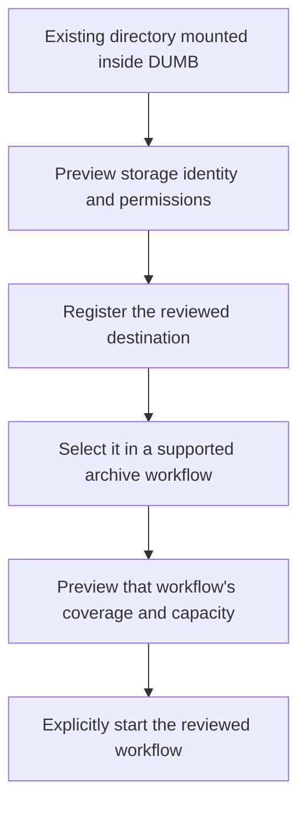

# Backup storage API

Endpoint paths below are backend-native. Add `/api` when using the dashboard gateway, for example `http://localhost:3005/api/process/capabilities`.

<details class="geek-details" markdown="1">
<summary>Register storage before selecting an archive destination</summary>

Registration describes an existing directory already mounted inside DUMB. It does not mount a host share or copy a backup by itself.



</details>

## Capabilities and routes

Clients gate these authenticated routes using explicit
`backup_storage_selection=true`, numeric `backup_storage_protocol=1` and the
required kind in `backup_storage_kinds`. Mutating storage routes require DUMB
API 2.24.0 or newer. InfiniDysk migration/cleanup clients additionally enforce
the strict API version floor and their specific workflow capabilities. See
[Backup Storage](../features/backup-storage.md) for mount, privacy and local
working-storage requirements.

Destination editing and explicit availability checks additionally require
`backup_storage_profile_management=true` and numeric
`backup_storage_management_protocol=1`. Mount-change review also requires
`backup_storage_revalidation=true`. Older backends keep their registration
controls; clients must not send unsupported management requests.

| Method | Route | Purpose |
|--------|-------|---------|
| `GET` | `/process/backup-storage` | List registered destinations and the explicitly saved global default |
| `POST` | `/process/backup-storage/preview` | Inspect an existing container-mounted directory without creating it |
| `POST` | `/process/backup-storage/profiles` | Register a named destination and bind its mounted identity |
| `PUT` | `/process/backup-storage/profiles/{destination_id}` | Edit metadata for the same identifier/root |
| `DELETE` | `/process/backup-storage/profiles/{destination_id}` | Remove registration while retaining archive ownership and receipts |
| `POST` | `/process/backup-storage/profiles/{destination_id}/check` | Explicitly check current mounted storage |
| `POST` | `/process/backup-storage/profiles/{destination_id}/revalidate/preview` | Review a changed runtime mount for the same owned storage |
| `POST` | `/process/backup-storage/profiles/{destination_id}/revalidate` | Confirm the unexpired runtime mount review |
| `POST` | `/process/backup-storage/default` | Explicitly save or clear the shared default |
| `GET` | `/process/backup-storage/artifacts` | List owned catalog receipts for `destination_id` and `namespace` |
| `GET` | `/process/backup-storage/download` | Verify and download the registered artifact identified by `reference` |

## Register a destination

Preview/registration body:

```json
{
  "id": "archive",
  "name": "Archive storage",
  "path": "/backups/dumb",
  "enabled": true,
  "make_default": false
}
```

The directory must already exist inside the container. `make_default` is an
explicit opt-in; the dedicated default route accepts
`{"destination_id": "archive"}` or an empty identifier to clear it. Missing or
replaced mounts and invalid receipts return a conflict; no local fallback is
created. Catalog readiness reflects saved registration, while each artifact
operation revalidates the mounted identity.

### Shared permissions

Backends advertising `backup_storage_shared_permissions=true` also accept
the strict boolean `allow_shared_permissions` in preview/registration requests.
It defaults to `false`, including for existing profiles without the field.
Explicit `true` permits fixed/shared mode bits on external managed directories
and artifacts; it acknowledges trust in storage access controls rather than
proving privacy. The saved profile and private controller metadata retain this choice; the
immutable ownership binding is preserved.
Private local controller/catalog state remains strict. Older backends must not
receive the new field.

Preview and catalog records can include `warnings` and
`observed_permissions`, with `directory_mode` and `file_mode` strings such as
`"0777"` and `"0666"`, or `null` when not observed. These describe visible
modes, not server ACL verification; cached catalog reads do not probe the NAS.

## Edit, remove, or check a destination

`PUT /process/backup-storage/profiles/{destination_id}` accepts the same full
profile body as registration. Both `id` and `path` must match the existing
registration; its name, enabled state and supported shared-permission policy
can change. The same identity/use guards apply to an existing profile passed
through the registration route. Name edits can remain local during an outage.

`DELETE /process/backup-storage/profiles/{destination_id}` takes no body and
removes only the saved registration. Its result includes `removed: true`,
`archives_preserved: true` and `receipts_preserved: true`. The owned marker and
immutable binding remain, reserving the identifier for the same storage.
Re-registering that identifier/root can restore access to historical receipts.
The delete does not rewrite consumers or defaults, delete archive bytes or
adopt a new root. Active leases, configured selections and retained recovery
references block removal/disable; narrowing permission consent is also guarded
when an operation still depends on it.

`POST /process/backup-storage/profiles/{destination_id}/check` takes no body.
It explicitly checks the mounted destination and returns a `profile` with
`live_checked`, `validation_state`, `revalidation_required`, check time and
`blockers`, plus safe `usage` labels for current references. Cached catalog
reads remain local and do not perform that check. A blocked check can return
readiness/blockers without changing the registration.

## Review a controller mount change

Across a new controller, a changed Linux device number alone is accepted only
when durable storage coordinates, directory inode/mode and the existing owned
marker match. The persisted binding/fingerprint stays unchanged, preserving
old archive and migration references. During a controller's lifetime, full
runtime mount identity remains pinned and is rechecked throughout artifact I/O.

`POST /process/backup-storage/profiles/{destination_id}/revalidate/preview`
takes no body. A successful review returns `ready`, `revalidation_required`,
a single-use `token`, Unix-seconds `expires_at`, registered/observed storage
descriptors, `changes` and `blockers`. The token expires after five minutes.
Confirm only the same owned storage:

```json
{
  "token": "<review token>",
  "confirm": true
}
```

Send that body to `POST /process/backup-storage/profiles/{destination_id}/revalidate`.
`confirm` is a strict boolean. Expired/changed reviews or active artifact use
are rejected. Revalidation refreshes only the runtime pin after repeat checks;
it does not rewrite the durable binding, enable a disabled profile, recreate
a missing namespace/marker or accept replaced storage. Removing an unused
registration retires its runtime check; later registration must prove the
same retained binding and marker again.

## Select storage in a workflow

Symlink backup requests accept optional `backup_destination_id`; `backup_path`
is required only for the legacy/path choice. Supplying a registered identifier
or `@default` explicitly selects managed storage. An empty or omitted selection
keeps the supplied path, including a custom path. Saved schedules use the
service's `backup_destination_id` field with the same semantics.

Managed results retain `backup_manifest` as an opaque `dumb-backup://` reference
and add checksum/readback metadata. Manual and scheduled artifacts have separate
retention scopes. `/process/symlink-manifest-files` accepts
`backup_destination_id` plus optional `process_name` for catalog browsing, or a
verified managed `manifest_path`. No arbitrary filesystem browsing is added.
Compare/restore accept the reference and optional process/destination context;
provided context must match. Explicitly choosing an older destination can restore
its retained snapshot after the current service preference changes. Global
restore without process context still requires a verified symlink artifact kind.

The InfiniDysk major preview accepts optional `backup_destination_id` to
explicitly select a registered destination or `@default`. An empty or omitted
selection keeps its legacy local backup tree. Live SQLite databases, migration
control records, database scratch
and runtime-install transactions retain their local storage contracts.
