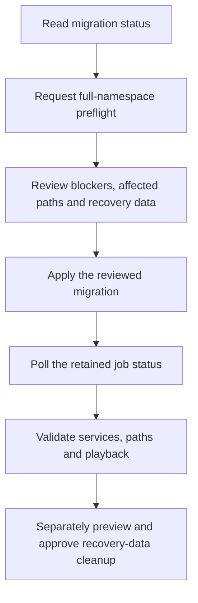

# InfiniDysk namespace migration API

Endpoint paths below are backend-native. Add `/api` when using the dashboard gateway, for example `http://localhost:3005/api/process/capabilities`.

<details class="geek-details" markdown="1">
<summary>Namespace migration request order</summary>

Review preflight findings before applying a namespace change. Cleanup is a later, separately reviewed operation after the migrated installation has been validated.



</details>

## InfiniDysk migration

### `GET /process/infinidysk-migration/status`

Returns whether a legacy NzbDAV deployment needs review, whether the notice is
due or snoozed, the legacy paths and DUMB-generated attached-service names that
were found, and the modes supported by this backend.

The response also exposes `cleanup_available`, `cleanup_finalized`,
`cleanup_finalized_at`, and `rollback_artifacts_available`. Clients must hide
both the notice and manual migration entry once `cleanup_finalized` is true.

### `POST /process/infinidysk-migration/remind-later`

```json
{ "days": 7 }
```

Persists the reminder on the DUMB instance. `days` must be between 1 and 90.

### `POST /process/infinidysk-migration/preflight`

Runs the non-mutating full-namespace preflight and returns a short-lived token,
expiry, blockers/warnings, `pending_conditions`, filesystem moves, active-read count, and counts of
planned Arr (including tag-label), Prowlarr application/tag, and media-library
updates. The response never includes application API keys or download-client
secrets. The full private inventory is stored separately from the small public
job record with mode `0600`, preventing job polling/progress writes from parsing
or rewriting the complete catalog.

`arr_discovery` lists every enabled Arr instance with `included` and human-readable
`reasons`. Inclusion uses either configured InfiniDysk `core_service` metadata or
live legacy root/item/import-list/collection/download-client/category/tag
references, so a Prowlarr-managed Arr is not omitted merely because its DUMB
linkage metadata is blank. Per-Arr public counts include `root_changes`,
`item_changes`, `client_changes`, `import_list_changes`, `collection_changes`,
and `tag_changes`.
`media_servers` marks `external_api_only=true` when no DUMB media server is enabled
and DUMB successfully infers Plex from `dumb.plex_address` plus `dumb.plex_token`.
The public entry includes the Plex display name/version and affected-library count,
but not the token or machine identifier.

`ready` remains false when activity cannot be inspected, an application API is
unreachable, a destination conflicts, a move crosses filesystems, or a legacy
path lies outside DUMB-managed roots. Current Arr queues, verified media
activity, and InfiniDysk reads are returned in `pending_conditions`; they are
handled by the apply job's automatic quiescence stage. Preflight also reads
InfiniDysk's effective `repair.enable` value. An enabled setting managed by an
environment variable is a blocker because DUMB cannot temporarily override it
through InfiniDysk's authenticated configuration API. Migration Arr requests
use a 120-second timeout for large catalogs. Generated attached-service paths such as
`/radarr/nzbdav` and `/log/rclone_w_nzbdav.log` are discovered and planned
automatically. Prowlarr legacy/canonical tag-label or application-name
collisions are structural blockers; the response identifies them so an
operator can reconcile the duplicate and rerun preflight before any path moves.

### `GET /process/infinidysk-migration/job-status`

Returns the latest persisted complete-namespace job, or a specific job when a
32-character hexadecimal `job_id` query parameter is supplied. The public job
record includes `status`, `stage`, `message`, `progress`, up to 100 recent
stage events, and the terminal result or safe error text. Arr stages also expose
a `detail` object with the current process, phase, completed/total reference
counts, and all-Arr completed/total counts. Active statuses are
`queued`, `running`, and `rolling_back`.

When no migration job exists, the response is `{"job": null}`. An empty object
is not a job and must not be used to infer that migration controls are needed.

A rolled-back terminal result includes a sanitized `result.recovery` object with
the cutover cause, component-scoped `rollback_errors`, retained backup/config
paths, and `manual_restore_required`. This is recovery guidance, not an instruction
to restore the entire bundle blindly; verify the legacy paths and application
state and repair only the failed rollback surface. Current rollback manifests
also restore captured file ownership and permissions; this includes SQLite WAL
and shared-memory sidecars that must remain writable by the managed service UID.
Rollback also reapplies and verifies every captured symlink target after the
legacy roots return, removes Arr root paths that exist only in the failed
migration direction, and treats any remaining stale root as a rollback error.

`failed_rolled_back` means the automatic namespace rollback completed and the
legacy topology should be verified before a new preflight. A
`rollback_attention_required` result freezes ordinary config/service lifecycle
changes and requires review of the named failed rollback surfaces; do not force
a provider/path toggle or restore the complete bundle. An `interrupted` job
known to have stopped before filesystem mutation may cold-start the legacy
topology for a fresh preflight. Unknown or post-mutation interruptions remain
frozen for recovery review.

While a current `quiescing` job is waiting on verified media activity and the
backend advertises capability `infinidysk_migration_playback_override`, the
record also exposes `playback_override_available`, `playback_stop_requested`,
and the process-name-only `active_media_servers` list. These transient fields
belong to the active backend worker; a backend restart interrupts the entire
migration rather than resuming the override.

The dashboard polls this route after the migration dialog is closed or the
page is reloaded. Another authenticated browser or device retrieves the same
backend-owned job without browser-local handoff state. A DUMB backend restart marks an active retained job
`interrupted`; it is not resumed automatically because the operator must first
inspect the backup bundle and current namespace paths.

### `GET /process/infinidysk-migration/cleanup-preview`

Returns a short-lived, state-bound preview for permanently purging recovery
material after a successful migration:

```json
{
  "available": true,
  "preview_token": "<short-lived token>",
  "expires_at": 1787270400,
  "selected_mode": "full_namespace",
  "migration_status": "completed",
  "cleanup_finalized": false,
  "cleanup_finalized_at": null,
  "rollback_artifacts_available": true,
  "deletion": {
    "files": 14,
    "directories": 3,
    "bytes": 1048576,
    "categories": [
      "Migration state details",
      "Preflight inventory",
      "Job history",
      "DUMB configuration backups and rollback bundles"
    ]
  },
  "retained": [
    "Current DUMB and InfiniDysk configuration",
    "InfiniDysk runtime, application data, and databases",
    "Mounts, symlink libraries, and normal symlink snapshots",
    "PostgreSQL cutover authorization and database-migration job records",
    "Operator-managed backups outside the namespace rollback root"
  ]
}
```

`expires_at` is Unix time in seconds. Counts and categories are returned without
raw filesystem paths. `available` is false and the token is null unless the
latest migration state is safely terminal and successful, no active/unsafe
latest job exists, cleanup has not been finalized, and the calculated deletion
plan is safe. `rollback_artifacts_available` separately reports whether the
DUMB rollback bundle is still present. The token fingerprints the current
migration state and deletion inventory; request a new preview after expiry or
any state change.

### `POST /process/infinidysk-migration/cleanup`

```json
{
  "preview_token": "<short-lived token>",
  "confirmation": "REMOVE INFINIDYSK MIGRATION DATA",
  "acknowledge_validation": true,
  "acknowledge_rollback_loss": true
}
```

`confirmation` must match exactly; surrounding whitespace is rejected. Both
acknowledgements must be literal `true`. Cleanup deletes the detailed namespace
migration state, private preflight inventory, namespace job history, and
DUMB-owned migration backup/rollback bundle. It does not delete the current
DUMB/InfiniDysk
configuration, runtime, application data, databases, mounts, symlink libraries,
normal symlink snapshots, the minimal controller-owned PostgreSQL cutover
authorization and database-migration job evidence under
`/config/arr-postgres-migration`, or operator-managed backups outside the
namespace rollback root. The retained authorization/evidence is required so a
PostgreSQL-backed InfiniDysk remains restartable and its guarded database
rollback contract remains verifiable after namespace cleanup.

The backend replaces the detailed state with a private mode-`0600` tombstone
containing only the selected mode, terminal status, and finalization metadata.
The response reports `status` as `completed` or idempotent
`already_completed`, sets `cleanup_finalized: true`,
`rollback_artifacts_available: false`, and `notice_due: false`, and returns the
actual `deleted` counts/categories plus the retained list. This action is
irreversible; a finalized compatibility-only migration also accepts the
retained legacy namespace as final.

### `POST /process/infinidysk-migration/stop-playback`

```json
{
  "job_id": "0123456789abcdef0123456789abcdef",
  "confirmation": "STOP ACTIVE PLAYBACK"
}
```

Requests the narrowly scoped playback override for the active quiescing job.
It is accepted only while verified active media playback is delaying the
cutover. The worker applies its media-server scan guard, stops the listed media
server through the normal DUMB process manager, and waits for InfiniDysk active
reads to reach zero. Stopping the server terminates its active streams.

Inferred external Plex is deliberately excluded from this override because DUMB
does not own its process. The operator must stop external playback and pause
Autoscan or other scan/request producers outside DUMB; the job continues polling
Plex activity and InfiniDysk reads.

This endpoint cannot override Arr queues, unavailable or unknown APIs/activity,
active InfiniDysk reads, filesystem conflicts, or other blockers. It returns
the updated job record. A stale job, a non-quiescing stage, no currently active
playback, or incorrect confirmation returns `400`/`409` without weakening the
migration checks.

### `POST /process/infinidysk-migration/apply`

```json
{
  "mode": "retain_legacy_namespace",
  "rename_attached_services": true,
  "confirmation": "MIGRATE TO INFINIDYSK",
  "acknowledge_external_backup": true
}
```

The available compatibility cutover adopts the canonical service/process
identity and can rename DUMB-generated attached instance/process labels. It
first saves a private complete-config backup under
`/config/migrations/infinidysk-backups`, and retains runtime, mount, symlink,
Arr category/root/tag, and media-server library paths. Both migration modes
require the external-backup acknowledgement.

The complete namespace request uses the token from the latest passing
preflight and requires all four acknowledgements. The external-backup
acknowledgement confirms that the operator has a current, verified backup
outside the paths DUMB will migrate; DUMB's private rollback bundle is not a
substitute for that backup.

```json
{
  "mode": "full_namespace",
  "rename_attached_services": true,
  "confirmation": "MIGRATE TO INFINIDYSK",
  "preflight_token": "<short-lived preflight token>",
  "acknowledge_downtime": true,
  "acknowledge_library_scan": true,
  "acknowledge_rollback_limits": true,
  "acknowledge_external_backup": true
}
```

The full-namespace request returns immediately with the persisted background
job:

```json
{
  "job": {
    "job_id": "0123456789abcdef0123456789abcdef",
    "status": "queued",
    "stage": "queued",
    "progress": 0
  }
}
```

The job stops linked NeutArr, Seerr, Profilarr, and Prowlarr producers first,
temporarily sets InfiniDysk `repair.enable=false` through its authenticated API,
verifies the change, then polls Arr queue counts and media activity. It latches each managed Arr/media
server stopped as soon as it is safe and holds those processes through the
cutover. Inferred external Plex remains running under an API scan guard and must
remain idle; DUMB cannot stop it or pause Autoscan.
Failed or held queue entries are never deleted automatically; operators can
resolve them through the still-running Arr UI. Transient Arr queue or inventory
API failures remain pending and are retried during quiescence. Quiescence times
out after one hour and aborts before path mutation if activity or an Arr API
remains unavailable, restoring scan guards and restarting processes DUMB
stopped. The optional confirmed playback-stop request may
interrupt active streams, but the worker still verifies that provider reads
have drained before path mutation.

The original effective `repair.enable` value and its management source are
saved in the private rollback bundle before the pause. Existing health probes
are allowed to drain, but no new scheduled probes are started. DUMB restores
and reads back the exact prior value before reporting success. Failure handling
restores it through the running API when possible and verifies the restored
database during rollback before the job becomes terminal.

The worker repeats live safety checks immediately before applying. It then
backs up configuration and application snapshots, stops the dependency chain,
atomically moves managed runtime/mount/symlink/log and discovered attached
service paths. Nested generated paths remain explicit ordered actions after a
parent move, so child names such as `radarr-nzbdav` cannot be silently retained
inside a canonical parent. The provider's `/content` and `completed-symlinks`
category directories are SQLite-backed virtual paths rather than ordinary
directories to rename through FUSE. While InfiniDysk is stopped, DUMB rewrites
the fixed history, queue, and DAV category/path records that materialize those
views; the captured database is restored if rollback is required. The worker
rewrites symlink targets and saved InfiniDysk configuration,
restarts the chain, updates Arr
root/item/import-list/Radarr-collection/download-client references and tag
labels while preserving tag IDs,
updates media-server library paths, and
verifies the persisted API values. Before scan guards are restored it also
requires every planned canonical path, rejects every planned legacy source and
legacy raw symlink target, and checks canonical filesystem availability for
file-bearing Arr items and changed media-library paths. Failures trigger automatic path,
configuration, application-reference, process-name, and scan-guard rollback.
The terminal job `result` identifies the private backup bundle and reports
changed symlinks, InfiniDysk database records, Arr references, and media
libraries.

Historical symlink snapshots are retained under their original names. Future
scheduled snapshots use the canonical name. A successful response instructs
the operator to run normal Arr and media-server library scans; the migration
does not initiate scans automatically.

Saved dashboard ordering, keyboard shortcuts, and notification service filters
are updated when their exact process names are renamed.
