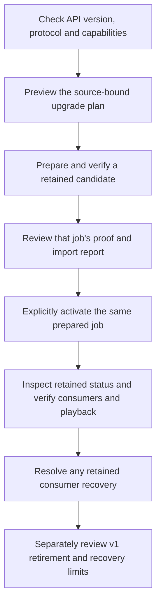

# InfiniDysk 2 API

Endpoint paths below are backend-native. Add `/api` when using the dashboard gateway, for example `http://localhost:3005/api/process/capabilities`.

<details class="geek-details" markdown="1">
<summary>Prepared activation keeps review tied to one candidate</summary>

Use this path only when prepared activation is advertised. The candidate that is reviewed is the same retained job later activated; cleanup is a separate decision after cutover verification.



</details>

## InfiniDysk 2 workflows

These routes are independent of the existing NzbDAV namespace migration and
generation 1 PostgreSQL adapter. See the
[InfiniDysk 2 upgrade guide](../features/infinidysk-v2-migration.md) for downtime,
containment, mount/library checks and recovery limits. Paths below are relative
to the DUMB API; the dashboard accesses them through its `/api` proxy prefix.

Clients require a valid `api_version >= 2.24.0`, explicit boolean
`infinidysk_v2=true`, `infinidysk_v2_migration=true` and numeric
`infinidysk_v2_migration_protocol=1`. Native PostgreSQL conversion also requires
`infinidysk_v2_postgres=true`. Missing, malformed, older or unknown versions and
protocols disable mutations. Retained job/recovery displays remain independent
of those new-operation controls.

Managed PostgreSQL destination preparation additionally requires strict boolean
`infinidysk_v2_postgres_prepare_target: true` and numeric
`infinidysk_v2_postgres_prepare_target_protocol: 1`. This grants the explicit
preparation action only; a destination preview remains read-only.

The strict boolean `infinidysk_v2_prepared_activation: true` selects the default
prepare-once workflow. Clients prepare and review one candidate, then explicitly
activate that same job. With the capability absent, retain the legacy separate
test/start workflow. InfiniDysk's native engines perform the major data-format
conversion and the later optional v2 SQLite-to-PostgreSQL conversion; DUMB
coordinates snapshots, checks, containment, activation and recovery.

### Embedded UI metadata and normal runtime updates

Embedded native UI routing requires the strict boolean
`infinidysk_v2_embedded_ui_adapter: true` and numeric
`infinidysk_v2_embedded_ui_protocol: 1`, alongside the runtime capability.
The embedded proxy looks up one enabled service through
`GET /config/embedded-ui-routing/{normalized_service}`. This read-only endpoint
does not require dashboard authentication: an iframe request cannot attach the
dashboard's browser-stored bearer token. Its response contains only `name`,
`config_key`, `runtime_generation` and `embedded_ui_protocol`; it exposes no
addresses, ports, paths, credentials or full service inventory. The dashboard
server fetches this metadata directly from DUMB, rather than trusting a
browser-supplied service header, and expires each service result after five
seconds. Failed refreshes cannot reuse an expired routing decision.

The separate `GET /config/service-ui?metadata_only=true` inventory remains
protected by dashboard authentication and does not regenerate Traefik
configuration. Both backend and dashboard need the matching embedded-routing
implementation; an older backend without the minimal endpoint cannot enable
the new adapter.

The adapter forwards the embedded UI through DUMB while keeping native
sessions separate from dashboard credentials. Direct UI addresses, Public URL,
signed playback queries and existing output files are unchanged. Password
sign-in is available in the embedded view; external SSO requires compatible
provider/callback configuration and may use the separate native UI instead.

Normal post-activation runtime updates require
`infinidysk_v2_runtime_updates: true` and
`infinidysk_v2_runtime_updates_protocol: 1`. They use the existing
`POST /process/update-check` and `POST /process/update-install` routes.
Existing-source migration preparation and recovery remain fixed to the verified
`v2.0.0-beta.6` importer. Fresh installation uses the saved official v2 release
selection, defaulting to latest. Completed migration activation releases its
internal pin once required recovery and restart work are finished. The active
service uses standard `release_version` and
`release_version_enabled` fields, with `runtime_generation: "2"` selecting the
native installer. Disabled release selection follows latest; enabled selection
uses the exact v2 tag, or follows latest when blank or `latest`. Only official
v2 releases are eligible; branch and commit selectors are not native sources.

A separate private installed-release record retains the exact verified artifact
for the installed runtime and resolved data location. It is recorded after
initial installation, activation and successful updates. Routine startup reuses
that release; if a container rebuild removes the program directory, restoration
uses its recorded release and hashes rather than resolving latest. Ordinary
configuration or environment edits do not invalidate this record. Legacy
completed update receipts can also authorize exact-release restoration despite
ordinary configuration or selector changes. Neither path bypasses an unfinished
update's stricter recovery checks. Once this release evidence is recorded,
latest is resolved for a requested update, not for ordinary startup.
For legacy installations without either record, ordinary startup restores missing
program files using the configured official v2 release selection, then records
the verified installed release. This compatibility path applies to both migrated
and fresh v2 installations; major-migration history is not required and conversion
does not repeat. Present invalid records and unfinished updates remain blocked;
they cannot fall through to configured-release restoration.

Configuration loading automatically converts the older `v2_release_version`
setting into the standard fields. New clients should submit the standard fields
and use the normalized configuration returned by the backend. Historical major
migration and native PostgreSQL rollback actions recorded with the old format
are unavailable, rather than being converted. Their archives and source plans
are retained, and DUMB may record the one-time migration-pin release. New native
update journals retain their normal recovery behavior.

A runtime update can retire historical major/provider rollback actions before
the new binary is allowed to open the database. Retained archives are not
removed. A retired job exposes `rollback_unavailable_reason`, and direct
rollback requests are also refused. After a post-launch failure, update status
uses `reason: "native_runtime_recovery"`; `can_retry_update: true` authorizes
an explicit retry through the existing install route for the same retained
replacement. Interrupted prelaunch work or changed evidence remains blocked.

### Major installation and upgrade

| Method | Route | Purpose |
|--------|-------|---------|
| `GET` | `/process/infinidysk-v2/status` | Current generation, fresh/migration mode, mount choices, eligibility and latest retained job |
| `POST` | `/process/infinidysk-v2/preview` | Review a source-bound plan and receive a short-lived authorization |
| `POST` | `/process/infinidysk-v2/preview/start` | Start a background preview using the same options as `/preview` |
| `GET` | `/process/infinidysk-v2/preview/task` | Retrieve the latest preview task |
| `GET` | `/process/infinidysk-v2/preview/task/{task_id}` | Poll one preview task and retrieve its completed result |
| `POST` | `/process/infinidysk-v2/preview/task/{task_id}/cancel` | Request cancellation of that preview without stopping services |
| `POST` | `/process/infinidysk-v2/prepare` | Prepare and verify one retained candidate for explicit activation |
| `POST` | `/process/infinidysk-v2/activate` | Activate that same prepared job after current proof and confirmation checks |
| `POST` | `/process/infinidysk-v2/rehearse` | Legacy separate test using the contained native importer |
| `POST` | `/process/infinidysk-v2/start` | Legacy eligible fresh install or guarded major cutover |
| `GET` | `/process/infinidysk-v2/jobs/{job_id}` | Retrieve one persisted job as `{"job": {...}}` |
| `GET` | `/process/infinidysk-v2/jobs/{job_id}/report` | Read the retained native import report as plain text with `Cache-Control: no-store` |
| `POST` | `/process/infinidysk-v2/cancel` | Request cooperative cancellation of the exact active major job and protected source recovery |
| `POST` | `/process/infinidysk-v2/retry-stage` | Retry the current paused DUMB checkpoint while its original worker still owns the job |
| `POST` | `/process/infinidysk-v2/rollback` | Restore the exact retained major-migration source when authorized |
| `POST` | `/process/infinidysk-v2/retry-consumers` | Verify/restart the owned exposed v2 target and retry only retained pending consumers |
| `POST` | `/process/infinidysk-v2/finish-consumer-recovery` | Acknowledge leaving pending consumers stopped after verified v2 delivery |
| `POST` | `/process/infinidysk-v2/cleanup/preview` | Review owned v1 removal paths and retained backups after a validated cutover |
| `POST` | `/process/infinidysk-v2/cleanup` | Retire automated rollback and remove only the approved unchanged v1 entries |

Preview body:

```json
{
  "mode": "migrate",
  "mount_backend": "rclone",
  "import_strategy": "preserve"
}
```

`mode` is `migrate` or `fresh`; fresh mode cannot overwrite an existing source.
`mount_backend` is `rclone` or explicit `fuse`. The initial major workflow accepts
only `import_strategy: "preserve"`; it does not regenerate existing outputs.
The exact consumer-visible mount path is retained. Generation 2 uses separate
runtime/data directories. `mode: "migrate"` uses the fixed verified beta.6
importer; `mode: "fresh"` uses the saved `release_version` and
`release_version_enabled` controls. These release controls belong to the service
configuration, not the preview body. Disabled selection, or enabled blank or
`latest`, selects the latest official v2 release, including beta releases; an
enabled exact v2 tag selects that release. Preparation retains the selected
artifact for activation rather than resolving latest again.

#### Queued-download policy

For a backend advertising the strict boolean
`infinidysk_v2_queue_omission: true`, an existing-source preview can request
`omit_queued_downloads: true`. This optional boolean defaults to `false`. Selecting it requires
`mode: "migrate"`. It is not an option for fresh installation or
native v2 PostgreSQL conversion. Clients must hide the choice and omit the field
when the capability is absent, even if a stale form value remains selected.

The default requires an empty v1 `QueueItems` table. Known live queued work blocks
the preview before large inventory/capacity walks. A second authoritative check
runs after quiescence, before PostgreSQL snapshot and full source fingerprints.
An unavailable live observation is not an empty queue.

Optional `preview.source_queue` and `job.source_queue` contain:

| Field | Meaning |
| --- | --- |
| `policy` | `require_empty` or explicit `omit_from_v2` |
| `observed_count` | Nonnegative count, or `null` when unavailable |
| `observed_at` | Observation time in Unix seconds, or `null` |
| `observation` | `live`, `unavailable` or authoritative `captured` |
| `omitted_count` | `null` until the separate importer input is verified, then the actual nonnegative omitted count |
| `source_queue_preserved` | `true`: the original/recovery queue records remain preserved |

The live count can change before capture. Omission applies to the whole captured
queue and is bound to the reviewed option; it is not a failed-job heuristic.
The backend records the captured identities/digest privately. It derives a
separate closed, queue-free native importer database while preserving the
original source database, complete archive/dump, media and history. Native
acceptance still requires zero imported queued jobs. No live API/SQL deletion
or blob cleanup is part of this option.

The explicit choice uses the current preview and confirmation requirements; it
adds no extra acknowledgement. Its value is pinned to the prepared job; changing
it needs a new review and preparation. The legacy flow also invalidates the old
test proof when options change. Rollback restores the original queued work, as
does a completed legacy test. Successful v2 activation does not carry those jobs
over; external Arr producers can submit them again. `source_queue_preserved` is specific to queue evidence and does not claim
that low-space reuse kept every original file locally.

#### Low-space migration

A supporting backend advertises
`infinidysk_v2_low_space_migration: true`. For an existing-data migration only,
the optional boolean `reclaim_source_space: true` selects guarded reuse of the
local v1 data tree after full archive verification. It requires an explicit
registered `backup_destination_id` on a different filesystem and a supported
local source/candidate layout. Omit the field or use `false` to retain the
default local-source recovery. Clients must not send this option to older
backends or treat archive selection alone as permission to reuse source data.

A low-space preview includes `source_storage` with
`mode: "archive_recovery"`, `reclaim_source_space: true` and
`rollback_requires_archive: true`. Its `required_acknowledgements` additionally
requires `archive_recovery`. Source recovery or rollback can release the exact
owned candidate before restoring original v1 files from the retained archive.
Recovery refuses an unavailable/replaced archive or changed owned path.
The capacity review retains actual free-space readings and includes remaining
local database, verification and safety requirements. Reuse removes a complete
candidate-copy allocation; it does not remove native output growth. New v2
metadata and retained v1 blobs can coexist, so native headroom also includes at
least a comparable full source-tree logical allocation. This remains an estimate
because the native metadata/compression formats differ. Recovery checks local
restore capacity before releasing the owned candidate and again after removal.

#### External legacy blob staging

For a backend advertising the strict boolean
`infinidysk_v2_external_blob_staging: true`, an existing-data preview can also
request `offload_legacy_blobs: true`:

```json
{
  "mode": "migrate",
  "mount_backend": "rclone",
  "import_strategy": "preserve",
  "backup_destination_id": "migration_archive",
  "reclaim_source_space": true,
  "offload_legacy_blobs": true
}
```

This option requires `mode: "migrate"`, `reclaim_source_space: true` and the
registered recovery archive on a different filesystem. Omit it for ordinary
reuse. Archive selection or the older low-space capability alone does not
authorize offload. The major status response can additionally advertise
`capabilities.external_blob_staging: true`; clients must gate the new option
using its explicit capability rather than the backend version alone.

The preview retains `source_storage.mode: "archive_recovery"` and adds
`source_storage.offload_legacy_blobs: true` for the chosen mode.
`required_acknowledgements` additionally requires `external_blob_staging`.
Use the acknowledgements returned by that preview for preparation, or for the legacy test/start flow.

DUMB verifies the cold recovery archive, copies and verifies a separate expanded
legacy blob input at the destination, then releases only the corresponding owned
local blob files. Public job stages distinguish `staging_blobs`,
`verifying_blob_staging` and `releasing_local_blobs`. The importer reads the
staged input while active SQLite, control state and PostgreSQL verification
scratch remain local. The archive remains the authoritative v1 rollback source;
a missing or damaged expanded copy does not substitute for that archive.

Capacity reporting includes `external_blob_staging` for the expanded input
on the destination and `native_import_growth` for local v2 output, in addition
to the recovery archive and other working requirements. The same destination
therefore needs room for both the archive and expanded input.

`capacity.phases` contains objects with `phase`, `status` and `filesystems`.
The phases are `before_blob_release` and `after_blob_release`; the flattened
`capacity.filesystems` rows also identify their `phase`. Each row's
`free_bytes` remains the measured filesystem value. Preview can separately
report `projected_released_bytes` and `projected_available_bytes`, with
`release_is_projected: true`; these are estimates, not increased observed free
space or a reservation. The worker checks fresh actual capacity after unlinking
the verified owned local files, without projected release credit, before import.
Source moves or symlinks created outside this workflow are not an offload
request.

After accepted import or completed v1 restoration, DUMB attempts cleanup of
only the recorded, unchanged expanded input. The verified recovery archive
remains retained. A missing, changed or otherwise unremovable staging copy can
leave `job.staging_cleanup_required: true` without invalidating an accepted
import or blocking restoration from the valid archive. Preserve the warning
and retained evidence; it does not authorize deleting a replacement directory.

#### Storage work comparison

Supporting previews and public jobs can expose optional `storage_work` with
`protocol: 1`. It describes the file I/O that differs between storage choices;
it is not an elapsed-time forecast, an eligibility result or permission to
select a different layout. The status response can advertise
`capabilities.migration_storage_work: true`.
`comparison_basis: "logical_io_same_storage"` identifies this work model;
`ranking: "not_estimated"` and null per-path `preparation_order` values explicitly
avoid an unsupported fastest-to-slowest ordering.

Source quantities `source_data_bytes`, `source_total_bytes` and
`legacy_blob_bytes` can be null when unavailable. `archive_bytes` uses the
retained archive's measured size when available; before that, source logical
size is only a lower bound, identified by `archive_bytes_is_minimum`.
Archive headers, runtime files and database snapshot artifacts can make the
actual archive larger. `archive_storage_type` identifies `local`, `network` or
`unknown`; it is not a speed measurement.

`selected_path` identifies the selected layout. `paths` describes `keep_local`,
`reuse_local` and `external_blobs`, with their selection and separate
`preparation`, `activation` and `restoration` I/O legs. A leg contains an authored
`id`, nullable `read_bytes` and `write_bytes`, `storage` of `local` or `archive`,
an integer `passes`, and a boolean `minimum`. Read/write quantities already total
all of that leg's passes; do not multiply them by `passes` again. A minimum is a
lower work bound, not a promise that no further I/O occurs.

Keep-local preparation copies the candidate and checks the retained local
source. Reuse avoids that copy but adds archive verification before reuse and
at acceptance. External blob staging adds archive checks, the blob copy and
repeated input readback. Activation checks the retained source or archive again
without repeating native conversion. Reuse/offload restoration needs archive
verification, extraction and restored-source readback; the older rehearsal flow
includes that restoration even when its test passes.

Common recovery-archive creation/readback, initial source and candidate fingerprints,
runtime verification, database snapshot/restore/export and native provider work
are outside these comparison legs. File metadata latency, shared-disk contention
and importer reads also prevent a byte count from establishing a fastest path.
In particular, reuse can be slower than keeping v1 local when its archive reads
cross a slow network. No universal preparation or finish-time ranking is
provided. Reporting uses existing inventory and retained records; it does not
run a speed benchmark or add a new scan.

#### Background preview

Use the background routes only when the strict boolean
`infinidysk_v2_async_preview: true` is advertised. The existing synchronous
`POST /preview` remains available for older clients.

Starting and polling return `{"protocol": 1, "task": {...}}`. Each task includes
`task_id`, `status`, `stage`, `message`, `created_at`, `updated_at`, the selected
`options`, `options_fingerprint`, `can_cancel` and `cancel_requested`. Major
workflow status also includes `preview_task`, so reopening the panel can reconnect
without submitting another scan. Only the latest task is retained; requesting a
different or no-longer-retained identity returns HTTP 409.

An identical request reuses the active task; changing options while it is running
is refused. An optional `request_id` (16–128 letters, digits, underscores or
hyphens) also deduplicates a retry of the latest request after a lost response.
Reusing that identity with different options is refused. Wait for the active task
to finish or cancel it before requesting a different preview.

Preview performs metadata and prerequisite checks while services remain running.
It does not stop services, copy source data or start the native importer. There is
no overall preview time limit. Cancellation is cooperative: follow the task until
it stops. A controller restart marks an unfinished preview as interrupted; it
does not automatically rerun it or enter migration recovery.

Task states are `queued`, `running`, `completed`, `cancelled`, `failed` and
`interrupted`. Only a completed task returns the normal result in `task.preview`,
with `preview_available: true`. An expired or consumed authorization returns
`preview: null`, `preview_available: false` and `preview_unavailable_reason` of
`expired` or `consumed`; generate a fresh preview before continuing. Status and
result responses use `Cache-Control: no-store, private` because a completed
preview contains its short-lived authorization token.

The authorization period starts at completion, not when scanning begins. Task
identity and progress alone never authorize preparation or activation; review that
completed result and its required acknowledgements first.

#### Preview contract

The preview returns `protocol`, `ready`, `preview_token`, `expires_at`,
`plan_fingerprint`, `confirmation_text`, `current`, `target`, `checks`,
`blockers`, `warnings`, `inventory`, `required_acknowledgements` and
`rehearsal_required`. The public fingerprint binds the job to its reviewed plan;
it is not an authorization token. `rehearsal_required` describes the legacy
test/start contract; prepared-activation clients select their workflow using the
strict capability above. Recorded inventory is not proof that unmanaged
consumers or STRM URLs are absent.

#### Compatibility authentication policy

Updated status responses include `current.compatibility_auth_policy`; previews
include `target.compatibility_auth_policy`. When the legacy compatibility relay
is enabled, it reports
`{"enforced": true, "mode": "required", "reason": "legacy_compatibility_listener"}`.
This is a read-only explanation of the authentication policy DUMB enforces at
native launch, not a runtime settings probe or a mutation option. With no relay the values are `false`, `null` and `null`.
The backend rejects conflicting explicit authentication overrides before native
setup or migration. Older backends may omit the object.

#### Prepare once, review, then activate

With `infinidysk_v2_prepared_activation: true`, post the current preview's token,
exact confirmation and required acknowledgements to `/process/infinidysk-v2/prepare`:

```json
{
  "preview_token": "<current-preview-token>",
  "confirmation": "<server-confirmation>",
  "acknowledgements": {
    "backup": true,
    "downtime": true,
    "beta": true,
    "oidc_policy": true,
    "downstream": true
  }
}
```

Use only the acknowledgements required by that preview, including any selected
storage options. Do not send a `rehearsal_job_id`. Both supported fresh
installation and existing-source migration can use preparation.

The persisted job uses `mode: "prepare"` and `prepare_mode: "fresh"` or
`"migrate"`. After native conversion and DUMB's verification, it reports
`status: "prepared"`, `stage: "awaiting_activation"` and `result.validated: true`.
Existing-source jobs retain the verified import report; a fresh installation has
no legacy import report. This is a deliberate paused review session: the candidate is retained and affected managed applications stay
stopped. It is neither an activated installation nor a source-restoration error.

Only a fresh confirmed job advertising `can_activate: true` admits activation.
Post its `job_id` and exact `activate_confirmation` as `confirmation` to
`/process/infinidysk-v2/activate`:

```json
{
  "job_id": "<prepared-job-id>",
  "confirmation": "ACTIVATE INFINIDYSK V2 <prepared-job-id>"
}
```

For a report requiring omission review, also send
`acknowledgements: {"skipped_media": true}` and `skip_review_digest` matching that
prepared job's current report. Public samples cannot replace the full retained
proof. Activation returns the **same job**, still `mode: "prepare"`, with
`status: "queued"` or `"running"` and `stage: "activating"`. It uses the already converted
candidate; it does not rebuild it or repeat native conversion.

Poll the existing job/status routes through live delivery validation and
consumer resumption. Acknowledgement alone does not establish completed
activation. The existing advertised rollback action restores the retained v1
state when eligible. A missing or invalid proof keeps activation unavailable;
retain the candidate and recovery evidence.

A controller restart preserves `status: "prepared"` and
`stage: "awaiting_activation"`. It boots the installed API/frontend in a minimal
control plane; normal applications and background workers remain held.
Reconcile the retained job and current guards before offering activation or
rollback. Neither action is automatic.

If activation or restoration completes in that minimal boot, the result exposes
`restart_required: true`. Activation itself starts the verified target and
retained affected consumers; the user must then restart DUMB once to initialize
normal workers and unrelated applications. A prepared review hold alone does not
request a restart. Retain this instruction on the completed or restored job
instead of treating its terminal status as proof of full normal startup.

#### Retry a paused DUMB checkpoint

Require strict boolean `infinidysk_v2_stage_retry: true` and numeric
`infinidysk_v2_stage_retry_protocol: 1` before opting into failed-step review.
Send `pause_on_stage_error: true` with a new `/prepare`, `/rehearse` or `/start`
request. Omitting the flag preserves the older automatic source-restoration
behavior. This option does not authorize skipping integrity or ownership checks.

A supported temporary I/O or database-access failure at a retryable checkpoint
can publish `status: "stage_retry_required"`. The original worker stays alive,
keeps migration admission and waits without automatically repeating the work.
The job's `stage` still identifies the failed step. Its bounded `stage_retry`
object includes `protocol`, `operation`, `stage`, `label`, `attempt`, `state`,
`failed_at` and an operator-facing `message`. `state: "waiting"` denotes a pending
decision. The panel must not display an old throughput or finish estimate as
live progress while the worker is waiting.

Only offer retry when the current job advertises `can_retry_stage: true` or
`actions.retry_stage: true`. The client includes the server-issued attempt
authorization from `confirmation_texts.retry_stage` when the user selects retry;
the user does not need to type it. Post that value with the job identity to
`/process/infinidysk-v2/retry-stage`:

```json
{
  "job_id": "<paused-job-id>",
  "confirmation": "<current-confirmation_texts.retry_stage>"
}
```

Acceptance resumes the failed callable in the same worker and job. It does not
repeat preceding completed steps or run another native conversion when only a
later verification failed. The current pass may restart from its beginning;
this is not byte-offset transfer resumption. An archive-write retry requires
confirmed removal of the exact owned incomplete file, then restarts the transfer
while retaining earlier source fingerprints and prepared database files.
Uncertain cleanup or publication prevents replay. `stage_retry.state` changes to
`"retrying"`, then `"completed"` after success. Another failure increments
`attempt` and requires a fresh confirmation. Replayed, stale or mismatched
confirmations cannot launch duplicate work. Continue polling the retained job.

The existing cancellation control remains available when advertised and wakes
the waiting worker to follow its guarded source-recovery path. Closing the
panel does not cancel or retry. A controller restart cannot reconstruct this
live continuation: the job reports `"interrupted"`, retry is unavailable, and
the existing retained recovery actions determine what can proceed. This differs
from the independently verified `"prepared"` activation checkpoint above.

Invalid inventory, changed input, unsupported reports, uncertain helper
termination, cancellation and lost worker ownership are not retry permission.
Native omissions still use their separate complete-proof review and explicit
acceptance policy; this endpoint does not retry the native importer's omissions.

#### Legacy separate test and start

Use this compatibility flow when prepared activation is not advertised.
Rehearse and start body, using values from the current preview:

```json
{
  "preview_token": "<current-preview-token>",
  "confirmation": "MIGRATE INFINIDYSK TO V2",
  "acknowledgements": {
    "backup": true,
    "downtime": true,
    "beta": true,
    "oidc_policy": true,
    "downstream": true
  },
  "rehearsal_job_id": "<validated-rehearsal-job-id>"
}
```

Omit `rehearsal_job_id` for the rehearsal request and for a fresh installation
that does not require one. Always use the backend's exact confirmation text;
fresh mode has a different phrase. A major cutover requires a successful
rehearsal with `status: "rehearsed"`, `mode: "rehearsal"`,
`result.validated: true` and the matching
`plan_fingerprint`. A successful rehearsal refreshes its reviewed preview's
expiry for 30 minutes and exposes `preview_expires_at` as Unix seconds; clients
can update that preview's countdown without treating a changed plan as approved.
Changed source facts, failed containment, unexplained native omissions, an
unsupported source adapter or failed identity/policy proof block
activation. General external networking remains denied during the contained
import. Supporting builds permit read-only NNTP article reads only through a
relay bound to the configured source providers, capped at two connections per
provider or its lower configured limit, and four overall with one request in
flight per connection. Active TLS-enabled upstream connections retain certificate and
hostname verification; insecure legacy TLS overrides are refused. Source and
affected managed consumers remain quiesced. Temporary relay configuration must
not replace the normal provider settings used after import; there is no
unrestricted network fallback.
The required `downstream` review covers current Arr/media mount paths, remote
path mappings, symlinks/STRM origins and stopped external writers/scanners.
OIDC-configured sources remain blocked until their target policy is verified;
the acknowledgement is not an authorization to bypass a blocker.

Prepare/activate and legacy start/rehearse responses, plus `status.job`, expose
a public job, including its identity, mode, status, stage, message, fingerprint
and result. A successful
cutover uses `status: "completed"`. The terminal `status: "failed_restored"`
confirms the source was restored and permits a fresh preview; recovery flags
remain authoritative for available actions. Rollback is available only when
`can_rollback` or `actions.rollback` is explicitly true.
Send `job_id` and the exact `rollback_confirmation_text` as `confirmation` to
the rollback route. When `rollback_requires_discard_ack: true`, also send
`acknowledge_discard_v2_writes: true` after explicitly reviewing that v2 writes
will be discarded. A held exposed target does not offer ordinary v1 rollback.
The default mode retains the original local source;
low-space recovery restores it from the retained archive. Later 2.x writes are
not merged back into v1.

For an offload-enabled job, accepted rollback promptly returns its persisted
`rolling_back` job while archive restoration continues in the worker. Poll the
job route until restoration and service recovery finish; the response does not
mean v1 is already running. Other existing migration modes retain their
synchronous rollback behavior. The exact confirmation and any required
`acknowledge_discard_v2_writes` consent are checked before either path starts.

#### Cancellation

The `infinidysk_v2_cancel: true` capability gates new cancellation requests.
For a job advertising `can_cancel: true` or `actions.cancel: true`, send
`{"job_id": "SERVER_JOB_ID", "confirmation": "SERVER_CANCEL_CONFIRMATION"}` to
`/process/infinidysk-v2/cancel`, using its exact `cancel_confirmation_text`.
The response can set `cancel_requested: true` while the owned worker reaches a
checkpoint. Repeating that same accepted cancellation is idempotent. If the job
stops before execution begins, it finishes with `status: "cancelled"`,
`error: null` and `result.source_untouched: true`: applications were not paused,
the source was not changed and no restore is needed. Once execution has begun,
cancellation stops the contained writer and restores the source before reporting
completion. Poll until the terminal state and recovery flags confirm the
outcome; the acknowledgement alone does not establish it. If source recovery
fails, retain the evidence and use the offered rollback action.
Once `activation_exposed: true`, cancellation cannot implicitly restore v1;
follow the current exposed-target recovery actions instead.

`status.job` prioritizes a retained blocking job over newer completed attempts;
`blocking_job_count` explains when other blocked jobs also remain. Updated jobs
can expose `import_progress` with a native `stage`, `elapsed_seconds`, and
`processed`/`total` counts when the native API provides them. These describe
native conversion rather than the entire validation/cutover/recovery pipeline.
#### Job progress and evidence

The outer `stage` and `message` describe the current DUMB phase.

Supporting builds also expose optional `stage_progress` to describe the ordered
workflow independently of the current phase's counters. It contains:

| Field | Meaning |
| --- | --- |
| `protocol` | `1` for this workflow-stage contract |
| `tracking` | `recorded` for jobs with recorded transitions; `legacy` when historical transitions are unavailable |
| `steps` | Ordered objects containing an authored `id`, a `state`, and optional `started_at` / `completed_at` timestamps |
| `current_step_id` | Current step identity, when available |

Step states are `pending`, `running`, `completed`, `failed`, `interrupted`,
`not_run` and `waiting`. The applicable forward-path IDs are `check_plan`,
`pause_services`, `source_database` (PostgreSQL sources), `save_recovery`,
`prepare_input`, `native_import`, `validate_import`, `review` (prepared
activation), `activate` and `resume_services`. Legacy rehearsals instead include
`restore_v1` and `cleanup_test`. A failure can add a separate `restore_v1`
recovery step without completing the unexecuted forward path.

Completion comes from recorded work milestones. Clients must not infer it from
the step's position, native `done`, byte totals or a terminal success/failure
label. Legacy tracking cannot prove earlier steps completed. A waiting review
is an explicit user decision point while the affected applications remain
paused; it is not a stalled worker. These states do not authorize activation,
restoration or any other mutation, and step counts do not represent a weighted
overall percentage or time estimate. Older backends and jobs can omit this
object.

The status response can advertise `capabilities.migration_stage_progress: true`.
A preview can include `stage_plan` with the same shape and pending steps; this
is the applicable plan, not recorded execution. Displaying either object does
not change the existing mutation capabilities or confirmation requirements.

A terminal job can expose `result.source_untouched: true` when it stopped before
migration execution began. DUMB did not pause applications or change the source
for that attempt, so no restore is needed. A pre-execution cancellation is
`cancelled` with `error: null`; failed preflight checks instead report their
blocker. Resolve any reported blocker, then obtain a fresh preview before
preparing again, or before the legacy test/start sequence. Untouched-source
evidence does not prove successful preparation or authorize activation.

Supporting builds can expose optional `scan_progress` during `revalidating`.
It describes one existing metadata traversal, without an extra scan to calculate
progress. An opaque `scan_id` identifies that scan. Supported `phase`
values are `reuse_eligibility`, `source_data`, `source_runtime` and
`legacy_blob_allocation`.

The object contains `entries_processed`, nullable `entries_total`,
`total_is_estimate`, `logical_bytes_processed`, `elapsed_seconds`,
nullable `rate_entries_per_second` and `estimated_remaining_seconds`,
`updated_at` and `complete`. Counts and elapsed/remaining seconds are
nonnegative integers; a reported rate is finite and positive.
`logical_bytes_processed` sums inspected file sizes, not bytes copied or read.
Prior-review per-root counts are optional estimates; an older aggregate spanning
multiple roots cannot establish a total for one root.

`estimate_scope` is always `current_scan`. An unknown total, insufficient pace
measurements, an overrun or progress older than 30 seconds suppresses the
remaining-time estimate. Clients must also suppress it for an unconfirmed,
completed or different phase/job observation. `updated_at` records observed
scan progress, not status polling. These fields never authorize skipping source,
capacity, cancellation or recovery checks and do not predict the entire test
or migration duration. Older jobs can omit the object. Preview tasks can also
expose these bounded observations; unknown totals leave their estimate null.

Supporting builds can also expose optional `io_progress` for an existing copy,
archive or verification pass. Its fixed fields are `phase_id`, `phase`, `unit`,
`processed`, nullable `total`, `total_is_estimate`, `elapsed_seconds`,
nullable `rate_per_second` and `estimated_remaining_seconds`, `updated_at` and
`complete`. Counts and timestamps are nonnegative integers; a rate is finite and
positive in the selected unit per second. `phase_id` is opaque and changes for
each pass, including repeated checks of the same archive or input.

| `phase` | Outer `stage` | `unit` |
| --- | --- | --- |
| `source_fingerprint` | `snapshotting` | `bytes` |
| `archive_inventory` | `archive_inventory` | `entries` |
| `archive_write` | `archiving` | `bytes` |
| `archive_readback`, `archive_recheck` | `verifying_archive` | `bytes` |
| `archive_restore` | `restoring_archive` | `bytes` |
| `restore_metadata` | `restoring_metadata` | `entries` |
| `restore_verify` | `verifying_restored_source` | `bytes` |
| `blob_copy` | `staging_blobs` | `bytes` |
| `blob_metadata` | `preparing_blob_staging` | `entries` |
| `blob_verify_staged` | `verifying_blob_staging` | `bytes` |
| `blob_verify_source` | `verifying_blob_staging` | `entries` |
| `blob_release` | `releasing_local_blobs` | `entries` |
| `blob_verify_input` | `verifying_blob_input` | `bytes` |
| `blob_cleanup` | `cleaning_blob_staging` | `entries` |

Archive writing estimates physical output from the existing manifest and tar
metadata; `total_is_estimate` distinguishes it from an exact archive-size bound
used for readback or restoration. Counters observe the existing operation
without another scan or read solely for progress.

These observations describe the current pass, not overall completion or
acceptance. Clients must require a confirmed active job and matching outer stage,
and suppress rate/ETA for completed, stale or mismatched observations. Pace needs
at least ten seconds in the phase and measured progress; observations older than
30 seconds are stale.
Unknown totals cannot provide remaining time; an overrun suppresses the estimate.
Status polling does not refresh `updated_at`. Byte completion alone is not
verified integrity, successful restoration or permission to start services.
Older jobs can omit this object.

A failed input check can expose optional `input_integrity` with authored `code`
equal to `recorded_entry_changed` or `input_content_mismatch`, `side` equal to
`source` or `staged`, `entry_type` equal to `file`, `directory` or `other`, and a
64-character lowercase hexadecimal `path_digest`. `changed_fields` contains only
`dev`, `inode`, `mode`, `size`, `mtime_ns`, `ctime_ns`, `nlink` or `sha256`.
Raw paths and expected/actual values are not public fields. The digest helps
correlate private evidence; it does not authorize retry, cleanup or acceptance.

Supporting builds additionally expose optional `snapshot_progress`. Its bounded
fields can include `phase`, `restore_phase`, `table`, `table_index`, `table_count`,
`rows`, `elapsed_seconds`, `idle_seconds` and `stall_warning`. These are observations
of source snapshot and verification work, not an overall migration percentage.
Unavailable observations are omitted. Older jobs can omit this object entirely.

Optional `affected_services` contains the deduplicated managed process names
retained for this job. It describes historical scope, not proof that those
services are currently stopped. Clients must read current service status before
updating indicators; a failed status read must not be treated as confirmed
running or stopped. Polling status must not replay migration mutations.

Bulk native import, file copy and database snapshot/restore have no fixed
overall deadline. Thirty minutes without observable native progress or provider
reads produces a warning while the worker continues; polling heartbeats alone
do not establish progress. Actual process or verification failures still block
acceptance. Startup dependency/readiness checks remain separate from bulk work;
neither a warning nor a transport timeout authorizes repeating a mutation or
bypassing retained recovery checks.

Updated jobs can expose `import_report` with `status` equal to `accepted`,
`review_required` or `blocked`, `imported_files`, `skipped_files`,
`reasons` entries `{reason, count}`, `skipped` entries `{path, reason}`,
`review_required`, `review_digest` and `blocking_reasons`.
The optional sample counts and truncation flags explain bounded public details;
the complete native report remains in private job storage.

Supporting jobs also expose optional `provider_diagnostics` with
`schema_version: 1`, `recorded_at`, `final`, `providers` and `unbound_failures`.
Each provider has a one-based `provider_ordinal`, `requests`, `bytes_received`,
`retries` and a `failures` count map. Counts are nonnegative safe integers;
there are at most 64 provider rows. `final: true` means the bridge stopped and
the observation was retained, not that migration or recovery finished.
Failure keys are restricted to `dns`, `connect`, `tls`, `authentication`,
`connection_limit`, `timeout`, `connection_closed`, `protocol`, `response_limit`,
`provider_reply`, `article_missing`, `bridge_capacity` and `bridge_handshake`.
Unbound failures happened before a provider was selected. No addresses,
credentials, article IDs or raw exception text are included. These are attempt
counters: a retry or another provider may have succeeded. They do not change
import-report acceptance or replace its per-file reasons. The last observation
remains available during recovery and after failure; older jobs may omit it.

Supporting reports also expose a bounded `import_report.history` summary with
`source_rows`, `completed`, `failed`, `unsupported_status`, `invalid_identity`
and `imported_this_attempt`. Verified history adds `verified_present` and
`attempt_count_differs`; missing required identities can add `missing_completed`
and `missing_failed` counts. These diagnostics distinguish a per-attempt report
count from actual preserved history; they do not relax identity checks.

A prepared job can report `import_report.status: "review_required"` for fully
reconciled item-level omissions, including provider/NNTP failures, missing
articles, source incompatibilities and unfamiliar reported reasons. The report
must identify every omitted file uniquely and reconcile all imported and skipped
totals with the source and actual destination. A reason alone grants no consent
and does not establish that the item cannot be recovered. Activating that same
candidate requires its current `review_digest` as `skip_review_digest` and
`acknowledgements.skipped_media: true`. These values authorize only that retained
candidate and its full verified omission evidence. The user may instead restore
v1, resolve the reported problems and prepare again. Activation does not retry
the omitted files or remove them from retained v1 recovery data.

In the legacy flow, reconciled omissions may complete a validated rehearsal
with `import_report.status: "review_required"`. Starting its cutover also requires
`acknowledgements.skipped_media: true` and `skip_review_digest` matching that
rehearsal's server-issued `review_digest`. The digest covers every omitted
identity, path and reason, including entries beyond a public sample. Actual
cutover omissions may be the same set or a strict subset, including none, only
with unchanged complete canonical source media/history census and identical
remaining identities, names, paths and exact reasons. Every required completed
and failed history identity must still exist in the actual native database;
a lower per-attempt report count alone is not a history-loss allowance.
The private complete census also binds referenced metadata/NZB blob contents
while excluding volatile health scheduling. Changed source facts or stale proof
require a fresh preparation and review, or a fresh isolated test in the legacy
flow; public samples cannot reauthorize it.
Unexplained missing files, ambiguous or changed identities, malformed or
unrecognized report formats, missing required history, database integrity
failures and failed containment remain blockers. A provider error or unfamiliar
reason attached to an exactly reconciled omitted file is not itself an integrity
failure. The acknowledgement is not a general skip override: it binds the exact
private identity, name, path and reason evidence under the current proof policy.

Only the legacy separate-test flow can record `candidate_discarded=true` after the native
candidate/group is proven stopped and v1 plus managed consumers are restored.
Only its full job-owned candidate is removed; receipts, the source archive or
backup and minimal database proof remain. Default-mode failed rehearsal
candidates are kept. Low-space recovery can remove its candidate before archive
restoration. The later cutover still needs its mode's local capacity and fresh
source checks.

### Recover an exposed v2 target or pending consumers

These additive protocol 1 controls require
`infinidysk_v2_consumer_recovery: true` and numeric
`infinidysk_v2_consumer_recovery_protocol: 1`. Keep `status: "recovery_required"`
or an interrupted controller's retained state distinct from a request to restore v1:

- `recovery_kind: "v2_activation"` means the v2 target was exposed and may contain
  new writes, but accepted runtime/mount activation still needs verification.
- `recovery_kind: "v2_consumers"` with `activation_committed: true` means the
  healthy native target and delivery mount passed cutover acceptance before
  downstream service resumption. A later consumer failure retains that cutover.
- `consumer_recovery` contains `failed` records with `process_name`, `reason_code`
  and a sanitized `message`, plus `pending` and `resumed` process-name arrays.
  Its boolean `ready` combines the last verified native health with current
  registered-process and delivery-mount checks. Status reads do not perform a
  new native health probe; each recovery action rechecks health before changing
  state. It does not mean every consumer resumed.

For an explicitly advertised `can_retry_consumers: true`, post `job_id` and the
exact `confirmation_texts.retry_consumers` as `confirmation` to
`/process/infinidysk-v2/retry-consumers`. This action can be offered while
`ready: false`: it verifies the owned accepted target and can restart its
provider/mount before retrying only the exact retained pending consumers in
dependency order. It does not repeat native import or restore v1.

New major migrations also retain private proof of existing download clients for
affected, running DUMB-managed Radarr, Sonarr, Lidarr and Whisparr instances.
Before quiescence, DUMB binds each client to its exact Arr and resource IDs and
settings fingerprints and requires a passing test of its saved configuration.
After v2 exposure and consumer resumption, DUMB uses the effective native SAB
key to verify the same client. Any repair changes only its API-key field on the
same ID and must pass both the candidate and saved-client tests. It does not
create clients or adopt resources by name. Failed checks retain consumer
recovery; the existing retry action can repeat them without another import or
v1 rollback. Missing proof, ambiguous identities or changed resources require
review. Keys and raw resources are private and are not added to public job
responses. This is part of the existing major/consumer-recovery workflow, with
no additional endpoint or protocol.

InfiniDysk 1.x can accept its stored API key and the legacy
`FRONTEND_BACKEND_API_KEY` separately. Native v2 accepts its single SAB key,
including a supported `INFINIDYSK__SAB__API_KEY` override; its administrative key
is separate. The major migration removes the obsolete frontend/backend variable
from the active target environment while preserving the v1 source environment.

For normal generation 2 launches, `infinidysk.env.INFINIDYSK__SAB__API_KEY` is
the persisted configured download-client key. A nonblank leaf value is preserved
and takes precedence at launch. A blank or missing leaf leaves the native key
unchanged during normal launch. Bounded post-startup reconciliation reads the
authenticated effective native key and saves it after the first successful
startup. Prepared migration/fresh-install activation adopts the verified
candidate key before committing activation. A fresh installation creates its
key once. This does not use the obsolete
`FRONTEND_BACKEND_API_KEY` as a v2 rekey instruction, rotate an existing native
key or substitute the administrative credential.
Once adopted, the DUMB configuration is the managed source. A post-startup
adopted leaf becomes a native environment override on the next launch; it does
not retroactively change the running process's environment. Explicit key edits
therefore require saving configuration and restarting the native service.

Native and enabled core-linked Arr startup/restart hooks schedule bounded
reconciliation. The effective native key must match the configured key before
updating exact durable client bindings. Successful migration proof promotes a
binding for subsequent checks; a previously unbound client needs exact managed
identity/endpoint/category and a passing saved test before adoption. Broken,
unknown or conflicting clients remain unchanged for review. Readiness failures
receive bounded retries; ownership conflicts do not authorize replacement.
Client-specific failures are reported per managed Arr instance while other
eligible instances continue reconciliation. A temporary admission/startup guard
is retryable within the bounded startup attempts; held migration/runtime
recovery waits for operator input. A genuine restart renews exhausted attempts.
An older unowned client that already fails its saved Test requires explicit
review and a one-time correction to the configured SAB key, followed by a
passing saved-client Test, before a later synchronization can bind it. Merely
having matching DUMB/native keys does not authorize changing that saved client.
External or unmanaged clients require manual review. Arr download-client
verification does not establish native Arr-notification readiness, a successful
import or playback. These settings and reconciliation use existing configuration
and lifecycle routes; no new key-management endpoint is introduced.

Finishing requires both `can_finish_consumer_recovery: true` and `ready: true`.
After reviewing the remaining stopped consumers, post `job_id`, the exact
`confirmation_texts.finish_consumer_recovery` as `confirmation`, and
`acknowledge_pending_consumers: true` to
`/process/infinidysk-v2/finish-consumer-recovery`. The job completes with warnings
and keeps its recovery kind, activation flags and consumer results available
after reload. Provider conversion, unrelated mutations and v1 cleanup remain
blocked while recovery is held.

If the controller booted with only the recovery control plane, a successful
retry or finish can return `result.restart_required: true` with a job message
instructing a DUMB restart. Retained applications can already be running, but
normal background workers were not initialized on that controller. Restart the
container when instructed, then refresh status and verify normal startup;
`status: "completed"` alone does not remove this requirement.

Older held activated jobs without the new private target binding require
manual review, with both v1 and v2 data retained. Possible exposure does not
itself authorize retry, cancellation, cleanup or ordinary rollback, and the
backend does not fabricate replacement acceptance evidence for those records.

Do not infer ordinary rollback or cancel permission from `recovery_required`.
After exposure, a healthy completed cutover can separately advertise a manual
rollback requiring `rollback_requires_discard_ack: true` and its explicit
`acknowledge_discard_v2_writes` request acknowledgement. Missing acknowledgements
are refused; retained v1 state does not contain later v2 writes.

### Retire a completed v1 installation

This separate workflow also requires `infinidysk_v2_cleanup=true` and numeric
`infinidysk_v2_cleanup_protocol=1`. It is available only for an eligible completed
v1-to-v2 cutover, with healthy owned v2 delivery and verified retained backups.
A fresh generation 2 installation has no old v1 installation to retire.
Low-space jobs also withhold original-tree cleanup because their source data was
reused; their archive remains required for rollback.

Preview with `{"job_id": "SERVER_JOB_ID"}`. The response supplies the exact
removal/retention lists, estimated reclaim, expiring `preview_token`, typed
`confirmation_text` and acknowledgement names. Start using those server values:

```json
{
  "job_id": "SERVER_JOB_ID",
  "preview_token": "SERVER_PREVIEW_TOKEN",
  "confirmation": "SERVER_CONFIRMATION_TEXT",
  "acknowledgements": {
    "playback": true,
    "test_import": true,
    "rollback_retirement": true
  }
}
```

Poll the existing job endpoint for cleanup progress. The backend verifies the
full retained backup and a bounded immutable deletion whitelist before durably
retiring automated rollback. It then removes only verified original entries.
Interruption keeps rollback retired; a fresh preview can resume the same
whitelist. Backups, retirement receipts and PostgreSQL databases remain retained.
See [Retire the old v1 installation](../features/infinidysk-v2-migration.md#retire-the-old-v1-installation)
for operator checks and recovery limits.

### Native generation 2 PostgreSQL

This existing workflow delegates copy, incremental synchronization and cutover
to InfiniDysk's built-in database API. It is separate from major prepared
activation and remains optional after the generation 2 SQLite installation is
activated and validated. DUMB guards the destination, retains recovery state and observes the
native engine.

| Method | Route | Purpose |
|--------|-------|---------|
| `GET` | `/process/infinidysk-v2/postgres/status` | Reconcile native provider/job state and advertise guarded actions |
| `POST` | `/process/infinidysk-v2/postgres/prepare-target` | Explicitly create or verify a managed empty destination with the required locale and owner |
| `POST` | `/process/infinidysk-v2/postgres/preview` | Verify a dedicated empty destination and its physical identity |
| `POST` | `/process/infinidysk-v2/postgres/start` | Retain recovery state and start native copy/synchronization |
| `POST` | `/process/infinidysk-v2/postgres/cutover` | Switch only the current synchronized job to PostgreSQL |
| `POST` | `/process/infinidysk-v2/postgres/cancel` | Cancel the current native job after destination identity checks |
| `POST` | `/process/infinidysk-v2/postgres/rollback` | Restore the retained SQLite snapshot when its guards permit |

Managed destination preparation and preview use the same request body:

```json
{"target": {"use_managed_postgres": true, "database": "infinidysk_v2"}}
```

An external `target` supplies `host`, `port`, `database`, `user`, `password`
and `sslmode`. Remote connections require verified TLS or explicit `require`
mode. Passwords and connection URLs remain private and are not returned in
public status. Preview returns the current/target summaries, physical
`target_identity` (`system_identifier`, `database_oid`, `schema`), checks and a
short-lived `preview_token`/`confirmation_text`.
Supporting builds also return an opaque `preview_id`, retained on the admitted
job. It identifies the reviewed request without granting mutation authority.

An explicit `prepare-target` request requires the configured, running managed
PostgreSQL service. It creates a new database from `template0`, with UTF-8,
`C` collation and the existing configured owner role. An existing compatible
empty database is checked and reused; a nonempty or incompatible database is
refused without modification. System databases and databases configured for
other services cannot be selected. It does not start or restart services, alter
roles, copy library data or change the active provider. External destinations
must be provisioned by their administrator; this action does not accept them.

Preparation returns `protocol: 1`, `ready: true`, `created: true` for a new
database (`false` for reuse), the public `target`, `target_identity` and a
message. The dashboard then calls the separate read-only `preview` endpoint.
Preparing a target alone never authorizes copying: review the fresh preview
and submit the ordinary guarded start request. `preview` never creates a
database, including when `use_managed_postgres` is true.

If the current provider workflow does not admit a new conversion,
`prepare-target` returns `409` with a specific safe blocking reason in `detail`.
When shared lifecycle admission blocks the request, the
`X-DUMB-Admission-Reason` response header also supplies a static reason code;
private operation labels and credentials are not included in that code or the
public message.
Refresh native database-conversion status and resolve that reported condition
before retrying preparation. An unavailable native state, competing migration
or held recovery must not be treated as evidence that the database is missing.
The destination guards remain enforced; the error does not authorize manual
creation, reset or truncation of an existing database.

Routine installation-only control writes, including metrics, notifications and
Seerr synchronization history, do not reserve database-conversion admission.
Actual service/database lifecycle operations, installation backup/restore and
held recovery retain their guards. Installation backup and rollback still track
both control-record writers and lifecycle reservations.

Start requires that token and exact confirmation, plus
`acknowledge_backup: true` and `acknowledge_destructive_target: true`.
Supporting builds durably record and return a `starting` job before running
destination revalidation, SQLite backup, integrity validation and fingerprinting
in a background worker. `GET /postgres/status` discovers that job independently
of the Start response and remains available during preparation. A lost response
must be reconciled through read-only status, never by automatically repeating
Start. The dashboard retains only opaque job/pending-request identities across
reload and uses a matching new job's `preview_id` to confirm a lost admission.

Optional job `progress` is scoped to its current `stage`. Snapshot copying can
report `unit: "pages"`, fingerprinting `unit: "bytes"`, and native copying
`unit: "rows"`. `done`/`total` count that pass or the current native `table`,
not the whole conversion. Native `pending_changes` is separate; null or absent
counts remain unknown. `elapsed_seconds`, `rate_per_second`,
`bytes_per_second` and `eta_seconds` are optional measurements. Validation may
report elapsed time without a measurable total or ETA. Clients must suppress
estimates when observations are stale or unconfirmed and must not interpret a
completed table as permission to cut over.

Supporting builds distinguish job observation from actual work measurements:
`progress.updated_at` is the measurement time in epoch seconds,
`progress.estimate_reliable` is a strict boolean, and `progress.restarts` is a
nonnegative restart count for the current phase. A counter rewind or changed
total invalidates pace and ETA; do not clamp the visible count to its previous
maximum. A new phase starts its own counters and restart count. The dashboard
requires recent confirmed measurements, `estimate_reliable: true`, zero
restarts and its measurement warmup before showing pace or ETA. Job/status
heartbeats cannot refresh the measurement time. Older responses without this
evidence retain counts and elapsed time without an unproven estimate.

Online snapshot preparation pins a consistent read-only SQLite view in WAL
mode while native writers continue. It releases that view immediately after
copying, before snapshot integrity checks and fingerprinting. DUMB monitors
source/destination storage headroom, including room for WAL growth. Non-WAL
mode or insufficient headroom stops preparation before native conversion;
the source journal mode is not changed.

Subsequent cutover/cancel/rollback requests use the **current `job_id`**, exact
text from `status.confirmation_texts[action]` and both acknowledgements. They
do not reuse an expired initial preview token after a long synchronization.
Only strict `status.actions[action] == true` admits an action; the backend
rechecks native state, source/target identities and recovery evidence.

Cancel can truncate the dedicated destination's migration tables. Rollback
does not merge later PostgreSQL writes into SQLite. Environment-managed
`INFINIDYSK_DATABASE_URL` configurations disable native provider moves, and
direct upstream cleanup routes must not bypass DUMB's checks.

Confirmed cancellation can return `status: "cancelled"` and
`cleanup_required: true` while SQLite remains usable and ordinary lifecycle is
unblocked. Bounded cleanup warnings stay private; they can refer to source
change-capture cleanup as well as destination tables. Keep a nonblocking review
notice visible without interpreting it as an active transfer. A warning-directed
managed restart may be appropriate; direct cleanup SQL is not authorized by
the notice.

Rollback does not require PostgreSQL connectivity. The wrapper durably records
the restored SQLite device/inode before startup. A retry after delayed delivery
checks that same live file rather than replacing newly accepted SQLite writes;
changed file identity blocks recovery.

### Conflicts and recovery

An expired/mismatched preview, wrong job, changed source/target or competing
lifecycle/migration operation returns a conflict (`409`). A backend below the
minimum code version rejects mutations (`426`). Refresh status and obtain a
fresh preview instead of automatically replaying a failed POST. HTTP timeouts
do not cancel native workers. Keep retained job identities visible when status
cannot be confirmed, and disable actions until a valid current response returns.

Neither workflow falls back to `/infinidysk-migration/*`,
`/postgres-migration/*` or the old `/arr-postgres-migration/*` routes.
