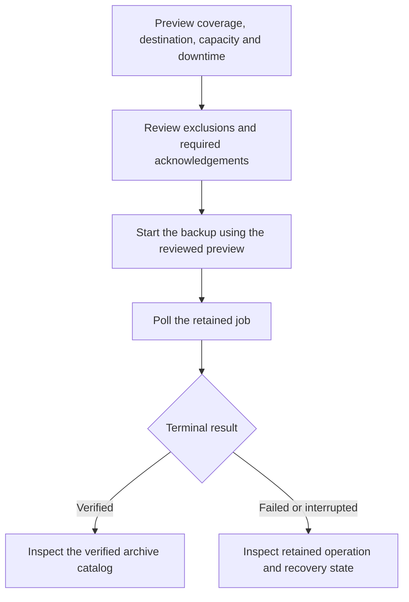

# Installation backups API

Endpoint paths below are backend-native. Add `/api` when using the dashboard gateway, for example `http://localhost:3005/api/process/capabilities`.

<details class="geek-details" markdown="1">
<summary>Preview, acknowledge and track an archive job</summary>

This is the reviewed-preview backup path. Direct start and restore have separate admission rules below; an accepted job still needs its final verification result.



</details>

## Routes and admission

These routes require `installation_backup=true` and numeric
`installation_backup_protocol=1`. They follow the normal DUMB authentication
policy. The frontend exposes them under **Settings → Backups and restore**.
Paths below are relative to the API; browser requests use its `/api` proxy.

| Method | Route | Purpose |
|--------|-------|---------|
| `GET` | `/process/installation-backups/status` | Schedule, preparation, operation/recovery state and current job |
| `GET` | `/process/installation-backups/catalog` | Verified installation archives from the selected destination |
| `GET` | `/process/installation-backups/services` | Eligible configured service instances and blockers when individual-service backups are supported |
| `POST` | `/process/installation-backups/preview` | Review coverage, exclusions, destination, capacity and downtime |
| `GET` | `/process/installation-backups/preview/status` | Reconnect to the current or selected tracked backup preview when supported |
| `POST` | `/process/installation-backups/preview/{preview_id}/cancel` | Request cooperative cancellation of that tracked backup preview when supported |
| `POST` | `/process/installation-backups/start` | Start the reviewed backup after explicit acknowledgement |
| `POST` | `/process/installation-backups/start-direct` | Admit an acknowledged backup without a live preview when supported |
| `GET` | `/process/installation-backups/jobs/{job_id}` | Poll a retained backup or restore job |
| `POST` | `/process/installation-backups/jobs/{job_id}/cancel` | Request cooperative cancellation of an active backup when supported |
| `PUT` | `/process/installation-backups/schedule` | Save an explicitly enabled/disabled schedule, destination, compression and retention |
| `POST` | `/process/installation-backups/restore/preview` | Verify a selected archive and preview compatible restore targets |
| `POST` | `/process/installation-backups/restore/start` | Start the reviewed restore with its required confirmations |
| `POST` | `/process/installation-backups/jobs/{job_id}/rollback` | Recover the exact retained operation after its typed rollback confirmation |

## Individual-service backup and restore

Backends advertising both `installation_backup_services=true` and numeric
`installation_backup_services_protocol=1` support selected-service archives.
`GET /services` returns `protocol: 1` and `services`. Each row includes `id`,
`key`, `instance_name`, `name`, `enabled`, strict boolean `available` and
`blocking_reasons`. IDs identify a configured service or instance (`key` or
`key:instance`); clients must use the backend-provided ID rather than a display
name. An unavailable row does not authorize a partial backup.
Optional `required_service_ids` identifies other owners of shared application
data. Clients must require those owners to be explicitly selected too; the
backend refuses an incomplete ownership bundle rather than expanding its scope
silently. Optional `warning` can explain the shared-data requirement.

`POST /preview`, `POST /start-direct` and `PUT /schedule` accept:

```json
{
  "scope": "services",
  "service_ids": ["radarr:movies"]
}
```

These fields supplement each route's existing destination, compression,
confirmation and schedule fields. `scope: "installation"` with an empty
`service_ids` selects the legacy whole-installation behavior and is the default.
Clients without the additive capability omit both fields. Service scope needs
at least one unique eligible instance; it cannot select DUMB control-plane
services or the shared PostgreSQL cluster. The reviewed preview binds the
selected IDs, configuration, persistence ownership and database coverage. Start
with the reviewed token as usual, without resending configuration or database
credentials. Direct-start request identities also bind the selected scope.

Preview, catalog and job responses add `service_scope`, either
`{"kind":"installation"}` or:

```json
{
  "kind": "services",
  "service_ids": ["radarr:movies"],
  "services": [{"id": "radarr:movies", "key": "radarr", "instance_name": "movies", "name": "Movies"}],
  "affected_process_names": ["Movies"],
  "database_count": 0
}
```

An omitted field on legacy archives means complete-installation scope. Service
archives use schema `2` so older restorers reject them instead of assuming a
complete installation. They retain a selected configuration fragment and
supported owned roots plus separate managed-database exports, without DUMB
authentication or unrelated configuration. The shared PostgreSQL server stays
online; only selected writers and their affected dependants are quiesced.

During `database_backup` and `database_restore`, the optional
`database_progress` reports `phase` (`database_records`, `database_dump` or
`database_restore`) and measured `completed`, `total` or `bytes` when available.
Record-check counts measure database **tables checked**, not the number of
rows copied. Dump bytes describe the current database export. Show this work
separately from archive counters; an earlier archive percentage does not measure
database export or restore progress. Missing totals require indeterminate
activity rather than an inferred percentage or finish time.

Restore preview takes the normal archive reference or mounted path. The archive
determines the exact saved bundle: no `service_ids` subset is accepted during
restore. Existing configured instance IDs, persistence paths and compatibility
bindings must match. Legacy schema `1` archives remain whole-installation
restores. After service replacement commits, affected previously running
applications resume without a normal container restart; unrelated app data and
DUMB accounts are preserved.

A missing configured application root can be restored at its recorded path.
For a missing standalone file, its parent directory must still exist; missing
aliases are not remapped to alternative targets. Configured instance identities,
path ownership and compatibility checks still apply.

PostgreSQL service restores are logical replacements within the existing managed
cluster. The recorded cluster identity must match, and current targets owned by
the selected services must already exist. If a service database was removed,
recreate it through normal managed-service setup before restore preview. A
service archive cannot replace or rebuild the shared PostgreSQL cluster; cluster
recovery requires a whole-installation backup.

Scheduled retention is partitioned by exact service IDs or whole-installation
scope. Switching a schedule's bundle does not prune archives from a different
bundle or whole-installation scope. Manual archives remain outside scheduled
retention.

If recovery is finished by a new controller process, the job instead retains
`restart_required=true` and its exact configuration hash. Follow the instructed
container restart to resume normal startup; the recovery-only controller does
not launch application writers itself. Same-controller recovery resumes the
previously running affected applications normally.

If a service restore reports `service_restore_committed=true` with
`can_rollback=true`, its existing `POST /jobs/{job_id}/rollback` route uses the
backend-owned `rollback_confirmation_text` to **finish** cleanup and resumption
while retaining the restored state. Clients must label that action **Finish
service restore**, not promise restoration of the old data. Before commit, the
existing guarded rollback recovers the original service state. Respect the
advertised action and typed phrase in either case.

## Compression

Backends advertising `installation_backup_compression=true` accept
`compression` in `POST /preview` and `PUT /schedule`: `"none"` selects the default
uncompressed `.tar`; `"zstd"` selects `.tar.zst` and additionally requires
`installation_backup_zstd=true`. The schema capability is independent of runtime
codec availability: with schema support and Zstandard unavailable, clients can
still explicitly save `"none"` to replace a schedule's previous `"zstd"` choice.
A preview response and its tracked operation report the reviewed compression
choice, which is bound to the preview token. Changing it requires another
preview. An omitted schedule field preserves its saved compression choice; a
newly configured schedule defaults to `"none"`. Clients lacking the schema
capability omit the field and keep the legacy uncompressed flow.

The catalog reports each archive's compression. Restore detects the actual
format from its bytes rather than trusting the extension, so legacy `.tar`
archives continue to work. Both formats are complete standalone archives.
Compression streams directly to the destination; capacity admission uses a
conservative uncompressed estimate plus overhead, not an assumed ratio.

## Direct start and request retries

Backends advertising `installation_backup_direct_start=true` support
`POST /start-direct`. The status response advertises `direct_start` with
`confirmation_text` and `required_acknowledgements`. Send:

```json
{
  "request_id": "0123456789abcdef0123456789abcdef",
  "destination_id": "registered_destination",
  "compression": "none",
  "confirmation": "BACK UP DUMB INSTALLATION",
  "acknowledgements": {
    "downtime": true,
    "secrets": true,
    "external_state": true
  }
}
```

Use a fresh random 32-character lowercase hexadecimal request identity for each
intended backup. Retries of the same identity and options return the original
durable job; different options with a spent identity are refused. The job
exposes its `request_id` for transport-loss reconciliation. A direct start skips
the live census and does not provide a reviewed size estimate. Its worker checks
coverage and destination, stops managed writers, and checks capacity from the
cold census before emitting archive payload. If it fails, poll the job for its
reason and service-resume outcome.
The job may include `capacity` with `from_census: true`, measured source totals
and filesystem-role free/required/shortfall byte counts. Failed admitted
scheduled jobs keep the normal interval; pre-admission blockers retain the
five-minute retry without stopping services.

On these backends, reviewed `POST /start` also admits a job without repeating
the preview's full census. Scheduled backups use direct admission. Both retain
configuration/destination identity checks and final source/archive verification.
The legacy `preparation` field remains `null`; older backends may expose
`checking_capacity` before admission. Clients must gate direct start by its
capability and keep polling status while a start response is pending or uncertain.
Never treat an older completed job as confirmation of a new request, and do not
automatically submit a fresh operation after a proxy timeout.

## Job status and progress

Job `created_at` / `updated_at` and preparation `started_at` values use Unix
seconds and can contain fractional seconds. Newer backends can include a `progress` object with optional
`entries`, `logical_bytes` and `bytes_processed` counters. These are relative to
the current `stage` and reset at a phase change: `inventorying` is a metadata
census, `archiving` is archive streaming, `checking_source` hashes source file
contents again, and `verifying` reads back the archive. In archive streaming
and verification, `bytes_processed` counts actual stored stream bytes, including
the stream containing headers, padding and manifest data; for Zstandard these
are compressed bytes. `logical_bytes` remains an uncompressed source measure.
In source checking, `bytes_processed` counts source file bytes hashed.
Consumers must tolerate omitted counters and must not infer an overall
percentage or advancement merely from a successful status request.

### Archive verification and publication

For an installation backup, `archive_verified=true` reports a persisted
`result.complete=true` with a verified archive receipt and its nonempty
reference in `result.archive`. This proof is saved before service resume. The
overall job can still be `recovery_required` because applications could not
resume; that status does not invalidate the published archive. Backup recovery
preserves the archive result and merges restart fields into it. Restore rollback
keeps its separate existing semantics.

The flag describes verification and publication at backup time, not a new
full-file integrity check on every status poll. Do not derive it from copied
bytes, elapsed time, a finished phase or a filename. A publication-stage
failure without a recorded receipt has an unconfirmed outcome: retain recovery
evidence and review the archive catalogue rather than declaring a verified
backup or assuming that publication never happened.

`archive_publication_uncertain=true` identifies that recorded publication
uncertainty. Its persistent marker survives a controller restart that changes
the job stage to `interrupted`; clients must not rely on the stage alone.
During service recovery, keep the archive receipt visible separately from the
overall job status. For scheduled backups, `last_success_at` records accepted
archive publication and the normal next interval is retained even when services
need recovery. Publication uncertainty also avoids an immediate heavy retry,
but does not create a successful-backup timestamp or verified-archive claim.

### Measured phase percentages

Backends advertising `installation_backup_phase_progress=true` can include measured
phase totals. When a phase has a measured total, `progress` can include `total_entries`,
`total_logical_bytes` or `total_bytes`, together with `percent` and
`percent_basis` (`"entries"` or `"bytes"`). These fields describe only the current
phase. Omit the progress bar when its measured percentage is absent; a finished
phase does not establish that the archive has passed later checks or been
published. Do not mix compressed stream bytes with logical source totals.

### Service state during the operation

Job `services_stopped` and `stopped_process_names`, when present, report the
exact retained service names whose complete quiescence was verified. Clients
must invalidate stale running/health data when an installation hold begins,
show an unknown or transitioning state while stopping/resuming, and only label
named services stopped when the backend supplies that evidence. The API and
frontend remain control-plane services. A cached green badge is not proof that
an application stayed running through a cold backup.

## Cancel an active backup

`installation_backup_cancellation=true` enables `POST /jobs/{job_id}/cancel`
with an empty request body. Public job fields `can_cancel` and
`cancel_requested` advertise whether the worker can accept the request and
whether cancellation is pending. This operation is only for an active
`installation_backup`, including a scheduled run; it does not cancel restores
or invoke rollback. Keep polling: the worker must leave its current I/O, remove
its own unpublished output and safely resume the retained service set before
reporting `cancelled`. Resume failure remains `recovery_required`. Cancellation
acceptance closes before verified archive publication; clients must respect
`can_cancel` rather than infer eligibility from a running status alone.

## Track or cancel a preview

Backends advertising `installation_backup_preview_status=true` track the
backup preview while the existing synchronous `POST /preview` is running.
Poll `GET /preview/status`; optional query parameter `preview_id` pins a selected
operation. The response contains `protocol`, `controller_session` and `preview`
(`null` when no current preview is retained). An explicitly queried unknown or
expired ID returns `409`; it does not start another scan. The operation reports `preview_id`,
`status`, `stage`, `message`, start/update/completion and last-progress timestamps,
`elapsed_seconds`, `entries`, `logical_bytes`, completed/total root counts,
`current_root` and `destination_id`. Statuses are `running`, `cancelling`,
`completed`, `failed` and `cancelled`; scan counters do not imply a known total or
an archive write. A completed operation supplies its original review `result`
and expiry. A completed scan can still return blockers and requires a separate
explicit `/start` request before a backup begins.

`POST /preview/{preview_id}/cancel` requests a stop; it does not claim immediate
completion. Wait for `cancelled` after the worker cleans its temporary ledger
and releases its preview lock. Preview never stops managed writers. Status is
held in controller memory, so a changed `controller_session` or a missing result
after a restart requires an explicitly requested new preview, not automatic
replay. Confirmation expiry begins after scanning completes. The capability
adds no fixed scan deadline and does not change restore-preview behavior.

## Restore and recovery

Preview authorization is short-lived and bound to the reviewed source, targets
and storage identity. A restore can select an owned catalog reference or a
container-visible archive path, allowing recovery without the original local
catalog. Backends advertising `installation_backup_shared_permissions=true`
accept the strict boolean `allow_shared_permissions` (default `false`) for that
mounted-file choice. Set it to `true` only with `archive_path` after explicit
consent to the source's shared access controls; `true` with an owned reference is
rejected because its registered profile supplies the policy. The choice is
bound into the reviewed source. Archive integrity, paths and file types are
validated before replacement. The operation preserves rollback evidence and
leaves a successful restore stopped with a container restart required to reload configuration and auth.

The preview states the actual inventory and exclusions. These archives cover
managed installation state, not host deployment files, media or external systems.
Failed admission, capacity, storage or compatibility checks do not authorize a
partial success. See [Installation backup and restore](../features/installation-backups.md)
for the operating and recovery procedure.

An installation-recovery hold continues to allow normal login/refresh and the
stateless `POST /auth/verify` session check under their ordinary authentication
rules. This exception does not allow other HTTP methods or unrelated mutations.
A held service/setup request's `409` is not an instruction to clear credentials;
clients retain the session unless authentication itself establishes its expiry.
