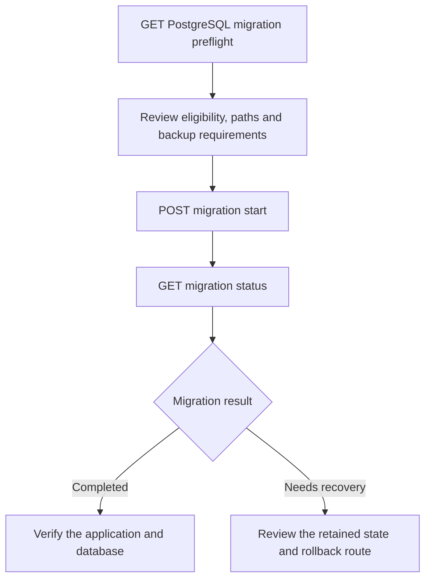

# PostgreSQL migration API

Endpoint paths below are backend-native. Add `/api` when using the dashboard gateway, for example `http://localhost:3005/api/process/capabilities`.

<details class="geek-details" markdown="1">
<summary>Database migration and recovery</summary>

The preflight is an inspection. The migration starts only after its requirements are satisfied; retain the reported recovery information until the result is verified.



</details>

## SQLite-to-PostgreSQL Migration

These endpoints power the guarded migration workflow for Sonarr, Radarr,
Lidarr, Prowlarr, Whisparr, Bazarr, Pulsarr, Seerr, AltMount, and InfiniDysk.
See [SQLite to PostgreSQL Migration](../features/arr-postgres-migration.md) for
operator guidance and service-specific limitations.

### `GET /process/postgres-migration/preflight`

Query parameter: `process_name`.

Returns non-mutating SQLite integrity, detected application version when available, PostgreSQL connectivity/role, target database, and backup-space checks. `ready` is false when any blocking check fails. The response never includes the PostgreSQL password. `supports_log_migration` tells clients whether to offer the separate Arr log-database option.

For InfiniDysk, this is a DUMB-managed migration adapter; upstream still
supports PostgreSQL selection only for fresh installs. The adapter accepts an
official stable v1.2.0-or-newer runtime only when the source SQLite database and
migration-only staged PostgreSQL database exactly match DUMB's supported
contract. The newest audited database contract is InfiniDysk v1.2.5. Missing,
extra, or changed schema objects or migration-history entries
make `ready` false until DUMB is updated. It migrates only the main `db.sqlite`;
`metrics.sqlite`, `warden.db`, and
`usenet-migration.db` remain SQLite, and `supports_log_migration` is false.
Any pending compatibility or full namespace migration must complete before
PostgreSQL is selected or this workflow starts.

InfiniDysk v1.2.6+ also returns an `infinidysk_database_contract_file` preflight
check. DUMB validates `infinidysk-db-v1`, the main provider, declared transient
objects, mirrored main fields, and a migration-history count, terminal ID, and
hash recomputed from the live SQLite database. A present invalid or stale file
makes `ready` false. A missing file is a warning for older releases and does not
replace the existing audited schema checks. Rehearsal/cutover binds the verified
source contract fingerprint and requires the isolated PostgreSQL staging pass to
emit a valid PostgreSQL contract before the rehearsal can authorize cutover.
Unknown migration histories remain blocked even when their file is internally
consistent.

Successful cutover authorization records the exact runtime commit. Subsequent
official release, branch, or exact-commit selections are accepted only when the
resolved commit equals or descends from that recorded cutover commit. Older,
diverged, and unverifiable targets are rejected before configuration is saved
or InfiniDysk starts.

### `POST /process/postgres-migration/start`

Queues a persisted rehearsal or cutover job.

```json
{
  "process_name": "Sonarr InfiniDysk",
  "mode": "rehearsal",
  "include_logs": false,
  "confirmation": "MIGRATE Sonarr InfiniDysk",
  "acknowledge_unsupported": true,
  "acknowledge_backup": true,
  "acknowledge_target_reset": true
}
```

`mode` must be `rehearsal` or `cutover`. The backend requires every acknowledgement and exact confirmation text. Jobs and detailed stage events persist under `/config/arr-postgres-migration/jobs`.

### `GET /process/postgres-migration/status`

Query parameter: `job_id`.

Returns stage, percentage, recent detailed events, result counts, errors, and rollback state for one job. Active statuses are `queued`, `running`, `finalizing`, and `rolling_back`. InfiniDysk uses `finalizing` at 99% while DUMB persists the controller-owned cutover authorization; clients must continue polling and must not offer rollback until a terminal status is returned.

### `GET /process/postgres-migration/latest`

Query parameter: `process_name`.

Returns the most recently updated migration job for that service so dmbdb can resume visibility after navigation or refresh.

### `POST /process/postgres-migration/rollback`

```json
{
  "job_id": "example-job-id",
  "confirmation": "ROLLBACK Sonarr InfiniDysk"
}
```

Restores the job's preserved application configuration when applicable,
persists `postgres_enabled: false`, and restarts the service against SQLite
when it was running. This does not reverse-copy changes made after PostgreSQL
cutover. For InfiniDysk, rollback restores the preserved main SQLite state;
the three auxiliary SQLite stores were never migrated.

Do not manually toggle the provider or restore the whole job bundle after an
interruption or rollback error. Use this guarded rollback route when the job
advertises `rollback_available`. For `status: rollback_failed`,
`rollback.retry_safe: true` means no saved-data mutation began and the guarded
rollback may be retried; `false` is an attention-required state that freezes
InfiniDysk lifecycle/provider changes until the precise failed recovery surface
is reviewed.

The former `/process/arr-postgres-migration/*` paths remain available as hidden compatibility aliases for older dmbdb clients and existing Sonarr/Radarr deployments.
