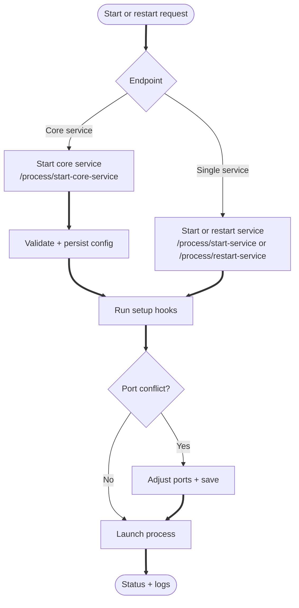

# Process Management API

The **Process Management** endpoints handle launching, stopping, restarting, and tracking subprocesses managed by DUMB.

---

## Lifecycle flow



---

## Endpoints

### Setup plans and retained runs

Available when `GET /process/capabilities` advertises `setup_arrangements=true`. Browser requests use the usual `/api` prefix.

| Method | Endpoint | Purpose |
|---|---|---|
| POST | `/process/setup/plan` | Validate selections, discover choices and preview actions without changing application settings. |
| POST | `/process/setup/runs` | Start the reviewed plan with a stable client idempotency key. |
| GET | `/process/setup/runs/latest` | Read the latest run; 404 when none exists. |
| GET | `/process/setup/runs/{run_id}` | Read a retained run. |
| POST | `/process/setup/runs/{run_id}/retry` | Retry incomplete automatic work. |
| POST | `/process/setup/runs/{run_id}/recheck` | Recheck and refresh discoverable inputs. |
| POST | `/process/setup/runs/{run_id}/cancel` | Request cancellation of setup work; this is not service removal. |
| POST | `/process/setup/runs/{run_id}/actions/{action_id}` | Preview, apply, recheck, defer or confirm an action. |

The plan extends existing onboarding selections with `arrangement: {values: {}, intent: {}}`. Use exact flat keys from `arrangement_schema.fields`; these identify resources and are not object paths. The schema supplies types, choices, defaults and conditional visibility. Nested `object` fields advertise relative child keys under `fields`; `list` fields advertise row fields under `item_fields`. Do not invent profile IDs or strip instance/options fields and retry arbitrary validation errors.

Responses include service identities/roles, actions, independent execution and verification, missing inputs, editable fields, links, schema and coverage. Credential-bearing values use presence markers. Never submit `[configured]` as a replacement credential.

InfiniDysk runtime choices additionally require
`setup_infinidysk_runtime_choices=true` and `setup_infinidysk_runtime_protocol=1`,
plus the native workflow's API/version/protocol capabilities. The advertised
arrangement fields are `infinidysk::runtime_generation` and
`infinidysk::mount_backend`. These describe the proposed setup; generic
`service_options` cannot authorize a major transition or replace native paths.
A required `native_transition` action supplies
`native_transition: {runtime_generation: "2", mode: "fresh" | "migrate", mount_backend: "rclone" | "fuse"}`
for the existing guarded native wizard. It is a handoff, not a new execution
endpoint or approval. Setup start remains blocked until that transition has
completed and a fresh plan confirms the actual configuration. Existing native
installations retain their detected topology; generation 1 settings adapters do
not run against generation 2.


Start accepts `{"plan_id": "<reviewed-plan-id>", "idempotency_key": "<stable-client-request-id>"}`. Keep the same key when retrying an uncertain response; changed choices need a fresh reviewed plan.

An action request has `{"operation": "apply", "values": {}}`; other operations are `recheck`, `defer` and `confirm`. Actions advertising `previewable=true` also accept `preview`, an inspection without native application writes. The returned `evidence.changes` describes current/proposed fields with secrets hidden; adoption consent includes the advertised source's `adoption_preview_id` and `adopt_existing` fields and is bound to that proposal. Refresh stale proposals before applying them. Manual confirmation is user attestation, not machine verification. Deferring required work does not complete it.

Actions advertising `explicit_only=true` require a deliberate action-level Apply. Starting or retrying the arrangement does not authorize consumer-file or workflow probes. Use their advertised scope, authorization and size/time-limit fields and retain partial or unavailable verification honestly.

Run statuses include `pending`, `running`, `waiting_input`, `partial`, `complete`, `failed` and `interrupted`. Use returned status/results, not timers or process counts. Protect backups of `/config/.dumb-setup` as credential-bearing state.

See [Setup checklist and automation](../features/setup-checklist.md) for account reuse, manual tasks and coverage.


### Install cache

These endpoints are available when `/process/capabilities` advertises
`install_cache_management=true`:

- `GET /process/install-cache/status` returns the full managed, legacy, and
  combined totals; namespace sizes; exact discovered legacy entries; configured
  limits; file counts; recent install-operation stages; and cache-root recovery
  fields (`configured_path`, active `path`, `using_fallback`, and
  `fallback_reason`).
- `POST /process/install-cache/verify` hashes cached download objects and
  quarantines invalid entries.
- `POST /process/install-cache/prune` accepts optional
  `{"max_size_gib": 25}` and removes least-recently-used cache entries until
  the limit is met.
- `POST /process/install-cache/artifacts/clear` accepts an optional
  `service_key`; omitting it clears all compiled build artifacts.

When `install_cache_limit_settings=true`, the dashboard persists a changed
limit through the normal global config update endpoint using
`{"dumb":{"install_cache":{"max_size_gib":25}}}`. The global schema accepts
1 through 1024 GiB. Pruning remains an explicit maintenance action.

When `install_cache_cleanup=true`,
`POST /process/install-cache/cleanup` accepts a non-empty `scopes` array. Valid
values are `downloads`, `dependencies`, `artifacts`, `quarantine`, and
`legacy`. Paths are not accepted. For example:

```json
{
  "scopes": ["legacy", "quarantine"]
}
```

Maintenance endpoints return HTTP 409 during nonterminal startup phases or
while DUMB's service-update lock is active.

Cache maintenance never deletes service configuration, databases, media, or
the currently active runtime. See [Install cache and safe
updates](../features/install-cache.md).

---

### `GET /process/processes`

Returns all configured processes, including enabled status, version, repo URL,
sponsorship URL, manual-update support, and the last recorded update status. The
dashboard uses the latter two fields to build its update inventory without one
status request per service.

#### Example Response:

```json
{
  "processes": [
    {
      "name": "rclone w/ RealDebrid",
      "process_name": "rclone w/ RealDebrid",
      "enabled": true,
      "config": { "enabled": true, "...": "..." },
      "version": "1.65.1",
      "key": "rclone",
      "config_key": "rclone",
      "repo_url": "https://rclone.org",
      "sponsorship_url": "https://rclone.org/sponsor/",
      "supports_manual_update": true,
      "update_status": {
        "status": "update_available",
        "current_version": "1.65.1",
        "available_version": "1.66.0"
      }
    }
  ]
}
```

---

### `GET /process`

Fetch details about a specific process.

#### Required Query Parameter:

* `process_name` (string)

#### Example Response:

```json
{
  "process_name": "rclone w/ RealDebrid",
  "config": { "enabled": true, "...": "..." },
  "version": "1.65.1",
  "config_key": "rclone",
  "repo_url": "https://rclone.org",
  "sponsorship_url": "https://rclone.org/sponsor/"
}
```

---

### `POST /process/start-service`

Starts a specific process.

#### Request Body:

```json
{
  "process_name": "rclone w/ RealDebrid"
}
```

#### Example Response:

```json
{
  "status": "Service started successfully",
  "process_name": "rclone w/ RealDebrid"
}
```

---

### `POST /process/stop-service`

Stops a running process.

#### Request Body:

```json
{
  "process_name": "rclone w/ RealDebrid"
}
```

---

### `POST /process/restart-service`

Restarts a running process.

#### Request Body:

```json
{
  "process_name": "rclone w/ RealDebrid"
}
```

---

### `GET /process/service-reset/preview`

Returns the guarded reset/removal plan when capability `service_reset=true`.

Required query parameter: `process_name`. Optional `action` is `reset` (default) or `remove`. The response identifies whether DUMB will reset a required template or remove a custom instance, reports `default_instance_after_removal` when removing the final custom instance will restore the disabled default template, lists exact eligible file targets, and reports retained/shared paths and dependency-reference warnings. Preview is read-only.

### `POST /process/service-reset`

Stops one eligible service, cancels its DUMB schedules, writes a private full-config backup, then applies a freshly validated preview.

```json
{
  "process_name": "Sonarr Movies",
  "action": "remove",
  "confirmation": "Sonarr Movies"
}
```

`confirmation` must exactly match `process_name`. `reset` preserves application files. `remove` clears only the returned DUMB-owned paths. Neither action removes mounts, symlink libraries, shared caches, PostgreSQL databases, external data stores, or other service configuration. DUMB API and DUMB Frontend are excluded.

See [Service Reset and Removal](../features/service-reset.md) for template behavior, safety boundaries, and recovery.

---

### `GET /process/service-status`

Gets the current status of a process.

Pass `include_health=true` to include structured health and Auto-restart state.
The `health_status` value is `healthy`, `degraded`, `starting`, or `unhealthy`.
`healthy` remains for backward compatibility; use `health_status` when the
difference between an application starting, degraded, and restart-worthy
unhealthy state matters.

#### Example Response:

```json
{
  "process_name": "InfiniDysk",
  "status": "running",
  "healthy": true,
  "health_status": "starting",
  "health_reason": "InfiniDysk reports migrating",
  "health_details": {
    "probe": "InfiniDysk backend health",
    "endpoint": "/health",
    "supported": true,
    "http_status": 503,
    "reported_status": "migrating"
  },
  "restart": {}
}
```

Health details expose only bounded probe metadata and component names/statuses.
They do not include response bodies, credentials, or arbitrary remote URLs.

---

### `GET /process/startup-status`

Returns the readiness-aware container startup lifecycle when capability
`startup_lifecycle` is true. The response includes phase/timestamps, expected
service names, each service's `pending`, `starting`, or `ready` state, and
terminal failure summaries.

```json
{
  "phase": "stabilizing",
  "terminal": false,
  "expected_services": ["DUMB API", "DUMB Frontend", "InfiniDysk"],
  "services": {
    "DUMB API": {"state": "ready", "reason": null},
    "DUMB Frontend": {"state": "ready", "reason": null},
    "InfiniDysk": {
      "state": "starting",
      "reason": "InfiniDysk reports migrating",
      "health_status": "starting",
      "health_details": {
        "probe": "InfiniDysk backend health",
        "endpoint": "/health",
        "http_status": 503,
        "reported_status": "migrating"
      }
    }
  },
  "failures": {}
}
```

---

## Runtime API logging

These endpoints are available when `/process/capabilities` advertises
`runtime_api_log_level`.

### `GET /process/runtime-log-level`

Returns the configured and effective DUMB API logging levels and whether a
temporary DEBUG override is active.

```json
{
  "configured_level": "INFO",
  "configured_uvicorn_level": "INFO",
  "effective_level": "DEBUG",
  "debug_enabled": true,
  "override_active": true,
  "temporary": true,
  "resets_on_restart": true
}
```

### `POST /process/runtime-log-level`

Enables or disables a temporary DEBUG override without restarting the DUMB
container or API. Enabling changes the running shared DUMB logger and Uvicorn
loggers immediately. Disabling restores their configured levels.

```json
{
  "debug_enabled": true
}
```

The override is intentionally not written to `dumb_config.json` and is cleared
by a container restart. It does not modify managed-service logging settings.
DEBUG output can be substantially larger and may contain additional operational
details; DUMB's normal log redaction remains active.

---

## Updates and scheduling

### `GET /process/update-status`

Returns the last recorded update state for the required `process_name` query parameter.

Scheduled work can add the following fields to `update_status`:

| Field | Meaning |
| --- | --- |
| `scheduler_state` | `running`, `deferred`, `error`, `blocked`, `disabled`, or `completed` for the scheduled callback |
| `scheduler_job` | `update` or `api` |
| `scheduler_message` | Progress or outcome message for the scheduled callback |
| `scheduler_started_at` | Callback start time as Unix seconds |
| `scheduler_elapsed_seconds` | Observed running duration |
| `scheduler_long_running` | Whether the callback has been running for at least five minutes |
| `retry_after_seconds`, `next_retry_at` | Retry delay and Unix retry time when admission is deferred |
| `last_run_status` | Completed callback outcome, including `rescheduled` when its due time moved before execution |

These fields supplement the existing `status`, `message`, schedule, and install
timing fields. Polling clients should display the message and tolerate absent
fields on older backends. A long-running flag does not mean the callback has
been stopped or its locks released. Scheduled service updates remain serial;
other due services can report `deferred` while the active callback finishes.
For DUMB API and DUMB Frontend, a known available update remains in `status`
and `message` during a recheck or deferral. Read `scheduler_state` and
`scheduler_message` for live progress; a failed recheck also records
`last_check_error` without discarding that known result.
Scheduled backups publish corresponding worker fields through
[`GET /process/symlink-backup-status`](#get-processsymlink-backup-status),
with `scheduler_job: "symlink_backup"` and `next_backup_at`.

### `GET /process/update-notices`

Returns available, informational, and recently applied update notices. `scope=project` (default) limits notices to DUMB/dmbdb; `scope=all` includes managed services.

Project terminal statuses are retained by the backend in `/config/update_notices.json`. Available DUMB API/frontend entries can include `releases_behind` when the installed release is present in the bounded GitHub release history, plus `last_check_error`/`last_check_failed_at` when a transient recheck failure leaves a known available result in place. Browser dismissals are presentation-only and do not mutate this endpoint's retained state.

The DUMB API is checked at startup and daily regardless of service auto-update opt-in. Its check is always report-only; applying a new API image remains external to this endpoint.

### `POST /process/update-check`

Runs a manual update check without installing it.

```json
{
  "process_name": "AltMount",
  "force": true
}
```

### `POST /process/update-install`

Installs an available update. `allow_override: true` temporarily ignores the
saved release, branch, commit, or pinned-version selection and installs the
latest stable release; DUMB restores the saved configuration afterward.
`target` optionally supplies a supported release selector; `target:
"configured"` applies the currently configured pinned commit/release/branch
without clearing or bypassing it.

Configured-target update-check responses include
`configured_target_kind` (`release`, `branch`, or `commit`) and
`configured_target_installed`. Clients can use these fields to offer the
matching configured-target installation action only when it is needed.

```json
{
  "process_name": "InfiniDysk",
  "allow_override": false,
  "target": "configured"
}
```

A completed install response can include backend-measured timing fields when
`update_timing_metrics` is advertised:

```json
{
  "status": "updated",
  "message": "Updated InfiniDysk to v0.10.0-rc.2.",
  "install_duration_seconds": 97.4,
  "downtime_seconds": 21.8,
  "downtime_status": "completed",
  "timing_completed_at": "2026-08-05T12:34:56+00:00"
}
```

`install_duration_seconds` covers the complete backend update operation.
`downtime_seconds` is the sum of observed intervals from stopping the managed
process until an application readiness probe succeeds. `downtime_status` is
`completed`, `ongoing`, or `not_observed`. An `ongoing` value is a lower bound
captured when the operation ended without verified readiness; `not_observed`
means no running managed process was stopped. Scheduled installs publish the
same fields through cached `update_status` data.

### `POST /process/auto-update/reschedule`

Recomputes the next automatic-update run after changing a service's enabled
state, interval, start time, or `auto_update_mode`. The supported modes are
`install` (the backward-compatible default) and `check_only` (record the result
without installing or restarting the service).

```json
{
  "process_name": "AltMount"
}
```

Clients should gate manual update actions on the `manual_update_check`
capability, configured-target installation on `configured_source_install`, and
the start-time control on `auto_update_start_time`, and the scheduled-action
selector on `auto_update_mode`. The dashboard multi-service
workflow is gated on `dashboard_bulk_updates`; it orchestrates the existing
per-service check/install endpoints sequentially and never sends bulk source
overrides. Clients should show update timing only when
`update_timing_metrics=true`.

---

### `POST /process/start-core-service`

Starts one or more core services and all required dependencies. This is used during onboarding.

The `core_services` field can be a single object or an array. The `name` can be the config key (e.g., `riven_backend`) or a display name (e.g., `Riven`).

#### Request Body Examples:

=== "Riven"

    ```json
    {
      "core_services": {
        "name": "riven_backend",
        "debrid_service": "RealDebrid",
        "debrid_key": "abc123",
        "service_options": {}
      },
      "optional_services": ["zilean", "pgadmin", "riven_frontend"]
    }
    ```

=== "Decypharr"

    ```json
    {
      "core_services": {
        "name": "decypharr",
        "debrid_service": "RealDebrid",
        "debrid_key": "abc123",
        "service_options": {
          "decypharr": {
            "mount_type": "dfs",
            "mount_path": "/mnt/debrid/decypharr"
          }
        }
      },
      "optional_services": []
    }
    ```

=== "CLI Debrid"

    ```json
    {
      "core_services": {
        "name": "cli_debrid",
        "debrid_service": "RealDebrid",
        "debrid_key": "abc123",
        "service_options": {
          "phalanx_db": { "enabled": true }
        }
      },
      "optional_services": ["zilean"]
    }
    ```

#### Example Response:

```json
{
  "results": [
    {"service": "riven_backend", "status": "started"},
    {"service": "decypharr", "status": "started"}
  ],
  "errors": []
}
```

!!! note "Notes"
    * Dependencies like Zurg or rclone are created using templates and attached to the calling core service.
    * Optional services such as `pgadmin`, `zilean`, `bazarr`, `pulsarr`, `maintainerr`, `mediastorm`, `traefik_proxy_admin`, or `cloudflared` are started only if included.
    * `debrid_key` is injected into Zurg or Decypharr as needed.
    * `service_options` can override config values such as `log_level`, `port`, or `enabled`.
    * Any startup errors appear in the `errors` list.

---

### `GET /process/core-services`

Returns the available core services, their dependencies, and default service options (used by onboarding).

---

### `GET /process/dependency-graph`

Returns backend-resolved dependency relationships for a specific process, including:

* static core dependencies (with instance-scoped matching for `rclone`/`zurg`)
* inferred links from `core_service`/`core_services`
* inferred links from `wait_for_url`/`wait_for_dir` entries (including localhost port matching)
* inferred links from `wait_for_mounts` by matching required mount paths to provider service mount points
* rclone provider links (`zurg_enabled`, `decypharr_enabled`, `key_type=infinidysk`) to reflect WebDAV provider dependencies directly
* non-core hard dependency map for service-specific startup requirements (for example `riven_frontend -> riven_backend`, `zilean -> postgres`, `pgadmin -> postgres`)
* conditional startup dependencies from the backend startup ordering logic -- config-aware dependencies like `tautulli -> plex` (when plex is enabled), `bazarr -> sonarr/radarr` (when those Arrs are enabled), `prowlarr -> sonarr/radarr` (when those Arrs are enabled), `neutarr -> sonarr` (when Sonarr has `use_neutarr` enabled), etc. For instance-scoped services (`rclone`, `zurg`), conditional deps are filtered per-instance so that only the specific associated instances are shown (for example, a rclone instance with `zurg_enabled` only shows its own zurg instance, not zurg instances belonging to other rclone configurations)
* documented integration links (soft linkage, `scope=all` only) -- for example `seerr -> sonarr/radarr` request routing
* per-process status state used by the frontend dependency graph panel
* `dependency_truth_table` describing the 12 dependency signal types and whether each is treated as hard dependency vs linkage
* `signals` array on each row/edge identifying which detection signals established the relationship (for example `["core_service_map"]`, `["rclone_provider_zurg", "conditional_startup_map"]`)

#### Required Query Parameter:

* `process_name` (string)

#### Optional Query Parameter:

* `scope` (string): `runtime` (default) or `all`
    * `runtime` returns runtime/configured hard dependencies
    * `all` additionally includes soft linkage edges (for example optional Zilean integrations)

The response includes `parallel_groups` metadata describing concurrent
prerequisite/dependent stages around the selected service.

#### Example Response (shape):

```json
{
  "process_name": "Seerr Main",
  "config_key": "seerr",
  "context": { "mode": "core", "key": "seerr", "core": { "key": "seerr", "name": "Seerr", "dependencies": [] } },
  "scope": "runtime",
  "startup_order": [{ "key": "seerr", "label": "Seerr", "state": "running" }],
  "dependency_rows": [],
  "dependent_rows": [],
  "linked_outgoing_rows": [{ "process_name": "Plex Media Server", "key": "plex", "label": "Plex Media Server", "state": "running" }],
  "linked_incoming_rows": [],
  "nodes": [{ "id": "Seerr Main", "process_name": "Seerr Main", "key": "seerr", "label": "Seerr Main", "state": "running" }],
  "edges": [{ "source": "Seerr Main", "target": "Plex Media Server", "signals": ["wait_for_url"], "strength": "hard_runtime" }],
  "parallel_groups": [{ "id": "pre_core", "label": "Parallel prerequisites", "type": "parallel", "members": ["PostgreSQL", "Rclone w/ Riven"] }],
  "updated_at": "2026-02-11T18:45:00Z"
}
```

---

### `GET /process/optional-services`

Returns optional services. You can pass `core_service` and `optional_services` query params to tailor the list.

---

### `POST /process/symlink-repair`

Runs symlink target rewrites for service symlink trees (Decypharr, InfiniDysk, CLI Debrid, Riven).

Use this endpoint when mount paths change and existing symlink targets need to be rewritten.

#### Request Body:

```json
{
  "dry_run": true,
  "include_broken": true,
  "presets": ["decypharr_beta_consolidated"],
  "roots": ["/mnt/debrid/decypharr_symlinks", "/mnt/debrid/clid_symlinks"],
  "root_migrations": [
    {
      "from_root": "/mnt/debrid/decypharr_symlinks",
      "to_root": "/mnt/debrid/combined_symlinks"
    }
  ],
  "overwrite_existing": false,
  "copy_instead_of_move": false,
  "rewrite_rules": [
    {
      "from_prefix": "/mnt/debrid/old",
      "to_prefix": "/mnt/debrid/new"
    }
  ],
  "backup_path": "/config/symlink-repair/manifest.json"
}
```

#### Behavior

* `dry_run: true` scans and reports without changing symlinks.
* `dry_run: false` rewrites matching symlinks in place.
* `process_name` is optional but recommended for async runs/job lookup.
* Provide at least one of: `presets`, `rewrite_rules`, `root_migrations`.
* `root_migrations` moves symlink entries from one symlink tree to another while
  preserving relative paths. This is intended for individual-root to combined-root migrations.
* `overwrite_existing` controls behavior when a destination symlink already exists during root migration.
* `copy_instead_of_move` (root migration mode) creates destination symlinks and keeps source symlinks in place.
* If `roots` is omitted, backend defaults are used:
  `/mnt/debrid/decypharr_symlinks`, `/mnt/debrid/infinidysk-symlinks`,
  `/mnt/debrid/combined_symlinks`, `/mnt/debrid/clid_symlinks`, and
  `riven_backend.symlink_library_path` when configured.
* `backup_path` is written only for non-dry-run operations with changes.

#### Example Response:

```json
{
  "dry_run": true,
  "scanned_symlinks": 2451,
  "changed": 312,
  "moved": 120,
  "copied": 0,
  "skipped_unchanged": 2139,
  "errors": [],
  "changes": []
}
```

### `POST /process/symlink-repair-async`

Queues symlink repair as a background job and returns immediately.

Use `GET /process/symlink-job-status` (or `/process/symlink-job-latest`) to track completion.

#### Response (example)

```json
{
  "status": "queued",
  "job_id": "76d1a3bd35f84e3fab0cc39f81246849",
  "operation": "symlink_repair"
}
```

### `POST /process/symlink-manifest/backup`

Creates a standalone snapshot manifest of symlink entries for later restore.

#### Request Body:

```json
{
  "backup_path": "/config/symlink-repair/snapshots/latest.json",
  "roots": ["/mnt/debrid/decypharr_symlinks", "/mnt/debrid/clid_symlinks"],
  "include_broken": true
}
```

#### Behavior

* Writes a manifest containing `link_path` + `target` entries.
* If `roots` is omitted, backend default symlink roots are used.
* Used by the internal DUMB scheduler when `symlink_backup_enabled` is set on supported services.
* Scheduled runs can prune older manifests when `symlink_backup_retention_count` is greater than `0`.

### `POST /process/symlink-manifest/backup-async`

Queues a standalone snapshot backup as a background job and returns immediately.

#### Response (example)

```json
{
  "status": "queued",
  "job_id": "8e9fd0fbe88d4a6fbb2f3f77b2a3f8c1",
  "operation": "symlink_manifest_backup"
}
```

### `GET /process/symlink-job-status`

Returns status/result for background symlink jobs.

#### Query Params

- `job_id` (required)

#### Response fields

- `status`: `queued`, `running`, `completed`, or `error`
- `result`: operation payload when completed
- `error`: error payload when failed
- `created_at`, `updated_at`, `started_at`, `finished_at` timestamps (when available)

### `GET /process/symlink-job-latest`

Returns the latest symlink job for a process/operation (optionally only active jobs).

#### Query Params

- `process_name` (required)
- `operation` (optional, default `symlink_manifest_backup`)
- `active_only` (optional, default `true`)

### `POST /process/symlink-manifest/restore`

Restores symlinks from a previously generated snapshot manifest.

#### Request Body:

```json
{
  "manifest_path": "/config/symlink-repair/snapshots/latest.json",
  "dry_run": true,
  "overwrite_existing": false,
  "restore_broken": true
}
```

#### Behavior

* `dry_run: true` previews restore actions without writing.
* `overwrite_existing` controls whether existing paths are replaced.
* `restore_broken` controls whether entries with currently missing targets are restored.

### `GET /process/symlink-manifest/compare`

Compares a snapshot manifest against current filesystem state and returns projected restore outcomes.

#### Query Params

- `manifest_path` (required)
- `overwrite_existing` (optional, default `false`)
- `restore_broken` (optional, default `true`)
- `sample_limit` (optional, default `50`, max `200`)

#### Behavior

* Uses the same overwrite/missing-target rules as restore.
* Returns projected counts (`projected_restored`, skipped categories, errors).
* Returns `sample_changes` with representative actions (`create`, `overwrite`, `skip_*`) for quick review before apply.

### `POST /process/symlink-manifest/restore-async`

Queues restore as a background job and returns immediately.

Use `GET /process/symlink-job-status` (or `/process/symlink-job-latest`) to track completion.

### `GET /process/symlink-backup-status`

Returns current symlink-backup scheduler state for a service.

### `GET /process/symlink-backup-manifests`

Lists backup manifests that match the current service `symlink_backup_path` template.

### `GET /process/symlink-manifest-files`

Lists legacy files under `/config/symlink-repair/snapshots` by default. With an explicit registered backup destination, lists only owned symlink catalog artifacts for the selected process; a managed `manifest_path` must verify before its namespace is listed.

Use this to populate manifest pickers in the Snapshot tab for quick restore/overwrite selection.

### `POST /process/symlink-backup/reschedule`

Rebuilds symlink-backup schedule state from current service config.

#### Request Body:

```json
{
  "process_name": "Decypharr"
}
```

---

## Installation backup and restore

These routes require `installation_backup=true` and numeric
`installation_backup_protocol=1`. They follow the normal DUMB authentication
policy. The frontend exposes them under **Settings → Backups and restore**.
Paths below are relative to the API; browser requests use its `/api` proxy.

| Method | Route | Purpose |
|--------|-------|---------|
| `GET` | `/process/installation-backups/status` | Schedule, operation/recovery state and current job |
| `GET` | `/process/installation-backups/catalog` | Verified installation archives from the selected destination |
| `POST` | `/process/installation-backups/preview` | Review coverage, exclusions, destination, capacity and downtime |
| `POST` | `/process/installation-backups/start` | Start the reviewed backup after explicit acknowledgement |
| `GET` | `/process/installation-backups/jobs/{job_id}` | Poll a retained backup or restore job |
| `PUT` | `/process/installation-backups/schedule` | Save an explicitly enabled/disabled schedule, destination and retention |
| `POST` | `/process/installation-backups/restore/preview` | Verify a selected archive and preview compatible restore targets |
| `POST` | `/process/installation-backups/restore/start` | Start the reviewed restore with its required confirmations |
| `POST` | `/process/installation-backups/jobs/{job_id}/rollback` | Recover the exact retained operation after its typed rollback confirmation |

Preview authorization is short-lived and bound to the reviewed source, targets
and storage identity. A restore can select an owned catalog reference or a
container-visible archive path, allowing recovery without the original local
catalog. Archive integrity, paths and file types are validated before replacement.
The operation preserves rollback evidence and leaves a successful restore
stopped with a container restart required to reload configuration and auth.

The preview states the actual inventory and exclusions. These archives cover
managed installation state, not host deployment files, media or external systems.
Failed admission, capacity, storage or compatibility checks do not authorize a
partial success. See [Installation backup and restore](../features/installation-backups.md)
for the operating and recovery procedure.

## Registered backup storage

Clients gate these authenticated routes using explicit
`backup_storage_selection=true`, numeric `backup_storage_protocol=1` and the
required kind in `backup_storage_kinds`. Mutating storage routes require DUMB
API 2.24.0 or newer. InfiniDysk migration/cleanup clients additionally enforce
the strict API version floor and their specific workflow capabilities. See
[Backup Storage](../features/backup-storage.md) for mount, privacy and local
working-storage requirements.

| Method | Route | Purpose |
|--------|-------|---------|
| `GET` | `/process/backup-storage` | List registered destinations and the explicitly saved global default |
| `POST` | `/process/backup-storage/preview` | Inspect an existing container-mounted directory without creating it |
| `POST` | `/process/backup-storage/profiles` | Register a named destination and bind its mounted identity |
| `POST` | `/process/backup-storage/default` | Explicitly save or clear the shared default |
| `GET` | `/process/backup-storage/artifacts` | List owned catalog receipts for `destination_id` and `namespace` |
| `GET` | `/process/backup-storage/download` | Verify and download the registered artifact identified by `reference` |

Preview/registration body:

```json
{
  "id": "archive",
  "name": "Archive storage",
  "path": "/backups/dumb",
  "enabled": true,
  "make_default": false
}
```

The directory must already exist inside the container. `make_default` is an
explicit opt-in; the dedicated default route accepts
`{"destination_id": "archive"}` or an empty identifier to clear it. Missing or
replaced mounts and invalid receipts return a conflict; no local fallback is
created. Catalog readiness reflects saved registration, while each artifact
operation revalidates the mounted identity.

Symlink backup requests accept optional `backup_destination_id`; `backup_path`
is required only for the legacy/path choice. Supplying a registered identifier
or `@default` explicitly selects managed storage. An empty or omitted selection
keeps the supplied path, including a custom path. Saved schedules use the
service's `backup_destination_id` field with the same semantics.

Managed results retain `backup_manifest` as an opaque `dumb-backup://` reference
and add checksum/readback metadata. Manual and scheduled artifacts have separate
retention scopes. `/process/symlink-manifest-files` accepts
`backup_destination_id` plus optional `process_name` for catalog browsing, or a
verified managed `manifest_path`. No arbitrary filesystem browsing is added.
Compare/restore accept the reference and optional process/destination context;
provided context must match. Explicitly choosing an older destination can restore
its retained snapshot after the current service preference changes. Global
restore without process context still requires a verified symlink artifact kind.

The InfiniDysk major preview accepts optional `backup_destination_id` to
explicitly select a registered destination or `@default`. An empty or omitted
selection keeps its legacy local backup tree. Live SQLite databases, migration
control records, database scratch
and runtime-install transactions retain their local storage contracts.

## SQLite-to-PostgreSQL Migration

These endpoints power the guarded migration workflow for Sonarr, Radarr,
Lidarr, Prowlarr, Whisparr, Bazarr, Pulsarr, Seerr, AltMount, and InfiniDysk.
See [SQLite to PostgreSQL Migration](../features/arr-postgres-migration.md) for
operator guidance and service-specific limitations.

### `GET /process/postgres-migration/preflight`

Query parameter: `process_name`.

Returns non-mutating SQLite integrity, detected application version when available, PostgreSQL connectivity/role, target database, and backup-space checks. `ready` is false when any blocking check fails. The response never includes the PostgreSQL password. `supports_log_migration` tells clients whether to offer the separate Arr log-database option.

For InfiniDysk, this is a DUMB-managed migration adapter; upstream still
supports PostgreSQL selection only for fresh installs. The adapter accepts an
official stable v1.2.0-or-newer runtime only when the source SQLite database and
migration-only staged PostgreSQL database exactly match DUMB's supported
contract. The newest audited database contract is InfiniDysk v1.2.5. Missing,
extra, or changed schema objects or migration-history entries
make `ready` false until DUMB is updated. It migrates only the main `db.sqlite`;
`metrics.sqlite`, `warden.db`, and
`usenet-migration.db` remain SQLite, and `supports_log_migration` is false.
Any pending compatibility or full namespace migration must complete before
PostgreSQL is selected or this workflow starts.

InfiniDysk v1.2.6+ also returns an `infinidysk_database_contract_file` preflight
check. DUMB validates `infinidysk-db-v1`, the main provider, declared transient
objects, mirrored main fields, and a migration-history count, terminal ID, and
hash recomputed from the live SQLite database. A present invalid or stale file
makes `ready` false. A missing file is a warning for older releases and does not
replace the existing audited schema checks. Rehearsal/cutover binds the verified
source contract fingerprint and requires the isolated PostgreSQL staging pass to
emit a valid PostgreSQL contract before the rehearsal can authorize cutover.
Unknown migration histories remain blocked even when their file is internally
consistent.

Successful cutover authorization records the exact runtime commit. Subsequent
official release, branch, or exact-commit selections are accepted only when the
resolved commit equals or descends from that recorded cutover commit. Older,
diverged, and unverifiable targets are rejected before configuration is saved
or InfiniDysk starts.

### `POST /process/postgres-migration/start`

Queues a persisted rehearsal or cutover job.

```json
{
  "process_name": "Sonarr InfiniDysk",
  "mode": "rehearsal",
  "include_logs": false,
  "confirmation": "MIGRATE Sonarr InfiniDysk",
  "acknowledge_unsupported": true,
  "acknowledge_backup": true,
  "acknowledge_target_reset": true
}
```

`mode` must be `rehearsal` or `cutover`. The backend requires every acknowledgement and exact confirmation text. Jobs and detailed stage events persist under `/config/arr-postgres-migration/jobs`.

### `GET /process/postgres-migration/status`

Query parameter: `job_id`.

Returns stage, percentage, recent detailed events, result counts, errors, and rollback state for one job. Active statuses are `queued`, `running`, `finalizing`, and `rolling_back`. InfiniDysk uses `finalizing` at 99% while DUMB persists the controller-owned cutover authorization; clients must continue polling and must not offer rollback until a terminal status is returned.

### `GET /process/postgres-migration/latest`

Query parameter: `process_name`.

Returns the most recently updated migration job for that service so dmbdb can resume visibility after navigation or refresh.

### `POST /process/postgres-migration/rollback`

```json
{
  "job_id": "example-job-id",
  "confirmation": "ROLLBACK Sonarr InfiniDysk"
}
```

Restores the job's preserved application configuration when applicable,
persists `postgres_enabled: false`, and restarts the service against SQLite
when it was running. This does not reverse-copy changes made after PostgreSQL
cutover. For InfiniDysk, rollback restores the preserved main SQLite state;
the three auxiliary SQLite stores were never migrated.

Do not manually toggle the provider or restore the whole job bundle after an
interruption or rollback error. Use this guarded rollback route when the job
advertises `rollback_available`. For `status: rollback_failed`,
`rollback.retry_safe: true` means no saved-data mutation began and the guarded
rollback may be retried; `false` is an attention-required state that freezes
InfiniDysk lifecycle/provider changes until the precise failed recovery surface
is reviewed.

The former `/process/arr-postgres-migration/*` paths remain available as hidden compatibility aliases for older dmbdb clients and existing Sonarr/Radarr deployments.

---

### `GET /process/mediastorm-initial-admin-password`

Returns mediastorm's active bootstrap credential while its first-login password file exists:

```json
{
  "available": true,
  "username": "admin",
  "password": "admin",
  "credential_kind": "default"
}
```

After the administrator changes the password, mediastorm deletes the file and the endpoint returns:

```json
{
  "available": false,
  "username": "admin",
  "password": null,
  "credential_kind": null
}
```

`credential_kind` is `default` when the file contains mediastorm's current public `admin` password
and `installation_specific` for an older generated password or an explicit
`STRMR_INITIAL_ADMIN_PASSWORD` value.

On current mediastorm builds, clients using the public default must provide a replacement
`newPassword` in the same login request. A login containing only `admin` / `admin` returns HTTP
`428` with code `password_change_required`; the replacement is committed before the first session
is created.

The endpoint uses the existing DUMB authentication dependency, accepts no caller-supplied path, and
reads only the fixed mediastorm cache credential. It refuses symlinks, non-regular files, oversized
values, and multiline values. Responses include `Cache-Control: no-store, private` and
`Pragma: no-cache`; clients must not persist the password.

DUMB checks both `initial_admin_password` and `initial_admin_password.txt` through mediastorm's
configured persistent cache directory. Clients should gate this endpoint on the
`mediastorm_initial_admin_password` capability.

---

## Rclone streaming optimizer

These authenticated process routes are available when capability
`rclone_optimizer_infinidysk` is true. Only enabled DUMB-managed rclone instances
whose `key_type` is `InfiniDysk` are eligible.

| Method | Route | Purpose |
|---|---|---|
| `GET` | `/process/rclone-optimizer/instances` | List eligible InfiniDysk rclone instances and mount state |
| `GET` | `/process/rclone-optimizer/content?process_name=...` | Derive active InfiniDysk Arr categories, perform bounded `content/<category>` discovery, and return automatic recent/older/large/typical suggestions |
| `POST` | `/process/rclone-optimizer/jobs` | Start a persistent background benchmark job |
| `GET` | `/process/rclone-optimizer/jobs?limit=20` | List recent jobs for frontend notifications/history |
| `GET` | `/process/rclone-optimizer/jobs/{job_id}` | Return live progress, results, and report |
| `GET` | `/process/rclone-optimizer/latest?process_name=...&active_only=true` | Find the latest matching job |
| `POST` | `/process/rclone-optimizer/cancel` | Cancel an active test and clean up its shadow mount/cache |
| `POST` | `/process/rclone-optimizer/apply` | Merge the recommendation, stop rclone, verify the previous FUSE mount is detached, restart rclone, and verify the replacement mount is accessible and stable |
| `POST` | `/process/rclone-optimizer/rollback` | Restore the privately retained pre-apply command through the same verified-unmount and mount-readiness sequence |

Start request:

```json
{
  "process_name": "rclone w/ InfiniDysk",
  "selected_paths": ["content/radarr-infinidysk/Example Movie (2026).mkv"],
  "depth": "standard",
  "limits": {
    "max_vfs_cache_gib": 5,
    "min_free_disk_gib": 10,
    "max_memory_mib": 2048,
    "max_test_download_gib": 4,
    "max_duration_minutes": 20,
    "concurrent_streams": 1,
    "startup_buffer_mib": 32,
    "bandwidth_limit_mbps": 0
  }
}
```

Content discovery returns `discovery_mode=active_arr_categories`, `content_base`,
and an `active_categories` list containing service, instance, category,
availability, and discovered-file count. Each file includes the mount-relative
`path` used by the job and a friendly `display_path` under InfiniDysk `content`.
`automatic_selection` is ordered first in `files` and includes `selection_key`,
`selection_label`, and `selection_reason` so clients can explain each suggestion
while allowing the operator to replace it.

Each candidate result includes `trace_capture`, which reports whether InfiniDysk
stream tracing was available, enabled or retained, the retained session count,
and overflow state. An unavailable capture is distinct from an available capture
whose retained sessions did not match the selected paths. The frontend aggregates
the candidate's `stream_traces` into unique providers plus summed retries, bytes
served, provider-wait time, and connection-wait time; these fields remain visible
as unavailable when `stream_traces` is empty.

Jobs include a `setting_model` that declares the five comparison roles:
`actually_varied`, `fixed_constraints`, `infinidysk_recommended`,
`bundled_assumptions`, and `preserved`. The InfiniDysk-recommended values are
`--dir-cache-time` and `--vfs-cache-max-age`; every candidate uses at least `1w`,
while existing values already at or above one week are retained. They are
operational guidance rather than score-selected benchmark dimensions. Jobs add
a warning when the associated InfiniDysk RC notification configuration is disabled,
mismatched, or unreachable.
Every candidate result includes `setting_comparison`, an ordered list of the
complete optimizer-relevant effective settings. Each entry contains `flag`,
`current_value`, `tested_value`, `changed_from_current`, `role`, and
`varied_across_candidates`. It also returns `independently_evaluated=false`
because even the actually-varied values move inside profiles rather than in
one-variable-at-a-time experiments. The recommendation repeats the winner's comparison
and includes `confidence_note` to make clear that the selected profile is a
bundle result rather than independent proof for every flag.

Each accepted candidate result records
`shadow_mount_cleanup_verified=true`. Terminal jobs expose `cleanup` with
`shadow_mounts_verified`, `runtime_removed`, and `cache_removed`. A job is not
marked completed unless all three are true; an unverifiable cleanup changes the
job to failed and remains eligible for a later startup cleanup retry.

The response never returns the full saved, recommended, or rollback rclone command
because commands may contain RC credentials or other private values. Public job
records expose the complete optimizer-relevant setting comparison but not the
values of unrelated preserved flags. Job IDs are 32-character
hex values; job files are stored privately under `/config/rclone-optimizer/jobs`.
Jobs active during a DUMB restart are marked interrupted and are not resumed.

See [Rclone Streaming Optimizer](../features/rclone-optimizer.md) for test and
provider-safety behavior.

## InfiniDysk 2 workflows

These routes are independent of the existing NzbDAV namespace migration and
generation 1 PostgreSQL adapter. See the
[InfiniDysk 2 upgrade guide](../features/infinidysk-v2-migration.md) for downtime,
containment, mount/library checks and recovery limits. Paths below are relative
to the DUMB API; the dashboard accesses them through its `/api` proxy prefix.

Clients require a valid `api_version >= 2.24.0`, explicit boolean
`infinidysk_v2=true`, `infinidysk_v2_migration=true` and numeric
`infinidysk_v2_migration_protocol=1`. Native PostgreSQL conversion also requires
`infinidysk_v2_postgres=true`. Missing, malformed, older or unknown versions and
protocols disable mutations. Retained job/recovery displays remain independent
of those new-operation controls.

### Major installation and upgrade

| Method | Route | Purpose |
|--------|-------|---------|
| `GET` | `/process/infinidysk-v2/status` | Current generation, fresh/migration mode, mount choices, eligibility and latest retained job |
| `POST` | `/process/infinidysk-v2/preview` | Review a source-bound plan and receive a short-lived authorization |
| `POST` | `/process/infinidysk-v2/rehearse` | Run the actual contained native importer against retained source snapshots |
| `POST` | `/process/infinidysk-v2/start` | Start an eligible fresh install or guarded major cutover |
| `GET` | `/process/infinidysk-v2/jobs/{job_id}` | Retrieve one persisted job as `{"job": {...}}` |
| `POST` | `/process/infinidysk-v2/rollback` | Restore the exact retained major-migration source when authorized |
| `POST` | `/process/infinidysk-v2/cleanup/preview` | Review owned v1 removal paths and retained backups after a validated cutover |
| `POST` | `/process/infinidysk-v2/cleanup` | Retire automated rollback and remove only the approved unchanged v1 entries |

Preview body:

```json
{
  "mode": "migrate",
  "mount_backend": "rclone",
  "import_strategy": "preserve"
}
```

`mode` is `migrate` or `fresh`; fresh mode cannot overwrite an existing source.
`mount_backend` is `rclone` or explicit `fuse`. The initial major workflow accepts
only `import_strategy: "preserve"`; it does not regenerate existing outputs.
The exact consumer-visible mount path is retained. Generation 2 uses separate
runtime/data directories and the verified beta artifact.

The preview returns `protocol`, `ready`, `preview_token`, `expires_at`,
`plan_fingerprint`, `confirmation_text`, `current`, `target`, `checks`,
`blockers`, `warnings`, `inventory`, `required_acknowledgements` and
`rehearsal_required`. The public fingerprint binds a rehearsal to its plan;
it is not an authorization token. Recorded inventory is not proof that
unmanaged consumers or STRM URLs are absent.

Updated status responses include `current.compatibility_auth_policy`; previews
include `target.compatibility_auth_policy`. When the legacy compatibility relay
is enabled, it reports
`{"enforced": true, "mode": "required", "reason": "legacy_compatibility_listener"}`.
This is a read-only explanation of the authentication policy DUMB enforces at
native launch, not a runtime settings probe or a mutation option. With no relay the values are `false`, `null` and `null`.
The backend rejects conflicting explicit authentication overrides before native
setup or migration. Older backends may omit the object.

Rehearse and start body, using values from the current preview:

```json
{
  "preview_token": "<current-preview-token>",
  "confirmation": "MIGRATE INFINIDYSK TO V2",
  "acknowledgements": {
    "backup": true,
    "downtime": true,
    "beta": true,
    "oidc_policy": true,
    "downstream": true
  },
  "rehearsal_job_id": "<validated-rehearsal-job-id>"
}
```

Omit `rehearsal_job_id` for the rehearsal request and for a fresh installation
that does not require one. Always use the backend's exact confirmation text;
fresh mode has a different phrase. A major cutover requires a successful
rehearsal with `status: "rehearsed"`, `mode: "rehearsal"`,
`result.validated: true` and the matching
`plan_fingerprint`. Changed source facts, failed containment, skipped native
media, an unsupported source adapter or failed identity/policy proof block
activation. External NNTP reads are denied during the contained import, and
there is no automatic online fallback.
The required `downstream` review covers current Arr/media mount paths, remote
path mappings, symlinks/STRM origins and stopped external writers/scanners.
OIDC-configured sources remain blocked until their target policy is verified;
the acknowledgement is not an authorization to bypass a blocker.

Start/rehearse responses and `status.job` expose a public job, including its
identity, mode, status, stage, message, fingerprint and result. A successful
cutover uses `status: "completed"`. The terminal `status: "failed_restored"`
confirms the source was restored and permits a fresh preview; recovery flags
remain authoritative for available actions. Rollback is available only when
`can_rollback` or `actions.rollback` is explicitly true.
Send `job_id` and the exact `rollback_confirmation_text` as `confirmation` to
the rollback route. Recovery retains the original source; later 2.x writes
are not merged back into v1.

A successful rehearsal can record `candidate_discarded=true` after the native
candidate/group is proven stopped and v1 plus managed consumers are restored.
Only its full job-owned candidate is removed; receipts, the source archive or
backup and minimal database proof remain. Failed rehearsal candidates are kept.
The later cutover still needs local candidate capacity and fresh source checks.

### Retire a completed v1 installation

This separate workflow also requires `infinidysk_v2_cleanup=true` and numeric
`infinidysk_v2_cleanup_protocol=1`. It is available only for an eligible completed
v1-to-v2 cutover, with healthy owned v2 delivery and verified retained backups.
A fresh generation 2 installation has no old v1 installation to retire.

Preview with `{"job_id": "SERVER_JOB_ID"}`. The response supplies the exact
removal/retention lists, estimated reclaim, expiring `preview_token`, typed
`confirmation_text` and acknowledgement names. Start using those server values:

```json
{
  "job_id": "SERVER_JOB_ID",
  "preview_token": "SERVER_PREVIEW_TOKEN",
  "confirmation": "SERVER_CONFIRMATION_TEXT",
  "acknowledgements": {
    "playback": true,
    "test_import": true,
    "rollback_retirement": true
  }
}
```

Poll the existing job endpoint for cleanup progress. The backend verifies the
full retained backup and a bounded immutable deletion whitelist before durably
retiring automated rollback. It then removes only verified original entries.
Interruption keeps rollback retired; a fresh preview can resume the same
whitelist. Backups, retirement receipts and PostgreSQL databases remain retained.
See [Retire the old v1 installation](../features/infinidysk-v2-migration.md#retire-the-old-v1-installation)
for operator checks and recovery limits.

### Native generation 2 PostgreSQL

| Method | Route | Purpose |
|--------|-------|---------|
| `GET` | `/process/infinidysk-v2/postgres/status` | Reconcile native provider/job state and advertise guarded actions |
| `POST` | `/process/infinidysk-v2/postgres/preview` | Verify a dedicated empty destination and its physical identity |
| `POST` | `/process/infinidysk-v2/postgres/start` | Retain recovery state and start native copy/synchronization |
| `POST` | `/process/infinidysk-v2/postgres/cutover` | Switch only the current synchronized job to PostgreSQL |
| `POST` | `/process/infinidysk-v2/postgres/cancel` | Cancel the current native job after destination identity checks |
| `POST` | `/process/infinidysk-v2/postgres/rollback` | Restore the retained SQLite snapshot when its guards permit |

Managed destination preview:

```json
{"target": {"use_managed_postgres": true, "database": "infinidysk_v2"}}
```

An external `target` supplies `host`, `port`, `database`, `user`, `password`
and `sslmode`. Remote connections require verified TLS or explicit `require`
mode. Passwords and connection URLs remain private and are not returned in
public status. Preview returns the current/target summaries, physical
`target_identity` (`system_identifier`, `database_oid`, `schema`), checks and a
short-lived `preview_token`/`confirmation_text`.
Provision the dedicated empty database with `C` collation and its role before previewing; choosing
`use_managed_postgres` selects DUMB's connection settings, not database creation.

Start requires that token and exact confirmation, plus
`acknowledge_backup: true` and `acknowledge_destructive_target: true`.
Subsequent cutover/cancel/rollback requests use the **current `job_id`**, exact
text from `status.confirmation_texts[action]` and both acknowledgements. They
do not reuse an expired initial preview token after a long synchronization.
Only strict `status.actions[action] == true` admits an action; the backend
rechecks native state, source/target identities and recovery evidence.

Cancel can truncate the dedicated destination's migration tables. Rollback
does not merge later PostgreSQL writes into SQLite. Environment-managed
`INFINIDYSK_DATABASE_URL` configurations disable native provider moves, and
direct upstream cleanup routes must not bypass DUMB's checks.

Confirmed cancellation can return `status: "cancelled"` and
`cleanup_required: true` while SQLite remains usable and ordinary lifecycle is
unblocked. Bounded cleanup warnings stay private; they can refer to source
change-capture cleanup as well as destination tables. Keep a nonblocking review
notice visible without interpreting it as an active transfer. A warning-directed
managed restart may be appropriate; direct cleanup SQL is not authorized by
the notice.

Rollback does not require PostgreSQL connectivity. The wrapper durably records
the restored SQLite device/inode before startup. A retry after delayed delivery
checks that same live file rather than replacing newly accepted SQLite writes;
changed file identity blocks recovery.

### Conflicts and recovery

An expired/mismatched preview, wrong job, changed source/target or competing
lifecycle/migration operation returns a conflict (`409`). A backend below the
minimum code version rejects mutations (`426`). Refresh status and obtain a
fresh preview instead of automatically replaying a failed POST. HTTP timeouts
do not cancel native workers. Keep retained job identities visible when status
cannot be confirmed, and disable actions until a valid current response returns.

Neither workflow falls back to `/infinidysk-migration/*`,
`/postgres-migration/*` or the old `/arr-postgres-migration/*` routes.

## InfiniDysk migration

### `GET /process/infinidysk-migration/status`

Returns whether a legacy NzbDAV deployment needs review, whether the notice is
due or snoozed, the legacy paths and DUMB-generated attached-service names that
were found, and the modes supported by this backend.

The response also exposes `cleanup_available`, `cleanup_finalized`,
`cleanup_finalized_at`, and `rollback_artifacts_available`. Clients must hide
both the notice and manual migration entry once `cleanup_finalized` is true.

### `POST /process/infinidysk-migration/remind-later`

```json
{ "days": 7 }
```

Persists the reminder on the DUMB instance. `days` must be between 1 and 90.

### `POST /process/infinidysk-migration/preflight`

Runs the non-mutating full-namespace preflight and returns a short-lived token,
expiry, blockers/warnings, `pending_conditions`, filesystem moves, active-read count, and counts of
planned Arr (including tag-label), Prowlarr application/tag, and media-library
updates. The response never includes application API keys or download-client
secrets. The full private inventory is stored separately from the small public
job record with mode `0600`, preventing job polling/progress writes from parsing
or rewriting the complete catalog.

`arr_discovery` lists every enabled Arr instance with `included` and human-readable
`reasons`. Inclusion uses either configured InfiniDysk `core_service` metadata or
live legacy root/item/import-list/collection/download-client/category/tag
references, so a Prowlarr-managed Arr is not omitted merely because its DUMB
linkage metadata is blank. Per-Arr public counts include `root_changes`,
`item_changes`, `client_changes`, `import_list_changes`, `collection_changes`,
and `tag_changes`.
`media_servers` marks `external_api_only=true` when no DUMB media server is enabled
and DUMB successfully infers Plex from `dumb.plex_address` plus `dumb.plex_token`.
The public entry includes the Plex display name/version and affected-library count,
but not the token or machine identifier.

`ready` remains false when activity cannot be inspected, an application API is
unreachable, a destination conflicts, a move crosses filesystems, or a legacy
path lies outside DUMB-managed roots. Current Arr queues, verified media
activity, and InfiniDysk reads are returned in `pending_conditions`; they are
handled by the apply job's automatic quiescence stage. Preflight also reads
InfiniDysk's effective `repair.enable` value. An enabled setting managed by an
environment variable is a blocker because DUMB cannot temporarily override it
through InfiniDysk's authenticated configuration API. Migration Arr requests
use a 120-second timeout for large catalogs. Generated attached-service paths such as
`/radarr/nzbdav` and `/log/rclone_w_nzbdav.log` are discovered and planned
automatically. Prowlarr legacy/canonical tag-label or application-name
collisions are structural blockers; the response identifies them so an
operator can reconcile the duplicate and rerun preflight before any path moves.

### `GET /process/infinidysk-migration/job-status`

Returns the latest persisted complete-namespace job, or a specific job when a
32-character hexadecimal `job_id` query parameter is supplied. The public job
record includes `status`, `stage`, `message`, `progress`, up to 100 recent
stage events, and the terminal result or safe error text. Arr stages also expose
a `detail` object with the current process, phase, completed/total reference
counts, and all-Arr completed/total counts. Active statuses are
`queued`, `running`, and `rolling_back`.

When no migration job exists, the response is `{"job": null}`. An empty object
is not a job and must not be used to infer that migration controls are needed.

A rolled-back terminal result includes a sanitized `result.recovery` object with
the cutover cause, component-scoped `rollback_errors`, retained backup/config
paths, and `manual_restore_required`. This is recovery guidance, not an instruction
to restore the entire bundle blindly; verify the legacy paths and application
state and repair only the failed rollback surface. Current rollback manifests
also restore captured file ownership and permissions; this includes SQLite WAL
and shared-memory sidecars that must remain writable by the managed service UID.
Rollback also reapplies and verifies every captured symlink target after the
legacy roots return, removes Arr root paths that exist only in the failed
migration direction, and treats any remaining stale root as a rollback error.

`failed_rolled_back` means the automatic namespace rollback completed and the
legacy topology should be verified before a new preflight. A
`rollback_attention_required` result freezes ordinary config/service lifecycle
changes and requires review of the named failed rollback surfaces; do not force
a provider/path toggle or restore the complete bundle. An `interrupted` job
known to have stopped before filesystem mutation may cold-start the legacy
topology for a fresh preflight. Unknown or post-mutation interruptions remain
frozen for recovery review.

While a current `quiescing` job is waiting on verified media activity and the
backend advertises capability `infinidysk_migration_playback_override`, the
record also exposes `playback_override_available`, `playback_stop_requested`,
and the process-name-only `active_media_servers` list. These transient fields
belong to the active backend worker; a backend restart interrupts the entire
migration rather than resuming the override.

The dashboard polls this route after the migration dialog is closed or the
page is reloaded. Another authenticated browser or device retrieves the same
backend-owned job without browser-local handoff state. A DUMB backend restart marks an active retained job
`interrupted`; it is not resumed automatically because the operator must first
inspect the backup bundle and current namespace paths.

### `GET /process/infinidysk-migration/cleanup-preview`

Returns a short-lived, state-bound preview for permanently purging recovery
material after a successful migration:

```json
{
  "available": true,
  "preview_token": "<short-lived token>",
  "expires_at": 1787270400,
  "selected_mode": "full_namespace",
  "migration_status": "completed",
  "cleanup_finalized": false,
  "cleanup_finalized_at": null,
  "rollback_artifacts_available": true,
  "deletion": {
    "files": 14,
    "directories": 3,
    "bytes": 1048576,
    "categories": [
      "Migration state details",
      "Preflight inventory",
      "Job history",
      "DUMB configuration backups and rollback bundles"
    ]
  },
  "retained": [
    "Current DUMB and InfiniDysk configuration",
    "InfiniDysk runtime, application data, and databases",
    "Mounts, symlink libraries, and normal symlink snapshots",
    "PostgreSQL cutover authorization and database-migration job records",
    "Operator-managed backups outside the namespace rollback root"
  ]
}
```

`expires_at` is Unix time in seconds. Counts and categories are returned without
raw filesystem paths. `available` is false and the token is null unless the
latest migration state is safely terminal and successful, no active/unsafe
latest job exists, cleanup has not been finalized, and the calculated deletion
plan is safe. `rollback_artifacts_available` separately reports whether the
DUMB rollback bundle is still present. The token fingerprints the current
migration state and deletion inventory; request a new preview after expiry or
any state change.

### `POST /process/infinidysk-migration/cleanup`

```json
{
  "preview_token": "<short-lived token>",
  "confirmation": "REMOVE INFINIDYSK MIGRATION DATA",
  "acknowledge_validation": true,
  "acknowledge_rollback_loss": true
}
```

`confirmation` must match exactly; surrounding whitespace is rejected. Both
acknowledgements must be literal `true`. Cleanup deletes the detailed namespace
migration state, private preflight inventory, namespace job history, and
DUMB-owned migration backup/rollback bundle. It does not delete the current
DUMB/InfiniDysk
configuration, runtime, application data, databases, mounts, symlink libraries,
normal symlink snapshots, the minimal controller-owned PostgreSQL cutover
authorization and database-migration job evidence under
`/config/arr-postgres-migration`, or operator-managed backups outside the
namespace rollback root. The retained authorization/evidence is required so a
PostgreSQL-backed InfiniDysk remains restartable and its guarded database
rollback contract remains verifiable after namespace cleanup.

The backend replaces the detailed state with a private mode-`0600` tombstone
containing only the selected mode, terminal status, and finalization metadata.
The response reports `status` as `completed` or idempotent
`already_completed`, sets `cleanup_finalized: true`,
`rollback_artifacts_available: false`, and `notice_due: false`, and returns the
actual `deleted` counts/categories plus the retained list. This action is
irreversible; a finalized compatibility-only migration also accepts the
retained legacy namespace as final.

### `POST /process/infinidysk-migration/stop-playback`

```json
{
  "job_id": "0123456789abcdef0123456789abcdef",
  "confirmation": "STOP ACTIVE PLAYBACK"
}
```

Requests the narrowly scoped playback override for the active quiescing job.
It is accepted only while verified active media playback is delaying the
cutover. The worker applies its media-server scan guard, stops the listed media
server through the normal DUMB process manager, and waits for InfiniDysk active
reads to reach zero. Stopping the server terminates its active streams.

Inferred external Plex is deliberately excluded from this override because DUMB
does not own its process. The operator must stop external playback and pause
Autoscan or other scan/request producers outside DUMB; the job continues polling
Plex activity and InfiniDysk reads.

This endpoint cannot override Arr queues, unavailable or unknown APIs/activity,
active InfiniDysk reads, filesystem conflicts, or other blockers. It returns
the updated job record. A stale job, a non-quiescing stage, no currently active
playback, or incorrect confirmation returns `400`/`409` without weakening the
migration checks.

### `POST /process/infinidysk-migration/apply`

```json
{
  "mode": "retain_legacy_namespace",
  "rename_attached_services": true,
  "confirmation": "MIGRATE TO INFINIDYSK",
  "acknowledge_external_backup": true
}
```

The available compatibility cutover adopts the canonical service/process
identity and can rename DUMB-generated attached instance/process labels. It
first saves a private complete-config backup under
`/config/migrations/infinidysk-backups`, and retains runtime, mount, symlink,
Arr category/root/tag, and media-server library paths. Both migration modes
require the external-backup acknowledgement.

The complete namespace request uses the token from the latest passing
preflight and requires all four acknowledgements. The external-backup
acknowledgement confirms that the operator has a current, verified backup
outside the paths DUMB will migrate; DUMB's private rollback bundle is not a
substitute for that backup.

```json
{
  "mode": "full_namespace",
  "rename_attached_services": true,
  "confirmation": "MIGRATE TO INFINIDYSK",
  "preflight_token": "<short-lived preflight token>",
  "acknowledge_downtime": true,
  "acknowledge_library_scan": true,
  "acknowledge_rollback_limits": true,
  "acknowledge_external_backup": true
}
```

The full-namespace request returns immediately with the persisted background
job:

```json
{
  "job": {
    "job_id": "0123456789abcdef0123456789abcdef",
    "status": "queued",
    "stage": "queued",
    "progress": 0
  }
}
```

The job stops linked NeutArr, Seerr, Profilarr, and Prowlarr producers first,
temporarily sets InfiniDysk `repair.enable=false` through its authenticated API,
verifies the change, then polls Arr queue counts and media activity. It latches each managed Arr/media
server stopped as soon as it is safe and holds those processes through the
cutover. Inferred external Plex remains running under an API scan guard and must
remain idle; DUMB cannot stop it or pause Autoscan.
Failed or held queue entries are never deleted automatically; operators can
resolve them through the still-running Arr UI. Transient Arr queue or inventory
API failures remain pending and are retried during quiescence. Quiescence times
out after one hour and aborts before path mutation if activity or an Arr API
remains unavailable, restoring scan guards and restarting processes DUMB
stopped. The optional confirmed playback-stop request may
interrupt active streams, but the worker still verifies that provider reads
have drained before path mutation.

The original effective `repair.enable` value and its management source are
saved in the private rollback bundle before the pause. Existing health probes
are allowed to drain, but no new scheduled probes are started. DUMB restores
and reads back the exact prior value before reporting success. Failure handling
restores it through the running API when possible and verifies the restored
database during rollback before the job becomes terminal.

The worker repeats live safety checks immediately before applying. It then
backs up configuration and application snapshots, stops the dependency chain,
atomically moves managed runtime/mount/symlink/log and discovered attached
service paths. Nested generated paths remain explicit ordered actions after a
parent move, so child names such as `radarr-nzbdav` cannot be silently retained
inside a canonical parent. The provider's `/content` and `completed-symlinks`
category directories are SQLite-backed virtual paths rather than ordinary
directories to rename through FUSE. While InfiniDysk is stopped, DUMB rewrites
the fixed history, queue, and DAV category/path records that materialize those
views; the captured database is restored if rollback is required. The worker
rewrites symlink targets and saved InfiniDysk configuration,
restarts the chain, updates Arr
root/item/import-list/Radarr-collection/download-client references and tag
labels while preserving tag IDs,
updates media-server library paths, and
verifies the persisted API values. Before scan guards are restored it also
requires every planned canonical path, rejects every planned legacy source and
legacy raw symlink target, and checks canonical filesystem availability for
file-bearing Arr items and changed media-library paths. Failures trigger automatic path,
configuration, application-reference, process-name, and scan-guard rollback.
The terminal job `result` identifies the private backup bundle and reports
changed symlinks, InfiniDysk database records, Arr references, and media
libraries.

Historical symlink snapshots are retained under their original names. Future
scheduled snapshots use the canonical name. A successful response instructs
the operator to run normal Arr and media-server library scans; the migration
does not initiate scans automatically.

Saved dashboard ordering, keyboard shortcuts, and notification service filters
are updated when their exact process names are renamed.

### `GET /process/capabilities`

Returns backend capabilities and feature flags. Used by the frontend to determine available features.

#### Example Response:

```json
{
  "optional_only_onboarding": true,
  "optional_service_options": true,
  "manual_update_check": true,
  "dashboard_bulk_updates": true,
  "update_timing_metrics": true,
  "install_cache_management": true,
  "install_cache_cleanup": true,
  "install_cache_limit_settings": true,
  "configured_source_install": true,
  "commit_sha_pinning": true,
  "seerr_sync": true,
  "auto_update_start_time": true,
  "auto_update_mode": true,
  "symlink_repair": true,
  "symlink_repair_async": true,
  "symlink_manifest_backup": true,
  "symlink_manifest_backup_async": true,
  "symlink_job_status": true,
  "symlink_job_latest": true,
  "symlink_manifest_restore": true,
  "symlink_manifest_restore_async": true,
  "symlink_manifest_compare": true,
  "symlink_backup_schedule": true,
  "symlink_backup_manifest_list": true,
  "symlink_manifest_file_list": true,
  "backup_storage_selection": true,
  "backup_storage_protocol": 1,
  "backup_storage_kinds": ["symlink_manifest", "infinidysk_v2_archive", "installation_backup"],
  "installation_backup": true,
  "installation_backup_protocol": 1,
  "infinidysk_v2_migration_backup_storage": true,
  "infinidysk_v2_cleanup": true,
  "infinidysk_v2_cleanup_protocol": 1,
  "arr_postgres_migration": true,
  "arr_postgres_migration_rehearsal": true,
  "arr_postgres_migration_rollback": true,
  "postgres_migration": true,
  "postgres_migration_rehearsal": true,
  "postgres_migration_rollback": true,
  "postgres_migration_service_keys": ["altmount", "bazarr", "infinidysk", "lidarr", "prowlarr", "pulsarr", "radarr", "seerr", "sonarr", "whisparr"],
  "database_health_metrics": true,
  "metrics_history_storage": true,
  "metrics_history_hot_activation": true,
  "metrics_filesystem_selection": true,
  "metrics_network_interface_selection": true,
  "mediastorm_initial_admin_password": true,
  "notifications": true,
  "startup_lifecycle": true,
  "infinidysk_migration": true,
  "infinidysk_full_namespace_migration": true,
  "infinidysk_migration_jobs": true,
  "infinidysk_migration_cleanup": true,
  "runtime_api_log_level": true,
  "rclone_optimizer": true,
  "rclone_optimizer_infinidysk": true,
  "rclone_optimizer_nzbdav": true,
  "infinidysk_install_info": true,
  "nzbdav_install_info": true
}
```

`metrics_history_hot_activation` means the frontend can enable, start, and synchronize DUMB-managed PostgreSQL for Metrics history without restarting DUMB. Clients must continue using the restart-based guidance when this flag is absent.

`metrics_filesystem_selection` means the backend accepts `dumb.metrics.filesystem_paths`, returns all selected paths in Metrics snapshots/history, and exposes `GET /metrics/filesystems` for container-visible mount discovery. Older backends support only the legacy root-filesystem metrics fields.

`metrics_network_interface_selection` means the backend accepts `dumb.metrics.network_interfaces`, returns per-interface Metrics data, and exposes `GET /metrics/network-interfaces` for network-namespace interface discovery. Older backends expose only the aggregate `system.net_io` counters.

| Field | Description |
|-------|-------------|
| `optional_only_onboarding` | Whether onboarding can skip core service selection |
| `optional_service_options` | Whether optional service options are exposed for onboarding |
| `manual_update_check` | Whether manual update check/install routes are available |
| `update_timing_metrics` | Whether update results include total install duration and readiness-based service downtime |
| `configured_source_install` | Whether `target: "configured"` can install a saved pinned source target without overriding it |
| `commit_sha_pinning` | Whether exact GitHub commit SHA source pins are supported |
| `seerr_sync` | Whether Seerr sync feature routes are available |
| `auto_update_start_time` | Whether anchored auto-update start time is supported |
| `auto_update_mode` | Whether schedules can report available updates without installing them |
| `project_update_status_persistence` | Whether DUMB API/frontend terminal update states survive backend restarts |
| `project_update_release_distance` | Whether project notices may report `releases_behind` |
| `api_update_check_always_on` | Whether DUMB API release checks run automatically in report-only mode |
| `runtime_api_log_level` | Whether the running DUMB API DEBUG override can be inspected and toggled without a restart |
| `startup_lifecycle` | Whether `GET /process/startup-status` exposes readiness-aware startup phases |
| `infinidysk_migration` | Whether the opt-in status, server-persisted reminder, and compatibility-cutover routes are available |
| `infinidysk_full_namespace_migration` | Whether the guarded path/category/library migration and rollback workflow is available |
| `infinidysk_migration_jobs` | Whether complete-namespace cutovers run as persisted, pollable background jobs with close/reopen progress |
| `infinidysk_migration_cleanup` | Whether successful migration recovery data can be previewed and permanently purged with guarded confirmation |
| `rclone_optimizer` | Whether background rclone optimizer job routes are available |
| `rclone_optimizer_infinidysk` | Whether the optimizer supports InfiniDysk-backed rclone instances |
| `rclone_optimizer_nzbdav` | Legacy capability alias retained for older dashboard clients |
| `infinidysk_install_info` | Whether InfiniDysk install provenance is included in process/update data |
| `nzbdav_install_info` | Legacy capability alias retained for older dashboard clients |
| `symlink_repair` | Whether `/process/symlink-repair` is available |
| `symlink_repair_async` | Whether `/process/symlink-repair-async` is available |
| `symlink_manifest_backup` | Whether `/process/symlink-manifest/backup` is available |
| `symlink_manifest_backup_async` | Whether `/process/symlink-manifest/backup-async` is available |
| `symlink_job_status` | Whether `/process/symlink-job-status` is available |
| `symlink_job_latest` | Whether `/process/symlink-job-latest` is available |
| `symlink_manifest_restore` | Whether `/process/symlink-manifest/restore` is available |
| `symlink_manifest_restore_async` | Whether `/process/symlink-manifest/restore-async` is available |
| `symlink_manifest_compare` | Whether `/process/symlink-manifest/compare` is available |
| `symlink_backup_schedule` | Whether scheduled symlink backup status/reschedule routes are available |
| `symlink_backup_manifest_list` | Whether `/process/symlink-backup-manifests` is available |
| `symlink_manifest_file_list` | Whether `/process/symlink-manifest-files` is available |
| `postgres_migration` | Whether the generic guarded SQLite-to-PostgreSQL routes are available |
| `postgres_migration_rehearsal` | Whether isolated rehearsal imports are supported |
| `postgres_migration_rollback` | Whether jobs can restore preserved SQLite configuration |
| `postgres_migration_service_keys` | Backend-authoritative service keys offered by the migration UI; clients require explicit `infinidysk` advertisement and keep the old fallback limited to legacy services |
| `api_version` | Authoritative API code version; generation 2 clients require valid SemVer at least `2.24.0` |
| `infinidysk_v2` | Explicit native generation 2 runtime support; generation 1 remains the default |
| `infinidysk_v2_migration` | Separate guarded major installation/upgrade workflow |
| `infinidysk_v2_migration_protocol` | Exact supported workflow protocol; currently numeric `1` |
| `infinidysk_v2_postgres` | Native generation 2 PostgreSQL wrapper, separate from the v1 adapter |
| `infinidysk_v2_rclone_optimizer` | Separate validated optimizer adapter for generation 2; currently `false`, including when rclone is retained |
| `backup_storage_selection` | Registered local or mounted cold-archive destination selection |
| `backup_storage_protocol` | Exact supported registered-storage protocol; currently numeric `1` |
| `backup_storage_kinds` | Supported producers: `symlink_manifest`, `infinidysk_v2_archive` and `installation_backup` |
| `installation_backup` / `installation_backup_protocol` | Managed installation archive, schedule and restore workflow; exact supported protocol is numeric `1` |
| `infinidysk_v2_migration_backup_storage` | Explicit registered backup destination in the major-migration preview |
| `infinidysk_v2_cleanup` | Guarded v1-installation retirement after a verified v2 cutover, retaining backups |
| `infinidysk_v2_cleanup_protocol` | Exact supported retirement workflow protocol; currently numeric `1` |
| `arr_postgres_migration*` | Legacy Sonarr/Radarr capability aliases retained for older clients |
| `mediastorm_initial_admin_password` | Whether the no-store mediastorm bootstrap credential endpoint is available |

---

!!! tip "Important Notes"
    * All process names are matched against the entries defined in `dumb_config.json`.
    * Most process commands are defined as arrays and are managed with subprocess handling inside Python.

---

## Related Files

* [`process.py`](https://github.com/I-am-PUID-0/DUMB/blob/dev/api/routers/process.py)
* [Configuration](config.md)
