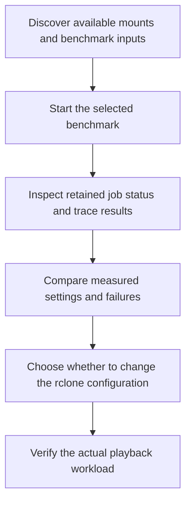

# Rclone optimizer API

Endpoint paths below are backend-native. Add `/api` when using the dashboard gateway, for example `http://localhost:3005/api/process/capabilities`.

<details class="geek-details" markdown="1">
<summary>Measure before changing settings</summary>

Benchmark and trace results are evidence for a settings decision. A comparison result does not by itself prove that the whole media workflow will perform better.



</details>

## Rclone streaming optimizer

These authenticated process routes are available when capability
`rclone_optimizer_infinidysk` is true. Only enabled DUMB-managed rclone instances
whose `key_type` is `InfiniDysk` are eligible.

| Method | Route | Purpose |
|---|---|---|
| `GET` | `/process/rclone-optimizer/instances` | List eligible InfiniDysk rclone instances and mount state |
| `GET` | `/process/rclone-optimizer/content?process_name=...` | Derive active InfiniDysk Arr categories, perform bounded `content/<category>` discovery, and return automatic recent/older/large/typical suggestions |
| `POST` | `/process/rclone-optimizer/jobs` | Start a persistent background benchmark job |
| `GET` | `/process/rclone-optimizer/jobs?limit=20` | List recent jobs for frontend notifications/history |
| `GET` | `/process/rclone-optimizer/jobs/{job_id}` | Return live progress, results, and report |
| `GET` | `/process/rclone-optimizer/latest?process_name=...&active_only=true` | Find the latest matching job |
| `POST` | `/process/rclone-optimizer/cancel` | Cancel an active test and clean up its shadow mount/cache |
| `POST` | `/process/rclone-optimizer/apply` | Merge the recommendation, stop rclone, verify the previous FUSE mount is detached, restart rclone, and verify the replacement mount is accessible and stable |
| `POST` | `/process/rclone-optimizer/rollback` | Restore the privately retained pre-apply command through the same verified-unmount and mount-readiness sequence |

## Start a benchmark

Start request:

```json
{
  "process_name": "rclone w/ InfiniDysk",
  "selected_paths": ["content/radarr-infinidysk/Example Movie (2026).mkv"],
  "depth": "standard",
  "limits": {
    "max_vfs_cache_gib": 5,
    "min_free_disk_gib": 10,
    "max_memory_mib": 2048,
    "max_test_download_gib": 4,
    "max_duration_minutes": 20,
    "concurrent_streams": 1,
    "startup_buffer_mib": 32,
    "bandwidth_limit_mbps": 0
  }
}
```

## Discovery and trace results

Content discovery returns `discovery_mode=active_arr_categories`, `content_base`,
and an `active_categories` list containing service, instance, category,
availability, and discovered-file count. Each file includes the mount-relative
`path` used by the job and a friendly `display_path` under InfiniDysk `content`.
`automatic_selection` is ordered first in `files` and includes `selection_key`,
`selection_label`, and `selection_reason` so clients can explain each suggestion
while allowing the operator to replace it.

Each candidate result includes `trace_capture`, which reports whether InfiniDysk
stream tracing was available, enabled or retained, the retained session count,
and overflow state. An unavailable capture is distinct from an available capture
whose retained sessions did not match the selected paths. The frontend aggregates
the candidate's `stream_traces` into unique providers plus summed retries, bytes
served, provider-wait time, and connection-wait time; these fields remain visible
as unavailable when `stream_traces` is empty.

## Interpret setting comparisons

Jobs include a `setting_model` that declares the five comparison roles:
`actually_varied`, `fixed_constraints`, `infinidysk_recommended`,
`bundled_assumptions`, and `preserved`. The InfiniDysk-recommended values are
`--dir-cache-time` and `--vfs-cache-max-age`; every candidate uses at least `1w`,
while existing values already at or above one week are retained. They are
operational guidance rather than score-selected benchmark dimensions. Jobs add
a warning when the associated InfiniDysk RC notification configuration is disabled,
mismatched, or unreachable.
Every candidate result includes `setting_comparison`, an ordered list of the
complete optimizer-relevant effective settings. Each entry contains `flag`,
`current_value`, `tested_value`, `changed_from_current`, `role`, and
`varied_across_candidates`. It also returns `independently_evaluated=false`
because even the actually-varied values move inside profiles rather than in
one-variable-at-a-time experiments. The recommendation repeats the winner's comparison
and includes `confidence_note` to make clear that the selected profile is a
bundle result rather than independent proof for every flag.

## Cleanup and retained jobs

Each accepted candidate result records
`shadow_mount_cleanup_verified=true`. Terminal jobs expose `cleanup` with
`shadow_mounts_verified`, `runtime_removed`, and `cache_removed`. A job is not
marked completed unless all three are true; an unverifiable cleanup changes the
job to failed and remains eligible for a later startup cleanup retry.

The response never returns the full saved, recommended, or rollback rclone command
because commands may contain RC credentials or other private values. Public job
records expose the complete optimizer-relevant setting comparison but not the
values of unrelated preserved flags. Job IDs are 32-character
hex values; job files are stored privately under `/config/rclone-optimizer/jobs`.
Jobs active during a DUMB restart are marked interrupted and are not resumed.

See [Rclone Streaming Optimizer](../features/rclone-optimizer.md) for test and
provider-safety behavior.
