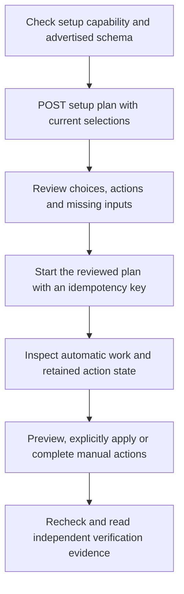

# Setup API

Endpoint paths below are backend-native. Add `/api` when using the dashboard gateway, for example `http://localhost:3005/api/process/capabilities`.

A reviewed plan becomes a retained run

A setup run reports automatic work and manual actions separately. Deferring an action does not make required work complete.

## Routes

Available when `GET /process/capabilities` advertises `setup_arrangements=true`. Browser requests use the usual `/api` prefix.

| Method | Endpoint | Purpose |
|---|---|---|
| POST | `/process/setup/plan` | Validate selections, discover choices and preview actions without changing application settings. |
| POST | `/process/setup/runs` | Start the reviewed plan with a stable client idempotency key. |
| GET | `/process/setup/runs/latest` | Read the latest run; 404 when none exists. |
| GET | `/process/setup/runs/{run_id}` | Read a retained run. |
| POST | `/process/setup/runs/{run_id}/retry` | Retry incomplete automatic work. |
| POST | `/process/setup/runs/{run_id}/recheck` | Recheck and refresh discoverable inputs. |
| POST | `/process/setup/runs/{run_id}/cancel` | Request cancellation of setup work; this is not service removal. |
| POST | `/process/setup/runs/{run_id}/actions/{action_id}` | Preview, apply, recheck, defer or confirm an action. |

## Plan fields and response

The plan extends existing onboarding selections with `arrangement: {values: {}, intent: {}}`. Use exact flat keys from `arrangement_schema.fields`; these identify resources and are not object paths. The schema supplies types, choices, defaults and conditional visibility. Nested `object` fields advertise relative child keys under `fields`; `list` fields advertise row fields under `item_fields`. Do not invent profile IDs or strip instance/options fields and retry arbitrary validation errors.

Responses include service identities/roles, actions, independent execution and verification, missing inputs, editable fields, links, schema and coverage. Credential-bearing values use presence markers. Never submit `[configured]` as a replacement credential.

### Native InfiniDysk runtime handoff

InfiniDysk runtime choices additionally require
`setup_infinidysk_runtime_choices=true` and `setup_infinidysk_runtime_protocol=1`,
plus the native workflow's API/version/protocol capabilities. The advertised
arrangement fields are `infinidysk::runtime_generation` and
`infinidysk::mount_backend`. These describe the proposed setup; generic
`service_options` cannot authorize a major transition or replace native paths.
A required `native_transition` action supplies
`native_transition: {runtime_generation: "2", mode: "fresh" | "migrate", mount_backend: "rclone" | "fuse"}`
for the existing guarded native wizard. It is a handoff, not a new execution
endpoint or approval. Setup start remains blocked until that transition has
completed and a fresh plan confirms the actual configuration. Existing native
installations retain their detected topology; generation 1 settings adapters do
not run against generation 2.

## Start and retry a run

Start accepts `{"plan_id": "<reviewed-plan-id>", "idempotency_key": "<stable-client-request-id>"}`. Keep the same key when retrying an uncertain response; changed choices need a fresh reviewed plan.

## Apply or recheck an action

An action request has `{"operation": "apply", "values": {}}`; other operations are `recheck`, `defer` and `confirm`. Actions advertising `previewable=true` also accept `preview`, an inspection without native application writes. The returned `evidence.changes` describes current/proposed fields with secrets hidden; adoption consent includes the advertised source's `adoption_preview_id` and `adopt_existing` fields and is bound to that proposal. Refresh stale proposals before applying them. Manual confirmation is user attestation, not machine verification. Deferring required work does not complete it.

Actions advertising `explicit_only=true` require a deliberate action-level Apply. Starting or retrying the arrangement does not authorize consumer-file or workflow probes. Use their advertised scope, authorization and size/time-limit fields and retain partial or unavailable verification honestly.

## Status and retained state

Run statuses include `pending`, `running`, `waiting_input`, `partial`, `complete`, `failed` and `interrupted`. Use returned status/results, not timers or process counts. Protect backups of `/config/.dumb-setup` as credential-bearing state.

See [Setup checklist and automation](../features/setup-checklist.md) for account reuse, manual tasks and coverage.
