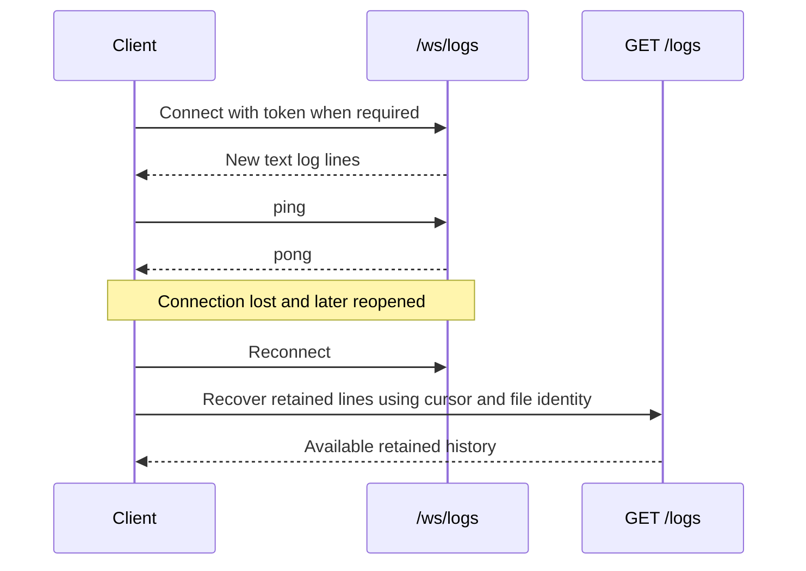

# WebSocket Logs API

Connect to `/ws/logs` for DUMB's live log stream. The frontend forwards the path unchanged; use `ws://<host>:3005/ws/logs` or `wss://` for HTTPS deployments.

When DUMB authentication is enabled, provide an access token using the [WebSocket authentication rules](websocket.md#authentication).

<details class="geek-details" markdown="1">
<summary>Live logs and retained history</summary>

The WebSocket delivers new lines. It does not replay missed lines after reconnection; the REST log endpoint provides the separate retained-history path.



</details>

## Messages and filtering

Log messages arrive as text, for example:

```text
Apr 12, 2025 10:04:01 - INFO - Riven Backend started
```

The connection receives the shared stream. Filter by process name, level, or search text in the client; `/ws/logs` does not take a server-side process filter.

Both `ping` and `{"type":"ping"}` receive the text response `pong`.

## Reconnect and recover history

The server does not replay missed log lines after a reconnect. Reconnect to `/ws/logs`, then use [GET /logs](logs.md) to recover retained history when needed. Keep the REST cursor and file identity to detect rotation.

Log responses use DUMB's redaction. Review diagnostics before sharing them; native application log files may follow different logging rules.

## Python example

This example requires the third-party `websockets` package. Set `DUMB_ACCESS_TOKEN` when authentication is enabled.

```python
import asyncio
import os
from urllib.parse import urlencode

import websockets

async def consume_logs():
    query = urlencode({"token": os.environ["DUMB_ACCESS_TOKEN"]})
    uri = f"ws://localhost:3005/ws/logs?{query}"
    async with websockets.connect(uri) as websocket:
        async for message in websocket:
            if message != "pong":
                print(message)

asyncio.run(consume_logs())
```

See [WebSocket API](websocket.md) for status, metrics, connection errors, and reconnection behavior.
