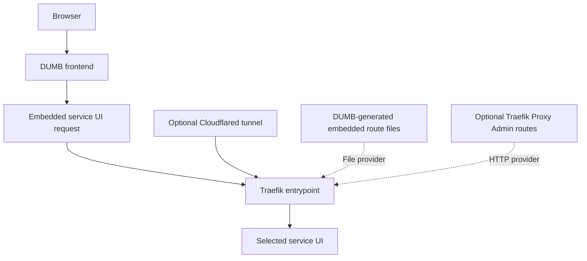

# Traefik proxy

Traefik provides optional reverse-proxy routing for service UIs and user-managed external routes. When enabled, it exposes a single entry point and maps requests to services through DUMB-generated dynamic config and, optionally, Traefik Proxy Admin. Cloudflared can then carry Cloudflare Tunnel traffic to that same entrypoint.

## Route owners and request paths

DUMB owns embedded UI routes. Traefik Proxy Admin owns optional user-managed routes; Cloudflared can carry external traffic to the Traefik entrypoint.



## What Traefik does in DUMB

- Builds dynamic routes for enabled embedded service UIs
- Adds path prefixes for UI services under `/service/ui/<service>`
- Supports embedded iframes in the frontend
- Can poll Traefik Proxy Admin for user-managed host-based reverse proxy routes
- Can load the optional DUMB-managed Authelia ForwardAuth middleware
- Can receive public traffic through the optional Cloudflared service

## Default access

| Component | Default |
|-----------|---------|
| Traefik entrypoint | `http://<host>:18080/` |
| DUMB API (Scalar) | `http://<host>:18080/service/ui/dumb_api_service/scalar` |
| DUMB Frontend | `http://<host>:3005/` (published directly, not through the embedded-service route set) |

!!! info "Path prefixes"

    Media applications may enter through a web asset directory such as `/web`. Their native API and media paths still live at the application root; do not prepend `/web` to every request.

## How routes are generated

The backend generates Traefik config based on enabled services and their ports. Services with UIs are registered automatically when they are enabled in `dumb_config.json`.

The generated configuration has separate owners:

| Owner | Purpose | Location or endpoint |
|-------|---------|----------------------|
| DUMB | Static Traefik configuration | `/config/traefik/traefik.yml` |
| DUMB | Embedded UI dynamic routes | `/config/traefik/dynamic/services.yaml` |
| DUMB | Optional custom dynamic routes from `traefik.services`/`traefik.middlewares` | `/config/traefik/dynamic/dynamic_config.yml` |
| DUMB | Optional Authelia ForwardAuth middleware | `/config/traefik/dynamic/authelia.yml` |
| Traefik Proxy Admin | User-managed reverse proxy routes | `http://127.0.0.1:3004/api/traefik/config` |

Traefik watches `/config/traefik/dynamic` with the file provider. When Traefik Proxy Admin is enabled, DUMB also adds Traefik's HTTP provider pointed at TPA's generated config endpoint.

In practice:

- DUMB can safely regenerate embedded UI routes whenever services change.
- TPA can manage host-based routes, auth, and middleware without DUMB overwriting them.
- The Authelia wizard can publish `dumb-authelia-forward-auth@file`, which TPA
  may attach to selected routes.
- Cloudflared can bring external traffic to Traefik without replacing either DUMB's routes or TPA's routes.

## Configuration example

```json
"traefik": {
  "enabled": false,
  "process_name": "Traefik",
  "pinned_version": "v3.6.6",
  "suppress_logging": false,
  "log_level": "INFO",
  "log_file": "/log/traefik.log",
  "access_log_file": "/log/traefik_access.log",
  "port": 18080,
  "entrypoints": {
    "web": {
      "address": ":18080"
    }
  },
  "command": [
    "/traefik/traefik",
    "--configFile=/config/traefik/traefik.yml"
  ],
  "config_dir": "/config/traefik",
  "config_file": "/config/traefik/traefik.yml"
}
```

This excerpt shows the main settings; the running schema/template is authoritative for additional fields. `pinned_version` selects the Traefik binary DUMB installs. The config and both
log paths live under the persistent `/config` and `/log` mounts. DUMB rewrites
its generated route files when service UI definitions change; put operator-owned
host routes in Traefik Proxy Admin rather than editing `services.yaml` by hand.

## Security considerations

!!! warning "Embedded routes do not add auth"

    DUMB's generated embedded-service routes do not add an authentication
    middleware. Some upstream apps have their own login and some do not. If you
    expose Traefik outside your LAN, use protected TPA routes, Cloudflare Access,
    or another deliberate authentication layer and verify it before publishing.

Do not protect the Authelia portal with its own ForwardAuth middleware. Also
avoid combining the Authelia ForwardAuth middleware with TPA Service SSO on one
router unless two sequential login gates are intentional.

## Related pages

- [Embedded UIs](../features/embedded-ui.md)
- [Traefik Proxy Admin](../services/optional/traefik-proxy-admin.md)
- [Authelia](../services/optional/authelia.md)
- [Cloudflared](../services/optional/cloudflared.md)
- [Service ports](../reference/ports.md)
