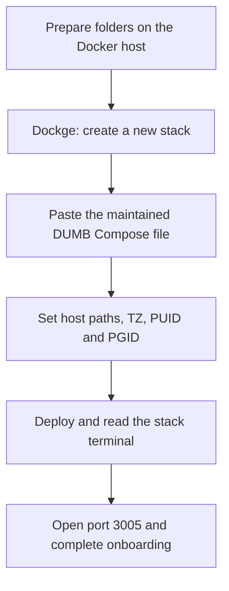

# Deploy with Dockge

[Dockge](https://github.com/louislam/dockge) manages file-backed Docker Compose
stacks. DUMB does not need a Dockge-specific image: use the maintained DUMB
Compose file and replace its example host paths.

## Create the Dockge stack

Dockge manages the Compose stack; DUMB's dashboard manages the selected applications after the stack starts.



## Prerequisites

- Docker Engine and Docker Compose v2
- A working Dockge installation connected to the target Docker host
- A numeric UID/GID with access to the persistent directories
- `/dev/fuse` on the host if the selected workflow uses a FUSE or rclone mount

Dockge stores each stack as a normal `compose.yaml`. Its stacks directory must be
mounted at the same path inside the Dockge container as on the host. See the
[Dockge installation and stacks documentation](https://github.com/louislam/dockge#how-to-install).

## Prepare persistent storage

Run this on the Docker host, not in the Dockge web terminal:

```bash
sudo install -d -o 1000 -g 1000 /opt/dumb
sudo install -d -o 1000 -g 1000 /opt/dumb/{config,log,data,mnt,mnt/debrid}
```

Replace `1000` with the nonzero UID and GID you will use for DUMB. These commands prepare new directories. For an existing installation, inspect its current ownership and mounts before changing them; do not recursively change the whole tree.

## Create the stack

1. In Dockge, choose **Compose** or **New Stack**.
2. Name the stack `dumb`.
3. Paste the current
   [DUMB Compose file](https://github.com/I-am-PUID-0/DUMB/blob/master/docker-compose.yml).
4. Replace `/home/username/docker/DUMB` with `/opt/dumb`.
5. Set `TZ`, `PUID`, and `PGID`.
6. Deploy the stack and follow its terminal output.

The resulting storage and port section should resemble:

```yaml
services:
  DUMB:
    image: iampuid0/dumb:latest
    container_name: DUMB
    volumes:
      - /opt/dumb/config:/config
      - /opt/dumb/log:/log
      - /opt/dumb/data:/data
      - /opt/dumb/mnt/debrid:/mnt/debrid
    environment:
      - TZ=UTC
      - PUID=1000
      - PGID=1000
    ports:
      - "3005:3005"
```

Keep the `devices`, `cap_add`, and `security_opt` entries from the maintained
Compose file when the stack uses FUSE. Remove `/dev/dri` only when the host does
not provide it and no selected service needs hardware acceleration.

## External media-server mounts

Prepare the producer host path as a shared Linux mount before relying on
`rshared`/`rslave`. Compose propagation flags alone do not change the host
mount. Check both the producer and consumer mount namespaces.

If Plex, Jellyfin, Emby, or an Arr runs in another container and must see a
submount created inside DUMB, change the DUMB mount to:

```yaml
- /opt/dumb/mnt/debrid:/mnt/debrid:rshared
```

Mount the same host path into each consumer at `/mnt/debrid` with `rslave` (or an
equivalent propagation mode). This is unnecessary when all consumers run inside
DUMB or the workflow exposes ordinary files/symlinks without a propagated
submount.

## Verify and update

- Open `http://<docker-host>:3005`.
- Check the Dockge stack terminal or DUMB container logs if startup fails.
- Update by pulling the new image and redeploying the stack; do not delete the
  four persistent host directories.

Continue with [Getting Started](../getting-started/index.md) or review the
[configuration model](../features/configuration.md).
