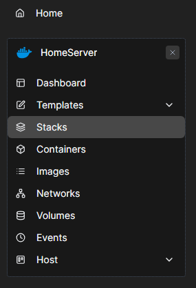
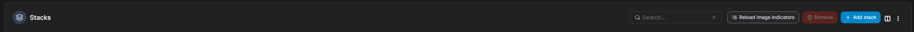
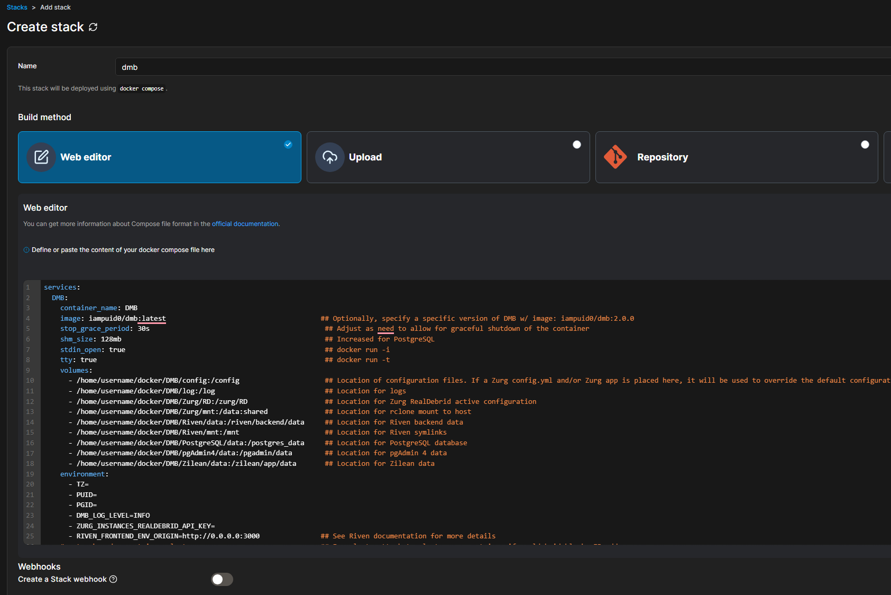
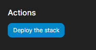

# Deploy with Portainer

Use a Portainer stack to manage DUMB's Compose configuration. You need a running Docker environment in Portainer and permission to deploy a stack to it.

If Portainer is not installed, follow its [official Docker installation guide](https://docs.portainer.io/start/install-ce/server/docker/linux). For Docker installation, use [Docker Engine's supported packages](https://docs.docker.com/engine/install/). Avoid the Snap build for DUMB's FUSE workflows.

## 1. Prepare paths on the Docker host

Create persistent directories on the machine running Docker, not merely on the machine where your browser or Portainer server runs:

```bash
mkdir -p "$HOME/docker/DUMB"/{config,log,data,mnt/debrid}
id -u
id -g
```

Use the absolute path and nonzero IDs from the account that should own application data. Portainer stack files do not reliably expand `~`.

## 2. Prepare the Compose file

Copy the maintained [DUMB Compose file](https://github.com/I-am-PUID-0/DUMB/blob/master/docker-compose.yml), or download it:

```bash
curl --fail --show-error --location \
  https://raw.githubusercontent.com/I-am-PUID-0/DUMB/master/docker-compose.yml \
  --output docker-compose.yml
```

Before deploying, edit:

- The four host paths: replace `/home/username/docker/DUMB` with your absolute directory.
- `PUID` and `PGID`: use nonzero IDs with access to those directories.
- `TZ`: use your time zone, for example `Etc/UTC`.
- Device mappings: keep `/dev/fuse` and its required capability/security options for FUSE workflows. Remove `/dev/dri` if the Docker host has no such device.
- Image: use the stable `latest` image or the intended development image. Keep the [docs channel](../reference/doc-versions.md) aligned.

The standard file publishes `3005` for dashboard, API, WebSockets, and embedded UI access. A normal private `/mnt/debrid` bind works for consumers inside DUMB. See [mount planning](../getting-started/installation.md#decide-who-reads-the-library) before enabling propagation for external consumers.

## 3. Deploy the stack

1. Open Portainer and select the intended Docker environment.
2. Choose **Stacks** → **Add stack**.
3. Enter `dumb` as the stack name.
4. Choose **Web editor** and paste the reviewed Compose file.
5. Select **Deploy the stack**.

??? example "Portainer screens"

    Labels may differ by Portainer version.

    
    
    
    

## 4. Verify startup

Open **Containers**, select DUMB, then open **Logs**. Follow startup and check any reported installation or permissions error.

Open `http://<docker-host>:3005` and complete [onboarding](../frontend/onboarding.md). Check that the host address belongs to the selected Docker environment; a remote agent's containers do not run on the Portainer server by default.

For a diagnostic shell, use the container's **Console** action and select `/bin/bash` or `/bin/sh`. This is separate from attaching to the container's existing main process.

## Direct application ports

Add mappings only when another client needs direct access, for example:

```yaml
ports:
  - "3005:3005"
  - "7878:7878" # Radarr, if its actual assigned port is 7878
```

Update the stack after changing mappings. See [Service ports](../reference/ports.md) and [Networking](networking.md).

The DUMB backend on `8000` is loopback-only by default. Prefer the gateway at `:3005/api/...`; a Portainer port mapping alone does not expose the backend listener.

## Update the DUMB image

1. Open **Stacks** → `dumb` → **Editor**.
2. Review Compose changes against your existing paths and settings. Preserve your values rather than replacing the file blindly.
3. Select **Update the stack** and choose the option to re-pull the image when offered.
4. Check the container logs and dashboard after replacement.

Application auto-updates inside DUMB do not update the DUMB image itself. Keep `/config`, `/data`, `/log`, and library mounts across replacement, and keep a separate backup before upgrades.
