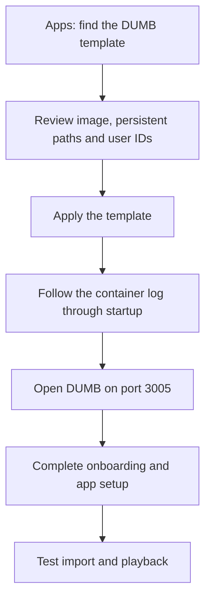

# Deploy DUMB on Unraid

Deploy DUMB from the Community Applications template when it is available, or
add it as a Compose stack/container using the maintained settings below. The
same persistence and path rules apply to both methods.

## Install and check the Unraid container

The application template sets up the container. The first import and playback check happens after DUMB and the selected apps have been configured.



## Prerequisites

- Unraid with Docker enabled
- Community Applications for the template-based path
- A persistent appdata directory and sufficient space for selected services
- A UID/GID that owns the mapped directories
- `/dev/fuse` access for workflows that create rclone/FUSE mounts

## Install from Community Applications

1. Open **Apps**, search for `DUMB`, and select the Distributed Unlimited Media Bridge
   template.
2. Confirm the image is `iampuid0/dumb:latest` (or the release tag you intend to
   run).
3. Configure the four persistent mappings shown below.
4. Set `TZ`, `PUID`, and `PGID` to values that can access those shares.
5. Keep `/dev/fuse`, `SYS_ADMIN`, and the required security settings when your
   workflow uses FUSE.
6. Apply the template and follow the container log through first startup.

The common Unraid `nobody:users` identity is `99:100`, but do not copy those
values blindly. Use the owner of your appdata/media paths, and correct existing
directory permissions before starting DUMB.

## Persistent path mappings

Use a layout such as:

| Unraid host path | Container path | Purpose |
|---|---|---|
| `/mnt/user/appdata/DUMB/config` | `/config` | Runtime configuration, auth, metrics, jobs |
| `/mnt/user/appdata/DUMB/log` | `/log` | DUMB and managed-service logs |
| `/mnt/user/appdata/DUMB/data` | `/data` | Service-specific persistent application data |
| `/mnt/user/appdata/DUMB/mnt/debrid` | `/mnt/debrid` | Mounts, links, and library trees |

Do not replace the `/data` mapping with a generic `/mnt` mapping. DUMB maps
internal paths such as `/plex`, `/altmount`, and `/postgres_data` into the
persistent `/data` tree.

If you deploy through Compose, start from the current
[DUMB Compose file](https://github.com/I-am-PUID-0/DUMB/blob/master/docker-compose.yml)
and replace `/home/username/docker/DUMB` with `/mnt/user/appdata/DUMB`.

## Open DUMB

The maintained deployment publishes the frontend at:

```text
http://<unraid-address>:3005
```

The frontend proxies DUMB API calls under `/api`. The backend-native `8000`
listener remains private by default; do not publish it for ordinary use.

## Share library paths with another container

Use the same container-visible path in DUMB and the external Plex, Jellyfin,
Emby, Sonarr, Radarr, or other consumer:

```text
/mnt/debrid
```

Then select the curated library produced by your workflow, for example:

- `/mnt/debrid/riven_symlinks`
- `/mnt/debrid/clid_symlinks`
- `/mnt/debrid/decypharr_symlinks`
- `/mnt/debrid/infinidysk-symlinks`
- `/mnt/debrid/combined_symlinks`
- the AltMount import directory configured for that instance

Do not point a media library at an entire raw provider mount unless that is
explicitly the workflow you designed.

### Mount propagation

Prepare the producer host path as a shared Linux mount before relying on
`rshared`/`rslave`. Compose propagation flags alone do not change the host
mount. Check both the producer and consumer mount namespaces.

When DUMB creates a nested FUSE/rclone mount that another container must see:

- DUMB's host bind must be `rshared`.
- Consumer containers should mount the same host path with `rslave` (or an
  equivalent slave propagation mode).
- Restart consumers after changing propagation settings and verify the nested
  mount from inside each container.

Propagation is unnecessary for ordinary symlink/file trees and when every
consumer runs inside DUMB.

## Permissions

Check the selected IDs and the exact directory before changing ownership:

```bash
id <user>
ls -ld /mnt/user/appdata/DUMB /mnt/user/appdata/DUMB/{config,data,log}
```

DUMB's controller prepares service ownership at startup. Do not recursively
`chown` the entire DUMB tree: private controller state under `/config` can
intentionally have a different owner from managed applications, and a nested
media mount can expose a much larger tree than expected. Fix only the specific
incorrect host directory after stopping its writers and checking its mounts.

## Troubleshooting

View the container log from the Docker tab, or inspect from an Unraid terminal:

```bash
docker logs -f DUMB
docker exec -it DUMB bash
docker exec DUMB findmnt -R /mnt/debrid
```

Do not install ad-hoc tools into the running container; those changes disappear
on recreation and can alter the supported runtime. Useful checks are already
available through the DUMB UI, logs, and standard Ubuntu utilities in the image.

Common causes of failure are:

- incorrect appdata ownership or mismatched `PUID`/`PGID`
- missing `/dev/fuse` or `SYS_ADMIN` for a FUSE workflow
- inconsistent paths between DUMB and external consumers
- missing `rshared`/`rslave` propagation for nested mounts
- a host port already in use

Continue with [Getting Started](../getting-started/index.md), then review
[Service ports](../reference/ports.md) before publishing any additional UI.
