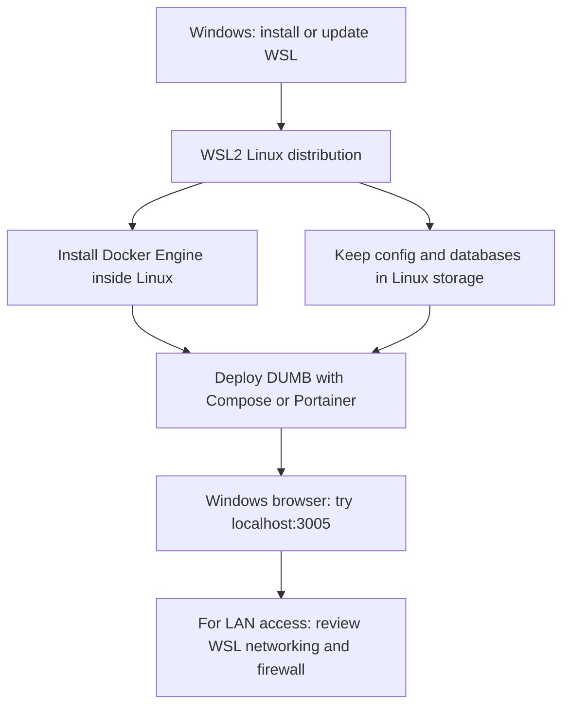

# Deploy with WSL2

Run Docker Engine inside a WSL2 Linux distribution. This gives DUMB the Linux mount behavior needed by FUSE/rclone workflows. Docker Desktop does not support sharing these submounts through bind propagation.

Avoid running both Docker Desktop integration and a separate Docker Engine against the same distribution without an explicit plan. Check which Docker daemon your CLI targets before deploying.

## Windows and Linux responsibilities

Run the Docker commands and keep application data inside WSL's Linux filesystem. Windows reaches the published dashboard through the configured WSL network.



## 1. Install or update WSL

In **PowerShell as administrator**, install WSL if needed:

```powershell
wsl --install
```

Restart Windows if prompted, open the installed Linux distribution, and create a non-root Linux user. For an existing WSL installation:

```powershell
wsl --update
wsl --list --verbose
```

The chosen distribution must show version `2`. To select or convert a distribution, use its exact name from the list:

```powershell
wsl --set-default <DistroName>
wsl --set-version <DistroName> 2
```

See [Microsoft's WSL installation guide](https://learn.microsoft.com/en-us/windows/wsl/install) for supported Windows versions and installation troubleshooting. Choose a distribution supported by Docker Engine rather than an old version solely to match a screenshot.

## 2. Install Docker Engine in Linux

Inside WSL, follow Docker's [Ubuntu](https://docs.docker.com/engine/install/ubuntu/) or [Debian](https://docs.docker.com/engine/install/debian/) package instructions. Check that systemd and Docker are available:

```bash
ps -p 1 -o comm=
sudo systemctl status docker
docker compose version
```

If the distribution does not use systemd, follow [Microsoft's systemd instructions](https://learn.microsoft.com/en-us/windows/wsl/systemd). WSL and Docker must be running for DUMB to remain available; plan startup after Windows restarts separately.

Keep DUMB's configuration and databases in the Linux filesystem, for example `$HOME/docker/DUMB`, rather than a Windows-mounted directory under `/mnt/c`.

## 3. Deploy DUMB

Choose one path:

- [Docker Compose](docker.md) for terminal management.
- [Portainer](portainer.md) for a web interface.

Deploy once using the chosen method. The Docker host in those guides is the WSL Linux distribution.

Try `http://localhost:3005` from Windows after startup. If you need LAN access or access through the Windows host's IPv4 address, review mirrored networking below and the Windows/Hyper-V firewall rules.

## Mirrored mode networking

On supported Windows 11 versions, WSL can mirror Windows network interfaces. See [Microsoft's WSL networking documentation](https://learn.microsoft.com/en-us/windows/wsl/networking#mirrored-mode-networking) for current requirements and limitations.

Open `%UserProfile%\.wslconfig` from PowerShell:

```powershell
notepad $env:USERPROFILE\.wslconfig
```

Merge these settings into the existing file:

```ini
[wsl2]
networkingMode=mirrored

[experimental]
hostAddressLoopback=true
```

`hostAddressLoopback` allows Windows and WSL to reach each other through IPv4 addresses assigned to the Windows host, in addition to loopback. It only applies in mirrored mode. Optional `autoProxy=true` belongs under `[wsl2]` when Windows proxy propagation is needed.

Apply the changes when it is safe to stop **all** WSL distributions:

```powershell
wsl --shutdown
wsl
```

Windows Firewall and the Hyper-V firewall can still block inbound connections. Allow the intended DUMB listener on trusted networks rather than assuming mirrored mode publishes every service. See [WSL advanced settings](https://learn.microsoft.com/en-us/windows/wsl/wsl-config).

## External consumers of FUSE mounts

All-in-one workflows do not need propagation to the WSL host. External Linux containers reading DUMB-created submounts need a shared host mount and matching bind propagation. Prepare only the intended host mount rather than changing the entire filesystem's propagation without review.

The propagation state must be restored after WSL restarts. See the [rclone mount-propagation guide](../faq/rclone.md#ubuntu-systemd-service), and verify the nested mount from the consumer container before relying on playback.

Windows Explorer access to `\\wsl.localhost\<DistroName>\...` is a separate sharing path. It does not establish that a Windows media server can follow Linux symlinks or use every FUSE mount correctly. Test the exact consumer.

To browse a Linux directory in Explorer:

```bash
explorer.exe .
```

Use [Networking and ports](networking.md) when choosing Docker bridge mappings or host networking.
