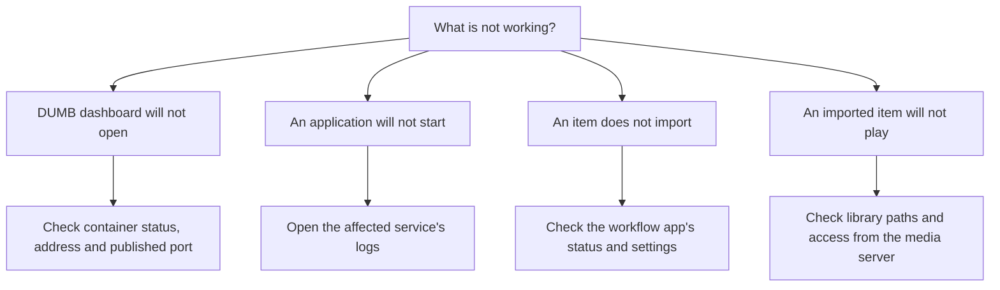

# General FAQ

Answers about storage, service choices, backups, and media paths.

---

## Find the next check

Start with the part that is failing. Opening the dashboard, starting an app, importing an item and playing it are separate checks.



## Where do I configure services?

Open the service card in DUMB. **DUMB Config** controls how DUMB starts and updates it; save those changes with **Save to File**. **Embedded UI** opens the application's own interface for accounts, libraries and everyday tasks. **Service Config**, when available, edits its underlying settings and uses **Save Service Config**.

Start with the service guide's first-start steps. Enable **Geek mode** for API, shell and configuration alternatives or to understand how the connections work. Required setup, account requirements and support links remain available in the ordinary guide.

## Will DUMB use a lot of storage space?

Budget for application runtimes, databases, logs, backups, and caches even when media is streamed remotely. rclone VFS caching and Usenet client caches can consume substantial disk space; local downloads and book libraries need their full file capacity. Size the data and cache filesystems for your chosen workflow.

!!! tip "VFS Cache Management"
    If you're using VFS cache (recommended for Plex), ensure that the cache size is managed appropriately. See the [rclone configuration](../services/dependent/rclone.md) for more.


## Do I need to install every service?

No. Select the services you need during onboarding, or enable them from their DUMB service pages. Check each workflow's dependencies before disabling a supporting service.

!!! info "Service Types"
    Some [core services](../services/core/index.md) (like `riven_backend`, `cli_debrid`, etc.) provide core functionality and have required [dependent services](../services/dependent/index.md) (like `zurg`, `rclone`, `postgres`, etc.), but others (like `pgadmin`) are [optional service](../services/optional/index.md) tools to help you manage your setup.


## Can I run DUMB offline?

!!! warning "Internet Required"
    Most DUMB services interact with external APIs (e.g., Real-Debrid, Plex, Trakt, TMDB, etc.), so **internet access is required** for normal operation. However, local database tools (e.g., pgAdmin) and UIs may still function offline for inspection.


## What happens when I update DUMB?

Published DUMB images include a tested snapshot of many service runtimes, but
image publication does not guarantee an immediate rebuild for every upstream
release. For more info, see the [DUMB FAQ](../faq/dumb.md#does-the-dumb-image-have-the-latest-version-of-x)
for how bundled and runtime-installed versions differ.

Alternatively, DUMB also includes **auto-update** functionality for most [services](../services/index.md). Depending on your configuration (`auto_update` and `auto_update_interval`), the system will check for new versions of services like Zurg, Riven, Zilean, etc.

Open the service card, select **DUMB Config**, review its update settings and choose **Save to File**. See [Service Updates](../features/auto-update.md) before enabling automatic installation or changing source channels.


## Is DUMB secure?

DUMB is intended to run on a **local or deliberately protected server**. The
maintained Compose file publishes only the frontend on port `3005`; the backend
API is loopback-only and managed service ports are not host-published unless you
add them.

!!! warning "Security Considerations"
    DUMB authentication protects the frontend and backend API, but it does not
    automatically add authentication to every upstream service UI or to DUMB's
    generated embedded Traefik routes. Some upstream apps have their own login;
    others do not.

    Before external exposure, enable DUMB auth, protect each published route
    with upstream auth, TPA/SSO, Cloudflare Access, or another verified layer,
    use HTTPS, and restrict unnecessary ports with a firewall.


## Can I use my own custom version of a service?

Yes. Open the service's **DUMB Config** to review source and version settings, then **Save to File**. Read [source selection and update modes](../features/auto-update.md) before changing a working service. Custom source settings and manual JSON examples are available in the service guide's Geek sections.


## Can I back up my DUMB setup?

Yes. Protect at least:

- `/config` (including `dumb_config.json`, users, feature state, and jobs)
- `/data` (the current consolidated persistence root for managed service data)
- curated symlink/library state below `/mnt/debrid` when it cannot be recreated
- Any deliberately configured external/direct service-data mounts

!!! tip "Backup Strategy"
    Regularly backing these up allows you to quickly restore your environment.

!!! warning "Separate links from live mounts"
    Do not recursively archive a live FUSE/rclone provider submount below
    `/mnt/debrid`; that can traverse and download the remote library. Back up
    only the ordinary symlink/manifest directories you need, or stop/unmount the
    provider and use a backup tool that does not follow symlink targets or cross
    filesystem boundaries.


## Can I monitor the system?

Yes — the DUMB Frontend shows real-time logs, service logs, service status, and allows interactive config management. You can also access logs from the filesystem or via the DUMB API (see [API docs](../api/index.md)).


## What's the difference between using rclone/Zurg mounts vs. symlinks (Riven, CLI Debrid, Decypharr, etc.) in my media server?

DUMB supports **two methods of exposing content to your media server**, each with its own use case:

=== "Direct Mount (Zurg/rclone)"

    Mounting the WebDAV or remote storage directly using `rclone` (which often connects to a Zurg instance) gives you full access to all files in your debrid account.

    **Pros:**

    - Access to **all debrid content**, including content not added by Riven
    - Instant visibility of new files from your debrid service
    - Useful for manual browsing or catching content missed by automation
    - Allows content orchestration with [Debrid Media Manager](https://github.com/debridmediamanager/debrid-media-manager) (DMM)
    - Less complexity when sharing mounts across the host or network

    **Cons:**

    - File/folder naming is often **inconsistent or messy**
    - Can lead to **Plex/Emby/Jellyfin misidentification**
    - Media scanners may perform poorly due to large, unorganized libraries

=== "Symlinked Mount (Riven/CLI Debrid/Decypharr/InfiniDysk)"

    Services like Riven, CLI Debrid, or Decypharr create cleanly named **symlinks** pointing to content in the underlying Zurg/rclone mount (usually in a shared directory like `/mnt/debrid/riven`). 

    These symlinks are stored in a separate directory (like `/mnt/debrid/riven_symlinks`) and represent only **curated content** that has been identified and processed.

    **Pros:**

    - Only includes content that's been properly scraped and sorted
    - Directory structure and filenames are optimized for media servers
    - More accurate **library scans** and faster detection
    - Ideal for fully automated Plex/Emby/Jellyfin setups

    **Cons:**

    - Only includes what has been processed — not your full debrid library
    - Requires the service to stay running and correctly configured
    - If settings are misconfigured, some content may not appear
    - Losing the application database can lose library ownership and acquisition history; symlinks alone may not reconstruct it
    - Symlinks add complexity by requiring your media server to share the same exact container paths as defined in DUMB's `dumb_config.json` — e.g., `/mnt/debrid` must exist **exactly** the same inside your media server container or on the host when the media server is not containerized  


## Host-Based Media Server: Mount Path Consistency

If your media server (such as Plex) runs **directly on the host** (not in Docker), it will access media files using the host's file system. In this setup, any symlinks created inside the DUMB container must resolve correctly **on the host**. This means the media paths inside the container must exactly match the paths used by the host.

DUMB's generated media links commonly use absolute targets. If those paths don't exist or don't match outside the container, the symlinks will be broken or unusable by the media server.

If the media server runs outside DUMB, the operator must make the same content reachable at the same absolute paths. Selecting a different folder in the media-server UI cannot repair a broken link target. Review the [deployment guides](../deployment/index.md) before moving a working library.

<details class="geek-details" markdown="1">
<summary>Geek details: host bind mounts and manual path configuration</summary>

### Example: Using Riven's Symlink Media Directory

Suppose your media is mounted on the host at:

```
/docker/DUMB/mnt/debrid
```

Since Plex (or another media server) and the DUMB container need to both access this path and resolve symlinks, your Docker bind mount must look like:

```yaml
/docker/DUMB/mnt/debrid:/docker/DUMB/mnt/debrid
```

!!! note "This differs from the default `/docker/DUMB/mnt/debrid:/mnt/debrid` mapping by preserving the host's absolute path inside the container."


Then, inside the `dumb_config.json`, you would also need to make sure you define the updated internal path for symlinks:

```json
{
"riven_backend": {
  "symlink_library_path": "/docker/DUMB/mnt/debrid/riven_symlinks"
}
}
```


This ensures that any symlinks Riven creates will remain valid on the host.


### Simplified Approach Using Standard Paths

To simplify configuration and reduce the need to hardcode deep paths, you can instead use standard directory mounts like `/mnt`.

Docker Compose example:

```yaml
/mnt/debrid:/mnt/debrid
```

And then update the configuration:

!!! note "The below is the default path used in the container when configured through the onboarding process"

```json
{
"riven_backend": {
  "symlink_library_path": "/mnt/debrid/riven_symlinks"
}
}
```

Using one shared absolute path reduces mapping errors. It still needs to exist and contain the same mounted content in every consumer.


!!! tip "also review the [Default Mount Structure](../services/dependent/rclone.md#default-mount-structure) and [Mount Propagation](../services/dependent/rclone.md#mount-propagation) sections for additional details!"

</details>

## Related Pages

- [Configuration Guide](../features/configuration.md)
- [Service Overview](../services/index.md)
- [DUMB Frontend](../services/dumb/dumb-frontend.md)
- [Deployment](../deployment/index.md)
