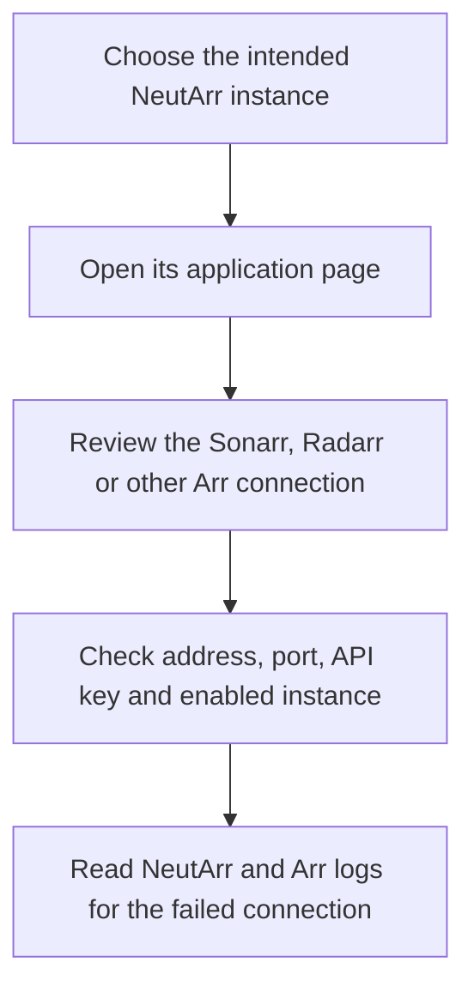

# NeutArr FAQ

Common questions and fixes for NeutArr in DUMB.

## Check the selected Arr connections

Use the intended NeutArr instance and inspect its configured Arr connections. A running page does not prove that it can reach the selected Arr applications.

## Why is the NeutArr UI not loading?

Check the following:

- Confirm the service is enabled in `dumb_config.json`.
- Verify the port in the service configuration (default `9705`).
- Review the NeutArr logs for startup errors.

!!! tip "Traefik access"

    Open the specific NeutArr instance's **Embedded UI** tab. The dashboard selects its route and assigned port.

## Why doesn't NeutArr see my Arr instances?

NeutArr relies on Arr API access.

- Ensure the intended Sonarr, Radarr, Lidarr, or Whisparr instance is running and reachable.
- In the Arr's DUMB settings, enable its NeutArr integration (`use_neutarr`).
- Check API-key discovery and any workflow filter on the NeutArr instance. A filter only includes Arr instances whose workflow selections overlap.

<!-- dev:start -->
If the setup checklist retains exact Arr targets for this NeutArr instance, review those selections as well.
<!-- dev:end -->

## Which NeutArr instance should I use?

DUMB supports multiple NeutArr instances for different workflows.

!!! info "Instance ports"

    - Default instance: `9705`
    - Additional instances: choose unique ports
