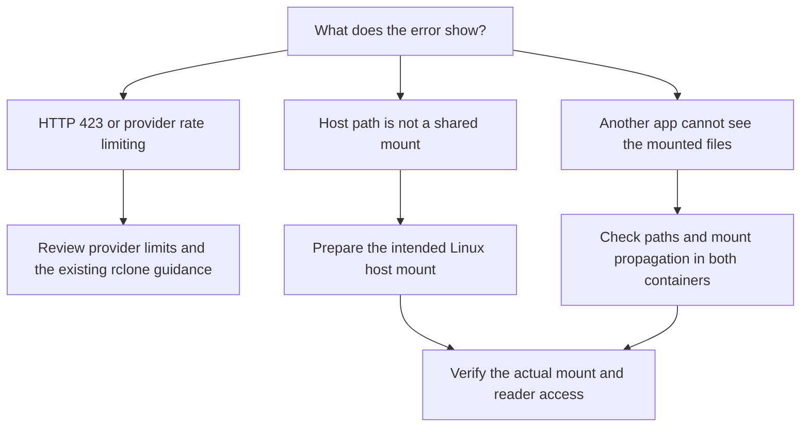

# rclone FAQ

## Separate provider throttling from mount visibility

An HTTP 423 response and a missing nested mount are different problems. Follow the matching branch before changing mount flags or provider settings.



## I think I might be rate limited by the debrid service - seeing `423` errors.

HTTP `423 Locked` means the requested resource is locked or unavailable. It can appear while a provider is preparing content as well as during provider-side limits. Check Zurg or the source service's logs alongside rclone's error before deciding which limit applies.

To reduce rclone HTTP transaction frequency, the correct variable is:

```env
RCLONE_TPSLIMIT=10
```

The earlier spelling `RCLONE_TSP_LIMIT` is invalid. `10` is an example, not a guaranteed provider allowance. A request limit does not cap streaming bandwidth or coordinate every other application using the same provider. Also review [Plex background analysis](plex.md#recommended-library-settings) and any other consumers.

See the official [rclone `--tpslimit` reference](https://rclone.org/docs/#tpslimit-float).

## How do I filter mounted files by resolution?

These filters use filename matching; they do not inspect a video's actual resolution. An exclusion can also hide a file referenced by an existing symlink, so test on a small listing before changing a production mount.

| Goal | Docker environment variable |
|---|---|
| Hide names containing `1080`, `720`, or `480` | `RCLONE_EXCLUDE=**/**{{(?i)(1080|720|480)}}**` |
| Hide names containing `4k`, `uhd`, or `2160` | `RCLONE_EXCLUDE=**/**{{(?i)(4k|uhd|2160)}}**` |

The first pattern does not strictly include only 4K files; files without those lower-resolution labels still pass.

For a mounted filter file, set:

```env
RCLONE_FILTER_FROM=/config/filter_exclude_2160.txt
```

Create `/config/filter_exclude_2160.txt` with:

```text
- **/**{{(?i)(4k|uhd|2160)}}**
+ *
```

Restart the affected mount after reviewing the effective command and environment. These global variables affect all rclone instances that inherit them. See [rclone filtering](https://rclone.org/filtering/) and [per-instance flags](../services/dependent/rclone.md#rclone-flags-via-environment-variables).

## Error response from daemon: path `/your/host/path/mnt` is mounted on `/` but it is not a shared mount.

Docker cannot propagate a mount from a private host mount. On the Linux Docker host, inspect the actual source path first:

```bash
findmnt -T /path/to/dumb/mnt/debrid -o TARGET,SOURCE,FSTYPE,PROPAGATION
```

For external consumers, DUMB's producer bind needs `rshared`; downstream consumers usually use `rslave` to receive host mount events without sending theirs back. See [mount propagation](../services/dependent/rclone.md#mount-propagation) for the layout and direction table.

If the intended source is an ordinary directory on a private mount, an administrator can create a dedicated bind mount and mark it shared:

```bash
sudo mount --bind /path/to/dumb/mnt/debrid /path/to/dumb/mnt/debrid
sudo mount --make-rshared /path/to/dumb/mnt/debrid
```

Plan this before starting DUMB or while the affected mounts are stopped. Inspect the existing mount topology before adding another bind; do not stack repeated bind mounts on retries. Avoid changing propagation for the entire root filesystem just to repair one media directory.

### Ubuntu systemd service

The commands above are temporary. On a systemd host, have an administrator persist the dedicated mount and its propagation policy in the host's mount configuration or a unit ordered before Docker/DUMB. Use the real source mount's dependencies and verify after reboot with `findmnt`; ordering and persistence depend on the host or NAS.

Docker Desktop does not support Linux bind propagation in the same way. WSL and NAS deployments need their platform's [deployment instructions](../deployment/index.md).

## Related pages

- [rclone configuration](../services/dependent/rclone.md)
- [Docker bind propagation](https://docs.docker.com/engine/storage/bind-mounts/#configure-bind-propagation)
