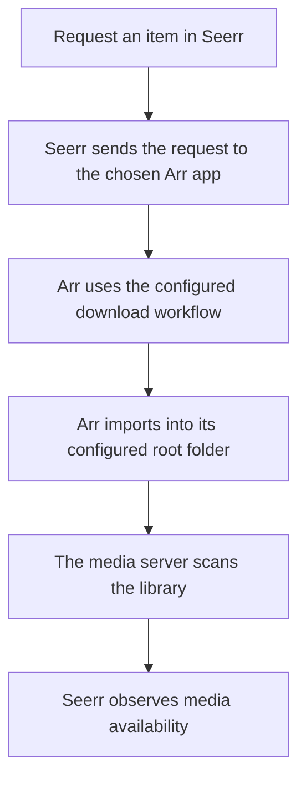

# Seerr FAQ

Common questions and fixes for Seerr in DUMB.

## Follow a request to the library

When a request stalls, check the application at the stage where progress stops. A successful Seerr login does not verify the later Arr import or media-server connection.

## Why is the Seerr UI not loading?

- Confirm the service is enabled in `dumb_config.json`.
- Ensure port `5055` is available and not blocked.
- Check logs at the configured log path for startup errors.

!!! tip "Traefik access"

    Open the intended Seerr instance's **Embedded UI** tab from its service page.

## Seerr cannot connect to my media server

Seerr needs API access to Plex/Jellyfin/Emby.

- Verify the media server is running and reachable.
- Confirm the API key/token is correct in Seerr settings.
- For a media server inside DUMB, use its native internal address and assigned port. Do not use the dashboard's embedded `/ui/...` URL for service-to-service API connections.

## Why are requests failing to import into Arr?

- Ensure Sonarr/Radarr are enabled and accessible.
- Verify API keys in Seerr match the Arr instances.
- Confirm the Arr instances are on the correct ports.
