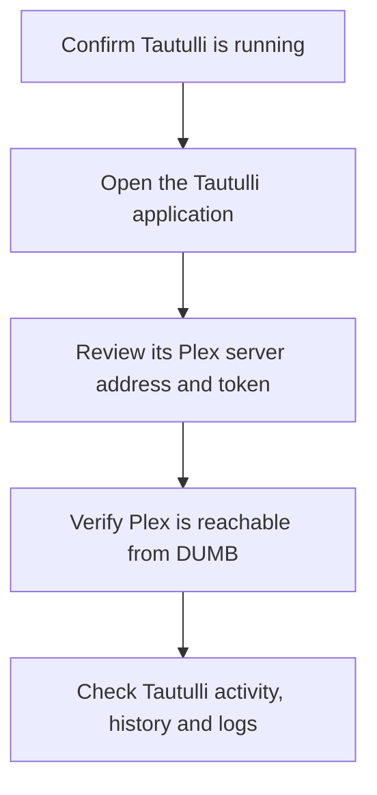

# Tautulli FAQ

Common questions and fixes for Tautulli in DUMB.

## Tautulli needs a working Plex connection

Check Plex reachability and its token separately from the Tautulli process. Monitoring history depends on the configured Plex connection.

## Why is the Tautulli UI not loading?

- Confirm Tautulli is enabled in `dumb_config.json`.
- Ensure port `8181` is available.
- Review the Tautulli log for startup errors.

!!! tip "Traefik access"

    Open **Tautulli → Embedded UI** in DUMB. Direct port access requires that port to be published.

## Tautulli cannot connect to Plex

- Confirm Plex Media Server is running.
- Check the Plex URL and token in Tautulli settings.
- Verify that the Plex port (`32400`) is reachable from the container.

## Tautulli data is missing or incomplete

Tautulli keeps its own history database. Check that DUMB still uses the original persistent Tautulli data directory and that Tautulli is connected to the intended Plex server. A library scan does not reconstruct a lost Tautulli history database.

If only new activity is missing, verify the Plex connection and Tautulli's session-monitoring log before changing stored data.

## Settings shows `KeyError: 'pms_is_cloud'`

This can happen when an older `data/interfaces` template remains beside newer
Tautulli Python code. The error can also appear when accessing Tautulli directly;
it is not an authentication error.

DUMB updates now refresh the bundled `data/interfaces` tree while preserving
configuration, databases, and other runtime files beside it. After installing a
DUMB version containing this fix, update Tautulli to refresh the matching source
and templates together. Do not delete the `data` directory: it also holds your
Tautulli configuration and history. An explicit exclusion of `data/interfaces`
will continue to preserve those templates and should be reviewed if the error
persists.

## A configured release install keeps the existing version

Older DUMB versions can report a successful configured Tautulli release install
without downloading it when `auto_update` is enabled. The manual action incorrectly
reuses the normal setup guard for pinned releases, then retains the existing files.

DUMB now invokes the selected release installer directly for an explicit configured
target install, including reapplying the same version. After deploying this fix,
select the desired release and run the configured-target install action. Saving
the release settings alone is not a request to reinstall. The normal update
snapshot and runtime-data preservation still apply.
