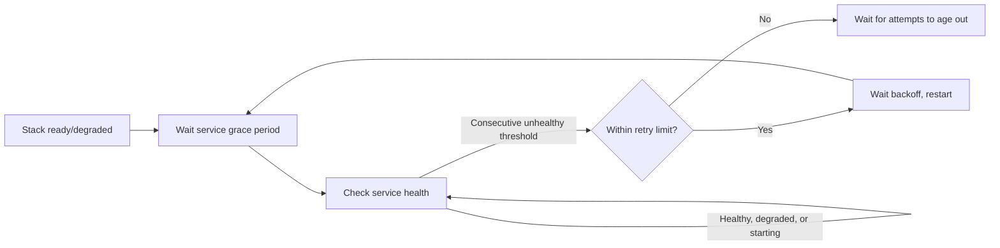

# Auto-restart

Auto-restart monitors explicitly selected services and retries a restart after repeated health failures. It is disabled by default. Use it for recoverable application failures; investigate repeated failures rather than raising the retry limit.

## Enable it for a service

1. Open the service page and select **Tools → Auto-restart**.
2. Enable the global policy and select the exact service to monitor.
3. Review its failure threshold, grace period, restart window, and backoff delays.
4. Save, then check the service's health reason and restart status.

An empty service list monitors nothing, even when the global switch is enabled. A deliberate manual stop disables monitoring for that service until it is started again.

{ .shadow }

## How it works



DUMB checks the tracked process, configured ports, and an allowlisted read-only application endpoint where available. Monitoring pauses while the stack is starting. After a restart, DUMB records success only when health checks pass.

## Health states and application probes

| State | Meaning | Restart behavior |
| --- | --- | --- |
| Healthy | Process, ports, and applicable probe passed | Reset consecutive failures |
| Degraded | Reachable, with a warning or an unsupported/protected optional probe | Keep running; show the reason |
| Starting | Application reports initialization or migration | Wait without counting a failure |
| Unhealthy | Process/port failure or a restart-relevant application failure | Count toward the threshold |

Current application probes include InfiniDysk `/health`, Servarr `/ping`, Jellyfin `/health`, Emby ping, Plex `/identity`, Seerr status, TPA health, PostgreSQL `pg_isready`, pgAdmin ping, and rclone's local RC version endpoint when enabled. Unknown services retain process/port checks.

Indexer/provider warnings, missing articles, and content-health failures are not restart signals. Restarting a healthy application does not usually repair those conditions. InfiniDysk's migration response, `503 {"status":"migrating"}`, is treated as Starting rather than a restart failure.

<details class="geek-details" markdown="1">
<summary>Technical details: restart JSON and field reference</summary>

## Configuration

Set defaults under `dumb.auto_restart`:

```json
{
  "dumb": {
    "auto_restart": {
      "enabled": true,
      "restart_on_unhealthy": true,
      "healthcheck_interval": 30,
      "unhealthy_threshold": 3,
      "max_restarts": 3,
      "window_seconds": 300,
      "backoff_seconds": [5, 15, 45, 120],
      "grace_period_seconds": 30,
      "services": [
        {
          "process_name": "Riven Backend",
          "enabled": true,
          "grace_period_seconds": 60
        }
      ]
    }
  }
}
```

This example enables monitoring for Riven Backend. The shipped defaults have `enabled: false` and `services: []`.

| Field | Shipped default | Meaning |
| --- | --- | --- |
| `enabled` | `false` | Global switch |
| `restart_on_unhealthy` | `true` | Allow unhealthy checks to trigger a restart |
| `healthcheck_interval` | `30` | Seconds between checks |
| `unhealthy_threshold` | `3` | Consecutive failures before retry |
| `max_restarts` | `3` | Attempts allowed within the rolling window |
| `window_seconds` | `300` | Length of that window in seconds |
| `backoff_seconds` | `[5, 15, 45, 120]` | Explicit delays between attempts |
| `grace_period_seconds` | `30` | Wait after stack readiness or a later launch |
| `services` | `[]` | Policy objects containing an exact `process_name` |

Use process names from `GET /process/processes`, not guessed display labels. There is no separate `health_check` configuration object.

</details>

## Backoff schedule

The delay comes from the configured list, not an exponential multiplier. The example uses 5, 15, 45, then 120 seconds for later attempts. Any attempt beyond the list uses its last entry.

## Restart limits

The default permits three attempts within a rolling five-minute window. Attempts age out automatically. A manual start re-enables monitoring after an intentional stop but does not erase the recent-attempt record.

A slow application can receive a longer per-service grace period without delaying other services. Choose it from observed startup time. The stack's readiness deadline is separate; see [Startup lifecycle](startup-lifecycle.md).

## Health checks

Checks reject missing/zombie PIDs and test the service's configured `port`, `frontend_port`, `backend_port`, and `webdav_port`, including corresponding environment values. Incorrect configured ports can therefore create false failures.

A longer grace period helps a known slow startup. It does not fix a wrong port, failed database connection, or broken mount.

## Monitoring restart status

Hover the dashboard or service-page health/restart indicator for its current reason. For API access:

```bash
curl 'http://localhost:3005/api/process/service-status?process_name=Riven%20Backend&include_health=true'
```

Add an Authorization header when DUMB authentication is enabled. The response includes `health_status`, `health_reason`, `health_details`, and a `restart` object:

| Restart field | Meaning |
| --- | --- |
| `restart_attempts`, `restart_successes`, `restart_failures` | Recorded outcomes |
| `recent_restart_attempts` | Attempts still in the rolling window |
| `pending`, `next_restart_time` | Scheduled retry state |
| `last_restart_time`, `last_exit_time`, `last_exit_reason` | Recent lifecycle evidence |
| `unhealthy_count`, `unhealthy_threshold` | Consecutive failure count and policy |
| `disabled` | Whether monitoring is disabled for this process |

Live process updates arrive through [`/ws/status`](../api/websocket.md). [Notifications](notifications.md) can deliver success/failure events; the destination's severity filter still applies.

## Disabling auto-restart

Remove a service from `services`, or retain an entry with `"enabled": false`. Disable all monitoring with `dumb.auto_restart.enabled: false`; saved service entries can remain for later use.

## Troubleshooting

| Symptom | Check first |
| --- | --- |
| Repeated restarts | Actual service error, dependency health, mounts, and configured ports |
| No automatic restart | Global switch, exact enabled service entry, startup/grace state, and rolling-window limit |
| Long wait before retry | Current backoff entry and recent attempts; verify the underlying failure before shortening delays |

## Related pages

- [Dashboard](../frontend/dashboard.md)
- [Process management API](../api/process.md)
- [Startup lifecycle](startup-lifecycle.md)
