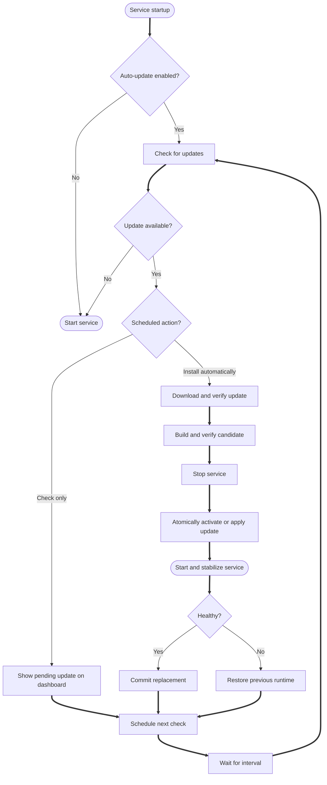

# Auto-update

Choose how each service checks for new versions and whether it should install them automatically. Checking does not restart the service; installing normally does.

## Set an update policy

1. Open the service page and select **Tools → Updates**.
2. Run **Check for updates** to inspect the current and available versions.
3. Enable scheduled checks if wanted, then choose **Show on dashboard** or **Install automatically**.
4. Set the start time and interval, and save.
5. Review source pins and media-library protection before installing.

Use [dashboard Updates](../frontend/dashboard.md#check-and-update-multiple-services) to install several ordinary available updates. A fixed branch, commit, release, or version choice needs review on its own service page.

---

## Overview

The auto-update system supports multiple update strategies:

| Strategy | Description | Use Case |
|----------|-------------|----------|
| **Latest Release** | Tracks the latest stable GitHub release with scheduled checks | Production environments |
| **Nightly Builds** | Tracks nightly GitHub releases with scheduled checks | Testing new features |
| **Prerelease** | Tracks prerelease GitHub builds with scheduled checks | Beta testing |
| **Branch-based** | Downloads directly from a Git branch on setup/startup | Development |
| **Version Pinning** | Locks to a specific version without scheduled updates | Stability critical |

---

<details class="geek-details" markdown="1">
<summary>Technical details: update lifecycle and timing</summary>

## How it works



### Update lifecycle

1. **Initial check** - When a service starts, DUMB checks for available updates
2. **Version comparison** - Current version is compared with the latest available
3. **Act** - In `check_only` mode, DUMB leaves the service untouched and records the pending update; in `install` mode, it downloads and applies the update
4. **Dashboard** - Pending check-only results appear in the dashboard **Updates** badge, service card, and Updates panel
5. **Notify** - Configured DUMB notifications can emit the `update.available` event, while project update notices cover DUMB backend/frontend updates
6. **Schedule** - Future update checks are scheduled based on the configured interval

Downloads, package-manager inputs, and supported compiled runtimes are reused
through the [verified install cache](install-cache.md). A failed build retains
or restores the previous runtime instead of accepting partial output. Services
with candidate-native layouts are not stopped until their replacement has
finished building.

The DUMB Frontend uses this candidate-first lifecycle for release, branch,
commit, and configured-target installs. Its current Nuxt server remains online
during download and build, then DUMB stops it only long enough to atomically
activate and health-check the replacement. If activation fails, DUMB restores
and verifies the prior frontend. When an operator starts the update from the
dashboard itself, the loaded page reconnects through the restarted frontend,
reads the terminal result retained by the DUMB API, and reloads to use the new
assets. A temporary request disconnect is therefore shown as reconnection and
verification, not immediately as a failed install.

Manual dashboard installs and scheduled update installs record total install
duration plus observed service downtime. Total duration covers the complete
installer and health-stabilization operation. Downtime covers only intervals
from stopping the managed process until its application readiness probe first
succeeds, including an additional interruption if a candidate regresses and
rollback is required. A result distinguishes completed, ongoing/unverified, and
not-observed downtime instead of assuming that every update caused an outage.
Current dmbdb versions show these values in both the dashboard Updates panel and
each service's Updates panel when the backend advertises
`update_timing_metrics`.

When an update affects storage used by Plex, Jellyfin, or Emby, [Media Library Protection](media-library-protection.md) runs before the service is stopped. Scheduled updates are deferred while playback is active or activity cannot be verified. Manual installs show explicit protect, keep-running, stop-now, and defer choices in dmbdb.

</details>

### Frontend notices

The global **DUMB Updates** banner and **Settings → About** share the backend's retained API/frontend update result. Open either to inspect versions, messages, and release/source links. A later failed recheck does not silently erase a known available result.

- **Dismiss** hides only that browser's banner; About can show it again.
- Released versions can show a releases-behind count when GitHub history includes the installed tag.
- Development builds show **Dev build** rather than an invented release count.
- API checks run at startup and daily in check-only mode. Apply an API update through your Docker image/stack; these checks never replace the container automatically.

DUMB API and frontend have independent version numbers. A development suffix identifies a moving image/source build, while stable releases link to their release notes. See [API versions](../services/dumb/api.md#development-and-release-versions).

<!-- dev:start -->
The candidate core in `v2.24.0-dev.34` is `2.24.0`; `-dev.34` identifies the rolling image build. The frontend follows its own releases and source commits; see [frontend development versions](../services/dumb/dumb-frontend.md#frontend-development-versions).
<!-- dev:end -->

!!! warning "Fixed versions and update schedules"

    Fixed release, branch, commit, and pinned-version choices can disable automatic
    scheduling. Review the configuration details below before relying on a saved
    schedule; an enabled auto-update toggle alone does not guarantee checks run.

<details class="geek-details" markdown="1">
<summary>Technical details: update configuration fields</summary>

## Configuration

Auto-update settings are configured per-service in `dumb_config.json`:

```json
{
  "service_name": {
    "enabled": true,
    "auto_update": true,
    "auto_update_mode": "check_only",
    "auto_update_start_time": "04:00",
    "auto_update_interval": 24,
    "release_version_enabled": false,
    "release_version": "latest",
    "commit_sha": "",
    "branch_enabled": false,
    "branch": "main",
    "pinned_version": "",
    "clear_on_update": true,
    "exclude_dirs": []
  }
}
```

### Configuration options

| Option | Type | Default | Description |
|--------|------|---------|-------------|
| `auto_update` | boolean | `false` | Enable scheduled update checks for this service |
| `auto_update_mode` | string | `"install"` | `check_only` reports pending updates; `install` applies them automatically |
| `auto_update_start_time` | string | `"04:00"` | 24-hour schedule anchor time (`HH:MM`) |
| `auto_update_interval` | number | `24` | Hours between update checks |
| `release_version_enabled` | boolean | `false` | Use release version strategy |
| `release_version` | string | `"latest"` | Target version: `latest`, `nightly`, `prerelease`, or specific version |
| `commit_sha` | string | `""` | Exact full 40-character GitHub commit to deploy |
| `branch_enabled` | boolean | `false` | Use branch-based deployment |
| `branch` | string | `"main"` | Git branch to track |
| `pinned_version` | string | `""` | Pin to specific version (disables auto-update) |
| `clear_on_update` | boolean | `true` | Clear working directory before update |
| `exclude_dirs` | array | `[]` | Directories to preserve during updates |

!!! warning "Auto-update and strategy interaction"

    Automatic scheduling is disabled when `pinned_version`, `commit_sha`,
    `release_version_enabled`, or `branch_enabled` are set. Exceptions are a
    `nightly` or `prerelease` release selector and a digit-free InfiniDysk release
    tag such as `dev`, `lts`, or `edge`, provided no commit, pinned-version, or
    branch selector takes precedence. InfiniDysk tags containing a digit remain
    fixed configured releases. A non-empty `commit_sha` always disables moving
    update checks, including the initial post-setup check.

    InfiniDysk/NzbDAV release updates are prebuilt-first. DUMB verifies the
    exact architecture archive and its published digest, then automatically
    builds the same resolved commit from source when the GitHub Release or a
    usable archive is unavailable. A missing prebuilt therefore does not strand
    the service on a broken install. The service Updates panel reports the
    installed method and any fallback reason when the backend supports
    `infinidysk_install_info` (or the legacy `nzbdav_install_info` alias).

After saving a fixed release, branch, or commit selection, the Updates panel
shows **Install configured release**, **Install configured branch**, or
**Install configured commit** without requiring a successful update check.
**Check for updates** remains useful for resolving the exact current branch
head and refreshing displayed version details. Applying the configured target
keeps the saved selection active. **Override + latest** is a separate escape
hatch that temporarily bypasses any saved release, branch, commit, or
pinned-version selection and installs the latest stable release. DUMB restores
the saved configuration after that one installation.

### Check only and review on the dashboard

Set `auto_update` to `true` and `auto_update_mode` to `check_only` when you want
DUMB to check on schedule without stopping, restarting, or changing the
service. When a newer ordinary release is found, the dashboard **Updates**
button shows a count, the service card exposes its update shortcut, and the
Updates panel includes the current and available versions. You can then install
one update or select several for sequential installation.

The dashboard refreshes the cached results while it remains open. A later
scheduled or manual check clears the pending state when the service is current.
Existing configurations that do not contain `auto_update_mode` retain the
legacy `install` behavior.

---

</details>

## Update strategies

### Latest release (default)

The default strategy fetches the latest stable release from GitHub:

```json
{
  "dumb": {
    "frontend": {
      "auto_update": true,
      "auto_update_mode": "install",
      "auto_update_start_time": "04:00",
      "auto_update_interval": 24
    }
  }
}
```

This checks GitHub's `/releases/latest` endpoint and downloads the newest stable version.

### Nightly builds

For testing cutting-edge features, enable nightly builds:

```json
{
  "service_name": {
    "release_version_enabled": true,
    "release_version": "nightly"
  }
}
```

!!! info "Nightly version format"

    Nightly builds use date-based versioning like `v2025.01.22.nightly`. Version comparison checks the first three parts (year, month, day).

### Prerelease versions

To receive beta or release candidate versions:

```json
{
  "service_name": {
    "release_version_enabled": true,
    "release_version": "prerelease"
  }
}
```

!!! tip "Prerelease scheduling"

    When `release_version` is `prerelease`, scheduled auto-update checks continue to run at your configured interval.

### Branch-based deployment

Track a specific Git branch for development or testing:

```json
{
  "service_name": {
    "branch_enabled": true,
    "branch": "dev"
  }
}
```

!!! warning "Branch-based updates"

    Branch-based deployment downloads the latest commit from the specified branch during setup/startup.
    Scheduled auto-update checks are disabled when `branch_enabled` is true.

### Exact commit pinning

Source-build services can be pinned to an immutable GitHub revision:

```json
{
  "infinidysk": {
    "commit_sha": "0123456789abcdef0123456789abcdef01234567"
  }
}
```

`commit_sha` must be the complete 40-character hexadecimal SHA. When non-empty,
it takes precedence over release and branch settings. DUMB downloads that exact
GitHub source archive, builds it through the service's normal source-build path,
records a `commit-<short-sha>` version marker where supported, and disables
automatic updates until the field is changed or cleared. This block applies to
scheduled checks, the initial post-setup check, and normal direct update checks.
When the configured commit differs from the installed version, use **Install
configured commit** to build and restart on that SHA without clearing or
bypassing the pin. **Override + latest** is a separate explicit action that
temporarily bypasses the pin and installs the moving latest release; it does not
clear the saved SHA. If source settings are saved while an update is already
running, DUMB preserves the newer saved selection rather than restoring the
update operation's older selection over it.

Supported source-build services are:

- DUMB Frontend
- Traefik Proxy Admin
- CLI Debrid
- Decypharr
- InfiniDysk
- Phalanx DB
- Tautulli
- Pulsarr
- Maintainerr
- NeutArr
- Profilarr
- Seerr
- Riven Backend and Riven Frontend
- Zilean

Arr applications and binary-only services such as Zurg do not use this source
commit strategy.

### Version pinning

Lock a service to a specific version:

```json
{
  "service_name": {
    "pinned_version": "v1.30.0"
  }
}
```

!!! tip "When to pin versions"

    Pin versions when:

    - A specific version is required for compatibility
    - You need to prevent unexpected changes
    - Testing a specific release
    - Production stability is critical

!!! warning "Pinned versions and auto-update"

    Setting `pinned_version` disables scheduled updates for that service.

---

## Update intervals

The `auto_update_start_time` and `auto_update_interval` settings control update cadence:

| Interval | Check Frequency | Recommended For |
|----------|-----------------|-----------------|
| `6` | Every 6 hours | Nightly/prerelease testing |
| `24` | Daily (default) | Most services |
| `168` | Weekly | Stable, critical services |

```json
{
  "frontend": {
    "auto_update": true,
    "auto_update_start_time": "04:00",
    "auto_update_interval": 24
  }
}
```

With this example, checks run once per day at 04:00. If you set `auto_update_interval` to another value (for example `12`), checks run every 12 hours anchored from the configured start time.

<!-- dev:start -->
### Scheduled work and deferrals

DUMB uses one shared scheduler. Scheduled service update checks and installs
run one at a time. If another scheduled update is still active, or a lifecycle
or migration operation holds a required lock, a due update records `deferred`
and retries on a later scheduler tick. Deferred work does not accumulate in
an install queue, and its enabled state and source selection are checked again
before it runs. DUMB API release checks and scheduled symlink backups use
separate bounded workers so a slow service update does not occupy the
scheduler loop.

The dashboard Updates panel shows recorded update messages. The
[update-status API](../api/process.md#get-processupdate-status) also reports
live scheduler state, progress messages, and elapsed time. DUMB API and DUMB
Frontend retain a known available result during rechecks and deferrals;
their `scheduler_state` and `scheduler_message` describe the active work
separately. A scheduled operation
that has run for five minutes is marked as long-running; DUMB logs its
continued activity each minute. This is an observation, not a cancellation
deadline. DUMB retains the active operation's locks and recovery state until
it returns, and later updates remain deferred where necessary.

An exception records an error and leaves the scheduler available for later
work. A service process starting successfully does not by itself mean update
health stabilization and cleanup have finished.

<!-- dev:end -->

---

## Preserving data during updates

### Clear on update

By default, DUMB clears the service directory before applying updates. This ensures a clean installation:

```json
{
  "service_name": {
    "clear_on_update": true
  }
}
```

### Excluding directories

To preserve specific directories during updates (like configuration or data):

```json
{
  "service_name": {
    "clear_on_update": true,
    "exclude_dirs": ["config", "data", "logs"]
  }
}
```

---

## GitHub API integration

### Rate limiting

GitHub's API has rate limits:

| Authentication | Requests per Hour |
|----------------|-------------------|
| Unauthenticated | 60 |
| With token | 5,000 |

### Using a GitHub token

For higher rate limits, add a GitHub token to your configuration:

```json
{
  "dumb": {
    "github_token": "ghp_xxxxxxxxxxxxxxxxxxxx"
  }
}
```

!!! tip "Token permissions"

    Prefer a fine-grained token restricted to the repositories DUMB must read.
    Fine-grained tokens already have read-only access to public repositories;
    for private repos/forks, grant only the minimum read permission required by
    the GitHub endpoint. Do not grant repository write, package write, workflow,
    or administration permissions for release checks.

!!! danger "Protect your token"

    Treat GitHub tokens as secrets. Never commit them to source control or share them in logs/screenshots.

---

## Service-specific behavior

Different services have specialized update handling:

| Service Type | Update Method |
|--------------|---------------|
| **Arr Suite** (Sonarr, Radarr, etc.) | Binary installation |
| **Plex Media Server** | System package installer |
| **Jellyfin** | System package installer |
| **Emby** | System package installer |
| **GitHub-based** (Frontend, NeutArr, etc.) | Release download and extraction |

!!! info "Strategy support varies"

    Not every service supports every strategy. For example, Arr services and Plex/Jellyfin/Emby use native installers,
    while GitHub-based services rely on release or branch downloads.

---

## Monitoring updates

### Dashboard update center

Open **Updates** on the dashboard to check enabled services, select ordinary available updates, and follow sequential installs. A saved source target is marked **Review source** and needs its own service-page review.

The panel retains in-app progress when closed. Frontend updates can briefly interrupt the loaded page during activation; reconnect and inspect the retained result. After any install, verify the service's health and logs.

See [Dashboard updates](../frontend/dashboard.md#check-and-update-multiple-services) for timing measurements, background progress, and source-selection limits.

### Check current versions

View installed versions in the frontend:

1. Navigate to **Settings**
2. Check the **Version** display for each service

### Update logs

Update activity is logged to the DUMB logs:

```
INFO - [Auto-Update] Checking for updates: frontend
INFO - [Auto-Update] Update available: v1.32.0 -> v1.33.0
INFO - [Auto-Update] Downloading update...
INFO - [Auto-Update] Update complete: frontend v1.33.0
```

---

## Troubleshooting

### Updates not running

1. **Verify auto_update is enabled** in the service configuration
2. **Check the interval** - updates may not be due yet
3. **Review logs** for error messages
4. **Verify network connectivity** to GitHub

<!-- dev:start -->
If the status is `deferred`, review its message and next retry time. Another
update, lifecycle operation, or migration can temporarily prevent admission.
For a running or long-running update, review the active service's install
stage and logs. Elapsed time alone does not identify the blocking operation;
collecting a thread traceback may be needed to diagnose a persistent stall.
The scheduler does not terminate the active installer to start another one.

<!-- dev:end -->

### Update fails repeatedly

1. **Check GitHub API rate limits** - add a token if needed
2. **Verify disk space** is available
3. **Check file permissions** in the service directory
4. **Review logs** for specific error messages

### Service won't start after update

1. **Check compatibility** between the new version and your configuration
2. **Review the service's changelog** for breaking changes
3. **Consider pinning** to the previous working version
4. **Check logs** for startup errors

---

## Before enabling automatic installation

Keep application/database backups, select a maintenance time, and confirm media-library protection is configured. Some upstream data migrations cannot be undone by restoring an older runtime. Start with **Show on dashboard** if updates need your review.

## Related pages

- [Configuration Guide](configuration.md)
- [Auto-restart](auto-restart.md)
- [Settings Page](../frontend/settings.md)
