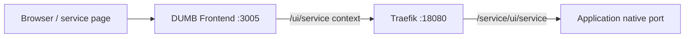

# Embedded service UIs

Open a managed application's own interface inside DUMB without publishing every native port. The frontend proxies embedded traffic through bundled Traefik. Each application keeps its own login requirements.

## Enable and open an application

1. Open **Settings → Embedded UIs** and select **Enable embedded service iFrames**, or enable embedded UIs during onboarding.
2. Open a running service's page and select **Embedded UI**.
3. Sign in to the application if it asks for its own credentials.
4. Use split/full-window view or the direct-link action as needed.

A matching enabled TPA public HTTPS route can supply an external link. AIOStreams' remote Stremio clients need its separately configured public base URL; the embedded operator route is not a replacement for that origin.

<!-- docs:visual scenario=settings-embedded-uis type=image -->

<!-- docs:visual scenario=embedded-sonarr type=image -->

<details class="geek-details" markdown="1">
<summary>Technical details: frontend proxy and direct Traefik routes</summary>

## How it works



The frontend's `/ui/<service>` routes carry the owning service context for assets, API requests, navigation, and WebSockets. Direct navigation to those internal iframe routes can redirect back to DUMB; use the service page or its link action.

For direct Traefik access, the default route is:

```text
http://<host>:18080/service/ui/<service_name>
```

This listener has its own exposure and authentication requirements. Enabling DUMB login does not add authentication to raw Traefik or application ports.
</details>

### Available services

| Service | Path | Native Port |
|---------|------|-------------|
| Riven Frontend | `/service/ui/riven_frontend` | 3000 |
| pgAdmin 4 | `/service/ui/pgadmin` | 5050 |
| Seerr | `/service/ui/seerr` | 5055 |
| Tautulli | `/service/ui/tautulli` | 8181 |
| Bazarr | `/service/ui/bazarr` | 6767 |
| Pulsarr | `/service/ui/pulsarr` | 3003 |
| Maintainerr | `/service/ui/maintainerr` | 6246 |
| mediastorm | `/service/ui/mediastorm` | 7777 |
| AIOStreams | `/service/ui/aiostreams` | 3006 |
| AltMount | `/service/ui/altmount` | 8088 |
| Radarr | `/service/ui/radarr` | 7878 |
| Sonarr | `/service/ui/sonarr` | 8989 |
| Lidarr | `/service/ui/lidarr` | 8686 |
| Prowlarr | `/service/ui/prowlarr` | 9696 |
| Whisparr | `/service/ui/whisparr` | 6969 |
| Jellyfin | `/service/ui/jellyfin` | 8096 |
| Emby | `/service/ui/emby` | 8096 |
| Zilean | `/service/ui/zilean` | 8182 |
| CLI Debrid | `/service/ui/cli_debrid` | 5000 |
| CLI Battery | `/service/ui/cli_battery` | 5001 |
| InfiniDysk | `/service/ui/infinidysk` | 3000 |
| NeutArr (instance) | `/service/ui/neutarr_<instance>` | 9705 |
| Authelia | `/service/ui/authelia` | 9091 |
| Traefik Dashboard | `/service/ui/traefik` | 18081 |
| Traefik Proxy Admin | `/service/ui/traefik_proxy_admin` | 3004 |

These are default ports and example route keys. Enabled instances, current ports, and API-discovered UI paths are authoritative; startup may move a conflicting port. Authelia is a top-level portal launcher rather than an embedded login form.

<!-- dev:start -->
InfiniDysk 2 currently requires its own root URL. Use its direct local address or configured public origin; embedded subpath login/playback remain unavailable until the backend advertises a validated adapter. Preserve existing stream URL origins and signed paths. See [InfiniDysk 2 authentication](infinidysk-v2-migration.md#authentication-with-the-retained-backend-port).
<!-- dev:end -->

<details class="geek-details" markdown="1">
<summary>Technical details: generated Traefik configuration and route ownership</summary>

## Traefik configuration

DUMB generates its embedded routes in `/config/traefik/dynamic/services.yaml`. Traefik watches that directory. Optional TPA routes come through its separate HTTP provider.

Routes use service-specific prefix stripping, entry-path rewriting, and frame headers where appropriate. A media web client may need `/web/index.html`; another application may serve `/` directly. Do not copy one application's rewrite into another route or edit DUMB's generated file as a permanent configuration method.

Use [Traefik Proxy Admin](../services/optional/traefik-proxy-admin.md) for deliberately published routes and [Traefik architecture](../architecture/traefik.md) for provider ownership and configuration.
</details>

## iframe embedding

### Embedded UI tab

The tab can choose among supported entry points, open a direct/private or matching public link, and expand to full-window view. Root-style applications remain attached to their own routing context even when they request paths such as `/api`, `/assets`, or `/dashboard`.

InfiniDysk's root WebSocket is routed to InfiniDysk while DUMB retains `/ws/status`, `/ws/metrics`, and `/ws/logs`. AIOStreams uses server-sent events for its live views. The proxy clears document context when navigating away from the service page.

### Split view mode

Open the split-view control on a service page to keep its application UI beside DUMB's controls or logs. Resize the divider as needed.

### Full iframe mode

Use the full-window control when the application needs more space. DUMB navigation remains available around it.

## Security considerations

### Same-origin policy

Embedded applications share the frontend's browser origin. Service context separates routing; it does not create separate cookie, local-storage, or CacheStorage security boundaries. Use dedicated origins when an application needs that separation.

### Frame headers

DUMB supplies compatible frame headers for supported embedded routes. Authelia deliberately retains `frame-ancestors 'none'` and `X-Frame-Options: DENY`. Do not remove those protections to embed its password or two-factor screens.

### Authentication passthrough

DUMB authentication protects its own API/frontend flows. Applications can still require their own accounts, and directly exposed Traefik/native ports need their own access policy.

For Authelia, select **Open Authelia Portal** and use the public HTTPS URL. For TPA admin SSO, use **Open TPA for SSO** and finish login in the top-level public tab. Embedded TPA remains available for its local recovery login and administration.

## Troubleshooting

| Symptom | Check |
| --- | --- |
| No Embedded UI tab | Service is enabled/running, exposes a UI, and Service UIs is enabled |
| Blank page or 404 | API-discovered path, current Traefik port, and routing logs; reopen from the service page |
| Direct app works, embedded login fails | Sign in on the frontend origin; check current frontend version and the application's frame policy |
| Jellyfin/Emby library is empty | Application account permissions and frontend update; see [library troubleshooting](../frontend/service-pages.md#jellyfin-and-emby-libraries) |
| Authelia refuses framing | Expected: use its public portal launcher |
| TPA SSO fails inside the tab | Use the public TPA HTTPS origin and its registered callback |
| Direct URL is unreachable | Check Docker port publication, network access, and application listener separately |

For a missing Authelia launch button, finish its bootstrap and public route. Never attach ForwardAuth or TPA Service SSO to the Authelia portal's own route.

## Proxy behavior and restrictions

Use the Embedded UI tab, its direct-link action, or the deliberate Traefik route. Internal `/ui/<service>` paths are for the embedded proxy. Supported workers retain service ownership, but browser notifications still need browser/OS permissions. See [service workers](../frontend/service-pages.md#service-workers-and-browser-notifications).

## Disabling embedded UIs

Turn off **Service UIs** in Settings. Native-port access then depends on your existing port publication and application authentication; disabling embedding does not publish those ports.

<details class="geek-details" markdown="1">
<summary>Technical alternative: toggle embedded UIs with the configuration API</summary>

The configuration API can toggle the same setting:

```bash
curl -X POST http://localhost:3005/api/config/service-ui \
  -H 'Content-Type: application/json' \
  -d '{"enabled": false}'
```

Add an Authorization header when authentication is enabled. See [Configuration API](../api/config.md).
</details>
