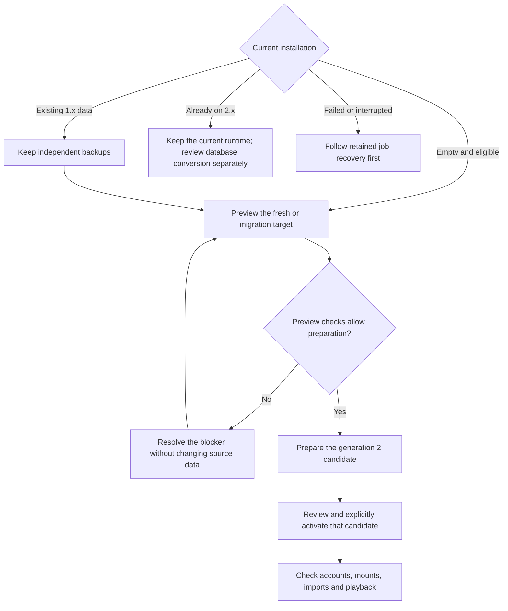
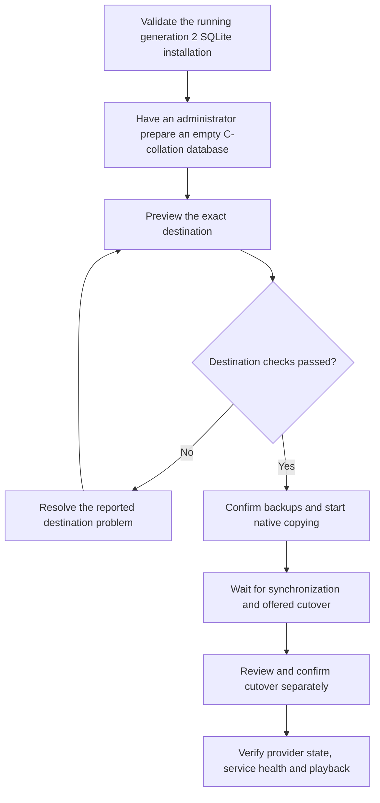

# InfiniDysk 2 installation and upgrade

DUMB keeps InfiniDysk 1.x as the default. InfiniDysk 2 uses a different native
runtime, configuration and data layout. Install it or move existing data through
**Tools → InfiniDysk 2 migration** on the InfiniDysk service page.
For an eligible empty installation, the wizard uses fresh-install mode. To choose
2.x during setup, use the runtime choice in
[service options](../frontend/onboarding.md#step-5-service-specific-options).
Fresh installations and services already running 2.x do not receive upgrade
invitations. An enabled, eligible 1.x service with existing data can show an
optional invitation: **Review upgrade** opens the wizard, **Remind me tomorrow**
or **Remind me in a week** hides it for that period, and **Don't show again**
hides it permanently in this browser. The service's **Tools** menu remains
available.

These preferences do not hide progress or required recovery for previews and jobs
you have started. During onboarding, those status notices appear below the
controls.

The wizard requires DUMB API **2.24.0 or newer**, explicit InfiniDysk 2 capabilities
and migration protocol **1**. An older, unknown or temporarily unavailable
backend cannot start a migration. Previously discovered job identities and
recovery information remain visible. The supported native artifact is currently
**`v2.0.0-beta.6`**; selecting 2.x through a 1.x release or source field is refused.

## Choose your path

Keep major installation, recovery and the optional database conversion as separate decisions:



| Starting point | Workflow |
| --- | --- |
| Empty eligible installation | Preview the empty target, prepare it, then explicitly activate it |
| Existing InfiniDysk 1.x data | Back up independently, preview, prepare once, then review and activate that same converted candidate |
| Running InfiniDysk 2 with SQLite | Use the separate [native PostgreSQL conversion](#native-postgresql-conversion) only if wanted |
| Interrupted or failed work | Open [recovery guidance](#progress-cancellation-and-recovery) before changing settings |

Keep this page open for the complete procedure. Migration can interrupt storage and downstream applications; choosing a generation in setup does not convert existing data.

## Separate the choices

| Choice | Initial behavior |
|--------|------------------|
| Runtime generation | Keep 1.x until an explicit, validated 2.x installation or cutover |
| Mount | Preserve the existing rclone-over-WebDAV mount by default; native FUSE is an explicit alternative |
| Database | Import v1 SQLite or v1 PostgreSQL into a separate generation 2 SQLite database first; PostgreSQL conversion is optional afterward |
| Import strategy | Preserve existing outputs; changing generation or mount does not regenerate symlinks or STRM files |

InfiniDysk's native importer converts the generation 1 schema and data into the
generation 2 format while DUMB retains a recoverable original source. You can
keep generation 2 SQLite or later use InfiniDysk's native SQLite-to-PostgreSQL
engine. DUMB coordinates the backups, checks, service lifecycle and recovery
around those native engines.

The original 1.x runtime, configuration and data remain the rollback source,
locally by default or in the verified archive when local storage is reused.
Generation 2 program files and data use separate directories. The native runtime
uses its verified artifact; active 1.x branch/commit selectors are cleared in
the prepared 2.x configuration while the original selection stays in recovery.
Do not toggle the generation or provider fields to bypass the wizard.

## Before starting

Keep independent backups of the source database, configuration, identity and
signing keys, symlink trees and existing STRM files. DUMB's retained migration
state is useful recovery evidence, not a replacement for those backups.

An existing source must meet the 1.3-era database schema floor checked by the
backend. By default its **InfiniDysk 1 download-task queue** must be empty after
applications stop. Supporting builds offer an explicit
[option to continue without queued downloads](#queued-downloads).
Failed history records alone do not block this queue check.

This check does not require deleting Sonarr history or media-library files.
If an Arr application reports a separate failed-download problem, review that
queue item and its actual error in the Arr application. DUMB does not
automatically clear those records. The release label alone does not establish
schema compatibility. Finish or resolve any existing namespace or database
migration before starting another workflow.

Sources with OIDC configured are currently blocked until the target policy has
been verified. The login/OIDC acknowledgement does not override that blocker.

Review every affected Arr, request producer and media server. Stop new imports,
playback and scans for the approved downtime. The preview records managed
mounts, enabled managed consumers and configured link roots. Check external
consumers, remote path mappings, library roots and signed stream URLs separately;
an empty recorded STRM list does not prove that none exist.

The major workflow validates the retained source and selected target dependency
orders before stopping managed processes. It stops dependants first, restores
the selected InfiniDysk service and mount, verifies delivery readiness, then
resumes the previously running consumers in dependency order. Sonarr/Radarr
therefore resume before a dependent Prowlarr. Configured consumers that were
already stopped remain stopped; DUMB does not enable unrelated applications.

The recorded migration scope determines downtime. Review its source, mount and
managed consumers before starting. Shared PostgreSQL, the DUMB API and frontend,
proxies and utilities outside that scope can remain running. A v1 PostgreSQL
source needs its database server available while DUMB captures and verifies the
snapshot. Green indicators for those other services do not mean that the
affected Arr, request or media applications are still running.

With a native FUSE target, the old associated rclone process stays stopped.
Rollback, or an older backend's test recovery, restores the original transport
when it was previously running. An upstream start failure or uncertain original-process
termination keeps recovery held instead of starting downstream consumers over
an unverified mount.

!!! warning "Contained import and provider reads"

    DUMB runs the actual upstream importer in a private environment.
    Writes outside its working candidate and general external networking remain
    denied. The host must support the required Linux namespaces, `nsenter` and
    Landlock ABI 3 or newer. Failed containment checks block the operation.

    Some older metadata needs NNTP article reads to recover segment sizes or
    inspect RAR volumes. Supporting builds provide a read-only relay restricted
    to the source's configured providers. It uses at most two connections per
    provider and four overall, respecting any lower configured provider limit,
    with one article request at a time on each connection. DUMB stops v1 and its
    affected managed consumers first so the source does not compete for those
    provider connections. Active TLS-enabled providers must pass certificate
    verification; an insecure legacy setting on an active provider is blocked.

    Temporary relay addresses belong only to the contained import. Normal
    provider settings are preserved for the restored v1 service and the live
    v2 runtime. Provider failures, unexplained omissions or incompletely proven
    media still prevent activation. There is no unrestricted network fallback.

A v1 PostgreSQL source also needs a backend-supported source snapshot adapter
and successful dump/restore proof. If that path is unavailable or unverified,
the preview blocks it. The major importer does not directly reuse the v1
PostgreSQL database as a generation 2 database.

### Queued downloads

DUMB checks the available live queue before large preview scans. It checks again
after stopping the affected applications, before PostgreSQL backup and full file
checks. A live count is advisory and can change before that stopped-source
check. If the live queue cannot be inspected, its count is unknown.

By default, finish the pending tasks before migrating. On a supporting backend,
**Continue without queued downloads** instead excludes the entire captured queue
from the private database supplied to the v2 importer. It does not cancel jobs
through the live v1 API or delete the original queue, completed/failed history,
library files or blobs. The original database and recovery backup retain those
queued jobs.

Review the displayed policy and count in the fresh preview. Changing the option
requires a new review before preparation. The running job reports its captured
count; an omitted count is confirmed only after the private importer database
has been verified. This choice applies to the whole queue, rather than guessing
which jobs are failed.

Preparation retains the original pending queue for recovery. Rollback restores
that queue to v1; the older separate test flow also restores v1 when it ends.
After activation those jobs are absent from v2, and Arr applications may submit
them again. This option is for an existing v1-to-v2 upgrade only; older backends
keep the empty-queue requirement.

## Choose migration storage

**Migration backup location** is where DUMB saves the verified v1 recovery
archive for this migration. It does not select the live v2 database location.
Choose the existing local backup tree or
[registered local/NAS archive storage](backup-storage.md). To use a share,
mount it inside the DUMB container first, then expand **Register a backup
destination** and register that existing directory.

Registration does not move existing files or set a global default. The separate
**Global default** controls save or clear that preference. Review the selected
location and its available space in each new preview.

### Choose what stays on local storage

| Choice | What DUMB does | Space to allow |
|--------|----------------|----------------|
| Keep v1 local (default) | Retains the original v1 installation and creates a separate migration candidate. | The original, recovery archive, candidate and new v2 output can coexist. An external backup location moves the archive off local storage. |
| Reuse v1 directory (avoid a second copy) | Verifies the recovery archive, then reuses the original local data as the candidate. | Avoids a second complete local source copy. Old blobs still occupy local storage while the new v2 database grows. |
| Move legacy blobs to migration backup location | Verifies the recovery archive and a separate copy of the legacy blobs on the selected share, then removes the corresponding owned local blob files. | Frees their local allocation for v2 output. The share needs room for both the recovery archive and expanded legacy input. |

The last two choices are separate, explicit options on supporting backends.
Selecting a migration backup location alone keeps v1 local. Both require a
registered destination on a different filesystem and a supported local
source/candidate layout. Mounted source roots or incompatible layouts block the
preview. Generate a new preview after changing the storage choice.

### Reuse local v1 storage

**Reuse v1 directory** avoids a duplicate source tree; it does not make the
old blobs disappear or increase reported free space. DUMB stops v1 and its
affected consumers, writes and verifies the complete recovery archive, then
reuses the original local data as the private candidate.

Native conversion still writes a new v2 database. Allow space for that output,
runtime files, local verification scratch and safety headroom. The preview
includes a conservative estimate because native metadata and compression
formats differ from v1.

### Move legacy blobs to migration backup location

This option also reuses the local source, but moves its legacy blob input out of
the way before native import. DUMB first verifies the complete recovery archive,
then copies and verifies the legacy blobs separately on the selected storage.
It frees the corresponding local blob files only after that copy is verified,
then checks the actual available local space again before import. Preview's
projected release is an estimate, not free space already available to use.
The importer reads that expanded legacy input without changing it while writing
the new v2 database locally.

Copying, preparing access permissions, reading back the staged files, checking
the retained local input and releasing the verified local files are separate
steps. A completed copy does not mean its readback has finished. Network storage
can spend substantial time checking many small files even after all bytes have
been transferred. DUMB can read the input and archive again at later verification
boundaries; keep the share available until the job reaches its confirmed result.

The recovery archive and expanded input have different jobs: the archive can
restore v1, while the expanded files let the importer read individual legacy
blobs. DUMB needs space for both on the share. Moving only the archive does not
free the local blobs, and an expanded input copy does not replace the verified
recovery archive.

Active SQLite databases, DUMB job/control state and PostgreSQL dump/restore
verification scratch still require local storage. External blob input can be
on a mounted NAS share; it is not a request to run the live database there.
Do not manually move the source or replace blob paths with symlinks to bypass
the workflow.

After a successful accepted import or a completed v1 restore, DUMB attempts to
remove only that job's recorded, unchanged expanded input. The verified recovery
archive stays available. If the working copy cannot be safely removed, the job
reports that staging cleanup needs attention and retains its evidence. A changed
directory is kept for review; do not delete it just to clear that warning.

### Recovery when v1 storage is reused

The verified archive is the v1 recovery source for both low-space choices.
Source recovery or rollback can need to remove the owned v2 candidate before
restoring v1 from that archive. Keep the selected storage mounted and readable
through migration and any recovery.

Review the archive-recovery acknowledgement before continuing. Restoring v1
takes time and needs local capacity; later v2 writes are not merged into v1.
An unavailable, replaced or damaged recovery archive keeps recovery held;
DUMB does not start v1 over an empty directory. Import needs its expanded legacy
input, but recovery restores from the verified archive if that working copy is
missing. After an interruption, reconnect the same storage and use the job's
recovery action. Keep its files and evidence until recovery completes.

For a migration that moved legacy blobs externally, **Rollback** starts a
persistent recovery job and returns before the archive has finished restoring.
Follow that job until v1 and its retained services are restored; keep the
container and selected storage available while it runs. Returning to the panel
or refreshing status does not restart the restore.

## Review and run

The preview inventories the complete source data and runtime trees and checks
copy capacity. Filesystem entry counts include application blob stores and any
build or dependency directories inside those trees; they are not counts of
titles or media files. The storage review shows source entry counts and logical
size, then each filesystem's required space, available space, shortfall and status.
Required space accounts for the selected storage choice: recovery archive,
candidate or staged legacy input, new v2 output, PostgreSQL verification and
restore overhead when applicable, up to 512 MiB for the inventory manifest, and
a safety margin. The review shows local and external requirements separately;
paths on the same filesystem share one budget. An unavailable estimate does not
pass the capacity check.

On supporting builds, **Preview migration** shows the request immediately,
then follows the background check's current stage. Scanning a large installation
can take time, especially on slower storage. Services keep running during preview; DUMB does not
copy, move or remove source files. You can close the panel and reopen it to
follow the same check. Use **Cancel preview scan** to stop it; this does not
start migration recovery.

A completed preview remains available for review until its authorization expires.
The review period starts when the scan finishes. If a connection fails, use
**Refresh status** before starting another preview; a lost response does not mean
the check stopped.

These estimates do not reserve space. DUMB checks capacity again before copying;
keep enough space available throughout the operation.

If an inventory or capacity check blocks the preview, keep the original
installation and its files intact. Do not bypass the check, truncate the
inventory or delete blobs or build files to get past it. Review the configured
source locations and available space, and resolve the blocker before retrying.

1. Open the migration tool and review the detected source, target directories,
   database and exact mount path.
2. Keep **historical rclone over WebDAV**, or explicitly choose **native FUSE**.
   The backend must verify ownership, prerequisites and consumer visibility.
3. Generate a preview. Review its checks, blockers, warnings and recorded scope,
   including the queued-download policy and any observed count.
   Existing migrations preserve the exact mount path; they do not rename the
   virtual library namespace or change import strategy.
4. Confirm the independent backup, downtime, beta, login/OIDC policy and
   downstream-path acknowledgements, then type the displayed confirmation.
   The downstream review confirms existing Arr/media mount paths, remote path
   mappings, symlinks and STRM origins, and that external writers/scanners are
   stopped. It is an operator review, not an automatic audit of external players.
5. Select **Prepare migration**, or **Prepare InfiniDysk 2** for a fresh
   installation. DUMB captures the recovery state, runs InfiniDysk's native
   conversion in the isolated candidate and verifies it. A fresh installation
   prepares an eligible empty target instead. Follow the persistent job;
   accepting the request does not mean preparation has finished.
6. When the job is ready for activation, review the import report for existing
   data, any omitted items, the mount choice and recovery information. The candidate is kept
   for this job. **v1 and its affected managed applications remain paused during
   this review.** Keep external writers stopped and required storage connected.
7. Select **Activate prepared InfiniDysk 2** and type its exact confirmation.
   DUMB activates **the same converted candidate**, checks live delivery and
   resumes the previously running managed consumers. It does not repeat the
   native conversion. Complete the playback and downstream checks below before
   resuming external imports and scans.

Preparation does not select v2 for normal use. Closing the panel leaves the
prepared job waiting for your explicit decision; it does not restore v1 or
activate v2. To return instead, use **Restore v1**, or **Restore previous setup**
for a fresh installation. Do not change the source, candidate or migration options
while review is held. The backend rechecks the retained job and its proofs before
activation.

The prepared job and recovery evidence survive reloading and controller restarts.
After a restart, DUMB serves the installed API and frontend while holding normal
applications and background workers. Reopen the same prepared job; it remains
waiting for your guarded activation or restore decision. Use the direct frontend
address if a stopped proxy is unavailable. A restart does not activate v2.

If the completed activation or restore asks for a DUMB restart, restart the
container once, then verify normal startup. The affected v2 consumers may already
be running after activation, but unrelated applications and normal workers still
need that final restart. **Waiting for review alone does not require a restart.**
If the prepared state cannot be confirmed, preserve its evidence and follow the
offered recovery path.

### Older backend: separate test and migration

A backend without prepared-activation support keeps the earlier
**Test migration → Start migration** workflow. For existing data, a successful
test matching the reviewed plan is required. DUMB stops the test candidate,
restores v1 and its previously running consumers, and can remove the job's full
private candidate while retaining backup and verification evidence. Starting the
migration later repeats native conversion in its new working candidate.

A successful test refreshes its matching preview authorization for 30 minutes.
Changed options or source facts require a fresh review and test. Failed tests
retain investigation evidence; low-space recovery can remove the owned candidate
before restoring v1 from its verified archive. A fresh installation still has to
prove that its target is eligible and will not overwrite existing data.

Closing the panel or visiting another page does not cancel the backend job.
The global notice reopens progress or recovery after navigation and reload.
Only job identities are saved for browser recovery; preview authorizations and
database passwords are not. A transport error does not prove that a job stopped.
Refresh status before retrying, and retain an unconfirmed job's recovery evidence.

The migration view refreshes status automatically while visible and rechecks it
when you return. These checks do not repeat preview, preparation, activation or legacy test
request. Use **Refresh status** if a connection is interrupted. Supporting builds
also refresh the affected services from their actual process status; if that
read fails, their indicators become unknown until status can be confirmed.

### Progress, cancellation and recovery

The displayed phase distinguishes native import, DUMB validation and source
recovery. Progress is shown while work is running; a finished job shows its
result and next step. Native counts and any time estimate describe that phase
only, rather than an overall completion percentage. Unknown counts do not
establish completion. **Native stage: done** means the upstream conversion
finished; DUMB still needs to reconcile its report and database identities.
A prepared candidate waits for explicit activation with its affected applications
paused. Activation must validate the live target before normal v2 work starts.
Only the older separate test flow restores v1 automatically after a passed test.

Before pausing applications, supporting builds show the current filesystem
scan's entries, measured pace and, when possible, approximate time remaining
**in that scan**. An earlier review can supply its approximate entry total.
Each new scan starts a separate estimate; the operation's elapsed timer keeps
counting across phases.

DUMB pauses the time estimate when the total is unknown, the measured pace is
not ready, the count grows beyond the earlier estimate or measurements are more
than 30 seconds old. The scanned count and elapsed time remain useful while an
estimate is unavailable. Later copying, database checks, native import and v1
recovery have separate work, so this estimate does not predict the whole test's
finish time. Older backends show their existing stage and message without a
scan estimate.

Supporting builds also show bytes or entries processed for the current archive,
input-copy, verification or restoration pass, with measured pace and approximate
time remaining when available. Archive writing can use an estimated total;
archive readback and restoration use the retained archive's size. Each new pass
starts its own counters and estimate. These numbers do not predict the whole
operation's finish time, and reaching the byte total does not establish
that integrity checks or service recovery have passed.

An unknown total, a new or stale measurement, or work exceeding an earlier
estimate can leave time remaining unavailable. A failed or cancelled attempt can
still need a lengthy v1 restoration. Follow the job's confirmed outcome.
Copy completion alone does not mean preparation or recovery has finished.

For PostgreSQL source snapshots and verification, supporting builds show the
current phase and observed table or row counts when available. These describe
database preparation, not how many media files have migrated. Stages without a
measurable total remain indeterminate; a quiet counter alone does not establish
that the worker stopped.

| Result | What to do next |
| --- | --- |
| Cancelled before applications paused | DUMB left the source unchanged. No restore is needed. Obtain a fresh preview before another preparation. |
| Checks failed before applications paused | Resolve the blocker and obtain a fresh preview. No source restore is needed. |
| Prepared; waiting for activation | Conversion and preparation checks passed. Applications remain paused. Review this job and explicitly activate its candidate, or restore the previous setup. |
| Preparation failed or was cancelled, with v1 restoration confirmed | v1 is available again. Resolve the reported error and obtain a fresh preview before trying again. No additional recovery action is needed. |
| Older backend: test passed | v1 and its previous managed services were restored. Review the matching preview and start migration while its authorization remains valid. |
| Older backend: test failed with v1 restored | Resolve its error, obtain a fresh preview and repeat the test. No additional source recovery is needed. |
| Recovery required | Restoration or target recovery has not finished. Preserve the evidence and use the job's offered action; do not assume either installation is ready. |
| Migration completed | Validate running v2, downstream paths and playback before resuming normal imports and scans. |

Restoring v1 after a failure does not make the preparation or legacy test successful.
Likewise, a retained archive or an available rollback control does not by itself
mean that recovery is running. Follow the job's result and reported error.

CIFS/SMB shares can finalize file timestamps when an upload closes. Supporting
builds record those closed-file values before later checks; every copied file
still needs complete content verification before local blobs are removed.

A failed input check can identify the source or staged copy, entry type, changed
metadata fields and a digest reference without exposing the original path.
Preserve that reference and the job evidence when reporting a failure; do not
change timestamps, move files or delete retained input to make a check pass.

Bulk migration work has **no fixed overall time limit**. Large file copies,
PostgreSQL dump and restore verification, and native import can take longer on
slow local or network storage. DUMB does not stop a running worker just because
an elapsed-time or inactivity threshold was reached.

After 30 minutes without observable native progress or provider-read activity,
DUMB shows a warning and keeps waiting. A status polling heartbeat or changing
time estimate does not clear that warning; observed progress does. PostgreSQL
steps similarly warn when their activity cannot be observed. A warning is a
reason to review the current stage, not proof that the operation has failed.
Actual process failure, a failed native report or failed verification still
stops acceptance and preserves the recovery path.

A supporting backend offers **Cancel migration** while its current job permits
restoring v1. Use that job's exact confirmation. Cancellation is cooperative:
DUMB records the request and waits for an owned checkpoint. If cancelled before
applications were paused, the job confirms that the source was unchanged; no
restore is needed. Once execution has begun, DUMB stops the contained native
writer and restores v1 before reporting completion. Once the live v2 target has
been exposed and may have accepted writes, cancellation cannot silently restore
v1. Closing the panel does not request cancellation.
A slow or blocked operating-system I/O call can delay a cancellation checkpoint;
wait for the job's confirmed outcome rather than assuming the request completed.
Keep imports, scans and playback stopped while source restoration or recovery runs.

After a controller restart, or if recovery fails, review the retained job's
current authorized actions. A pre-activation job can offer **Restore v1**
(**Rollback** on the older flow) with its exact confirmation to recover v1. A job that still blocks new work takes priority
over newer completed attempts in the migration panel; its current recovery
actions determine what can proceed. Low-space recovery
also requires the selected migration backup location to be mounted and readable.
Keep any expanded legacy input until the job no longer needs it.
Preserve the job files, native report, archives and any retained candidate.
If DUMB cannot confirm that its owned helper stopped, recovery remains held.
Rollback becomes available only after helper termination is confirmed; retain
the private recovery files while reviewing that state.
Deleting a database or job file to clear a lock can destroy the recovery path.

### Recover v2 activation or pending consumers

Starting the live v2 target establishes a different recovery boundary from the
isolated prepared candidate. It may already contain new writes. DUMB retains that target
and the original v1 recovery evidence instead of automatically restoring v1
because a later activation check or downstream start failed.

After native health and the selected delivery mount are verified, DUMB records
the accepted cutover before resuming the previously running consumers. A
consumer start failure leaves that cutover retained and the job held for service
recovery. Review the named failed and pending services and their reported reasons.
Ordered process launch is not proof that every Arr API or playback client is
healthy; verify those separately.

Backends advertising the guarded service recovery controls offer:

- **Verify/restart v2 and retry consumers**, or **Retry pending consumers** after
  accepted cutover. Type the job's displayed confirmation. The backend verifies
  the owned target, current configuration, native health and delivery mount,
  restarting its selected runtime or mount when needed. It then retries only
  the retained pending consumers in dependency order, without repeating the
  import or duplicating already-running services. This action can be available
  while the target still needs verification; a failed verification keeps the hold.
- **Finish with pending services stopped** only when the backend has verified
  the v2 runtime and delivery mount. Review every pending service, acknowledge
  leaving those services stopped and type the separate confirmation. Completion
  retains their warnings and the dashboard reminder after reload. Review their
  errors before starting them later.

If DUMB started with only its recovery control plane, retry or finish can resume
retained services and complete the job before normal background workers have
been initialized. Follow an explicit **restart DUMB** instruction in the job:
restart the container, then refresh status and verify normal startup. The API
marks this condition with `result.restart_required: true`; a completed recovery
job alone does not replace that restart.

Keep media protections and retained evidence while recovery is held. Database
provider changes and old-installation cleanup remain blocked until the held
operation is resolved. Lost mount readiness or uncertain process ownership is
not a successful degraded migration; retain the data and follow the reported
recovery checks.

An older job that already activated v2 can lack the private target-binding
evidence required for these recovery controls. Such a held job needs manual
review of both retained v1 and existing v2 data. Updating DUMB does not invent a
new acceptance receipt or authorize blindly restoring v1; keep both data sets
and the job evidence while resolving its reported blocker.

After a healthy completed cutover, a supporting backend can offer a separate
manual v1 rollback. Its confirmation also requires explicitly accepting the
loss of writes accepted by v2. Preserve any v2 data you need first. This action
restores retained v1 state; it does not merge v2 writes into v1. A held activation
or consumer recovery does not offer this ordinary rollback.

### Review native import omissions

The job's import report distinguishes imported files, omitted files and their
reported reasons. Omitted files are absent from v2; a completed native import does
not establish that those files will be repaired or replaced automatically.

A known, fully accounted source incompatibility can require review before
activation. Read the reasons and affected paths, then explicitly accept the
prepared job's omissions. Acceptance is bound to that candidate's full private
evidence and exact report digest; the dashboard's limited path samples cannot
replace it. Activating the prepared candidate does not run another import.

On the older separate test workflow, cutover can omit the same items or fewer,
including none, when the complete
canonical source media and history census is unchanged. Every remaining omitted
identity, name, path and exact reason must match the reviewed evidence. An item
that succeeds at cutover no longer needs omission consent. New omissions or
changed identities or reasons require another verified review; there is no
generic allowance for a maximum number or percentage of skipped files.

The complete proof also binds referenced metadata and NZB blob contents;
identifiers alone do not establish that those bytes stayed unchanged. Validation
can therefore read many metadata files from the retained source. This proof uses
filesystem reads rather than adding NNTP requests. Keep its full private
evidence with the job; a bounded public sample cannot replace it.
Volatile health scheduling is excluded from this census. Changed source facts
or stale private proof require a fresh preparation and review, or a new test on
an older backend.

A lower count in one native import report is not accepted as a history-loss
tolerance. Every required completed and failed source-history identity must
still exist in the actual v2 database. Unsupported source states, invalid
reserved identities and missing required history remain blockers.

Provider/NNTP failures, unrecognized reasons or report formats, unexplained
missing identities, changed names, database integrity failures and missing
history still block migration. Review provider failures separately from known
source exclusions: the restricted relay can recover missing metadata only when
the configured provider permits the required reads. An acknowledgement does not
override unavailable providers or unexplained omissions.

Supporting builds show **Provider activity** while importing and retain those
observations after the importer stops. Provider numbers follow the captured
provider order. The counts distinguish requests, retries, article-not-found
replies, and connection or protocol errors without showing server addresses or
credentials. Expand **Connection and protocol errors** to see which step failed.
An attempt can recover through a retry or another provider, so these counters
alone do not mean a file was lost. Use the native import report to see whether
any files remain blocked. Older jobs may not contain these observations.

The dashboard bounds its path/reason samples and identifies truncated details;
DUMB retains the full native report privately with the migration job. The
job's report action retrieves that plain-text report through the authenticated
API. Preserve that report and the retained candidate when investigating a
blocked import.
In low-space mode, recovery can need to release the candidate's storage before
restoring v1; the retained archive and diagnostic report remain protected.

## Mount and library continuity

Both mount choices expose InfiniDysk's virtual filesystem. Keeping
`/mnt/debrid/infinidysk` alone is insufficient: existing relative paths such as
`content/<category>/...`, completed-download paths, categories and link semantics
must still identify the same media.

| Mount | Consequences |
|-------|--------------|
| rclone over WebDAV | Native FUSE stays off. DUMB uses the generation 2 HTTP endpoint and Basic login, keeps `--links`, and uses a shorter directory-cache policy because 1.x RC refresh notifications are absent. Rclone settings remain rclone-owned. |
| Native FUSE | Requires working FUSE access, permissions and mount visibility in every consumer namespace. The old associated rclone owner must stop and detach before the native mount takes its exact path. Rclone flags and optimizer recommendations do not apply. |

A foreign, ambiguous, busy or stale mount blocks a transition. DUMB does not
mount over another owner or force-detach a mount to make the check pass. Keep
unrelated rclone instances and shared storage workflows intact.

Before stopping the source, the native FUSE prerequisite check reports missing
`/dev/fuse`, `fusermount3`, or an explicit `user_allow_other` policy in
`/etc/fuse.conf` for a non-root configured mount owner. DUMB's image includes
that policy; review it in a custom image if the check fails. The check does not
edit the policy, detach a stale mount or change unrelated directory ownership.

For symlinks, compare raw targets and verify they resolve through the selected
mount. For STRM files, preserve identity/signing material and the original
reachable origin and signed path. A valid token does not repair a retired URL
route. Generic preview/view links may differ between generations. DUMB's symlink
repair tool does not rewrite STRM URLs.

Choose any later symlink/STRM strategy change separately in InfiniDysk's native
configuration. A global STRM selection still produces symlinks for music and
book jobs. Validate playback from the actual media server/player network;
STRM does not establish compatibility with every media server or remove all
filesystem requirements.

## Native PostgreSQL conversion

After activating generation 2 and validating the running installation, open
**Tools → InfiniDysk 2 database
conversion**. This uses the native copy, synchronization and cutover engine,
not DUMB's generation 1 SQLite-to-PostgreSQL adapter.

1. Have an administrator create and start a dedicated, empty PostgreSQL database
   with **`C` collation** and a suitable owner role first. DUMB's managed option
   uses its configured PostgreSQL connection; it does not create the named
   database. The ordinary [database list](../services/dependent/postgres.md)
   inherits the cluster's locale and does not request `C` explicitly. Use the
   destination example below, then select that database or supply its external
   TCP address and TLS policy. The migration preview only verifies the destination.
2. Preview the destination. Review its physical cluster identity, database OID
   and schema, along with source, emptiness and recovery checks.
3. Confirm backups and the destination reset acknowledgement, type the exact
   confirmation, then start native copying and synchronization.
4. Wait for the backend to advertise **cutover**. Review and confirm that action
   separately. The native restart may retain its process ID; wait for confirmed
   provider state and service health.

### Prepare a PostgreSQL destination

Copying prepares a destination while SQLite stays current; switching providers is a later confirmation:



The conversion needs a separate, empty PostgreSQL database with DUMB's supported `C` locale. Selecting managed PostgreSQL fills connection settings; it does not create that destination for you. Ask the person managing PostgreSQL to prepare it, then enter the same database name and role in the conversion form. Keep the existing v1 database and every other application's database intact.

<details class="geek-details" markdown="1">
<summary>Technical alternative: create the dedicated PostgreSQL destination with SQL</summary>

The following PostgreSQL 16 example creates a **new** database with an explicit
locale. Connect as a database administrator to a maintenance database such as
`postgres`, and run the statement outside a transaction. Replace
`example_role` with the existing role that the conversion will use; for
DUMB-managed PostgreSQL this is its configured `postgres.user`. Choose an unused
database name and enter that same name in the conversion form.

```sql
CREATE DATABASE infinidysk_v2
  OWNER "example_role"
  TEMPLATE template0
  ENCODING 'UTF8'
  LOCALE_PROVIDER libc
  LC_COLLATE 'C'
  LC_CTYPE 'C';
```

`template0` permits an explicit locale even when the cluster was initialized
with another default. Adding an ordinary database-list entry alone can inherit
`C.UTF-8`, which differs from DUMB's supported exact-`C` destination contract.
Do not change an existing cluster's locale or drop/recreate an existing database
to make the preview pass. Select a separate, empty destination; retain the old
v1 database and all other applications' databases.

InfiniDysk's native tool can warn and continue with other collations; DUMB's
guarded workflow requires `C` so its supported destination keeps the intended
folder ordering and path-search behavior. See PostgreSQL's
[CREATE DATABASE reference](https://www.postgresql.org/docs/16/sql-createdatabase.html)
and the native [PostgreSQL preparation guide](https://www.infinidysk.com/v2/operate/postgresql/).
</details>

Successful playback after the major upgrade verifies the current SQLite-backed
installation. It does not establish that this separate PostgreSQL destination
exists or is reachable. SQLite remains current while native copying and
synchronization run; PostgreSQL is selected only after confirmed cutover.

### Destination preview problems

Preview failures concern the selected PostgreSQL destination. Resolve the
reported condition, then request and review a fresh preview:

| Reported condition | Next step |
| --- | --- |
| The destination database does not exist | Create the new empty database first, using the same name and role as the conversion form. Selecting managed PostgreSQL reuses its connection settings. |
| PostgreSQL rejects the credentials | Check the configured role, password and PostgreSQL connection/authentication policy. Keep credentials out of screenshots and shared logs. |
| Physical identity inspection is denied | Ask the database administrator to review the named permission in the destination database. Keep the identity check enabled. |
| The destination could not be verified | Check that the server is running and listening, the address/port and database name are correct, and the connection and TLS policies permit DUMB's selected connection. |
| The database does not satisfy DUMB's `C`-collation or emptiness checks | Prepare a different dedicated destination with the supported locale. Keep the existing database intact. |

<details class="geek-details" markdown="1">
<summary>Technical alternative: grant a specifically denied identity-inspection function</summary>

Ordinary PostgreSQL roles can normally execute the catalog identity function.
If an administrator has revoked it and the preview explicitly reports that
denial, the administrator can grant only the required function in the
**destination database**, using the role selected for conversion:

```sql
GRANT EXECUTE ON FUNCTION pg_catalog.pg_control_system()
  TO "example_role";
```

This does not require making the application role a superuser. A successful
login alone does not establish that DUMB can verify the destination's physical
identity and safety requirements. PostgreSQL documents the
[control data functions](https://www.postgresql.org/docs/16/functions-info.html#FUNCTIONS-CONTROLDATA)
and [function privileges](https://www.postgresql.org/docs/16/ddl-priv.html).
</details>

### Copy, cutover and recovery

External credentials are sent only to the private backend preview and cleared
from the form. They are not returned in public status or browser job storage.
The backend checks the current job and physical source/target identities before
each destructive action; a changed target or stale preview blocks it.

!!! warning "Dedicated destination required"

    Native cancellation can empty the migration destination's tables. Never
    use a database belonging to another application or reuse the source as the
    destination. Cancel and rollback are offered only when their current
    backend guards permit them; do not call upstream cleanup routes to bypass
    those checks.

The native **cancel** and retained **rollback** actions require their own exact
confirmation and acknowledgements. Rollback restores retained SQLite state; it
does not merge later PostgreSQL writes. A fresh 2.x deployment configured directly
through `INFINIDYSK_DATABASE_URL` is environment-managed and disables the native
provider conversion UI. Do not use that variable to convert an existing store.

Cancellation can complete with a nonblocking **native cleanup needs review**
notice while SQLite remains active. Retained private warnings can concern
PostgreSQL destination tables or SQLite change-capture cleanup. Review that
evidence under `/config/migrations/infinidysk-v2-postgres` before reusing the
destination or changing capture state. The private bundle also contains
connection credentials. If the native
warning calls for a restart, use a normal managed restart after reviewing it;
do not delete tables or provider files to clear the notice. A nonempty destination
still fails a later preview.

Rollback can restore the retained SQLite source while PostgreSQL is unreachable.
DUMB records the restored file identity before restarting it. If mount recovery
is delayed, retrying verifies that same SQLite file and its health without
restoring over writes accepted since the first restart. A missing or replaced
file remains blocked for investigation.

## Existing Arr download-client credentials

For a new v1-to-v2 migration, DUMB carries the effective v1 **SAB-compatible
download API key** into v2 and verifies it before accepting the candidate. This
includes supported v1 environment key overrides. The native v2 administrative
API key is a separate credential; do not substitute it into an Arr SAB download
client.

Whole-section JSON overrides such as `INFINIDYSK__SAB` are refused during
v1-to-v2 migration: native section replacement can hide the retained download API
key. Remove that override or express the settings as individual
`INFINIDYSK__SAB__...` fields. An explicit `INFINIDYSK__SAB__API_KEY` must match
the retained v1 key; other individual SAB fields remain supported. If DUMB
requests renewed key proof, generate and review a fresh preview, then prepare a
new candidate. An older backend requires its separate test before migration.

DUMB does not edit Arr applications' settings. If v2 is already running after an
earlier migration or manual credential changes, compare the Arr download client's
host, port and SAB API key with the current v2 configuration, then test that
client's connection. Updating DUMB does not automatically rotate working v2 or
Arr credentials back to the retained v1 key.

## Authentication with the retained backend port

When `backend_port` differs from `frontend_port`, DUMB runs a compatibility
relay so existing SAB, WebDAV and signed-stream URLs can retain their port.
The relay cannot preserve the original network peer identity, so DUMB locks
native **Required** authentication at launch while it is enabled. Native **Local** or
**Disabled** exemptions cannot be used through this relay.

The wizard reports this policy, and the native settings UI shows the
DUMB-enforced authentication lock. Explicit conflicting `INFINIDYSK__AUTH__MODE`
overrides are rejected before installation or migration. DUMB does not rewrite
the saved native authentication setting; the runtime override keeps it inactive
while compatibility forwarding is enabled, including after native UI/API changes.

To use native authentication policy without this relay, configure matching
backend and frontend ports. Review and update existing client and stream origins
before removing the old port. Authentication requirements on the native listener
then follow its own configuration.

## Validate and recover

Before resuming normal work, verify queue/history/provider settings, timezone,
login and OIDC policy, virtual categories, existing symlinks, representative
file/range/seek reads, signed STRM playback and paths from each real consumer.
Run a deliberate test import only after those checks and review the resulting
Arr and media-server paths. A healthy process or a successful fixture test is
not proof of real provider/account playback.

InfiniDysk 2 uses a dedicated root URL for its UI. Use the direct local address
or configured public portal; embedded subpath login/playback remains unavailable
unless the backend explicitly advertises a validated adapter.

If the job is interrupted or needs recovery, keep the original data, any exposed
v2 target and private job evidence under `/config/migrations/infinidysk-v2`.
Use the offered action for that recovery boundary: retrying v2 service recovery
keeps the target, while an authorized v1 rollback restores retained v1 state.
Post-cutover rollback requires accepting discarded v2 writes; those writes are
not copied back. A failed rollback or unavailable recovery action needs
investigation before restarting imports, scans or services. Do not delete
retained state to clear a banner.

## Retire the old v1 installation

After a verified cutover and real-library validation, the same migration panel
can offer **Retire the old v1 installation** for a migration that retained the
original local tree. Low-space migrations have already reused that data and do
not offer original-tree retirement. Their recovery archive remains separate from
temporary migration copies; keep it for recovery.
Keep independent backups and confirm successful playback and a test import
before retiring a retained local installation.

1. Select **Review old-installation cleanup** and review the exact old paths,
   estimated reclaim and retained backups.
2. Confirm playback, test-import and rollback-retirement acknowledgements, then
   type the server's exact confirmation.
3. Select **Retire rollback and remove reviewed v1 files** and follow the job.

Cleanup verifies the retained source backup and unchanged v1 files, then durably
retires automated major rollback before removing reviewed entries. Backups and
receipts remain retained; PostgreSQL databases, shared mounts and unrelated
libraries are not removed. Later v2 writes are never merged into a v1 backup.

If cleanup stops, the old tree can be partially removed and automated rollback
stays retired. Preserve the job and deletion-manifest evidence; use a fresh
review to resume the same removal plan. Changed files or mounts stop remaining
removal, and new files are retained rather than added to the deletion plan.
Do not delete backups or job state to clear a cleanup warning.

See [Process Management API](../api/process.md#infinidysk-2-workflows),
[Media Library Protection](media-library-protection.md),
[Symlink Operations](symlinks.md) and the
[generation 1 PostgreSQL migration guide](arr-postgres-migration.md) for the
separate existing workflows.
