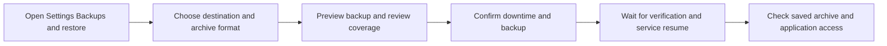
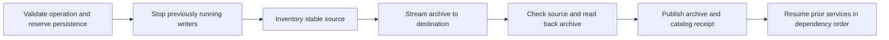

# Installation backup and restore

Open **Settings → Backups and restore** to manage installation archives and
shared backup destinations. This requires a backend advertising installation
backup protocol `1`; older backends continue to expose their existing tools.

## Choose a task

| Task | Start here |
| --- | --- |
| Make an archive | [Create a backup](#create-a-backup) |
| Keep a recurring archive | [Schedule backups](#schedule-backups) |
| Recover an installation | [Restore an existing or fresh installation](#restore-an-existing-or-fresh-installation) |
| Resolve a held startup | [Startup and private recovery state](#startup-and-private-recovery-state) |

Review coverage and storage before the first backup. Archives contain credentials and keys, and are not encrypted.

## What an installation backup contains

The preview inventories DUMB configuration, authentication and signing state,
managed application configuration and persistent data, managed databases, and
configured symlink state. Existing data belonging to disabled services is
included when it is discovered. Review the actual roots and exclusions rather
than assuming that a process's working directory is its complete data directory.

Plex DBRepair's native installation and database directories are included from
the nested `plex.dbrepair` settings when they exist, including when scheduled
repair is disabled. The default installation directory is `/data/dbrepair`.
Its supported `install_dir` and `databases_path` settings supplement the
existing Plex database coverage; see the
[Plex configuration guide](../services/core/plex-media-server.md). A command's
working directory alone does not add its contents to the archive.

Media content, mounted remote libraries, external services and databases,
container images, host deployment files and separate log/cache stores are outside
the installation archive. Application-owned logs, artwork, blob stores and caches
inside an included data root may still be included. Preserve your Compose/Portainer deployment, bind mounts
and external systems separately. A symlink's target text is preserved without
copying the referenced media. Recognized STRM, subtitle, metadata and artwork
sidecars in managed library-link directories are included. Actual media files
and unrecognized regular payloads in those directories remain blockers; DUMB
identifies the path instead of silently omitting it. DUMB refuses unsupported
or ambiguous state instead of silently reporting a complete backup.

Technical details: aliases, archive metadata, and unsupported file types

A managed file or selected service alias is archived as a literal entry, so a
final symlink is preserved without copying its target. A sibling alias under
`data_root` pointing to an already-covered managed directory is also preserved
as literal link state; its target is not copied again. Archive storage
locations and intermediate directories must still be verifiable without
following symlinks. An ancestry error identifies the component that failed and
the reason; clearing it must not require deleting or retargeting service aliases.

Both supported archive formats preserve regular files, directories, literal symlinks,
normal POSIX ownership/permissions and modification times. Hardlinks are stored
as independent files. Extended attributes, ACLs, special permission bits and
unresolved nested mounts are blockers. Nested controller-auth paths or an
inventory that exceeds the restorable transaction budget also require review;
the utility does not silently discard that state.

Archives contain credentials and private keys and are not encrypted.
Restrict access to the destination, partial exports and downloaded copies;
shared storage permission consent does not prove confidentiality.

## Choose storage

In **Backup destination**, expand **Register a backup destination**.
Register an existing container-visible directory, then explicitly select that
destination or **Use global default**. The separate **Global default** controls
show, set or clear the saved preference. See
[Backup storage](backup-storage.md) for registration and mount requirements.

An already-mounted NFS/SMB directory can hold closed archives when it passes the
storage checks. Enable **Allow shared archive permissions** during registration
only when you trust the destination's access controls; it starts unchecked and
restrictive POSIX checks remain the default.
DUMB does not mount shares or change their existing ownership/permissions.
Active database and private recovery working files remain local. A missing or
replaced destination mount blocks the operation;
DUMB does not write into an underlying local directory as a fallback.

A configured backup profile cannot use a managed persistence root itself or a
directory containing one. This includes unselected or disabled profiles:
excluding such a backup location would hide application state from the archive.
Review the reported paths and correct the conflicting profile. A separate
destination or a dedicated child archive directory can still be used when it
passes the storage checks.

## Choose an archive format

Uncompressed `.tar` is the default. When the backend supports Zstandard,
manual backups and the schedule can each select compressed `.tar.zst` archives.
Choose the format before requesting a preview; changing it requires a new
review. Older backends retain uncompressed backups.

Zstandard streams directly to the selected destination without making a
complete uncompressed archive on local disk first. Compression can reduce
storage and transfer volume, but requires CPU time and may save little for
already-compressed data. It does not encrypt the archive or make shared storage
private. Each archive remains a complete, standalone backup; compression adds
neither incremental backups nor deduplication.

Capacity checks remain conservative: they reserve an uncompressed archive
estimate plus overhead, without assuming a compression ratio. A preview can
therefore block for space even if the actual compressed output might fit.
Local inventory/verification ledgers and restore staging still require their
own working space.

DUMB verifies the stored archive bytes and the complete logical contents before
publishing either format. Restore detects compression from the file contents,
not its filename; existing uncompressed archives remain supported.

## Create a backup

Plan for application downtime. Once DUMB stops managed applications, playback, imports, scans, and service UIs remain unavailable until archive checks and service resume finish. The API and frontend stay available through their direct ports. Large data sets or slow storage can take hours; there is no promised finish time.

Use direct frontend/API access before starting. Managed proxies and tunnels can stop with the applications, making their public routes unavailable.

1. Select a destination and archive format in **Settings → Backups and restore**.
2. Choose **Preview backup** to review roots, exclusions, estimated space, and blockers while applications remain running.
3. Stop external writers, including another container sharing the same state.
4. Review the downtime, credential-handling, and external-state acknowledgements, enter the displayed phrase, and select **Start reviewed backup**.
5. Follow the admitted job through archive verification and service resume.
6. Check both the saved archive receipt and application availability before leaving the operation.

On backends advertising `installation_backup_direct_start`, **Back up without preview** skips the live file/size census. It still requires the acknowledgements. DUMB checks coverage, stops the previously running applications, and uses one cold inventory for capacity and archiving. A reviewed start also uses this cold inventory rather than repeating a full live census. Scheduled backups use the same direct path.

If capacity is insufficient, the operation fails before archive payload is written and attempts to resume applications. Measured capacity, required space, and missing space are shown when supported. An admitted scheduled failure waits for its normal interval; transient admission blockers can retry after five minutes.

### Follow progress and confirm the result

The application-wide notice survives navigation and refresh. **Preparing installation backup** describes the admission recheck before an archive job is accepted; it does not mean applications have already stopped. After admission, the job reports its current stage and elapsed time.

Do not stop DUMB or its host while the operation is active. A lost connection or proxy timeout does not prove failure or cancellation. Reconnect through the direct frontend/API and refresh status before submitting another operation. Direct-start retries retain their request identity, and a consumed preview cannot start a second job.

| Result | Meaning and next action |
| --- | --- |
| Archive verified and saved | Source consistency, logical archive checks, stored-byte readback, and catalog publication passed; service resume may still be running |
| Completed | Review the receipt and verify resumed application health |
| Archive saved, recovery required | Keep the receipt; use **Finish backup recovery** to resume services rather than repeating the backup |
| Failed before publication | Partial output is not a verified backup; follow the recovery guidance |
| Publication interrupted / unconfirmed | Inspect the catalog and recovery details before assuming an archive exists or is absent |

DUMB resumes only applications that were running before the backup, in dependency order, with storage mounts ready before their consumers. Previously stopped services remain stopped. A failed resume does not invalidate an already verified and catalogued archive.

Technical details: progress phases and consistency checks

| Phase | What its counters measure |
| --- | --- |
| Inventorying | Entries and logical source sizes; no archive transfer |
| Archiving | Stored archive stream, including headers, padding, and manifest |
| Checking source | A second source read/hash pass to detect changed data |
| Verifying | Readback of the stored archive |

For Zstandard, archive-stream bytes are compressed stored bytes. Source-size and hash counters are uncompressed file data. Counters reset between phases; a percentage describes only a phase with a known total. It is not an overall percentage or a reliable finish-time estimate. A phase reaching its total can still leave later checks and service resume outstanding.

Worker timestamps report actual work updates. Polling status does not itself advance inventory or transfer progress. Older backends can show only stage and elapsed time.

Seerr Sync and Metrics storage operations reserve installation persistence for their complete operations, including SQLite connection cleanup. A busy cycle can delay admission. During the backup hold, those controller writes pause and resume through their normal schedules after the hold ends.

There is no fixed overall file-count or payload-size ceiling. Individual path, nesting, record, metadata, and restorable-transaction checks still apply. Local space is needed for verification ledgers and later restore staging in addition to archive capacity. A large NAS destination does not remove those requirements.

Database consistency requires a stopped [PostgreSQL cluster](https://www.postgresql.org/docs/current/backup-file.html) and quiescent [SQLite databases and journals](https://sqlite.org/howtocorrupt.html#_backup_or_restore_while_a_transaction_is_active).

### If service resume needs attention

Follow the job's exact recovery action and verify the affected service's logs before retrying a backup. For PostgreSQL, a literal `{postgres_config_dir}` in a launch error indicates an older launcher that failed to expand its configured placeholders; it is separate from archive consistency. Update through the normal image path and preserve existing database state.

A pgAdmin connection-registration warning can require account or connection review even when its web service is running. DUMB preserves existing accounts/definitions; it does not replace them to clear the warning.

A successful archive checksum describes recorded bytes. Keep an independent copy and rehearse restore before relying on the archive for disaster recovery.

### Follow or cancel a backup preview

On backends with tracked backup-preview support, the progress notice shows the
current stage and managed root, entries scanned, logical bytes inventoried and
elapsed time. These are inventory counters, not bytes already copied to an
archive. DUMB does not show a percentage or remaining-time estimate before it
knows the complete scope. A quiet counter while a filesystem call is pending
does not by itself mean that the scan failed.

You can leave Settings and return, or refresh the browser, to reconnect to the
same preview while the DUMB controller remains running. The interface checks
its retained status and result rather than automatically starting another scan.
Completion is reported with the same notification style as a user-run update;
review the returned blockers and capacity report before confirming a backup.

**Cancel preview** requests a cooperative stop. Wait until the status reports
**Cancelled**: an in-flight filesystem operation can need time to return, and
the temporary local inventory must be cleaned up before the scan releases its
lock. Cancellation does not stop applications, create an archive or remove
application files. Closing the tab alone does not request cancellation.

Preview tracking is held by the running controller, not a resumable disk job.
After a DUMB restart, request a new preview explicitly. A completed review's
15-minute confirmation window begins after the scan finishes, not when scanning
starts. There is no fixed scan-duration limit.

Starting the confirmed backup rechecks the reviewed coverage. With direct-start support, DUMB does not repeat the complete live file census; its later cold inventory supplies the authoritative size. Older backends can repeat a longer live recheck. The preparation notice reconnects after refresh, and archive-job progress starts after admission.

Older backends keep the synchronous preview flow. Its spinner and elapsed time
indicate a pending request, but cannot provide scan counters, reconnection or
cancellation. Keep that page open to receive its result; refreshing it does not
reliably stop the backend scan.

Estimates are not a reservation: another process can consume space afterward.
Admission is checked again during the operation, and failed or incomplete
output is never advertised as a verified backup.

If the connection drops after a start request, the operation may already have
been accepted. Reconnect through direct frontend/API access and refresh status
before submitting another operation. Keep the recorded job identity when one
was received.

The archive list reports completed archives separately from running or failed
jobs. Record the selected archive and retain an independent copy before relying
on it for disaster recovery. A checksum verifies the recorded bytes; a successful
restore rehearsal remains the practical test of your recovery procedure.

### Cancel a running backup

On backends advertising backup cancellation, **Cancel backup** requests a
cooperative stop for a manual or scheduled installation backup. Keep the
container running and wait for **Cancelled**. An in-flight filesystem or network
operation can take time to return before the worker reaches a cancellation
checkpoint.

This job control becomes available after admission. The earlier coverage and
capacity recheck has not stopped applications or admitted an archive job, so it
does not offer that job's cancel action. Closing the page does not cancel a
submitted start request; keep monitoring its preparation and accepted job state.

DUMB stops archive work, removes only the unpublished output owned by that job,
and attempts to resume the previously running applications in dependency order.
It does not restore an archive or replace application data. Existing completed
archives remain available. If services cannot resume safely, the job reports
**Recovery required** and retains its recovery evidence instead of claiming that
cancellation restored service availability.

Cancellation closes before the verified archive is published. The control is
unavailable once the job has passed that boundary, after completion, and for
installation restores. Closing the browser does not cancel a job. Older backends
can expose **Cancel preview** without supporting cancellation of an actual
backup; those are separate operations.

## Unclassified data in a backup preview

A preview can stop on an unrecognized child of `data_root`, even when that
directory is empty. Current backends identify the first unclassified path and
entry type in the blocker; long or unusual paths are escaped and can be marked
as truncated. The backup job has not started and managed services have not
been stopped.

The inventory follows supported application persistence settings. There is no
generic application/media classification wizard or arbitrary include/exclude
switch for this guard. Review the reported path and its owning service's
actual configuration. Do not add unrelated settings, rename, move or delete
state just to clear the warning. If an existing DUMB-managed path is missing
from coverage, retain it and report its path and owning tool so that its
persistence can be qualified. Custom state and external media require their
own backup/deployment review; DUMB does not silently omit them or sweep them
into an installation archive.

## Schedule backups

Scheduling is off by default. Enable it deliberately, choose its destination,
interval, archive format and retention, then select **Save backup schedule**. Check the next scheduled run and use **Reload saved schedule** to verify the saved choices. The schedule
keeps its own format choice; changing a manual backup does not change it.
Each manual or scheduled run
creates a full, standalone archive; incremental or deduplicated installation
backups are not currently supported. Scheduled backups use the same
coverage, quiescence, admission and verification checks as manual backups, so
schedule them during a suitable maintenance window.

Saving or enabling a schedule requires reviewing the same downtime warning as
a manual backup. Every scheduled run stops the managed applications until its
backup and resume stages finish, which may extend beyond the intended window.
The global backup notice shows scheduled activity too. Changing or disabling
the schedule does not cancel an already-running job; use that job's supported
**Cancel backup** control and wait for its terminal result.

Missed or blocked jobs remain visible. A schedule does not bypass startup,
another active operation, unavailable storage or insufficient space. Retention
applies only to verified scheduled installation archives owned by that schedule;
manual archives and other tools' backups are retained separately.

## Restore an existing or fresh installation

A restore replaces managed state and requires downtime. Keep a separate backup
of the current installation and keep external writers stopped throughout the
operation, including any other DUMB container using the same mounted state.
Restore only archives whose origin you trust.

1. Provision the required container image and original container-visible mounts.
   For a fresh installation, open the backup/restore entry before rerunning
   onboarding or enabling application services.
2. Select a catalogued archive, or enter the container-visible path of an
   installation archive already mounted into the container. The mounted-file
   option does not require the old installation's local catalog receipts.
   If that file has fixed/shared permissions, review its origin and access
   controls before enabling **Allow shared archive permissions**. This is an
   independent checkbox for the mounted file and starts unchecked.
   Catalogued archives use their registered destination's permission policy.
3. Request a restore preview. Review archive integrity, application data roots,
   container/database compatibility, destination identity, space requirements,
   and any existing data that would be replaced.
4. Complete the displayed acknowledgements and confirmation phrase, then start.
5. Follow the retained job. After a successful restore, restart the container
   when instructed so DUMB reloads the restored configuration and authentication.
6. Verify login, mounts, application databases, imports and playback before
   retiring the independent backup.

The restore cannot recreate host mounts or a missing external database.
Incompatible paths, architecture or database state are blockers. Restored
authentication can require the original installation's login after restart.
Keep the original registry image digest with your deployment files; archive
compatibility metadata does not recreate or pin the container image itself.

Restore preview reads and verifies the complete archive. Large NAS archives can
take several minutes; the interface reports verification in progress and does
not automatically submit another request. This read-only phase does not stop
applications. Restore staging is also verified before managed writers are stopped
and live state is replaced.

Archives are checked before extraction into private local staging. Paths,
checksums and file types are validated; archive links cannot direct extraction
outside that staging tree. The restore retains rollback evidence for replaced
state. Where a job advertises **Rollback**, the control is available only after
an eligible completed, failed or recovery-required state; it cannot run while
that job is queued or running. This is recovery of retained state; use the
separate supported **Cancel backup** control for an active backup. It does not
cancel an active restore. A failure during read-only verification does not stop applications.
Before live replacement, DUMB attempts to resume any writers it stopped if the
operation fails. Once replacement has started, or if the previous running set
cannot be safely resumed, DUMB keeps applications blocked for recovery instead
of starting them against a mixture of old and restored data. Use the offered
rollback/recovery action and retain its files until recovery completes.

For a failed installation backup, **Finish backup recovery** continues the
retained service/startup recovery. The original application data remains in
place: this action does not install applications or restore an archive. Follow
any container-restart instruction before expecting services to resume. If the
archive was already verified and saved, its receipt remains available through
this recovery; an application-startup failure does not invalidate that archive.
Older
frontends label this same guarded action **Rollback**; the displayed
job-specific confirmation is still required. For a restore, **Request reviewed rollback**
instead returns the retained application state from before live replacement.
After an instructed restart, refresh status; a recovered job can still show the
failed backup's historical error without indicating another failure.

A change during a cold archive means the stopped-state assumptions were not
met. DUMB also checks the complete source again after streaming. If that final
check fails, the job error identifies a representative added, removed or changed
path, naming the metadata fields that changed or indicating changed file
contents. This is a limited sample, not a complete list of changes. Paths are
escaped for display; field values, file contents and checksums are not included
in the diagnostic.

Retain the path and job error, then identify what can still write to that path,
including another container or host process sharing the directory. Resolve the
actual writer before requesting a fresh preview and backup. An older generic
error alone cannot identify the changed entry or its writer. The failed output
is not a verified backup; do not delete state or edit the job to force acceptance.
Follow the service-resume or recovery guidance above. An operation still marked
queued or running is not eligible for rollback, even if its displayed stage or
error indicates failure. If it cannot reach a terminal recovery state, preserve
its records and request diagnosis.

## Startup and private recovery state

DUMB checks its local installation-recovery records before normal applications
start. If those records require recovery or cannot be trusted, only the API and
already-installed frontend start. Service actions can return `409` while this
installation-wide hold is active; the recovery banner identifies the blocked
controller rather than an individual application's startup failure.

Normal sign-in, session refresh and stateless session verification remain
available during this hold. A held service/setup request does not itself mean
that the browser's credentials expired. Use the retained recovery details
through direct frontend/API access; unrelated configuration and service
mutations remain blocked.

Newer frontends recognize this installation hold during the normal
post-login/onboarding check and open **Settings → Backups and restore**. This
does not mark onboarding complete or perform rollback. With an older frontend,
open and reload `/settings#backups` directly to reach that recovery entry;
normal login is still required. Unrelated API or authentication errors retain
their own diagnostics.

Some configuration mounts give new directories a group-inheritance bit
(**SGID**), even when DUMB creates them with private `0700` permissions. Current
builds recognize that inheritance on otherwise private, eligible controller
state and clear it after a complete safety check. New installation-control
folders are created with controller ownership and mode `0700`. This repair does
not make shared or writable recovery payloads trustworthy: unexpected owners,
shared/special file permissions, links and changed mounts still require review.
The diagnostic distinguishes ownership, permission and mount failures.

Preserve `/config/installation-backups`, its job records and referenced backups
when investigating a hold. Use the relevant retained recovery action, then
restart when instructed. Do not delete the directory, purge databases or apply
recursive ownership/permission changes to clear the banner. A
[major InfiniDysk migration](infinidysk-v2-migration.md#progress-cancellation-and-recovery)
has its own job, cancellation and rollback flow.

## Related tools

- [Symlink operations](symlinks.md) provides smaller link snapshots and schedules.
- [InfiniDysk 2 installation and upgrade](infinidysk-v2-migration.md) has its own
  major-upgrade archive and rollback workflow.
- Application-native backup/export tools and external systems keep their own
  recovery contracts.
