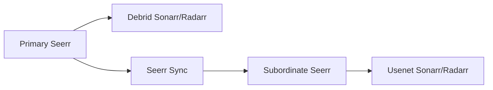

# Seerr Sync

Seerr Sync copies requests from one primary Seerr instance to one or more subordinate instances. Each subordinate sends those requests to its own Sonarr/Radarr stack. It is one-way replication, not a shared request database or bidirectional sync.

Use it when independent stacks should receive the same requests—for example, separate Debrid and Usenet stacks, or libraries at two locations. Each stack still needs working indexers, download clients, profiles, and storage.

## Set it up

1. Open the primary Seerr service page and choose **Tools → Seerr Sync**.
2. Choose the role of each managed instance and select **Save role**. Use the external-instance editors for Seerr servers outside this DUMB installation.
3. Enter reachable URLs and API keys. Use **Test connection** for each external endpoint and correct errors before continuing. Review the sync options and polling interval.
4. Enable sync and select **Save to file**. Wait for **Seerr sync saved**, then reopen the panel to confirm the choices. **Apply in memory** is temporary.
5. Create an intended test request on the primary. Check sync status, the subordinate request, and the resulting Arr entry. If any step is missing, use the checks below before retrying the request.

Technical details: configuration ownership and API integration

Configuration is stored in the top-level `seerr_sync` block and each managed Seerr instance's `sync_role`. The [Seerr service guide](../services/core/seerr.md) documents fields and validation rules; the [API reference](../api/seerr-sync.md) covers status and failed-request reporting.

## Example: Debrid and Usenet stacks

A request made on the primary is copied to the subordinate. The two Arr stacks resolve and download it independently; success on one does not prove success on the other.

## Check a missing request

| Check | What it rules out |
| --- | --- |
| Correct primary/subordinate roles | A request originating on the wrong instance |
| Reachable URL and valid API key | Authentication or container-network problems |
| Sync options and failed-request status | Filtering or a rejected replication attempt |
| Subordinate Seerr request and Arr entry | A downstream problem after replication |

Inspect the failed request before repeatedly retrying it. Seerr Sync does not repair an invalid quality profile, missing indexer, blocked download client, or unavailable media path.
