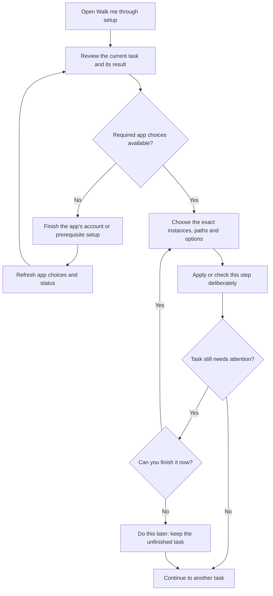

# Setup checklist and automation

DUMB can install services and configure many of their connections. The setup checklist records what DUMB can configure, what needs your input, what was applied, and which checks actually passed. A running process alone does not establish that a download, import, request, or playback workflow works.

This experience requires a DUMB API advertising `setup_arrangements` and a compatible frontend. Older backends retain service-start onboarding and show that they cannot retain or verify a complete arrangement checklist.

## Choose an arrangement, then review its requirements

Categories describe roles: download workflows, library automation, media servers and playback, requests and discovery, access and security, databases and administration, and utilities and interfaces.

The review distinguishes **Chosen by you**, **Required dependency**, and **Optional companion**. A media server is a choice; a database or mount helper can become required by another selection. The existing Core, Optional and Dependent documentation sections are catalogs, not a statement that every core service is mandatory.

Choose the complete arrangement you want. DUMB prepares the selected instance configuration before reconciling connections, so a provider-first selection does not depend on an Arr already existing when its provider starts.

## Before starting

Onboarding first collects the apps and essential installation choices. Confirm
runtime, mount and storage requirements, review the plan, then choose **Start
services**. The optional **Walk me through setup** guide becomes useful after
startup, when the apps can advertise their real choices. Experienced users can
instead open **Show connection settings before startup**; app sections start
collapsed and unfinished choices remain on the saved checklist.

**Review your setup** shows the apps you chose, their purposes and a collapsed
list of supporting services. It explains what DUMB will do when you start and
counts required connection tasks separately from optional work that can wait.
Confirmed blocking checks remain visible. Saved connection choices, technical
checks, the detailed checklist and the masked configuration payload are collapsed
until you choose to inspect them. The review keeps you in onboarding rather than
sending you to an app that has not started yet.

## Connect the running apps

The guide retains incomplete work when a prerequisite or account still needs attention:

Choose **Walk me through setup** on the saved setup panel to work through one
task at a time. From onboarding, it opens the separate **Connect your apps** page
without discarding the saved run or unfinished work. The dashboard and service
pages also offer the guide. **Finish connecting your apps** shows what the current
task does, its result and any earlier steps it needs. It collects decisions DUMB
cannot safely infer:

- Exact Arr and media-server instances to connect.
- Authorized application credentials or an explicitly selected external server.
- Actual quality profiles, root folders, default/4K request routes and languages advertised by the applications.
- Library names, content types and paths, including permission to create a library only when missing.
- Provider accounts and connection allocations.
- Whether an existing connection may be adopted into DUMB management.

For example, select the Arr instance before choosing its quality profile and
library folder. A download location is where the downloader presents completed
files; a library folder is where the Arr application organizes the collection.
Both paths must be meaningful to the application that uses them. Provider
credentials retrieve content; indexer credentials find it. One does not replace
the other.

**Needed for this connection** means the task is required before that connection
can be finished. **Optional** work can be omitted; enable **Include optional
workflow checks** when you want to inspect the separately authorized tests.
Neither label proves that a connection has been tested. **Show full checklist**
lets experienced users work directly with the saved tasks, grouped by app.

Existing external Radarr, Sonarr, Lidarr and Whisparr servers can be registered under **Existing external services**. Give each a stable ID, its direct API base URL and an authorized API key. Select those exact references in supported connection assignments. Discovery is read-only; permission to change an external server's configuration is a separate choice. Supported tasks can configure native download clients, root folders and explicit remote-path mappings after preview and approval. You must create and authorize the actual mounts and enter paths in the correct server's namespace. DUMB does not install or restart an external server.

Lists such as external servers and indexers have individual entries with guided fields. Choosing an installed indexer definition refreshes its advertised settings, including masked credential inputs. Entries omitted from a later draft do not authorize deleting native settings.

Choices refresh as you select targets. Some profiles, roots or generated keys are
discoverable only after first start or initial account setup. An unavailable menu
explains what must be ready first. Use **Do this later** to retain the unfinished
task. After the app is ready, **Recheck this step** or **Refresh app choices and
status** retrieves its current choices and result. DUMB does not offer invented
profiles or treat an instance named `1080p` as a configured quality profile.

An empty list of compatible Arr applications requires selecting or registering
the intended library app. If you do not want that connection, leave it off.
Starting unrelated services does not add a missing application to this list.

**See another task** lets you move through the guide without claiming the current
task succeeded. **Pause walkthrough** closes the guide; it does not cancel work
already accepted by DUMB. Choose **Resume guided setup** from the dashboard or a
matching service page to continue the saved run. Skipping this optional guide
does not complete required connection tasks.

Supported Jellyfin and Emby library forms offer **Scan this new library after creation**, off by default. Review the paths before enabling it. The choice authorizes the initial scan only when DUMB creates that library; it does not rescan an existing library. An empty newly created library may need this initialization before native file-change notifications can discover its first item.

**No media server** and **External server** are different guided decisions. DUMB carries the chosen default into the advertised connection fields for selected request and maintenance services; you can review or change each connection. External URLs must be reachable from DUMB; a hostname or path that works in your browser or on the Docker host may not work inside the container. Keep TLS certificate verification enabled unless you have reviewed the specific connection. An external private network address also requires explicit endpoint authorization.

## Share provider accounts without entering credentials twice

When several selected clients use the same Usenet account, enter it once and choose **Reuse accounts from** that client on the others. The backend resolves the reference to protected account information; the browser does not receive the stored password.

Set each client's allocation and, when known, the account's total connection limit. An account limited to ten concurrent connections could allocate five to InfiniDysk and five to Decypharr. Allocating ten to both would exceed that limit. Include consumers outside DUMB when deciding the available budget. DUMB validates declared selections; it cannot discover every external consumer.

Provider accounts provide Usenet access. They do not create or authenticate indexer accounts.

## Follow progress and finish later

The checklist is available during setup, on the dashboard, and on matching
service pages. On the dashboard and service pages, it starts as a compact setup
summary. It shows unfinished required and optional work, checked tasks and
separate manual confirmations. Select **Setup checklist** or **Show** to expand
the panel. Errors and
backup/recovery holds remain visible while it is collapsed.

The expanded checklist starts with **Task status → Needs attention**, focusing
on unfinished work. Saved but unchecked choices, deferred tasks and failed
checks remain in that view. Choose **All tasks** to include completed work, or
**Checked or confirmed** to review checked tasks and manual confirmations.
Manual confirmation remains distinct from a passed connection check.

Tasks are grouped by app, with each app group collapsed initially. Choose an
app from **App** to focus and open its group, or use **All apps** to browse the
groups. Service pages already scope the checklist to that service or instance.
Task rows show a short summary; open a task for its instructions and controls.
Opening another task closes the previous task's details.

The optional guided setup remains available from the expanded panel. Choosing
**Show full checklist** after onboarding opens the checklist directly; it does
not make you reopen the compact summary first. Collapsing or filtering the view
does not cancel accepted work or change the saved setup results.

Each action reports automation, configuration, verification, missing input and
an explanation. After startup, app links open in a new tab so the checklist
stays available. Last-checked and scheduled-retry times include a timezone, and
attempt counts appear after work has been attempted. Status refreshes continue
during active work and around scheduled retries even while the panel is
collapsed.

| Control | Effect |
|---|---|
| **Walk me through setup** / **Resume guided setup** | Opens the optional walkthrough for the saved run. |
| **Pause walkthrough** | Saves the walkthrough position and closes it without cancelling accepted work. |
| **Do this later** | Retains the walkthrough task as unfinished. |
| **Show full checklist** | Opens the retained checklist directly, grouped by app and focused on unfinished work. |
| **Task status** | Switches between **Needs attention**, **All tasks**, and **Checked or confirmed**. |
| **App** | Focuses one app and opens its task group; **All apps** offers all groups. |
| **Configure this step** | Opens the advertised guided inputs. |
| **Apply configuration** | Submits deliberate changes for that action. |
| **Preview changes** | Inspects current settings and shows proposed field changes without applying them. |
| **Run this check** | Runs the selected optional check within the scope and limits you supplied. |
| **Retry this action** | Retries only the selected action. |
| **Recheck** / **Recheck connections** | Runs available checks and refreshes results. |
| **Retry incomplete automatic steps** | Retries incomplete supported automatic work. |
| **I completed this manually** / **I completed this in the app** | Records your confirmation; it does not mark a connection test passed. |
| **Do later** | Retains unfinished work. Deferring required work does not complete it. |
| **View latest setup** | Loads the backend's latest saved arrangement run. |
| **Continue to dashboard** | Leaves onboarding while retaining unfinished tasks. |

There is no success timer or forced redirect. Leaving onboarding changes a navigation preference, not verification. A backend restart or browser change does not turn interrupted work into success. Correct rejected credentials in the relevant task and retry it rather than restarting unrelated applications.

Manual confirmation can let you continue through the walkthrough, but it stays
separate from verified checks. A failed connection check remains unfinished even
after you confirm that you performed the app's setup.

### During an installation backup or recovery

Setup checks and configuration pause while an installation backup, restore or
recovery controls application data. This is an expected hold, not a failed
connection check or lost setup run. Previously loaded results and the remembered
run remain available; the pause does not clear the open panel's input draft.
Use **Open Backup and restore for status** to inspect the operation.

Finish the offered recovery action, then return to setup and retry the affected task. Keep any previously entered choices; reopening onboarding does not release a backup/recovery hold.

Technical details: request handling during a persistence hold

The checklist suppresses ordinary result requests and disables its configuration
controls while a known hold is active, then refreshes when that hold ends.
A hold reported by the backend before global status is available is checked
again periodically. Other authentication, gateway and unrelated conflict errors
keep their normal error/retry behavior; they are not relabeled as a backup hold.
The hold does not itself log you out: session verification and refresh remain
available while the retained backup/recovery state is reviewed. Complete that
recovery before retrying setup changes; rerunning onboarding does not release it.

### If the checklist cannot load

No saved setup run is a normal result for an existing installation that has not
used the retained setup workflow. The dashboard does not require you to rerun
onboarding to dismiss that empty state.

A failed lookup is different: DUMB cannot establish whether a saved run exists.
The checklist retains any previously loaded results and offers a retry, including
when no results have loaded yet. Its error identifies the request and, when
available, its HTTP status and a safe explanation. It does not discard saved
state or treat an unavailable request as completed setup.

- Authentication failures require restoring the browser's login session.
- An unreachable API or gateway failure requires checking API/proxy availability.
- A private-state ownership or permissions failure requires checking controller
  access to its setup state. Startup preserves controller-owned state separately
  from the application PUID/PGID; do not delete the saved records to silence it.

The startup/readiness banner is separate from retained setup actions. A green
process tile does not establish that every configured service endpoint is ready.
See [Startup lifecycle](startup-lifecycle.md) for phases and readiness checks.

## Understand automation coverage

Coverage counts **applicable required setup actions**, including required manual work. Automatic work, automatic work after input, manual work, applied configuration and verified checks are separate counts.

New API-based connections can initially appear as **Needs review** until DUMB recognizes the installed application's supported contract. Coverage is provisional during this discovery; unknown versions do not count as supported automation. The guided inputs and deliberate Apply control remain available, and unsupported results retain manual instructions.

Where available, DUMB probes the running application's version/capabilities and validates its authenticated settings interface. A release name, branch, successful version response or healthy process alone does not prove that a connection contract is supported. Results describe the checks actually performed; manually confirmed work remains unverified.

AltMount settings authorization is separate from its download-client API key. On recognized guarded versions, the checklist can create the first administrator only after explicit consent and a native zero-user check; you can also use its native UI. Existing accounts are never recreated. DUMB retains an authorized expiring settings session privately and removes the temporary administrator password after successful authorization. WebDAV credential changes need a fresh masked preview and approval, coordination of external consumers, and an explicitly authorized AltMount-only restart when its internal rclone mount needs rebuilding. An expired settings session needs a new login. See [AltMount setup](../services/core/altmount.md#setup-checklist-and-remaining-work).

Process health does not complete an action. Manual confirmation is distinguished from machine verification. Optional work you did not choose does not inflate the denominator.

These are unweighted action counts for the plan version. They do not measure time saved, playback quality, feature completeness, or the proportion of an entire media workflow tested.

## InfiniDysk generation and mount choices

InfiniDysk 1 remains the default and uses rclone. With the advertised setup
runtime capability, selecting InfiniDysk 2 offers historical rclone or native
FUSE and a required handoff to the existing guarded native wizard. Setup cannot
start while that transition is pending. Complete the wizard's preview and
acknowledgements, then refresh the plan. Existing v1 data still requires its
major migration; changing a setup field does not authorize it.

An existing generation 2 installation retains its actual mount choice and
consumer-visible path. A FUSE plan excludes the associated rclone dependency;
it still needs FUSE access and consumer namespace checks. Generation 2 native
provider/account, Arr connection and import-strategy tasks remain manual where
no audited adapter exists. DUMB does not run generation 1 settings automation
against the native runtime or count those tasks as verified.

Keep existing media paths, symlinks and STRM origins under review. The mount
choice alone does not rewrite them or prove external playback. See the
[InfiniDysk 2 guide](infinidysk-v2-migration.md).

## Example: InfiniDysk, Arrs and Plex

1. Select InfiniDysk, the Arr instances, Plex and desired companions.
2. Assign each Arr to its intended provider workflow.
3. Enter or reference provider accounts and connection budgets.
4. Choose actual roots, profiles and libraries as they become available.
5. Review the automatic service, mount and Arr connection actions.
6. Start setup, then finish remaining provider, indexer, Plex authorization and library tasks.
7. Run the offered checks. You can authorize the optional bounded workflow test when supported, then separately review your real request and playback behavior before relying on the complete arrangement.

Prowlarr adds explicit Arr application assignments. Seerr or Pulsarr adds chosen request/watchlist routes; administrator authorization and policy decisions remain separate from making a connection.

## What still needs a decision

The actual checklist depends on selections and supported application interfaces:

Technical details: automation coverage by service

| Services | DUMB can handle or guide | Decisions or checks that remain yours |
|---|---|---|
| Decypharr, InfiniDysk 1, AltMount | Provider inputs/references, selected Arr clients, categories, roots and managed mounts; supported guarded AltMount account/WebDAV setup | Account limits, indexer accounts, administrator/import decisions, credential-rotation/restart consent, external mounts and real imports |
| InfiniDysk 2 | Guarded native installation/migration handoff, detected runtime/mount topology and path prerequisites | Native provider/account, Arr-link and import-strategy configuration until an audited generation 2 adapter is advertised; external playback and real imports |
| Radarr, Sonarr, Lidarr, Whisparr | Selected workflow links and discovered connection choices; supported Lidarr existing-root quality/metadata defaults | Content and quality/language/upgrade policy; a tier in a name does not configure it |
| Prowlarr and supported native Arr indexers | Explicit Arr assignments, schema-backed private/Usenet indexer inputs, preserved native definitions, connection tests and reviewed adoption | Indexer accounts, selected definitions, categories/tags and deliberate enablement/synchronization policy |
| NeutArr | Selected owned Arr connections and opt-out reconciliation | Search schedules, limits and upgrade policy; intentional user disables remain preserved |
| Profilarr | Selected Arr connections, supported profile-database linking, discovered profile selections and reviewed synchronization | Database repository/account authorization, exact profile/format policy and deliberate synchronization |
| Seerr, Pulsarr | Supported authorized media-server/Arr links and explicit profile/root/default routing | First account authorization, permissions, approvals, quotas, watchlists and notifications; Pulsarr metadata credentials where required |
| Bazarr | Selected Sonarr/Radarr links, supported discovered language/profile choices and reviewed native subtitle-provider credential settings | Your provider accounts and native login/search test; deliberate activation can activate existing schedules |
| Maintainerr | Supported selected application connections | Review and activation of retention, unmonitoring and deletion rules; connections never authorize cleanup |
| Tautulli | Readiness-aware Plex connection setup where supported | Administrator setup, Plex authorization, notifications and retention |
| Plex, Jellyfin, Emby, Audiobookshelf | Guarded first administrator for Jellyfin/Audiobookshelf, focused Plex claim, and supported authenticated library creation/reuse | Emby's first administrator remains in its native UI; account authorization, sharing, playback/remote access, host GPU devices and real playback checks remain explicit |
| Riven Backend, Riven Frontend | Source-aware provider handoff, database/backend key/schema/version checks and selected media-server connection | Updater enablement, content sources, scrapers/ranking, library policy and final browser origin |
| CLI Debrid, CLI Battery, PhalanxDB | Compatible Battery/database topology and managed dependencies | Native content/scraper/collection choices and the selected source's supported layout |
| rclone, Zurg | Managed configuration and mount/provider links | Host FUSE/device/bind permissions, access from consumers and optional scan hooks |
| mediastorm | Supported primary-administrator session, explicit initial-password replacement, metadata keys, selected managed/native provider and search-source handoff with readback | Authorized account/provider/indexer choices and budgets; real client/import/playback checks remain separate |
| AIOStreams | Selected Prowlarr/Zilean presets and InfiniDysk/AltMount playback settings in an explicitly chosen encrypted profile, plus public-origin readiness | Profile password/creation consent, compatible playback credentials and public origins; final Stremio installation and preferences |
| Traefik, Traefik Proxy Admin, Authelia, Cloudflared | Runtime dependencies, bootstrap panels and reviewed native TPA domain/application routes | First TPA administrator, DNS, certificate/tunnel settings, notifier setup, identity enrollment and deliberate SSO/protection choices |
| PostgreSQL, pgAdmin, Zilean | Managed database/runtime configuration and supported pgAdmin PostgreSQL registration through its official provisioning CLI | Backup/restore policy, database password on pgAdmin's first connection and Zilean's initial index population |

Unavailable or unrecognized interfaces remain manual, unsupported or needing review. DUMB does not guess successful integration.

## Readiness scope and authorization

Readiness checks do not recursively enumerate remote libraries, scan media collections, or write probe files into media paths. A remote mount, timeout, inaccessible path or consumer namespace that cannot be checked is **Not verified**. It is not a green result and is not automatically a confirmed failure. Review the explanation and perform the indicated consumer-side check.

An optional **consumer path** check can inspect explicitly selected paths from a tracked application's filesystem namespace and effective user/group permissions. Run it deliberately from its retained task. A sample-file read is bounded by your byte limit; remote access also requires explicit authorization. Results distinguish path access, content actually read and a bounded versus complete sample. This does not establish playback or import success, and it does not write a probe file into your library. Missing namespace access remains unverified.

The optional **workflow test** has stronger side effects and separate authorization. Choose the provider, an unmonitored native item with no existing file, media server, authorized sample NZB, download-size limit, timeout and cleanup policy. Reserve that item for the test and leave it unchanged until the run finishes. Preview the exact proposal, authorize the download/import/refresh scope, then choose **Run this check**. Audiobookshelf requires explicit approval of its containing-library scan. Jellyfin and Emby can also use a containing-library scan when you explicitly authorize it; this can initialize a fresh library whose first item is not discoverable through a file-change notification alone. If the installed interface scans all server libraries, DUMB requires separate permission for that larger scope when more than one library exists. Changing those choices needs a fresh preview. Results report separate download, native import, media refresh, bounded stream/decoded-frame and owned-artifact cleanup stages. A partial check does not verify the whole workflow. Rechecking reads the retained test state; it does not start another download. Starting setup or retrying other work never authorizes this test. If cleanup needs attention, select the offered cleanup-only recovery to remove artifacts owned by the recorded test. It does not start another download or import; it may refresh the removed test entry in the media server.

Fresh-account actions require explicit administrator input and evidence that the application is still uninitialized. They do not reset existing accounts. DUMB exchanges temporary administrator credentials for a dedicated application key, then removes the submitted administrator password from retained inputs after successful verification. Resulting application keys stay in protected backend setup state; public responses contain presence markers rather than reusable secrets.

Plex claim tokens are short-lived. Request a fresh token in the retained account task after Plex is ready; retry that task without reinstalling unrelated services. An already claimed server keeps its account.

A Tautulli connection change may require a restart to take effect. DUMB requests explicit permission for that restart; opening or rechecking the checklist does not authorize it.

New library-protection policies created during arrangement setup remain disabled until you review the mount scope and deliberately enable them. Existing configured policies keep their settings. Review the selected media server, credentials and affected paths in [Media Library Protection](media-library-protection.md) before enabling a new policy.

Battery topology is source-specific. Known immutable CLI Debrid releases/commits can advertise audited choices; an unknown branch needs an explicit supported topology choice. DUMB does not infer integrated Battery support from an unverified branch name.

## Preserve existing installations

Existing applications are not fresh merely because you selected them. Accounts, libraries and unowned connections must be reused, preserved or explicitly adopted. Library creation does not authorize deletion or replacement of existing paths.

For supported existing connections, choose **Preview changes** to inspect current and proposed field values. The table identifies DUMB-managed fields and settings needing your approval; credentials are hidden. Approve the specific proposal before applying an adoption. Changing a choice invalidates that approval. If the native configuration changes after inspection, refresh the preview and review the new proposal. Approval does not authorize unrelated fields, target instances or policy changes.

Setup is not a database migration. Use separate [SQLite-to-PostgreSQL migration](arr-postgres-migration.md), namespace migration or [reset/removal](service-reset.md) tools where required.

Setup previews can send entered credentials to protected backend inputs before
you choose **Start services**. Setup records and protected inputs live under
`/config/.dumb-setup`; include them in private configuration backups and protect
them as credential-bearing data. Browser persistence retains only the run
identifier and walkthrough position/preferences, not passwords or unfinished
credential drafts.

## Related pages

- [Onboarding wizard](../frontend/onboarding.md)
- [Service pages](../frontend/service-pages.md)
- [Process management API](../api/process.md)
- [Startup lifecycle](startup-lifecycle.md)
