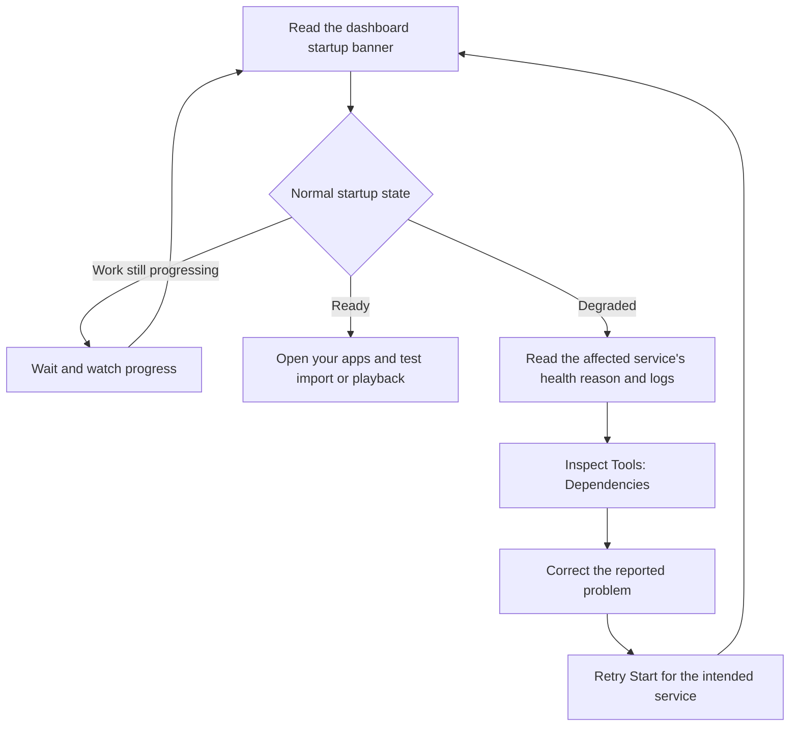

# Startup lifecycle

## Check startup progress

Use the startup result to decide whether to wait, investigate a service, or test the stack:



1. Open the dashboard and read the startup banner. DUMB can show the dashboard while larger services are still installing or starting.
2. Wait while work is progressing. If a service needs attention, open its page, read its health reason, and open **Service Logs**.
3. Use **Tools → Dependencies** to see whether that service is waiting for storage, a database, or another application. Correct the reported problem before retrying **Start**.
4. When startup reaches **Ready**, open the applications you use and test an ordinary import/playback task. **Degraded** means DUMB is still available but at least one enabled service needs attention.

A green running indicator confirms that a process started. Its application and storage may still be preparing; use the readiness result and a real task to check usability.

DUMB distinguishes a service that is still starting from one that is unhealthy
in steady state. The lifecycle is:

1. `initializing`
2. `preinstalling`
3. `starting_services`
4. `stabilizing`
5. `ready` or `degraded`
6. `shutting_down`

<!-- dev:start -->
An interrupted installation restore uses a separate **`recovery_required`**
phase. DUMB starts only the configured API and already-installed frontend for
recovery; normal application setup, services and background workers remain
paused. Use direct frontend/API access, finish the offered recovery action, then
restart the container. Docker health checks the required recovery control plane
instead of treating intentionally paused applications as failed startup.
An unavailable API or missing installed frontend remains a real health failure.

<!-- dev:end -->

The DUMB API starts before enabled-service preinstall. An already-installed
frontend can also start early, so the dashboard can show startup progress while
large service installs or migrations continue.

## Readiness and stabilization

During `stabilizing`, DUMB checks every enabled process and each configured
`port`, `frontend_port`, `backend_port`, and `webdav_port`. Every enabled
service must remain ready for the stabilization window before the lifecycle
becomes `ready`.

<details class="geek-details" markdown="1">
<summary>Technical alternative: startup timing configuration</summary>

```json
{
  "dumb": {
    "startup": {
      "readiness_timeout_seconds": 300,
      "readiness_poll_interval_seconds": 5,
      "stabilization_seconds": 15
    }
  }
}
```

| Setting | Default | Purpose |
|---------|---------|---------|
| `readiness_timeout_seconds` | `300` | Maximum time to wait for all enabled services |
| `readiness_poll_interval_seconds` | `5` | Delay between readiness checks |
| `stabilization_seconds` | `15` | Continuous healthy period required before `ready` |
</details>

<!-- dev:start -->
The readiness deadline starts after the dependency-aware service-launch phase
returns; it is not a maximum duration measured from container creation. Green
process tiles show running processes while this phase also checks their configured
endpoints. The startup banner exposes pending readiness checks and their reasons
so a launch delay, an unopened port and the stabilization window can be distinguished.

<!-- dev:end -->

If the deadline expires, DUMB enters `degraded` instead of shutting down the
API/frontend. The dashboard identifies services that missed readiness, and one
consolidated degraded-startup notification can be routed to operators.

## Startup-safe monitoring

Until startup reaches `ready` or `degraded`:

- Auto-restart does not health-check or restart services.
- Automatic service, resource, database, and recovery notifications are
  suppressed.
- Database Health does not probe a service that is still starting.
- Manual notification tests remain available.
- Docker health reports startup progress instead of declaring the container
  unhealthy merely because a slow service is still initializing.

When startup becomes terminal, notification monitoring records a fresh
baseline. It does not send recovery messages for failures that existed only
during startup. Persistent conditions must still satisfy their normal duration
threshold before they alert.

Auto-restart then applies its grace period. A successful process spawn is only
an attempt; DUMB records `service.auto_restart.succeeded` after the restarted
service passes health checks.

<details class="geek-details" markdown="1">
<summary>Technical details: install concurrency, ownership checks, and network caches</summary>

## Preinstall behavior

Every enabled instance is preinstalled. Instances of the same service key run
sequentially so shared source/runtime trees are not modified concurrently,
while different service keys can still preinstall in parallel.

A failed preinstall is retried through normal service startup. Startup is
reported as degraded only if the service still misses the final readiness
deadline.

## Ownership and network storage

Startup ownership repair no longer performs a full count pass followed by a
second walk. It caps ownership workers and treats correctly owned top-level
trees as healthy, avoiding repeated traversal of large package caches on NFS.
Service-specific setup still repairs a subtree when its top-level ownership is
wrong.

JavaScript package caches are disposable. For NFS-backed `/config`, consider
moving these existing cache roots to host-local storage with the matching
environment overrides:

- `DUMB_PNPM_STORE_ROOT`
- `DUMB_BUN_CACHE_ROOT`
- `DUMB_YARN_CACHE_ROOT`

Keep durable service configuration and databases on storage appropriate for
their recovery requirements.
</details>

<details class="geek-details" markdown="1">
<summary>Technical details: init process, child cleanup, and lifecycle API</summary>

## Container process cleanup

DUMB images run the controller under Tini, a small container init process. It
collects exited orphan processes from bundled services so they do not accumulate
and exhaust the container's PID limit. DUMB continues to supervise its services;
Tini forwards container signals to the controller and preserves its exit code.

This protection is active when using the image's default entrypoint. If you
replace that entrypoint, enable your container runtime's init option, such as
Docker `--init` or Compose `init: true`. Native systemd installations use the
host init process.

See [the PID exhaustion troubleshooting guidance](../faq/dumb.md#why-can-no-services-start-after-the-container-has-been-running-for-days)
for older images.

## API

When capability `startup_lifecycle` is true:

```http
GET /api/process/startup-status
```

The response includes the current phase, timestamps, expected services,
per-service `pending`/`starting`/`ready` state, and terminal failures.
</details>
