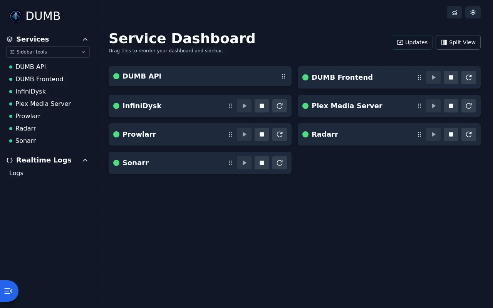

# Use DUMB { #dashboard-guide }

The dashboard is where you set up and manage DUMB. Open `http://<host>:3005` in your browser, replacing `<host>` with the machine running DUMB. Sign in if authentication is enabled.

You can follow the tasks below without editing files or running API commands.

<figure class="docs-visual docs-frontend-figure" markdown="1">

{ loading=lazy decoding=async }

<figcaption class="docs-visual-caption">Select a service card to open that app's controls. DUMB Frontend 1.91.0 · example data. Other versions may look different.</figcaption>
</figure>

## Choose a task

| I want to… | Open this guide |
| --- | --- |
| Set up services for the first time | [Onboarding](onboarding.md) |
| Start, stop, or check an app | [Dashboard](dashboard.md) and [service controls](service-pages.md#status-and-controls) |
| Change a DUMB setting or an app's own setting | [Configuration](../features/configuration.md) |
| Check for updates or install an update | [Auto-update](../features/auto-update.md) |
| Restart an app automatically after a failure | [Auto-restart](../features/auto-restart.md) |
| Sign in or manage DUMB accounts | [Authentication](../features/authentication.md) |
| Read an error or download a log | [Service logs](service-pages.md#logs) |
| Open Plex, Jellyfin, InfiniDysk, or another app | [Embedded UI](service-pages.md#embedded-ui) |
| Back up or repair library links | [Symlink operations](../features/symlinks.md) |
<!-- dev:start -->
| Back up or restore the whole installation | [Installation backups](../features/installation-backups.md) |
<!-- dev:end -->
| Investigate resource use | [Metrics](metrics.md) |
| Change appearance or dashboard preferences | [Settings](settings.md) |

Each task guide explains the controls to use, what to save, and how to check the result. Service-specific account and library setup is covered in the [service guides](../services/index.md).

## DUMB and application accounts are separate

A DUMB account gives operator access to its dashboard, including service and user management. Opening an app inside DUMB does not sign you into that app: Plex, Jellyfin, pgAdmin, and other services may ask for their own account.

See [Authentication](../features/authentication.md) before sharing DUMB access with someone else.

## If the instructions do not match your screen

Check the DUMB and frontend versions in **Settings → About**, then choose **Latest release** or **Development** documentation in this site's header. An older installation may not show a newer tool.

Use a current browser. If the dependency graph's Flow view cannot display, its **Details** view provides the connections as text.

## What Geek mode adds

The normal guides use frontend tools. Geek sections explain the underlying processes and connections, or show alternatives such as API calls, command-line tools, environment variables, and manual configuration.

Geek mode changes these docs; it does not change DUMB's settings. [How the documentation modes work](../reference/doc-versions.md#use-geek-mode-when-you-want-more-detail).

Geek reference: how the dashboard connects and alternative deployment settings

## Ports and live connections

The maintained Compose example publishes the frontend on `3005`. Bundled Traefik uses `18080` for service UI routes; it does not replace the frontend listener.

The frontend proxies backend requests under `/api` and streams status, metrics, and logs over WebSockets. A reverse proxy in front of the dashboard must allow those WebSocket connections. If the connection indicator is disconnected, check proxy and network settings before relying on the displayed sample as current.

## Frontend configuration

Managed installations receive these values from DUMB. A separately deployed frontend must use addresses reachable from its own container:

| Variable | Default | Purpose |
| --- | --- | --- |
| `DUMB_API_URL` | `http://127.0.0.1:8000` | Backend API |
| `DUMB_TRAEFIK_URL` | API host on port `18080` | Embedded HTTP and WebSocket proxy target |
| `NUXT_TELEMETRY_DISABLED` | `1` | Disable Nuxt telemetry |

DUMB injects the current Traefik listener into its managed frontend, including when port reservation moves Traefik away from `18080`.

## Browser support

Use a current Chrome/Chromium, Firefox, Safari, or Edge release. The dependency panel's [Flow view](service-pages.md#dependency-graph-view) uses Mermaid 12 and requires Safari 17.4+ or another ES2024-capable browser. If that view cannot render, use **Details** to inspect dependencies. See the [Mermaid 12 release notes](https://github.com/mermaid-js/mermaid/releases/tag/mermaid@12.0.0) for its browser requirements.

