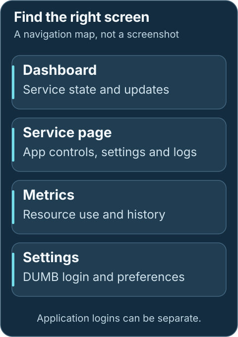

# Dashboard guide

The DUMB Frontend, also called **dmbdb**, is the browser interface for service controls, configuration, logs, and metrics. Open `http://localhost:3005` on the Docker host, or use the host's address from another device.

<figure class="docs-visual" markdown="1">

<figcaption class="docs-visual-caption">A navigation map, not a screenshot. Open a service card for that app; use Metrics and Settings for installation-wide tasks. Available controls depend on the connected backend.</figcaption>
</figure>

## Find a task

| Task | Page |
| --- | --- |
| Set up a new installation | [Onboarding](onboarding.md) |
| Check services or install available updates | [Dashboard](dashboard.md) |
| Edit one service, read its logs, or open its application UI | [Service pages](service-pages.md) |
| Change login, tokens, appearance, or UI preferences | [Settings](settings.md) |
| Investigate resource usage and database pressure | [Metrics](metrics.md) |

The API supplies the available services and tools. Controls that need a newer backend remain hidden when its capability is missing.

## Ports and live connections

The maintained Compose example publishes the frontend on `3005`. Bundled Traefik uses `18080` for service UI routes; it does not replace the frontend listener.

The frontend proxies backend requests under `/api` and streams status, metrics, and logs over WebSockets. A reverse proxy in front of the dashboard must allow those WebSocket connections. If the connection indicator is disconnected, check proxy and network settings before relying on the displayed sample as current.

## Login and application accounts

DUMB can use local accounts, an OIDC provider, or both. Every enabled DUMB user has the same operator privileges, including service and user management. See [Authentication](../features/authentication.md) before sharing access.

An embedded application's login remains separate from the DUMB login. Opening Plex, Jellyfin, pgAdmin, or another service inside the dashboard does not sign in to that application automatically.

## Frontend configuration

Managed installations receive these values from DUMB. A separately deployed frontend must use addresses reachable from its own container:

| Variable | Default | Purpose |
| --- | --- | --- |
| `DUMB_API_URL` | `http://127.0.0.1:8000` | Backend API |
| `DUMB_TRAEFIK_URL` | API host on port `18080` | Embedded HTTP and WebSocket proxy target |
| `NUXT_TELEMETRY_DISABLED` | `1` | Disable Nuxt telemetry |

DUMB injects the current Traefik listener into its managed frontend, including when port reservation moves Traefik away from `18080`.

## Browser support

Use a current Chrome/Chromium, Firefox, Safari, or Edge release. The dependency panel's [Flow view](service-pages.md#dependency-graph-view) uses Mermaid 12 and requires Safari 17.4+ or another ES2024-capable browser. If that view cannot render, use **Details** to inspect dependencies. See the [Mermaid 12 release notes](https://github.com/mermaid-js/mermaid/releases/tag/mermaid@12.0.0) for its browser requirements.
