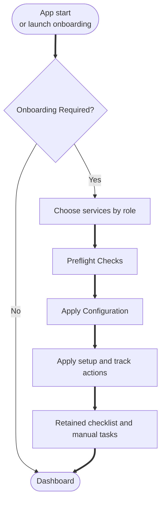

# Onboarding Wizard

The onboarding wizard guides you through the initial setup of DUMB, helping you choose an arrangement, review automatic changes, and retain unfinished configuration tasks.

---

## Overview

The wizard walks you through:

1. Choosing the services in your arrangement by role
2. Running preflight health/readiness checks
3. Configuring debrid service credentials (when applicable)
4. Choosing companion services
5. Customizing service-specific options
6. Choosing exact connections, libraries and policies when supported
7. Reviewing and applying your configuration
8. Following the retained checklist and finishing remaining tasks

---

## Onboarding flow

---

## When to use onboarding

The onboarding wizard runs automatically when:

- DUMB is started for the first time
- No core services have been configured
- You manually navigate to `/onboarding`

You can also re-run onboarding at any time from the Settings page to reconfigure your setup.

---

## Wizard steps

### Step 1: Choose services

Choose the services that form your arrangement. The manual list groups them by role,
including **Download workflows**, **Library automation**, **Media servers and
playback**, and **Requests and discovery**. Category headings and service names
are sorted alphabetically.

Open a category to browse its services, then open a service to read its details
and configure its instances. Expanded descriptions preserve paragraphs, lists,
emphasis, and inline code, with clickable documentation links in both core and
optional service details.

You can keep several categories open at once or use **Expand all** and
**Collapse all**. Category summaries show your selection counts, so you can
review your choices while a category is collapsed. Expanding or collapsing a
category does not change your selections.

Categories containing selected services open initially. If no core services are
selected, the first category opens to help you get started.

!!! info "Chosen services and required dependencies"

    Choose the complete arrangement you want. The review distinguishes your choices, required dependencies and optional companions. Historical core/optional catalog names do not mean every core service is mandatory.

!!! note "Guided setup"

    1. Choose **Debrid**, **Usenet**, or **Both**.
    2. Choose the Usenet workflow service (**Decypharr**, **InfiniDysk**, **AltMount**, InfiniDysk + AltMount, or **All**) when using Usenet.
    3. Decide whether to use **Arrs** (required for Usenet).
    4. If using both workflows, pick **Combined** or **Separate** Arr instances.
    5. (Optional) Enable **multi-quality** Sonarr/Radarr instances.
    6. Select supporting services (Seerr, NeutArr, Profilarr, music/adult Arrs, and optional utilities in later steps).
    7. Click **Apply recommendations** to populate the core services list.

!!! tip "Arr instance layouts"

    - **Combined**: one Arr instance uses a list-based `core_service` when multiple workflow services are selected. Decypharr-only hybrid setups keep `core_service: decypharr`.
    - **Separate**: Debrid and Usenet get separate Arr instances
    - **Multi-quality**: Sonarr/Radarr instances are created per quality tier

---

### Step 2: Preflight checks

The wizard checks these frontend-proxied endpoints before proceeding:

- `GET /api/health`
- `GET /api/process/capabilities`
- `GET /api/process/core-services`
- `GET /api/config`
- `GET /api/config/service-ui`

Backend health, capability and service-catalog failures block the next step. The storage configuration inventory remains **Not verified** because configured path strings do not prove mount readiness or consumer access. It and embedded UI readiness are advisory. Arrangement review adds its own checks: unknown remote storage, timeout or consumer-namespace results remain **Not verified**, distinct from a passed check or a confirmed critical failure.

---

### Step 3: Configure debrid service

For each debrid-capable core service, provide your debrid credentials:

| Field | Description |
|-------|-------------|
| **Debrid Service** | Select your provider (RealDebrid, AllDebrid, etc.) |
| **API Key** | Your debrid service API key |

!!! tip "Finding your API key"

    - **RealDebrid**: [real-debrid.com/apitoken](https://real-debrid.com/apitoken)
    - **AllDebrid**: Account settings :material-arrow-right: API Keys
    - **Premiumize**: Account :material-arrow-right: API Key

For Decypharr, DUMB writes the selected provider, API key, download folder, and mount mode before the service starts for the first time. Decypharr's separate standalone setup wizard should therefore already be complete when you open its UI.

---

### Step 4: Choose companion services

Choose additional services to enable from the same alphabetical, expandable
category layout. Optional roles include **Access and security**, **Databases and
administration**, **Library automation**, **Media servers and playback**,
**Requests and discovery**, and **Utilities and interfaces**.

Categories containing selected optional services open initially; the others stay
collapsed until you open them. Use **Expand all** to browse everything or
**Collapse all** to review the category summaries. Those summaries show selected
and already enabled service counts. Already enabled services remain visible in
their categories with a disabled selection control.

The available services still depend on your backend's supported integrations,
core dependencies, and earlier selections. For example, PostgreSQL may be added
automatically as a dependency rather than offered as a separate choice.
Categories with no matching services are omitted.

Authelia is additionally gated by the backend's `authelia_integration`
capability. dmbdb removes it from the Optional Services list when connected to
an older backend instead of submitting unsupported setup options.

Selecting Authelia enables PostgreSQL and installs the Authelia runtime, but
intentionally does not start Authelia during onboarding. After onboarding, a
**Stopped** or **Unhealthy** Authelia status is expected until you open its
service page and complete **Step 1: Configure and start Authelia**. Only that
first step is required; the DUMB OIDC, TPA OIDC, and ForwardAuth steps are
optional. DNS and an HTTPS Traefik route are required before browser SSO can
work.

!!! warning "mediastorm first login"

    Current mediastorm builds use the public first-login credentials `admin` / `admin`. During that same sign-in, the login form requires a new password and confirmation before creating the first admin session; this works through Docker and reverse proxies. The later mediastorm onboarding page recognizes that the password is already secured and does not require a second change. DUMB's Optional Services step directs you to the mediastorm service page, where the protected bootstrap file keeps older, pinned, or explicitly customized first-login passwords compatible. mediastorm removes the file and DUMB hides the notice after the password changes.

mediastorm's service-options step also allows its OCI runtime to follow `latest` or be pinned to a release tag, full commit SHA, or OCI digest. Leave release pinning disabled for normal automatic updates. See the [mediastorm version-selection guide](../services/optional/mediastorm.md#version-selection) before selecting a fixed build.

!!! info "AIOStreams needs a public URL and dashboard login"

    AIOStreams can start with its generated local `base_url`, but remote Stremio clients require a stable trusted HTTPS origin. Set the final hostname, such as `https://aiostreams.example.com`, then create the matching reverse-proxy route before saving/installing the addon. Onboarding also requires an administrator username and a 12–256-character password for the AIOStreams Dashboard. The Configure page remains public unless you later enable AIOStreams' **Auth Required** setting. DUMB generates and preserves AIOStreams' separate encryption secret automatically. The initial integration uses SQLite by default; PostgreSQL is an advanced `aiostreams.database_uri` override rather than an onboarding toggle or guided migration. See [AIOStreams](../services/optional/aiostreams.md).

For GitHub source-build services, the service-options step also exposes
`commit_sha`. Paste the full 40-character SHA to select an immutable source
revision. Once the SHA is complete, onboarding clears competing release and
branch selections; enabling a release or branch clears the commit pin.

---

### Step 5: Service-specific options

Configure additional settings for selected services:

**Example options:**

- **Zurg**: Custom port, log level
- **rclone**: Mount options, log level
- **Phalanx DB**: Enable/disable for CLI Debrid
- **Decypharr**: FUSE, embedded rclone, external rclone, or no-mount mode
- **AltMount**: FUSE, embedded rclone, external rclone, or no-mount mode
- **InfiniDysk 1**: Fresh-install SQLite or PostgreSQL main database
- **InfiniDysk 2**: Guarded native installation or migration, with historical rclone or native FUSE
- **AIOStreams**: Public base URL and Dashboard administrator credentials

Default values are pre-filled but can be customized.

!!! info "InfiniDysk runtime and mount choices"

    With the advertised setup runtime capability, arrangement review distinguishes
    InfiniDysk 1 from InfiniDysk 2. Generation 1 keeps historical rclone. Generation
    2 can use rclone over WebDAV or native FUSE; FUSE requires the device,
    permissions and mount visibility in every consumer namespace.

    Choosing generation 2 opens the existing guarded installation/migration tool.
    It passes your mount preference without starting a job or accepting its
    acknowledgements. Complete that tool, then refresh the setup plan before
    starting setup. Existing generation 1 data requires major migration; a setup
    option does not convert it. An existing generation 2 installation keeps its
    detected mount choice and paths.

    Native FUSE omits the associated rclone dependency and its options. Review
    Arr/media paths, remote mappings, symlinks and STRM origins separately. Native
    provider/account, Arr-link and import-strategy configuration remains manual
    where no generation 2 setup adapter is advertised. These tasks stay visible;
    process readiness does not complete them. See the
    [InfiniDysk 2 guide](../features/infinidysk-v2-migration.md).

!!! info "InfiniDysk onboarding PostgreSQL is fresh-install only"

    InfiniDysk v1.2.0+ exposes `postgres_enabled` and
    `postgres_database` (default `infinidysk`) in its service options. Enable
    PostgreSQL here only for a fresh InfiniDysk installation, matching
    upstream support.

    For an existing SQLite installation, leave the onboarding option disabled.
    After onboarding, open **Database Migration** on the InfiniDysk service
    page and complete DUMB's guarded rehearsal before cutover. The DUMB adapter
    accepts an official stable v1.2.0-or-newer runtime only while its source
    SQLite and staged PostgreSQL databases exactly match the supported contract;
    schema drift blocks migration until DUMB is updated. Only the main
    `db.sqlite` moves; `metrics.sqlite`, `warden.db`, and
    `usenet-migration.db` remain local and require filesystem backups. If the
    installation still needs an InfiniDysk identity or namespace migration,
    complete that before making any PostgreSQL selection.

!!! note "AltMount still needs deliberate choices"

    Select the mount mode, provider account/reference and intended Arr links.
    Create the administrator, choose an import strategy and validate library
    paths. Unfinished choices remain in the
    [setup checklist](../features/setup-checklist.md); see the
    [AltMount guide](../services/core/altmount.md#first-start-checklist).

!!! info "Instances"

    Services that support multiple instances show instance panels on a single page. Each instance can have its
    own options (including `core_service` routing).

---

### Connections and choices

On compatible backends, choose exact application connections and settings DUMB cannot safely infer: provider-account references, per-client connection budgets, library creation/reuse, actual quality profiles and roots, languages, and default/4K request routes.

Choices refresh when you select targets. Profiles or roots needing an initialized application remain unfinished until first start and can be selected later. **External services** and **No media server** are separate choices. Existing connections require deliberate adoption when DUMB would change unowned settings.

### Embedded service access

When offered, enable proxied service tabs, direct links and split view. This choice does not configure public DNS or external HTTPS origins.

### Review configuration

Review selected services, required dependencies and companions, followed by meaningful library/provider/routing choices with credentials masked.

The plan groups tasks into **DUMB will configure**, **Information you must provide**, and **Finish manually**. Click **Start services** on this review step to apply the plan. A preview or healthy process is not proof of a working complete arrangement.

### Setup progress and retained tasks

The progress page shows the backend checklist and live logs. Configuration, verification, failures and missing input remain distinct. Use targeted apply, retry and recheck controls after correcting the relevant choice.

**Continue to dashboard** leaves onboarding without discarding unfinished work. The checklist remains on the dashboard and matching service pages. There is no fixed success delay or automatic redirect. Manual completion records your confirmation separately from a passed connection test.

See [Setup checklist and automation](../features/setup-checklist.md) for coverage, account reuse and remaining manual tasks. Older backends without this capability show an honest startup result and require you to check each application's configuration.

---

## Skipping onboarding

If you prefer to configure services manually:

1. Navigate to `/onboarding`
2. Click **Skip Onboarding**
3. Configure services individually in Settings

!!! warning "Manual setup caveats"

    Onboarding is the preferred way to add or configure services. Manual edits
    can miss the nuanced wiring DUMB applies for core services, so a manual-only
    setup may fail to fully configure dependencies and integrations.

!!! note "Re-running onboarding"

    You can always return to onboarding from Settings :material-arrow-right: Launch Onboarding.

---

## Configuration applied

The wizard updates `dumb_config.json` with:

- Enabled services
- Selected provider inputs, including supported direct source-mode mappings
- Service options
- Instance configurations

---

## Multi-instance support

For services that support multiple instances (like Zurg or rclone), the wizard:

- Creates instances linked to core services
- Names them appropriately (e.g., "Zurg w/ Riven")
- Configures separate ports to avoid conflicts

For Arr services and NeutArr, instance names can be used to split workflows (e.g., Debrid vs Usenet, or multiple
quality tiers). 

Combined Arr workflows that include Decypharr plus InfiniDysk or AltMount use
`/mnt/debrid/combined_symlinks/<slug>` for the Decypharr-managed root. An
AltMount-only route—or InfiniDysk + AltMount without Decypharr—does not get a
combined root automatically.

---

## External media and Plex authorization

Guided setup separates **External server** from **No media server**. The selected choice becomes the initial connection choice for selected request and maintenance applications; review each application's typed connection form before applying it. External URLs must be reachable from DUMB, and private network endpoints require deliberate authorization.

Plex options no longer require an early claim token before you can continue. Use the retained account task after Plex is ready to submit a fresh claim token when needed. Existing claimed servers retain their account. Plex API tokens and claim inputs are masked.

---

## After onboarding

After leaving the wizard:

1. **Dashboard** shows your services and retained setup checklist
2. **Settings** allows further customization
3. **Service UIs** are accessible (if enabled)
4. **Logs** can be viewed for each service

---

## Troubleshooting

### Services fail to start

- Check logs for specific error messages
- Verify debrid API key is valid
- Ensure required ports are available

### Can't proceed past a step

- Fill in all required fields
- Check for validation errors (red highlights)
- Retry the failed request after resolving its explanation. Refreshing loses unsubmitted credential drafts, but not the backend setup run.

### Need to change configuration

- Resume the retained checklist for unfinished connections or manual tasks
- Use Settings to modify individual services
- Launch Onboarding to review another arrangement; re-running it is not a database migration

---

## Related pages

- [Dashboard](dashboard.md) - Post-setup service management
- [Settings](settings.md) - Manual configuration
- [Authentication](../features/authentication.md) - User setup
