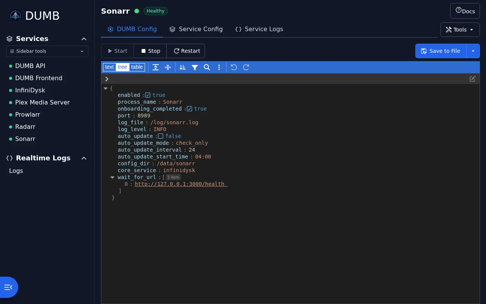

# Service pages

Select a service card to open its status, configuration, logs, and application interface. Frequent controls stay in the command bar; less frequent tools are grouped under **Tools**, beside the tab strip. The tools shown depend on the service and connected backend.

## Choose a task

| Task | Control |
| --- | --- |
| Start, stop, or restart | Command bar |
| Change DUMB-managed settings | DUMB Config |
| Edit the application's configuration | Service Config, when available |
| Read or download logs | Service Logs, when available; otherwise sidebar Realtime Logs |
| Open the application's own UI | Embedded UI |
| Check/install an update | Tools → Updates |
| Inspect a missing dependency | Tools → Dependencies |
| Diagnose with selected evidence | AI Assist |
| Change the page's default tab | Tools → Preferences |

<!-- dev:start -->
## Setup checklist

Retained setup tasks are scoped to the current service and instance. Expand **Configure this step** to supply missing inputs, then apply, retry, or recheck the intended action. Manual completion records your confirmation separately from a passed connection test. See [Setup checklist](../features/setup-checklist.md).
<!-- dev:end -->

## Status and controls

The header shows process status, application health, and restart information. Hover a health badge for the backend's probe reason. **Starting** and **Degraded** are distinct from a restart-relevant **Unhealthy** result.

<figure class="docs-visual docs-frontend-figure" markdown="1">

{ loading=lazy decoding=async }

<figcaption class="docs-visual-caption">Choose a tab for configuration, logs or the application's interface; open Tools for additional tasks. DUMB Frontend 1.91.0 · example data. Other versions may look different.</figcaption>
</figure>

Use **Start**, **Stop**, or **Restart** for the current service. The DUMB API page has no start/stop/restart buttons. A storage operation affecting a protected media server prompts for playback and scan handling before it runs. Dashboard bulk updates use safe mode; use the individual service page to review an override.

**Save to File** persists a configuration. Its DUMB Config split-button also offers **Apply in Memory** for a temporary controller change. Saving configuration does not necessarily restart or reconfigure the application.

### InfiniDysk namespace migration

An eligible legacy NzbDAV installation shows its retained migration notice. Choose compatibility-only branding or run the complete namespace preflight. A fresh canonical InfiniDysk installation does not receive this action.

The full cutover requires a current preflight and downtime acknowledgements. It shows a persistent background job with **Open progress**; navigation or browser refresh reattaches to that job. Restarting DUMB interrupts the job rather than resuming it automatically.

| Result | Next action |
| --- | --- |
| Completed | Perform the [post-migration checks](../services/core/infinidysk.md#after-the-full-migration-succeeds), including paths, scans, and sample playback |
| Failed and rolled back | Verify the legacy stack before retrying |
| Interrupted / rollback attention required | Preserve the named backup and follow the reported targeted recovery; do not toggle providers or move paths manually |

**Review cleanup**, where offered after success, is an irreversible purge of migration recovery/history data. Keep independent backups and complete validation before using it. See the [namespace migration procedure](../services/core/infinidysk.md#migration-from-nzbdav) and [cleanup instructions](../services/core/infinidysk.md#finalize-the-migration-and-remove-recovery-data).

### Reset / Remove

**Reset DUMB configuration** disables the target and restores its DUMB defaults. **Remove service files** additionally removes the exact managed paths listed in its preview. The dialog identifies retained/shared paths and requires the exact process name.

Neither operation is a database reset or media-library cleanup. Read [Service reset and removal](../features/service-reset.md), especially for database-backed services and dependencies.

### Rclone Optimizer tab

Eligible InfiniDysk-backed rclone instances show file selection, safety limits, background progress, candidate results, and apply/rollback controls. The production mount supplies discovery metadata; test reads use isolated shadow mounts and can consume provider traffic.

Set limits for your own hardware, connection budget, and provider. A winning profile is a combined result, not proof that each flag is independently optimal. Missing matched provider evidence is shown as unavailable. Apply/rollback interrupts rclone and verifies mount replacement. Use [Rclone Streaming Optimizer](../features/rclone-optimizer.md) before starting a test.

## mediastorm first-login credential

On supported backends, a masked credential notice appears while mediastorm's bootstrap credential file exists. Reveal/copy it only as needed. Current builds require a replacement password during first login; pinned older builds may require changing it immediately after sign-in. The notice disappears when the bootstrap file is removed. See [mediastorm setup](../services/optional/mediastorm.md#initial-setup).

## Database Migration panel

Supported services expose **Database Migration** through backend capability metadata. The panel separates preflight, rehearsal, guarded cutover, and rollback. A successful rehearsal is required before the frontend enables cutover.

Closing the panel does not cancel the backend job. Reopen it to follow progress. InfiniDysk failures, interruption, or rollback problems retain a recovery banner after navigation and reload; use the reported guarded rollback rather than manual provider/file changes.

The [SQLite-to-PostgreSQL guide](../features/arr-postgres-migration.md) lists supported applications, schema checks, backup requirements, and the limits of rollback.

<!-- dev:start -->
For InfiniDysk 2, the frontend selects the separate [native conversion tool](../features/infinidysk-v2-migration.md#native-postgresql-conversion) for the active generation.
<!-- dev:end -->

## Dependency graph view

Open **Tools → Dependencies** to inspect startup order, missing prerequisites, and relationship signals. Available **Fix now** actions start the identified dependency; review the target before using them.

| View | Shows |
| --- | --- |
| Runtime scope | Hard runtime and explicitly configured dependencies |
| All scope | Runtime edges plus soft/optional application links |
| Details | Dependency reasons and current states |
| Flow | Mermaid graph and parallel prerequisite groups |

Instance links are scoped to the current workflow. An unrelated rclone or Zurg instance is not treated as a valid dependency when the intended mapping is missing. Conditional startup dependencies apply only when the relevant services are enabled. Signals distinguish runtime waits, configured `core_service` links, and optional integrations.

<figure class="docs-visual docs-frontend-figure">
<video class="docs-frontend-video" controls playsinline preload="none" poster="../../assets/images/guides/frontend/v1.91.0/tour-2/dependencies.webp" aria-label="Review a service's dependencies" aria-describedby="dependencies-demo-caption">
  <source src="../assets/images/guides/frontend/v1.91.0/tour-2/dependencies.webm" type="video/webm">
  
<a href="../assets/images/guides/frontend/v1.91.0/tour-2/dependencies.webm">Download the demonstration</a>, or follow the written steps above.

</video>
<figcaption id="dependencies-demo-caption" class="docs-visual-caption">Watch: open Dependencies and compare Details with Flow. Review the named prerequisite before using a Fix now action. DUMB Frontend 1.91.0 · example data. Other versions may look different. <a href="../assets/images/guides/frontend/v1.91.0/tour-2/dependencies.webp">Open the full-size screenshot</a>.</figcaption>
</figure>

With [Geek Mode](settings.md#geek-mode), the panel also exposes API latency, **Copy JSON**, and raw Mermaid source. Use Details if the browser cannot render Flow.

## Process Metrics panel

Geek Mode adds a Process Metrics panel with PID, uptime, CPU/RSS, I/O, ports, connection count, configured paths, container resources, and restart history. It fetches on page entry; **Refresh** requests a new sample.

### Database Health panel

Supported services expose Database Health independently of Geek Mode. Choose **Standard / passive** or **Enhanced / read-only probes** explicitly for the intended service. Opening the panel does not enable collection.

Expanded results include provider/store information, pressure reasons, database/WAL size, filesystem capacity and inodes, network/read-only state, log signals, and bounded probe results where supported. Plex while running, Decypharr append logs, Phalanx Hyperbee, and Zurg state remain passive-only.

**Ignore network storage score** excludes only intentional network placement; low space, inodes, read-only storage, and other signals still count. The panel does not run maintenance, repairs, integrity checks, or migration. See [Database Health](../features/metrics.md#database-health-monitoring) for interpretation and limits.

## Auto-restart policy

Use **Tools → Auto-restart** to select the current service and set its policy. Global defaults and per-service overrides control the interval, failure threshold, restart window, explicit backoff delays, and grace period.

Monitoring pauses during stack startup. A restart is counted as successful only after the service passes its health check. **Starting** and **Degraded** states remain visible without incrementing the unhealthy threshold. See [Auto-restart](../features/auto-restart.md) before changing limits.

Use the [auto-restart controls walkthrough](../features/auto-restart.md#enable-it-for-a-service) to locate the policy before changing and saving it.

## Auto-update settings

| Action | Use it to |
| --- | --- |
| Check for updates | Refresh available version/source information without installing |
| Install update | Apply the reported available update |
| Install configured release/branch/commit | Install the saved source target without overriding it |
| Override + latest | Bypass saved source/version selectors for one install |

The automatic schedule has an enable switch, start time in `HH:MM`, interval in hours, and—on supported backends—**Show on dashboard** or **Install automatically**. Saving reschedules the updater; fixed source selections can disable scheduling.

Checks and installs keep progress when you close their panel or navigate within the app. A background banner reopens the active result. DUMB Frontend updates build a candidate while the current frontend remains running, then briefly disconnect during activation. The page reconnects, reads the backend's retained result, and reloads after confirmed success. An unconfirmed reconnect asks you to review stored status.

Where `update_timing_metrics` is supported, **Install** measures the full operation and **Downtime** measures from stopping the old managed process to verified application readiness. The DUMB API's release notice never replaces the Docker container automatically.

[Auto-update](../features/auto-update.md) explains source strategies and protection prompts. [Install cache](../features/install-cache.md#dashboard-maintenance) covers the dashboard's capability-gated cache usage and cleanup tools.

## Seerr Sync panel

On Seerr pages, **Tools → Seerr Sync** configures the primary/subordinate role, polling, external instances, request options, connection tests, and failed-request status. API keys are masked by default. See [Seerr Sync](../features/seerr-sync.md) for the one-way workflow.

## Configuration editors

### Edit DUMB Config

1. Open **DUMB Config** for the selected service or instance.
2. Change the intended fields in the editor. Keep the existing structure and correct any validation errors.
3. Review the added, changed, and removed settings. Acknowledge highlighted sensitive changes only when intended.
4. Select **Save to File** to keep the change after DUMB restarts. **Apply in Memory**, when offered, is temporary.
5. Reopen the tab to confirm the saved value. Follow the service guide for any required restart/setup action, then check its health and logs.

Invalid JSON or validation errors block saves. Command, path, credential, and networking changes can require acknowledgement.

On the DUMB API page, **DUMB API Logging** can temporarily enable DEBUG without a restart when supported. It shows configured/effective levels and clears the override on container restart. It does not change application log levels. If DEBUG is configured persistently, edit the saved configuration to disable it.

### Edit Service Config

1. Open **Service Config** when the application provides this tab.
2. Change the intended application setting and select **Save Service Config**.
3. Reopen the editor to confirm the saved value. Follow the application's restart/setup instructions and verify the result in its own interface.

Application settings and DUMB-managed settings are separate. Use the [service guide](../services/index.md) to find the correct editor and restart requirements.

Compare the two tabs in the [configuration-editor walkthrough](../features/configuration.md#change-a-setting) before choosing which setting to change.

## AI Assist

1. Choose a diagnostic preset and time/comparison window.
2. Select **Preview bundle** to inspect redacted evidence without a provider call.
3. Select **Analyze** when ready to send that evidence.
4. Review coverage and confidence before acting on the response.

Saved provider profiles are shared with Stack AI Assist. Keys stay server-side. Editing a profile's details marks it unsaved; selecting a different provider does not silently overwrite the saved profile. Deep scans inspect retained backend logs within the configured MiB budget, rather than only the visible log rows.

The [AI Assistant guide](../features/ai-assistant.md) covers supported models, provider setup, redaction, and evidence limitations.

## Logs

1. Open **Service Logs** for the app you want to check.
2. Choose a log level or enter search text to focus on the relevant lines.
3. Select **Refresh now** for a new sample, or choose an interval such as **Every 5s** for repeated checks. Choose **Off** to pause those checks.
4. Keep **Follow tail** checked to scroll to the newest lines. Download a snapshot when you need to keep it.

You can also change the line limit. Service-aware parsing retains application timestamps/severity and groups multiline errors where supported. Traefik offers access logs; Plex offers DBRepair logs when enabled.

DUMB applies its sensitive-data redactor to logs viewed or downloaded here. Review a download before sharing it; arbitrary application output can contain values the redactor does not recognize.

<figure class="docs-visual docs-frontend-figure">
<video class="docs-frontend-video" controls playsinline preload="none" poster="../../assets/images/guides/frontend/v1.91.0/tour-2/service-logs.webp" aria-label="Filter service logs demonstration" aria-describedby="service-logs-demo-caption">
  <source src="../assets/images/guides/frontend/v1.91.0/tour-2/service-logs.webm" type="video/webm">
  
<a href="../assets/images/guides/frontend/v1.91.0/tour-2/service-logs.webm">Download the demonstration</a>, or follow the written steps above.

</video>
<figcaption id="service-logs-demo-caption" class="docs-visual-caption">Watch the log filters, refresh interval and Follow tail controls. DUMB Frontend 1.91.0 · example data. Other versions may look different. <a href="../assets/images/guides/frontend/v1.91.0/tour-2/service-logs.webp">Open the full-size screenshot</a>.</figcaption>
</figure>

## Embedded UI

Enable service UIs in Settings, then open the service's **Embedded UI** tab. Choose its supported base path, use split/full-window view, or open the direct link. A matching enabled TPA HTTPS route can supply a public link; otherwise use the local/private link.

DUMB login does not replace the application's own login. Root-relative APIs, assets, and WebSockets use the frontend's service context. Authelia login and TPA admin SSO open at their public HTTPS origins in a top-level tab.

<!-- dev:start -->
InfiniDysk 2 currently opens at its own root URL. Use the direct local/public address until a validated embedded adapter is advertised; do not substitute a subpath URL into signed playback links.
<!-- dev:end -->

### Service workers and browser notifications

Embedded workers are scoped to the owning service to preserve background updates and destination routing. This routing does not isolate the applications' cookies, CacheStorage, or other storage on the shared frontend origin. Native OS notification delivery also depends on browser and system permissions. A dedicated application origin keeps its own native worker behavior.

### Jellyfin and Emby libraries

Sign in within Embedded UI using an application account allowed to access the libraries. A login at the direct server address may not carry over to the frontend origin. If the same account sees libraries directly but not embedded, update the frontend and reopen the tab; older proxies could incorrectly route library requests under the web client's asset path.

See [Embedded service UIs](../features/embedded-ui.md) for routing and troubleshooting.

## Default tab selection

Use **Tools → Preferences** to choose the default tab, or make the current tab the default. On narrow screens, swipe the tab bar horizontally; edge chevrons indicate hidden tabs.

## Sidebar operator QoL

Use quick status filters, service/config-key search, saved views, compact mode, or `Ctrl/Cmd + K` to find a service. The command palette also supports capturing an assigned service shortcut. **Auto-hide on navigation** is enabled by default and can be disabled for a persistent desktop sidebar.

Sidebar preferences are saved under `dumb.ui.sidebar`. Dashboard drag-and-drop writes `service_order`, which both the dashboard and sidebar use.
