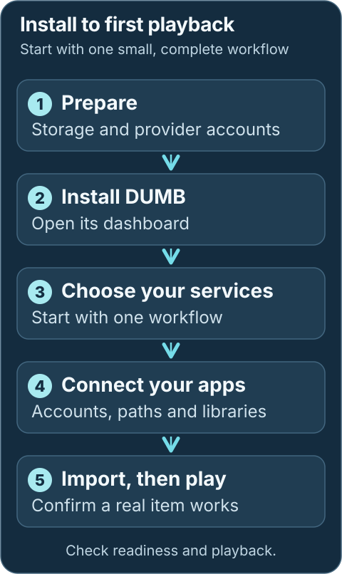
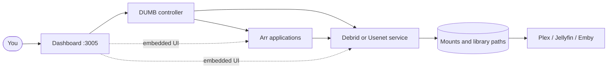

# Start here

DUMB (Distributed Unlimited Media Bridge) runs your chosen media services in one container and gives you a dashboard to configure, monitor, and update them. You can use Debrid, Usenet, or both, with a media server inside DUMB or on another machine.

You choose the services. You do not need to enable the whole catalog.

Use the documentation channel that matches your image: **Latest release** for stable images or **Development** for `dev`. [How documentation versions work](../reference/doc-versions.md).

## Choose a workflow

| What you want | Start with |
|---|---|
| Manage a library with Sonarr or Radarr using Debrid | [Decypharr](../services/core/decypharr.md) |
| Manage a Usenet library with Arr applications | [InfiniDysk](../services/core/infinidysk.md) or [AltMount](../services/core/altmount.md); Decypharr also supports native Usenet |
| Use lists, watchlists, or requests with a Debrid workflow | [Riven](../services/core/riven-backend.md) or [CLI Debrid](../services/core/cli-debrid.md) |
| Run a media server | [Plex](../services/core/plex-media-server.md), [Jellyfin](../services/core/jellyfin.md), or [Emby](../services/core/emby.md) |
| Aggregate sources for Stremio | [AIOStreams](../services/optional/aiostreams.md) |
| Add tools to an existing stack | Browse the [service catalog](../services/index.md); onboarding can skip core workflow selection |

These are starting points, not interchangeable backends. Each service has its own provider support, accounts, and library behavior. Check its guide before choosing.

## From install to first playback

<figure class="docs-visual" markdown="1">

<figcaption class="docs-visual-caption">Start with one workflow and test a real item from import to playback. The steps below link to the instructions for each stage.</figcaption>
</figure>

1. **Prepare storage and credentials.** Read [Before you install](installation.md).
2. **Deploy DUMB.** Choose your host in [Deployment](../deployment/index.md).
3. **Open the dashboard.** The default address is `http://<host>:3005`.
4. **Complete onboarding.** Select services and enter provider credentials. See [Onboarding](../frontend/onboarding.md).
<!-- dev:start -->
5. **Finish application setup.** Review the [setup checklist](../features/setup-checklist.md), including accounts, indexers, root folders, libraries, and any manual tasks.
<!-- dev:end -->
<!-- release:start -->
5. **Finish application setup.** Configure accounts, indexers, download clients, root folders, and media-server libraries in the selected applications.
<!-- release:end -->
6. **Check the workflow.** Add a test item through your chosen application, confirm its import, and play it from the media server. A running process alone does not establish this.

## What runs where

Technical details: control and media paths

DUMB installs and coordinates services. Each upstream application still owns its accounts, provider behavior, database, and content decisions. The [architecture guide](../architecture/index.md) explains the boundaries.

!!! tip "Using a media server outside DUMB?"

    Plan the shared paths before installation. An external application must see the library **and the targets of its symlinks**. FUSE submounts may also require Linux mount propagation. See [rclone and external consumers](../services/dependent/rclone.md).
