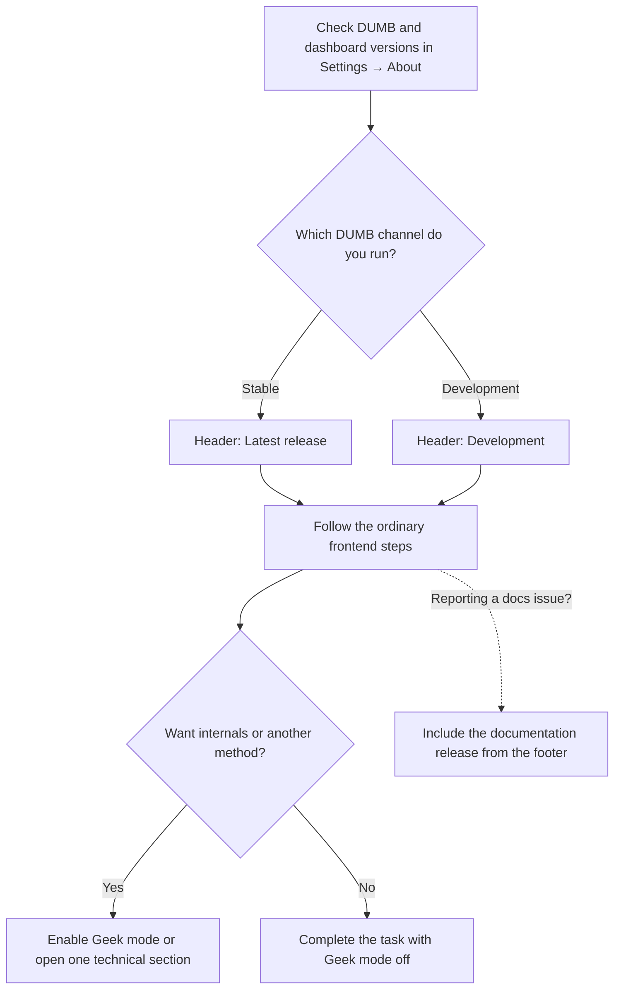

# Choose the right documentation

The selector in the site header switches between **Latest release** and
**Development**. It shows the DUMB version each channel covers. These numbers
refer to DUMB itself, rather than the documentation site's own releases.

The footer shows **Documentation release** with a separate version number and
a link to its release notes. That number identifies the published guides you
are reading; it is shared by both channels. Include it when reporting a docs
problem. A local or pull-request preview is labelled **unreleased** instead.

| Choose | When to use it |
| --- | --- |
| **Latest release** | You run a stable DUMB image, such as `iampuid0/dumb:latest` or a numbered stable tag. |
| **Development** | You run `iampuid0/dumb:dev`, or you want to read about work awaiting a stable release. |

Switching keeps you on the same guide where it exists. A feature that has not
shipped shows an availability page in the release channel with a link to its
development guide. If there is no matching page, the selector opens the other
channel's homepage.

Check the DUMB version shown in the dashboard's **Settings → About** if the
instructions do not match your installation. The dashboard updates independently:
an older dashboard may not show controls supported by its backend, while a newer
one cannot add a missing backend feature to an older DUMB image. Check both
versions in **About**. Individually pinned service versions may also differ from
the examples.

## Choose the version, then the level of detail

The release selector chooses which DUMB behavior the guide describes. Geek mode changes how much of that guide is expanded.

## Use Geek mode when you want more detail

The main guide is for people using the DUMB frontend. It explains where to go,
what to click or enter, how to save the change, and how to check the result.
You should be able to complete that frontend task with Geek mode off.

**Geek mode** adds two kinds of optional material:

| If you want to… | Geek sections provide |
| --- | --- |
| Understand how the feature works | Internal processes, dependencies, request/data flow, and detailed workflow diagrams |
| Use another method | API calls, command-line tools, environment variables, and manual configuration procedures |

For example, the ordinary update guide explains the dashboard's **Check for
updates**, install, and scheduling controls. Its Geek sections explain version
selection and the installer lifecycle, with alternative configuration methods.

The header shows **On** or **Off**. Enabled Geek sections have a light green
background and **Geek detail** label. Your browser remembers the choice, and you
can also open a single section without enabling the whole mode.

Warnings, required frontend steps, deployment guides, community links, and
maintainer support remain visible in both modes. A long frontend procedure is
still a user procedure; it does not become Geek content because it has many steps.

Some pages have no optional Geek sections. Direct links to a heading inside a
closed section open that section so the linked explanation stays reachable.
The [Geek reference](index.md) also provides API, configuration, and architecture
references directly.

This switch changes the documentation display. It does not change DUMB or its
frontend settings. If you see **Geek Mode** inside the DUMB dashboard, that is a
separate setting; see [dashboard Settings](../frontend/settings.md).

## Spot development additions

Each page identifies its documentation channel and DUMB version. **Released
docs** use a blue-green label; **Development docs** use amber. Words accompany
the colors so you can tell them apart without relying on color alone.

In development guides, amber panels and small **Dev** badges identify additions
beyond the released documentation snapshot. A development-only feature page
also states which stable DUMB release does not include that feature. A newly
written guide for an existing feature is labelled **New guide** instead.

## How release docs stay current

The release channel is a snapshot of reviewed documentation. Later development
edits do not silently change its description of the stable image.

A scheduled watcher checks DUMB releases every six hours. When a new stable
release matches the reviewed development version and includes the backend
source covered by that review, the watcher also checks that the compatible
dashboard code has a published stable release. The docs workflow validates and
records that snapshot, then Release Please prepares a documentation release.
After its checks pass, the generated version update merges automatically and
the site publishes from that release's exact source. A maintainer can run the
release check or retry publication manually.

If the release version or source does not match the reviewed documentation,
promotion stops for a maintainer review. This prevents development features
from being presented as released. Shared theme and accessibility fixes can
still apply to both channels.

## Documentation for AI agents

Each channel provides an [`llms.txt`](../llms.txt) index and
[`llms-full.txt`](../llms-full.txt) with its complete documentation text.
Use the files from the channel matching the installed backend. Technical
details are included regardless of the browser's Geek mode preference.
