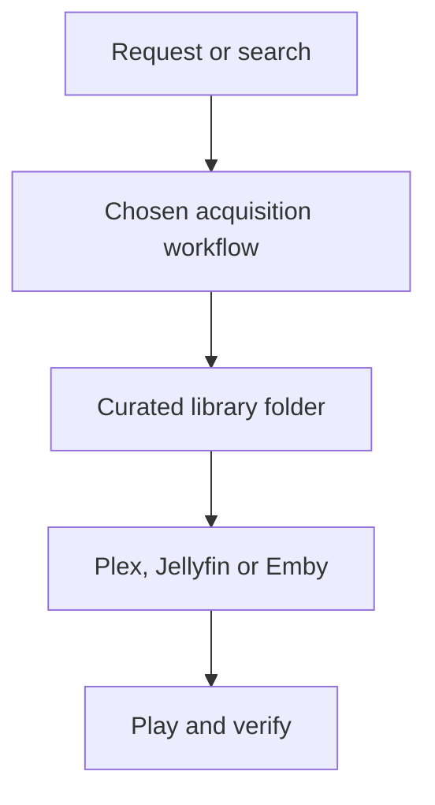

# Core services

Choose core services around the library workflow you want. A media server can use files you already own; a download workflow usually also needs provider accounts, library paths, and one or more dependencies.

<!-- visual:service-flow -->
## At a glance

A complete media workflow connects acquisition, a curated library folder and playback. Use only the parts you need.

Several core services can run together. Check shared paths, provider connection limits, and assigned ports before adding a second workflow.

## Core Service Index

| Service                             | Description                                          | Depends On                        | Optional Integrations        |
| ----------------------------------- | ---------------------------------------------------- | --------------------------------- | ---------------------------- |
| [CLI Debrid](cli-debrid.md)         | Debrid media scraper, automation engine, and upgrade engine              | CLI Battery for standalone upstream layouts; Phalanx DB, rclone, Zurg | Zilean |
| [Decypharr](decypharr.md)           | Debrid and native Usenet workflow service for Arrs, symlinks, and WebDAV access | rclone when external mount mode is used | Zilean, Sonarr, Radarr, Lidarr, Whisparr |
| [InfiniDysk](infinidysk.md) | Usenet WebDAV and Arr download-client workflow | rclone for the default 1.x integration | Sonarr, Radarr, Lidarr, Whisparr |
| [AltMount](altmount.md)             | Usenet streaming, WebDAV, and SABnzbd-compatible Arr workflow             | NNTP provider account             | Sonarr, Radarr, Lidarr, Whisparr |
| [Plex](plex-media-server.md)        | Hosts media collected by core services               |                                   |                              |
| [Jellyfin](jellyfin.md)             | Media server for hosting and playing content         |                                   |                              |
| [Emby](emby.md)                     | Media server for hosting and playing content         |                                   |                              |
| [Seerr](seerr.md)                   | Media request and discovery platform                 |                                   | Plex, Radarr, Sonarr          |
| [Riven Backend](riven-backend.md)   | Debrid media scraper and automation engine           | PostgreSQL; stable mode also uses rclone and Zurg | Zilean, Riven Frontend |
| [Sonarr](sonarr.md)                 | TV automation and organization                        |                                   | Prowlarr, Decypharr, InfiniDysk, AltMount  |
| [Radarr](radarr.md)                 | Movie automation and organization                     |                                   | Prowlarr, Decypharr, InfiniDysk, AltMount  |
| [Lidarr](lidarr.md)                 | Music automation and organization                     |                                   | Prowlarr, Decypharr, InfiniDysk, AltMount  |
| [Prowlarr](prowlarr.md)             | Indexer manager for Arrs                              |                                   | Sonarr, Radarr, Lidarr, Whisparr |
| [Whisparr](whisparr.md)             | Adult content automation and organization             |                                   | Prowlarr, Decypharr, InfiniDysk, AltMount  |
| [NeutArr](neutarr.md)               | Continuous backlog searches for Arr instances         |                                   | Sonarr, Radarr, Lidarr, Whisparr |
| [Profilarr](profilarr.md)           | Profiles and formats manager for Sonarr/Radarr         |                                   | Sonarr, Radarr |

---

## Dependency guidelines

- Enable dependencies required by the installed service layout. DUMB orders managed dependencies during startup.
- Keep raw provider mounts separate from curated library roots. Media servers must resolve the paths used by symlinks.
- Use each Arr instance's `core_service` setting to select its workflow. Review [routing rules](../../reference/core-service.md) before combining clients.
<!-- dev:start -->
- Finish account and library choices in the [setup checklist](../../features/setup-checklist.md).
<!-- dev:end -->

A running process does not confirm a working import or playback path.

## Example workflows

| Workflow | Typical components |
|---|---|
| Debrid automation | CLI Debrid or Riven, the dependencies required by its installed layout, and a media server |
| Arr with Debrid or Usenet | Sonarr/Radarr, Decypharr, indexers, and a media server |
| Usenet streaming | Sonarr/Radarr, InfiniDysk or AltMount, NNTP providers, and indexers |
| Requests | Seerr or Pulsarr connected to selected media-server and Arr instances |
| Existing local media | Plex, Jellyfin, or Emby with readable local media folders |

## Related pages

- [All services](../index.md)
- [Dependent services](../dependent/index.md)
- [Optional services](../optional/index.md)
