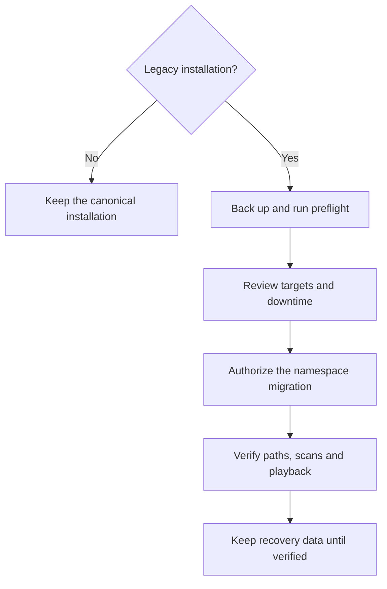

# NzbDAV to InfiniDysk migration

[Back to InfiniDysk setup](infinidysk.md).

<!-- visual:service-flow -->
## At a glance

Only eligible legacy installations need this migration. Keep the backup and review the full procedure before authorizing downtime.

## Migration from NzbDAV

Fresh DUMB installations use the canonical `infinidysk` service key,
**InfiniDysk** process name, `INFINIDYSK_*` configuration prefix,
`/infinidysk` runtime root, `/mnt/debrid/infinidysk` mount, and
`/mnt/debrid/infinidysk-symlinks` library root.

Because that namespace is already canonical, a fresh installation is not
migration-eligible and the dashboard does not show **Review migration**. The
migration job API returns `null` until an actual guarded namespace job exists.

Existing installations are not silently moved. DUMB accepts the legacy
`nzbdav` key, dependency tokens, paths, and `NZBDAV_*` variables, normalizes
them in memory, and continues writing the legacy identity back to disk until
the user opts in. If both top-level service keys are present, DUMB refuses to
guess which entry owns the existing data.

The automatic migration reminder appears only while InfiniDysk/NzbDAV is enabled.
Disabled legacy configuration defaults alone do not trigger it. Disabling the
service preserves migration eligibility, job history, and rollback information;
re-enabling it restores any otherwise-due reminder.

The dashboard presents enabled existing installations with **Review migration** and
**Remind me later**. The reminder is stored by the backend, so it applies across
browsers and reappears after seven days.

!!! danger "Create and verify an independent backup first"

    Before accepting either migration path, back up the DUMB configuration,
    InfiniDysk/NzbDAV state, Arr and Prowlarr databases, affected media-server
    configuration, and the symlink library to storage outside the paths DUMB
    will migrate. Confirm that the backup is readable and restorable. DUMB
    creates a private rollback bundle during migration, but that bundle is a
    recovery aid—not a replacement for an independent backup. The dashboard
    requires an explicit acknowledgement of this backup before it enables
    **Migrate now**.

The available compatibility cutover changes the persisted service identity and
managed process name to InfiniDysk. It can also rename DUMB-generated attached
instance/process labels such as `Radarr NzbDAV` to `Radarr InfiniDysk`. Before
writing those changes, DUMB saves a private copy of the complete configuration
under `/config/migrations/infinidysk-backups`. Saved dashboard ordering,
keyboard shortcuts, and notification service filters follow any renamed
process labels. It does not change:

- `/nzbdav` or another existing runtime path
- `/mnt/debrid/nzbdav` or `/mnt/debrid/nzbdav-symlinks`
- Arr categories, root folders, item paths, tags, or tag IDs
- Arr import-list or Radarr collection root paths
- media-server library paths
- existing symlink targets

The exact former DUMB repository defaults are updated to
[`infinidysk/infinidysk`](https://github.com/infinidysk/infinidysk) so installs
and updates continue to resolve; intentional custom forks remain untouched.
Restart DUMB after accepting the compatibility cutover when the service is
enabled.

!!! warning "Run namespace migration before selecting PostgreSQL"

    Both compatibility-only identity migration and the complete path require
    InfiniDysk's active main provider to be SQLite. DUMB blocks them once
    PostgreSQL is selected because the complete workflow mutates the SQLite
    main store and a compatibility rename would disconnect guarded database
    rollback lookup. Do not toggle providers merely to bypass this check.

The complete namespace migration is offered only after preflight can inspect the participating services and prove that paths, mounts, and destinations can be moved safely. Resolve its blockers in the dialog before accepting downtime. Keep the required independent backup outside the migration paths.

Technical details: full namespace preflight inventory

The optional **Migrate the complete InfiniDysk namespace** path performs the
remaining cutover as one guarded operation. It is not enabled until its
preflight passes. The preflight makes no changes and checks:

- InfiniDysk active reads can be measured;
- InfiniDysk's effective `repair.enable` scheduler state can be inspected and
  changed through its authenticated API when necessary. An enabled value owned
  by an `NZBDAV_CONFIG__...` environment variable is a
  blocker: set that value to `false`, restart InfiniDysk, and rerun preflight so
  DUMB is not fighting an authoritative environment override;
- every enabled Arr API can be inventoried. DUMB includes an Arr when its
  `core_service` metadata links it to InfiniDysk **or** live API inventory finds
  a legacy root/item path, import-list root, Radarr collection root,
  download-client/category reference, or `nzbdav` tag.
  This catches Prowlarr-managed Arrs whose metadata intentionally omits the
  InfiniDysk linkage. The preflight lists included and excluded Arr instances
  with the reason for each decision. Large Arr catalogs use a
  migration-specific 120-second API timeout; current queue entries are reported
  as pending quiescence rather than forcing the operator to empty every queue at
  the same instant;
- every enabled InfiniDysk-linked rclone, Radarr, Sonarr, Lidarr, Whisparr,
  NeutArr, Profilarr, and Seerr instance is inventoried, including singular,
  list, and combined `core_service`/`core_services` values;
- enabled Prowlarr instances are reachable so their Arr application
  connections and the shared legacy `nzbdav` tag can be inventoried. While an
  installation still uses the legacy namespace, normal DUMB setup reuses the
  existing `nzbdav` tag ID for InfiniDysk-linked applications instead of
  creating a competing `infinidysk` tag. Preflight blocks when both labels (or
  both legacy and canonical application names) already exist and would collide
  during rename. This can happen after an older failed migration attempt;
  reconcile the duplicate in Prowlarr, preserving the tag assignments you need,
  and run preflight again;
- affected Plex, Jellyfin, and Emby activity and library APIs can be inspected.
  If no DUMB-managed media server is enabled and both `dumb.plex_address` and
  `dumb.plex_token` are configured, DUMB infers that Plex is external, verifies
  its server identity, and inventories its libraries through the Plex API;
- destination paths do not contain conflicting data;
- active mounts can be detached and every filesystem move is an atomic,
  rollback-safe rename; and
- every detected legacy path is under a supported DUMB-managed root. This
  includes generated attached-service config and log paths such as
  `/radarr/nzbdav` and `/log/rclone_w_nzbdav.log`; paths outside managed roots
  remain blocked for manual review.

Before downtime begins, DUMB stores the complete DUMB configuration, relevant
application configuration/database files, Arr, Prowlarr, and media-library API
snapshots, scan-guard state, and a symlink manifest in a private mode-`0700`
bundle under `/config/migrations/infinidysk-backups`. The symlink snapshot
catalogs link paths and target strings without checking target existence, so
backup cannot trigger reads or metadata waits through the active rclone/FUSE
mount.

These internal snapshots are designed to reverse this specific cutover. They
cannot protect against pre-existing corruption, failure of the storage holding
both the live data and rollback bundle, or unrelated application writes made
during the migration.

When applied, DUMB first enters an automatic quiescence stage. It stops linked
NeutArr, Seerr, Profilarr, and Prowlarr processes so they cannot add new Arr
work. It also captures InfiniDysk's exact effective `repair.enable` value in the
private rollback bundle, temporarily disables the internal scheduled health
checks through InfiniDysk's API, and reads the value back before waiting on
active reads. Health probes already in progress are allowed to finish, but the
scheduler cannot continuously replace them. Each Arr remains available while its current queue drains; DUMB reports
the remaining count in job progress and stops that Arr immediately after its
queue reaches zero. If a failed, held, or otherwise stuck download prevents the
queue from draining, use the still-running Arr UI to remove, retry, or resolve
that entry while its producers remain stopped. DUMB never deletes or ignores
queue items automatically. Affected media servers are handled independently.
DUMB waits for playback to become idle and guards automatic scans. DUMB-managed
servers are stopped as soon as they are safe. An inferred external Plex remains
running because DUMB does not own its process; DUMB cancels/guards Plex scans
through the API and requires it to remain idle. Pause Autoscan and any other
external scan or request producer before cutover because the Plex token cannot
stop those separate processes. DUMB then waits for InfiniDysk reads to drain
and holds every managed stopped service through mutation and validation.

While the persisted job is waiting on verified active playback from a
DUMB-managed media server, **Open
progress** offers **Stop active playback and continue**. The action requires
typing `STOP ACTIVE PLAYBACK`, immediately stops the listed media server, and
therefore terminates its active streams. DUMB then waits for InfiniDysk active
reads to reach zero before continuing. This override applies only to verified
media playback: it cannot bypass Arr queues, unknown media/API state, active
InfiniDysk reads, path conflicts, or any other safety check. Operators may
instead leave the job waiting for playback to finish normally.

The playback-stop action is never offered for inferred external Plex. Stop its
playback from Plex or the owning container/platform, pause Autoscan, and let the
persisted job continue polling. The progress message distinguishes Arr queues,
managed playback, external Plex activity, and remaining InfiniDysk reads so an
active read alone is not mislabeled as a failed Arr queue.

Automatic quiescence waits up to one hour. A transient Arr API or database
failure remains a visible pending condition and is retried during that window;
it does not immediately trigger rollback. If activity remains, an Arr API stays
unavailable through the deadline, or another non-retryable quiescence step
fails, the job aborts before moving namespace paths, restores scan guards, and
restarts only the processes DUMB stopped. This removes the requirement for the
operator to pause every queue, automation producer, and playback session at
exactly the same moment.

After a successful cutover DUMB restores and verifies the captured
`repair.enable` value before restarting request/search producers. If any later
stage fails, rollback restores the captured InfiniDysk database and verifies the
same scheduler value before the job becomes terminal. The scheduler guard is
recorded as `infinidysk-health-check-guard.json` in the private migration bundle.

After quiescence, DUMB detaches
the old rclone mount, moves the runtime/mount/symlink/log paths plus discovered
DUMB-managed attached-service paths, rewrites symlink targets and InfiniDysk
configuration records, saves the canonical DUMB paths, and restarts the stack
in provider-first order. Parent namespace moves and nested generated roots are
planned separately: for example, after moving `nzbdav-symlinks`, DUMB still
renames children such as `radarr-nzbdav` and `sonarr-nzbdav` inside the new
parent. It then verifies that every planned legacy source is absent, every
canonical destination has the expected type, and no raw symlink target retains
the legacy namespace. Every linked service that was running before the
cutover is restarted, and DUMB reruns setup for rclone, Arr, NeutArr, Profilarr,
and Seerr so their generated integration state sees the canonical linkage.
Services that were stopped remain stopped. Any running service whose DUMB
process or instance label is renamed is also included even when its linkage is
otherwise unrelated, preventing an old process from being orphaned under its
former name. Generated provider category directories beneath
`completed-symlinks` are SQLite-backed virtual paths, so DUMB rewrites the
history, queue, and DAV category/path records that materialize them while the
provider is stopped. Do not try to rename those paths through the live FUSE
mount. The database is part of the private rollback bundle. DUMB then updates and verifies
configured or live-reference-discovered Arr root folders, existing
movie/series/artist paths, import-list roots, Radarr collection roots, managed
download-client names/categories, Arr tag labels (without changing tag IDs),
Prowlarr Arr application names and
core-service tag labels (also without changing IDs), and Plex/Jellyfin/Emby
library paths. Compatible Arr builds receive bounded bulk-editor batches for
root-prefix-only item changes; unsupported editor APIs fall back to exact
per-record updates. When a supported bulk editor reports a conflict, DUMB
bisects that batch to isolate the conflicting records instead of converting an
otherwise large catalog into hundreds or thousands of serial API writes. DUMB
validates every resulting API item path and requires the canonical filesystem
path for every file-bearing Arr item and every changed list/collection root
before continuing,
so a partial or incompatible bulk result still fails into the normal rollback
path. The job reports completed/total counts for the current Arr and across all
affected Arrs instead of holding one percentage for an entire large catalog.
Plex identity, scan-guard, inventory, and library-path operations use an
extended API response window because large servers can respond slowly during
cutover. If a Plex library update times out after submission, DUMB does not
blindly submit it again: it reconnects and accepts the change only when the
library exposes the exact requested path set. An unverifiable result still
fails into rollback.

Do not manually change Arr roots or scan a media library while the job is still
running. DUMB keeps media-server scan guards in place until canonical Arr item
directories and media-library paths have passed these checks. After the job
reports success, confirm the new roots contain the expected symlinks, then run
the normal Arr and media-server scans. Keep automatic trash/deletion disabled
until the refreshed libraries and sample playback are verified.

Arr's **Update All** action refreshes existing records; it does not change root
folders, import-list roots, or Radarr collection roots. If manual recovery is
required after an older migration, use the Arr root-folder change workflow and
choose **No, I'll move the files myself** because DUMB already moved the
symlink library. Update import lists and Radarr collections separately before
scanning, then run **Update All** only as the follow-up refresh.

## After the full migration succeeds

Do not start this checklist unless the result is **Namespace migration
completed**. A rolled-back, interrupted, or attention-required result needs its
recovery details reviewed first.

1. Confirm InfiniDysk, its rclone mount, every affected Arr, Prowlarr, and the
   affected media server report healthy.
2. Open each affected Arr and confirm its canonical root is populated, sample
   existing items use the `infinidysk-symlinks` path, and **System → Health**
   has no missing-root or download-client path warning.
3. Open the Arr's main library page and click **Update All** in its top toolbar:
   **Movies → Update All** in Radarr, **Series → Update All** in Sonarr,
   **Artists → Update All** in Lidarr, or the equivalent main-library
   **Update All** action in Whisparr. This is the circular-arrows refresh action
   beside the main library controls—not a System task or root-folder edit. Do
   not use **Change Root Folder** or ask Arr to move files after a successful
   migration—DUMB already updated the roots, existing item paths, import-list
   roots, and Radarr collection roots and moved the managed symlink namespace.
4. In Prowlarr, confirm the affected Arr applications connect and the canonical
   `infinidysk` tag is present where the legacy `nzbdav` tag was used.
5. Keep automatic trash/deletion disabled, then scan the affected
   Plex/Jellyfin/Emby libraries. DUMB updates and verifies their paths but does
   not start the scans.
6. Compare expected library counts, inspect several items, and test playback
   plus seeking for at least one movie and one episode.
7. Only after those checks pass, restore the operator's preferred automatic
   trash/deletion behavior. Retain the independent backup and DUMB rollback
   bundle for a suitable observation period.

The compatibility-only migration keeps all paths unchanged. After that path,
verify InfiniDysk starts, attached services reconnect, and existing playback
works; an Arr or media-library scan is not normally required.

## Finalize the migration and remove recovery data

After the checklist passes and the migrated stack has remained healthy for a
suitable observation period, the InfiniDysk service page can permanently purge
DUMB-owned migration recovery material. This action is optional. It appears
only when the backend advertises `infinidysk_migration_cleanup`, the latest
recorded migration is a successful terminal result, and cleanup has not already
been finalized. It is unavailable during active, failed, interrupted,
rolled-back, or rollback-attention jobs.

Choose **Review cleanup** to request a short-lived preview. The
preview reports counts, total bytes, user-facing deletion categories, retained
categories, and its expiry without exposing private filesystem paths. Review it
after every refresh because the token is bound to the current migration state.
To proceed, acknowledge that:

- the post-migration validation and playback checks passed; and
- DUMB's rollback bundle and detailed migration history will no longer be
  available.

Then type the exact phrase `REMOVE INFINIDYSK MIGRATION DATA` and select the
permanent cleanup action.

Cleanup deletes the detailed InfiniDysk namespace-migration state, preflight
inventory, namespace job history, and DUMB-owned migration backups under
`/config/migrations/infinidysk-backups`. It replaces the state with a small
private mode-`0600` tombstone containing only the selected mode, terminal
status, and finalization metadata. DUMB retains:

- current DUMB and InfiniDysk configuration;
- the InfiniDysk runtime, application data, and databases;
- mounts, symlink libraries, and normal symlink snapshots;
- the minimal controller-owned PostgreSQL cutover authorization and
  database-migration job evidence under `/config/arr-postgres-migration`, which
  keeps restart and guarded database-rollback contracts verifiable; and
- operator-managed backups outside the namespace rollback root.

!!! danger "Cleanup is irreversible"

    DUMB cannot reconstruct the deleted recovery bundle, detailed preflight, or
    job history. Keep independent operator backups somewhere outside the
    DUMB-owned migration backup directory. Cleanup does not delete service data
    or the separate PostgreSQL migration authorization/job store, but anything
    intentionally placed inside
    `/config/migrations/infinidysk-backups` is in the purge scope.

After finalization, the migration notice and manual migration action remain
permanently hidden. Finalizing a compatibility-only migration records that the
retained legacy paths are the accepted final namespace, so DUMB no longer
prompts for the complete namespace workflow.

## If migration or rollback fails

If a stage fails, DUMB stops the partially migrated stack, restores paths and
saved files with their captured ownership and permissions, reapplies and
validates the previous Arr/Prowlarr/media-library references, removes every Arr
root path created only by the failed direction, and restores the exact captured
symlink targets after the original symlink roots are back in place. Missing
symlink roots, restore errors, target mismatches, or obsolete Arr roots make
rollback report that attention is required rather than claiming recovery.
Rollback restarts the original process names and publishes its own path,
symlink-catalog, configuration, service, Arr, Prowlarr, media-library, and
scan-guard progress stages. A
terminal rolled-back job finishes at 100% and retains a redacted root-cause
message; 100% means the recovery workflow finished, not that the requested
cutover succeeded. When rollback needs attention, the dashboard lists the
sanitized component errors and retained backup/config paths. Inspect those
details and verify the legacy stack before performing a targeted repair; do
not manually toggle service/provider settings, blindly restore the complete
bundle, or rerun the migration.

The terminal namespace statuses have different meanings:

- `failed_rolled_back` means DUMB's automatic rollback completed. Verify the
  legacy service, paths, integrations, and playback before generating a fresh
  preflight; do not reuse old preflight approval.
- `rollback_attention_required` means one or more rollback surfaces could not
  be proven restored. DUMB freezes ordinary service/config lifecycle changes.
  Open the persisted result, inspect its component errors and retained paths,
  and repair only the named surface; this is not a signal to restore the whole
  bundle.
- `interrupted` before any namespace filesystem mutation may allow DUMB to
  cold-start the known legacy topology so a new live preflight can be made.
  An interruption at an unknown or post-mutation stage remains frozen for
  recovery review. Never force a provider or path toggle to bypass either
  state.

Older DUMB builds did not retain file ownership metadata in this rollback
manifest. If an older rollback reports that InfiniDysk/NzbDAV cannot read its
configuration path, inspect the owner and mode of the named database and its
SQLite `-wal`/`-shm` sidecars. Restore only the affected files to the configured
PUID/PGID and their prior restrictive mode before restarting DUMB; do not
recursively change ownership across the blob, mount, or symlink trees.

Combined relationships remain combined: for example,
`decypharr, nzbdav` becomes `decypharr,infinidysk`; DUMB does not discard the
Decypharr relationship. Zurg is deliberately not an InfiniDysk migration
consumer. Its `core_service` field is used by other workflows and does not make
Zurg part of this cutover.

## Progress, interruption, and final paths

The complete cutover runs as a backend-persisted background job. The migration
dialog shows the current stage, percentage, and recent stage history. Closing
the dialog or navigating to another page does not cancel the job; a persistent
**InfiniDysk migration running** banner shows the latest progress and reopens
the dialog. Reloading the dashboard or signing in from another browser/device
reattaches to the same backend-owned job. If a browser observes it finish while
the dialog is closed, that browser shows a dismissible result banner once. A
terminal job first discovered after a later reload, sign-in, or focus event is
not announced again as a new completion; its persisted result remains manually
reopenable from the InfiniDysk service page.

The live job record and full preflight inventory are stored as separate private
mode-`0600` sidecars under `/config/migrations`. This keeps job-status polling
small and responsive even when the rollback inventory contains tens of
thousands of Arr records; polling never rewrites the complete inventory.

Do not restart the DUMB container while the migration is active. A backend
restart cannot safely resume an in-process filesystem/API cutover, so DUMB
marks the retained job **interrupted** and directs the operator to inspect its
private backup bundle and current service paths before retrying. Normal dialog
closure and dashboard navigation do not interrupt it.

The final paths are `/infinidysk`, `/log/infinidysk.log`,
`/mnt/debrid/infinidysk`, and
`/mnt/debrid/infinidysk-symlinks`. Historical snapshot filenames are retained;
future scheduled snapshots use `infinidysk-{timestamp}.json`. DUMB intentionally
does not launch Arr or media-server scans after success. Review service health,
then scan the affected libraries so their availability state is refreshed.

!!! warning "Preflight must be current"

    A passing preflight expires after 30 minutes. DUMB repeats structural/API
    checks before starting and then owns the live quiescence window. Queue,
    playback, and active-read activity shown as pending conditions does not
    invalidate the preflight; it must drain during the one-hour automatic
    quiescence stage before DUMB moves any path. The explicit playback-stop
    action interrupts viewers but does not waive the active-read drain.

---
