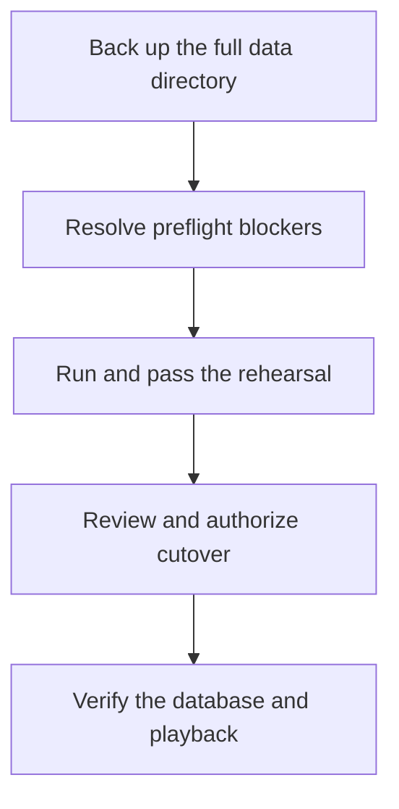

# InfiniDysk 1 PostgreSQL migration

[Back to InfiniDysk setup](infinidysk.md).

<!-- visual:service-flow -->
## At a glance

Keep the independent backup and original SQLite recovery data until the new database and playback have been verified.

This guide covers the InfiniDysk **1.x main database**. SQLite remains the default. A migration changes the main store; it does not move the separate local helper databases or application files.

## Before you start

- Finish any NzbDAV identity or namespace migration first.
- Keep the existing SQLite provider selected and use **Database Migration**. Turning on PostgreSQL directly does not migrate the library.
- Verify an independent backup of the whole InfiniDysk data/configuration directory. After cutover, add tested logical backups of the PostgreSQL database too.
- Keep a recovery window: rollback restores the preserved SQLite state and loses later PostgreSQL-only writes.
- Resolve every preflight blocker. An unrecognized runtime or schema needs support in DUMB before migration can proceed.

## Guarded migration checklist

1. Verify an independent filesystem backup of the complete InfiniDysk
   configuration directory before rehearsal or cutover.
2. Open **Database Migration**, run preflight, and resolve every blocker.
3. Run the required rehearsal. InfiniDysk remains on SQLite while DUMB runs only
   the migration maintenance command and imports and validates the isolated
   PostgreSQL staging database; the normal application is never booted against
   staging.
4. Review the safeguards and start guarded cutover. DUMB takes a fresh cold
   snapshot, imports it, validates it, and only then enables PostgreSQL. Cutover
   requires the SQLite service to be running and healthy and does not complete
   until the PostgreSQL service reports healthy through both `/health` and
   `/ready`.
5. Verify the InfiniDysk UI, provider/queue/history state, WebDAV or rclone
   access, Arr categories and download client, plus representative playback
   and seeking. Confirm the three auxiliary SQLite stores are still healthy.

!!! warning "Validate before accepting PostgreSQL writes"

    Roll back from the migration panel promptly if validation fails. Rollback
    restores the preserved main SQLite state; it cannot copy later PostgreSQL
    writes back into SQLite. The auxiliary SQLite stores never move.

See [SQLite to PostgreSQL Migration](../../features/arr-postgres-migration.md)
for the complete rehearsal, cutover, validation, backup, and rollback flow.

See [PostgreSQL](../dependent/postgres.md) for DUMB-managed database details and
the [pgAdmin/pgAgent backup example](../../faq/pgadmin.md#example-scheduled-backups-with-pgagent)
for scheduled logical backups. Upstream references include the
[official PostgreSQL guide](https://github.com/infinidysk/infinidysk/blob/main/docs/operations/postgresql.md),
[InfiniDysk v1.2.0](https://github.com/infinidysk/infinidysk/releases/tag/v1.2.0),
[native migration issue #1012](https://github.com/infinidysk/infinidysk/issues/1012),
and [InfiniDysk PR #1013](https://github.com/infinidysk/infinidysk/pull/1013).

!!! danger "Do not toggle an existing SQLite installation directly"

    Upstream InfiniDysk currently supports choosing PostgreSQL for a fresh
    installation; it does not provide an in-place `db.sqlite` migration. On an
    existing SQLite installation, leave `postgres_enabled: false` and open
    **Database Migration** from the InfiniDysk service page after the backend
    advertises `postgres_migration` with `infinidysk` in
    `postgres_migration_service_keys`. DUMB fails closed if an existing main
    SQLite store is pointed directly at PostgreSQL; the guided tool is required.

Technical details: supported schemas, source versions, and backup coverage

## PostgreSQL in InfiniDysk v1.2.0+

InfiniDysk v1.2.0 added optional PostgreSQL support for its **main operational
database**. SQLite remains the DUMB default. On a fresh installation, setting
`postgres_enabled: true` makes DUMB enable/start its managed PostgreSQL service,
create the configured `postgres_database`, and supply InfiniDysk's upstream
`DATABASE_PROVIDER=postgres` and `DATABASE_CONNECTION_STRING` values from
DUMB's PostgreSQL settings.

DUMB's migration is a separate guarded workflow: preflight is non-mutating
and a successful rehearsal is required. Official v1.2.0 commit
[`8c960ffc39fc85fdf9166aafd6cb2846878ec3c2`](https://github.com/infinidysk/infinidysk/commit/8c960ffc39fc85fdf9166aafd6cb2846878ec3c2)
is the audited schema baseline rather than a runtime pin. Official stable
v1.2.0-or-newer runtimes are allowed only if both the source SQLite database
and migration-only staged PostgreSQL database exactly match DUMB's supported
contract. The newest audited database contract is InfiniDysk v1.2.5.
Missing, extra, or changed schema objects or migration-history
entries block the operation until DUMB is updated. Cutover takes a fresh
cold backup, resets the named target, imports and validates the main store,
and changes the provider only after validation succeeds. A failed cutover
restores the saved SQLite configuration automatically.

InfiniDysk v1.2.6 and newer write a machine-readable
[`db-contract.json`](https://www.infinidysk.com/operations/postgresql/#database-contract-file-since-126)
after every successful migration pass. DUMB verifies that the source file
describes the live SQLite provider and exact applied migration history, then
requires the isolated staging run to write a matching PostgreSQL contract.
A present but malformed, stale, unsafe, or mismatched contract blocks the
operation. A missing file warns and falls back to DUMB's exact audited checks
so v1.2.0-v1.2.5 remain supported. The file does not make an unknown schema
automatically safe; DUMB must still carry an audited schema/catalog contract
for that history.

After a guarded cutover, DUMB blocks directly toggling PostgreSQL off. Use
the migration job's explicit rollback action promptly when validation
fails; it validates the preserved source before restart. PostgreSQL writes
are not merged back into SQLite.

Cutover also stores the exact full commit of the runtime that performed the
migration. PostgreSQL does not permanently pin InfiniDysk to stable release
mode: official release tags, branches, and full commit pins remain usable
when GitHub proves that the selected commit is the cutover commit or a
descendant. DUMB rejects older, diverged, or unverifiable targets before
saving the source selection or starting the service.

Treat that recorded commit as a permanent minimum version notice for the
PostgreSQL deployment. Installing anything older requires a guarded rollback
to SQLite first, and rollback does not merge later PostgreSQL writes into the
preserved SQLite database.

Complete any NzbDAV-to-InfiniDysk identity or full namespace migration
before making any PostgreSQL selection or starting Database Migration. The
full workflow rewrites and validates the SQLite main store, while an
identity rename would disconnect guarded rollback job lookup. DUMB
therefore blocks every namespace mode once PostgreSQL is selected.

PostgreSQL replaces only `db.sqlite`. These stores remain local beneath the
InfiniDysk configuration directory and still need filesystem backups:

- `metrics.sqlite`
- `warden.db`
- `usenet-migration.db`
- `blobs/`, `session.key`, and the rest of the application configuration

InfiniDysk's application backup does not include the PostgreSQL main database.
A complete backup therefore needs both:

1. a tested logical `pg_dump`/`pg_restore` workflow for the configured
   PostgreSQL database; and
2. a filesystem backup of the InfiniDysk configuration/data directory,
   including the local SQLite helper stores, blobs, and `session.key`.

DUMB keeps job-specific SQLite and configuration backups under
`/config/arr-postgres-migration`, but that recovery bundle is not a substitute
for a verified independent backup stored outside the paths DUMB manages.

