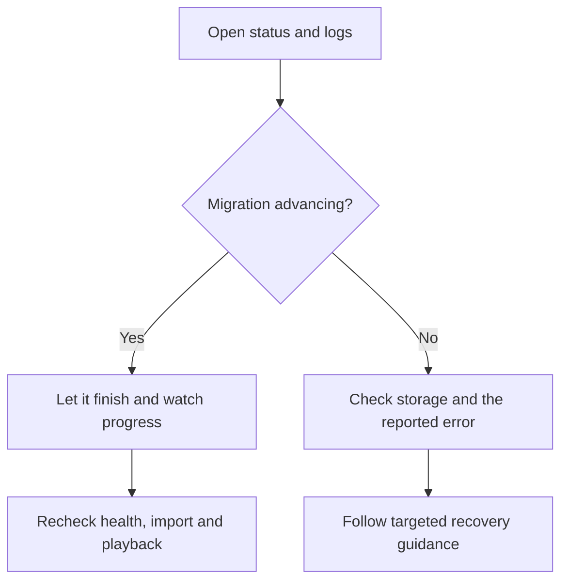

# InfiniDysk troubleshooting

[Back to InfiniDysk setup](infinidysk.md).

<!-- visual:service-flow -->
## At a glance

Check the reported state before restarting. A legitimate database migration can accept connections while the application is still starting.

## InfiniDysk starts but its port is already open

The maintained InfiniDysk fork serves a controlled migration status responder while
blocking database migrations run. During that phase the backend port can accept
connections, but `/health` returns HTTP `503` with
`{"status":"migrating"}`. DUMB's service health shows **Starting** and keeps
stack readiness open until InfiniDysk's real backend returns `Healthy`.

This is not an Auto-restart failure. Do not repeatedly restart or interrupt a
legitimate migration. Open InfiniDysk's embedded UI to view its migration progress.
If the state never advances, inspect InfiniDysk logs and available storage before
deciding whether recovery is required.

## Compare InfiniDysk performance

Open the InfiniDysk service page's **AI Assist** tab and choose **Performance** to compare a selected window with the previous matching period or with the period before the latest DUMB-saved setting change.

In addition to generic logs and process metrics, DUMB can read the maintained fork's `metrics.sqlite` and `db.sqlite` in read-only mode. The evidence includes queue worker settings, segment success/missing/error/retry rates, provider latency, read-session activity, queue completion/failure timing, long-running queue processors, and busy-period throughput.

Use **Preview bundle** first to confirm native telemetry is available and check the exact coverage. These metrics do not measure Plex click-to-first-frame latency, so playback-start conclusions should remain qualified unless Plex-side timing is correlated separately.

See [AI Assistant](../../features/ai-assistant.md#infinidysk-native-evidence) for the full evidence and safety model.

## Assess SQLite pressure

By default, InfiniDysk stores its main operational database and local metrics/helper stores in SQLite. A fresh v1.2.0+ installation or successful guarded DUMB cutover can move only the main database to PostgreSQL; the DUMB migration adapter accepts official stable v1.2.0-or-newer runtimes only while the source and staged target exactly match its supported database contract. `metrics.sqlite`, `warden.db`, and `usenet-migration.db` remain local SQLite files. DUMB can monitor the detected database surfaces from **Metrics → Settings → Database Health Monitoring** or the InfiniDysk service page's **Database Health** panel.

Start with **Standard / passive** mode and collect through normal imports, health checks, and playback. Use **Enhanced / read-only probes** when you also want bounded metadata latency. Repeated lock/busy/timeout errors, sustained WAL growth, slow probes, or network-filesystem placement are stronger signals than database size alone. Moving the main database does not resolve pressure in a separate local helper store, so check which file/provider owns the signal before changing the main database provider. See [Metrics Collection](../../features/metrics.md#database-health-monitoring) for the safety boundary and interpretation guidance.

## Integration and update checks

!!! warning "Permission changes"

    DUMB updates Arr media-management permissions to enable chmod operations (folder `777`, file `666`).
    If you manage permissions manually, review these settings after integration.

* If rclone fails to authenticate, verify `WEBDAV_USER`/`WEBDAV_PASSWORD` and restart the container.
* If Arr download clients are not created, confirm each Arr instance is enabled and has a readable `config.xml` for API key discovery.
* If Arr root folders are missing, verify `core_service` includes `infinidysk` and the Arr API is reachable.
* Every release install automatically tries InfiniDysk's matching verified Linux
  x64/ARM64 prebuilt archive first. If the archive is absent, has no published
  SHA-256 digest, fails validation, or is not available for the current
  architecture, DUMB keeps the live runtime untouched and automatically falls
  back to the source build. This behavior is inherent and has no user-facing
  toggle. For the official InfiniDysk repository, the moving `prerelease` selector
  follows its `rc` channel; this avoids selecting a newer development snapshot.
  Its installed marker is `<tag>-<short-sha>`; update checks resolve the current
  tag commit before comparing, so an unchanged prerelease is reported as current
  while a tag moved to a different commit remains detectable.
  Source fallback resolves the selected tag to its immutable commit before
  downloading; branch/commit installs use an on-demand managed .NET SDK.
  DUMB merges the InfiniDysk-specific build variables with the container environment so system tools
  remain available, and invokes `/bin/bash` explicitly when installing the SDK.
  An error such as `No such file or directory: 'bash'` indicates an image that
  predates this fix and should be retested after pulling a fixed tag and
  recreating the container.
* If a production v1.2.0 update fails with a permission error for
  `session.key`, update/restart DUMB so its bounded writable-state preflight
  repairs that file to the configured PUID/PGID. DUMB also protects
  `session.key` from release archive clear/merge replacement. Do not delete
  the key unless you intentionally want to invalidate existing InfiniDysk
  sessions.
* Check `/log` for InfiniDysk startup errors, and ensure `frontend_port`/`backend_port` are not already in use.

---
