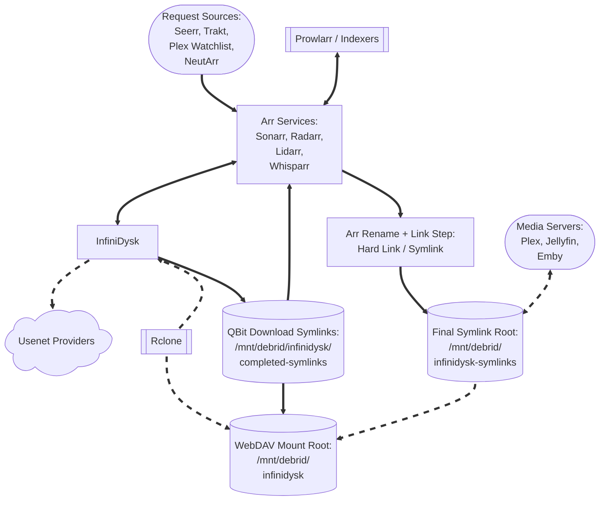

# InfiniDysk (Core Service)

**InfiniDysk** is a combined backend + frontend WebDAV service for **Usenet** workflows. In DUMB it runs as a single service that exposes a Web UI, a WebDAV endpoint for browsing/serving content, and a backend API used for automation.

<!-- dev:start -->
DUMB keeps InfiniDysk 1.x as the default. DUMB API 2.24.0 or newer can offer the
separate [InfiniDysk 2 installation and upgrade wizard](../../features/infinidysk-v2-migration.md).
The workflow below describes the default 1.x integration unless a section says otherwise.
<!-- dev:end -->

## First start

1. Choose InfiniDysk as your Usenet workflow in onboarding.
2. Open InfiniDysk and add/test your NNTP provider accounts. Allocate connections within each provider's account limit.
3. Review the selected Arr clients, categories, and library paths. Add and test indexers in Prowlarr or the Arr application.
4. Verify that the mount is readable, then test an intended import and playback through your media server.

Existing NzbDAV installations should read [Migration from NzbDAV](infinidysk-migration.md) before changing names or paths.

<!-- dev:start -->
## Setup checklist and remaining work

Choose intended Arr instances and provider accounts in the setup checklist. Other selected Usenet clients can reference InfiniDysk's accounts with separate connection allocations. Review the shared limit, add/test indexers, verify mount access and test a real import. Runtime readiness and Arr connections are separate results.

Requires the backend setup-arrangement capability. See [Setup checklist and automation](../../features/setup-checklist.md) for retained tasks, coverage and safe retries.

The account-sharing and automatic connection steps above describe generation 1.
Generation 2 uses the guarded native wizard for installation/migration and
mount selection. Refresh the setup plan afterward; native account/provider,
Arr-link and import-strategy work remains manual where no generation 2 adapter
is advertised. Native FUSE excludes the associated rclone dependency while
preserving the existing consumer path.
<!-- dev:end -->

## Workflow diagram



---

## Service Relationships

| Classification | Role                                                     |
| -------------- | -------------------------------------------------------- |
| Core Service   | NZB WebDAV gateway                                       |
<!-- dev:start -->
| Mount          | [rclone](../dependent/rclone.md) by default; optional native FUSE with generation 2 |
<!-- dev:end -->
<!-- release:start -->
| Mount | [rclone](../dependent/rclone.md) |
<!-- release:end -->

| Optional       | Sonarr, Radarr, Lidarr, Whisparr, Prowlarr, NeutArr      |
| Exposes UI     | Yes (Web UI + WebDAV)                                    |

---

## What InfiniDysk provides

| Endpoint | Purpose | Default |
|----------|---------|---------|
| Web UI + WebDAV | Primary UI and WebDAV endpoint | `http://<host>:3000/` |
| Backend API | Internal API for DUMB automation | `http://127.0.0.1:8080/` |

InfiniDysk also exposes a **Usenet download client** path in Arr by emulating a Sabnzbd-compatible API. DUMB registers this client automatically when `core_service: infinidysk` (or `core_service` includes `infinidysk`) is set on Arr instances.

!!! info "WebDAV endpoint"

    InfiniDysk 1.x has separate frontend and backend listeners. Managed rclone
    uses the internal backend WebDAV endpoint; the frontend can proxy WebDAV
    for clients. Keep existing external stream origins reachable.

---

!!! warning "WebDAV credentials"

    If `webdav_password` is blank, DUMB generates one at startup and stores it in the config.
    Change the password before exposing InfiniDysk outside your trusted network.

!!! danger "Protect API keys"

    `FRONTEND_BACKEND_API_KEY` grants backend access. Treat it like a secret and avoid committing it to source control.

<details class="geek-details" markdown="1">
<summary>Technical details: configuration reference</summary>

## Configuration in `dumb_config.json`

!!! important "DUMB defaults to InfiniDysk"

    DUMB installs and updates the renamed project from
    [`infinidysk/infinidysk`](https://github.com/infinidysk/infinidysk) by
    default. The legacy `nzbdav` DUMB service key and `NZBDAV_*` environment
    variables remain compatibility aliases. Existing configs containing either
    former DUMB repository default, `nzbdav-dev/nzbdav` or `nzbdav/nzbdav`,
    follow the maintained repository automatically; intentional custom forks
    remain unchanged. User-visible identity changes remain opt-in.

<!-- dev:start -->
!!! important "Supported InfiniDysk versions"

    `runtime_generation: "1"` remains the default. Its `latest` and `prerelease`
    channels stay on official InfiniDysk 1.x; selecting a 2.x release through
    the 1.x release, branch or commit fields is refused. Named 1.x refs must
    belong to the upstream `v1` maintenance line before installation.

    Generation 2 is an explicit opt-in through the separate wizard and requires
    DUMB API 2.24.0 or newer plus the advertised protocol 1 capabilities. This
    integration currently accepts only the verified `v2.0.0-beta.6` native
    artifact. It does not fall back to a source build or silently replace 1.x.
    Existing data requires a guarded major migration; changing the generation
    field does not convert a database. See the
    [upgrade guide](../../features/infinidysk-v2-migration.md) for eligibility,
    mount choices and current containment limitations.
<!-- dev:end -->

!!! tip "Support the maintainer"

    If InfiniDysk is useful to your stack, you can support the maintainer
    through [Buy Me a Coffee](https://buymeacoffee.com/hoivikaj). DUMB also
    exposes this link through the frontend's InfiniDysk service page and
    **Settings → About**.

```json
{
"infinidysk": {
    "enabled": false,
    "process_name": "InfiniDysk",
    "repo_owner": "infinidysk",
    "repo_name": "infinidysk",
    "release_version_enabled": false,
    "release_version": "latest",
    "commit_sha": "",
    "branch_enabled": false,
    "branch": "main",
    "suppress_logging": false,
    "log_level": "INFO",
    "frontend_port": 3000,
    "backend_port": 8080,
    "postgres_enabled": false,
    "postgres_database": "infinidysk",
    "auto_update": false,
    "auto_update_interval": 24,
    "auto_update_start_time": "04:00",
    "symlink_backup_enabled": false,
    "symlink_backup_interval": 168,
    "symlink_backup_start_time": "04:00",
    "symlink_backup_path": "/config/symlink-repair/snapshots/infinidysk-{timestamp}.json",
    "symlink_backup_include_broken": true,
    "symlink_backup_retention_count": 1,
    "symlink_backup_roots": [
        "/mnt/debrid/infinidysk-symlinks"
    ],
    "clear_on_update": false,
    "exclude_dirs": [],
    "platforms": [
        "pnpm",
        "dotnet"
    ],
    "command": [],
    "config_dir": "/infinidysk",
    "log_file": "/log/infinidysk.log",
    "webdav_password": "",
    "env": {}
}
}
```

### Key configuration fields { #key-configuration-fields }

* `enabled`: Toggle to run InfiniDysk via DUMB.
* `frontend_port`: Port for the Web UI and WebDAV endpoint.
* `backend_port`: Port for the backend API.
* `postgres_enabled`: Use DUMB-managed PostgreSQL for InfiniDysk's main
  operational database on a fresh InfiniDysk v1.2.0-or-newer installation or
  after a successful guarded DUMB cutover. The migration adapter accepts an
  official stable v1.2.0-or-newer runtime only while its SQLite and staged
  PostgreSQL schemas exactly match DUMB's supported database contract. SQLite
  remains the default. Leave this disabled on an existing SQLite installation
  until the migration panel completes cutover.
* `postgres_database`: Managed PostgreSQL database name. The default is
  `infinidysk`.
* `commit_sha`: Optional full 40-character GitHub SHA. When set, DUMB builds
  that exact InfiniDysk revision instead of selecting a release or branch.
  After PostgreSQL cutover, the commit must equal or descend from the recorded
  cutover commit; the same ancestry rule applies to resolved release tags and
  branch heads.
* `webdav_password`: Default WebDAV password (overridden by `WEBDAV_PASSWORD`).
* `config_dir`: Path where InfiniDysk data is stored.
* `log_file`: Path for the consolidated InfiniDysk log.
* `env`: Optional environment variables (see below).

<!-- dev:start -->
### Generation 2 configuration

The wizard prepares these fields after reviewing an eligible fresh installation
or retaining the original 1.x data and recovery state:

| Field | Purpose |
|-------|---------|
| `runtime_generation` | `"1"` by default; the guarded workflow selects `"2"` |
| `mount_backend` | `rclone` by default, or explicit native `fuse` |
| `mount_path` | Exact consumer-visible mount path; existing paths are preserved |
| `v2_runtime_dir` | Native program directory, normally `/opt/infinidysk-v2` |
| `v2_data_dir` | Separate generation 2 data; blank resolves beneath `data_root` as `infinidysk-v2` |
| `v2_release_version` | Verified native release, currently `v2.0.0-beta.6` |

The 1.x source selection is retained for rollback. Its branch and commit selectors
are inactive on the prepared native runtime. Do not reuse `postgres_enabled` or
the 1.x `DATABASE_PROVIDER`/`DATABASE_CONNECTION_STRING` variables for generation 2;
use its [separate native database conversion](../../features/infinidysk-v2-migration.md#native-postgresql-conversion).

InfiniDysk 2 opens at a dedicated root URL. The frontend does not embed its UI
under `/ui/infinidysk` unless a validated adapter is explicitly advertised.
Use the service page's direct local address or configured public portal.

When DUMB retains a distinct 1.x backend port for generation 2 clients, its
compatibility relay requires native **Required** authentication. DUMB applies a
runtime lock, preserving the saved native setting and rejecting conflicting
mode overrides. See the [compatibility authentication policy](../../features/infinidysk-v2-migration.md#authentication-with-the-retained-backend-port)
before changing listener ports or native authentication.

<!-- dev:end -->

### PostgreSQL in InfiniDysk v1.2.0+

SQLite remains the default. Fresh compatible 1.x installs can select PostgreSQL for the main database; existing SQLite installs must use **Database Migration** and pass rehearsal before cutover. The helper stores stay local and still need filesystem backups.

Read the [InfiniDysk 1 PostgreSQL procedure](infinidysk-postgres.md) for supported schema contracts, source-version safeguards, backups, and rollback limits. Complete any NzbDAV identity or namespace migration first.

#### Guarded migration checklist

Back up independently, run preflight and rehearsal, review cutover, then validate the UI, queues, WebDAV, Arr connections, and playback. Follow the [full checklist](infinidysk-postgres.md#guarded-migration-checklist); a provider toggle does not migrate data.

### Tracking a moving InfiniDysk release tag

A moving tag resolves to an immutable source commit for installation. With automatic updates disabled, a healthy installed runtime stays in place at restart. See [release-tag selection](infinidysk-installation.md#tracking-a-moving-infinidysk-release-tag).

### Prebuilt archives and automatic source fallback

DUMB tries a verified matching prebuilt archive before source fallback. See [archive verification and source selection](infinidysk-installation.md#prebuilt-archives-and-automatic-source-fallback).

### Pinning an exact InfiniDysk commit

An exact source pin uses a full commit SHA. Review [pinning and its update behavior](infinidysk-installation.md#pinning-an-exact-infinidysk-commit) before changing a running service.

### Source-build update safety

Candidate builds and data preservation are documented in the [source-build update guide](infinidysk-installation.md#source-build-update-safety).

### Environment Variables

* `LOG_LEVEL`: Logging level for InfiniDysk (defaults to `INFO`).
* `WEBDAV_USER`: Override the WebDAV username (defaults to `admin`).
* `WEBDAV_PASSWORD`: Override the WebDAV password.
* `CONFIG_PATH`: Override the InfiniDysk config path (defaults to `config_dir`).
* `FRONTEND_BACKEND_API_KEY`: Backend API key shared with the frontend.
  DUMB generates and saves it when missing, then preserves it across configure
  runs and configuration reloads.
* `ASPNETCORE_URLS`: Backend bind address (defaults to `http://+:<backend_port>`).
* `PORT`: Frontend port (defaults to `frontend_port`).
* `BACKEND_URL`: Frontend-to-backend URL (defaults to `http://127.0.0.1:<backend_port>`).

The frontend/backend key and the API key shown in InfiniDysk's settings may
differ; upstream accepts both. If a running instance rejects DUMB's configured
key with HTTP 401, DUMB can retry once using the API key from that instance's
active database. This does not rotate the saved frontend/backend key or fall
back to a retained SQLite database when PostgreSQL is active.

---

</details>

## Integration with DUMB

When InfiniDysk starts, DUMB performs several automation steps:

- Syncs Arr instance details into the InfiniDysk database
- Ensures API categories exist for Arr integrations
- Creates `/mnt/debrid/infinidysk-symlinks/<category>` roots
- Updates Arr permissions and root folders
- Adds or updates a download client named `InfiniDysk` in Arr

The Arr instance list is stored under `arr.instances` in InfiniDysk's main
operational database/config store (SQLite by default, or PostgreSQL on a fresh
opted-in installation), so DUMB can merge user edits with auto-detected instances.

!!! info "Startup timing"

    If the InfiniDysk backend is not reachable yet, DUMB retries the download-client setup shortly after startup.

### AIOStreams playback

[AIOStreams](../optional/aiostreams.md) currently calls the canonical InfiniDysk integration **NzbDAV**. In AIOStreams, add **NzbDAV**, then provide:

- **URL:** InfiniDysk's direct local frontend/API listener, normally `http://127.0.0.1:3000`; use the saved port if DUMB reassigned it.
- **API key:** The key shown in InfiniDysk's SABnzbd settings.
- **WebDAV username/password:** Dedicated credentials from InfiniDysk's WebDAV settings.
- **Public URL:** Prefer leaving this blank and supplying an AIOStreams auth credential (`username:password`) whose user has **Proxy** permission. Alternatively, enter a separately published trusted HTTPS InfiniDysk origin that the player can reach.

Do not use `/ui/infinidysk` for either URL. It is dmbdb's embedded operator route, not InfiniDysk's direct service address or a player-facing origin.

### Database migration startup

DUMB starts the InfiniDysk frontend before running the blocking database migration.
This is the default launch behavior and lets the Web UI show InfiniDysk's live
**Database maintenance in progress** page, including migration steps, progress,
and elapsed time, even when a large database takes a long time to migrate.

After a successful migration, DUMB starts the normal backend and the page reloads
into InfiniDysk when it becomes healthy. If migration fails, DUMB keeps the frontend
alive through InfiniDysk's brief failure-display window, then stops it and exits the
InfiniDysk process with the migration's non-zero exit code. No separate setting is
required.

### Arr `core_service` setting

For Sonarr/Radarr/Lidarr/Whisparr instances you want wired to InfiniDysk, set
`core_service` to `infinidysk` or include it in a list:

```json
{
"core_service": "infinidysk"
}
```

```json
{
"core_service": ["decypharr", "infinidysk", "altmount"]
}
```

This tells DUMB to auto-configure Arr integration around InfiniDysk’s WebDAV and download-client workflows.
See [Core Service Routing](../../reference/core-service.md) for how `core_service` affects automation.

### 1. rclone WebDAV Mount

Create a dedicated rclone instance for InfiniDysk and point it at the WebDAV endpoint:

<details class="geek-details" markdown="1">
<summary>Technical details: configuration example</summary>

```json
{
"rclone": {
  "instances": {
    "InfiniDysk": {
      "enabled": true,
      "core_service": "infinidysk",
      "process_name": "rclone w/ InfiniDysk",
      "suppress_logging": false,
      "log_level": "INFO",
      "key_type": "InfiniDysk",
      "zurg_enabled": false,
      "decypharr_enabled": false,
      "mount_dir": "/mnt/debrid",
      "mount_name": "infinidysk",
      "config_dir": "/config",
      "config_file": "/config/rclone.config",
      "log_file": "/log/rclone_w_infinidysk.log",
      "zurg_config_file": "",
      "cache_dir": "/cache",
      "command": [],
      "api_key": ""
    }
  }
}
}
```

</details>

When `key_type` is set to `InfiniDysk`, DUMB configures rclone to use:

* `http://127.0.0.1:<backend_port>/` as the internal generation 1 WebDAV URL
* `WEBDAV_USER` / `WEBDAV_PASSWORD` (or the values stored in the InfiniDysk DB)
* an rclone RC listener on the first available port starting at `5572`

DUMB reserves RC ports already assigned to other managed rclone instances and
AltMount, and also checks active listeners before selecting the port. On first
setup, DUMB enables **Settings -> Rclone Server** in InfiniDysk and points it at the
local RC listener so WebDAV changes can invalidate rclone's VFS directory cache.
Later InfiniDysk UI changes to the RC enablement, host, username, or password are
preserved. A saved `--rc-addr` and `--dir-cache-time` in the rclone command are
also retained when they remain valid.

<!-- dev:start -->
For generation 2, the WebDAV transport uses its consolidated HTTP listener and
native Basic login. Its mount can remain rclone or explicitly use native FUSE.
Generation 2 does not send the 1.x rclone RC directory-refresh notifications, so
its rclone setup uses a shorter directory-cache policy and retains `--links` for
`.rclonelink` handling. Native FUSE does not use rclone flags or the optimizer.
The optimizer described below currently supports generation 1; generation 2
needs a separately advertised and validated native adapter, even when it keeps rclone.
<!-- dev:end -->

Default rclone mount path (if not overridden) is:

```
/mnt/debrid/infinidysk
```

#### Streaming optimization

When the backend advertises `rclone_optimizer_infinidysk`, open the dedicated
InfiniDysk-backed **rclone service page** and select **Rclone Optimizer**. The primary
job indicator, content picker, live measurements, report, apply, and rollback
controls belong to rclone because those are rclone settings. The InfiniDysk page only
shows a contextual link while an associated rclone test is active.

The test does pull content through InfiniDysk's authenticated WebDAV server and the
configured Usenet providers. It also consumes InfiniDysk Overview and stream-trace API
data while rclone RC and DUMB host metrics describe the mount and system side.
Review [Rclone Streaming Optimizer](../../features/rclone-optimizer.md) before
testing, especially the provider traffic and concurrency limits.

### 2. Arr Integration (Sonarr/Radarr)

Set `core_service` to `infinidysk` (or include `infinidysk` in a list) for the Sonarr and
Radarr instances you want wired to InfiniDysk:

```json
{
"sonarr": {
  "instances": {
    "Default": {
      "enabled": true,
      "core_service": "infinidysk",
      "port": 8989
    }
  }
},
"radarr": {
  "instances": {
    "Default": {
      "enabled": true,
      "core_service": "infinidysk",
      "port": 7878
    }
  }
}
}
```

DUMB will:

* Create symlink roots at `/mnt/debrid/infinidysk-symlinks/<category>`
* Configure InfiniDysk to recognize these paths
* Update Arr permissions (enable chmod + set folder/file modes)
* Attempt to add an `infinidysk` download client in the Arrs using their API keys

When `core_service` includes both `decypharr` and `infinidysk`, the root folder base
shifts to `/mnt/debrid/combined_symlinks/<category>`. Other multi-service
combinations keep the InfiniDysk symlink root unless another workflow owns its own
root-folder setup.

!!! info "Automatic vs manual wiring"

    When `core_service` is set to `infinidysk` (or includes it), DUMB
    automatically configures download clients, root folders, and permissions.
    If `core_service` includes both `decypharr` and `infinidysk`, the Arr root folder
    base switches to `/mnt/debrid/combined_symlinks/<category>`.
    Manual setup is only needed when `core_service` is blank or you want to override
    the combined workflow wiring.

### Category mapping

By default, DUMB maps Arr types to categories:

| Arr service | Default category |
|-------------|------------------|
| Radarr | `movies` |
| Sonarr | `tv` |
| Lidarr | `music` |
| Whisparr | `whisparr` |

Instance names are slugified into categories if present (for example, `Radarr 4K` becomes `radarr-4k`).

---

## Accessing the UI

Open the service from DUMB's **Embedded UI** tab when available. The native URLs below require the corresponding Docker host port to be published; use the port saved in your running configuration.

* Navigate to: `http://<host>:<frontend_port>` (default port `3000`)
* WebDAV endpoint: `http://<host>:<frontend_port>/`

!!! warning "Port conflicts and auto-shift"

    InfiniDysk defaults (`3000`/`8080`) overlap with Riven defaults. DUMB can auto-shift
    conflicting ports at container startup or during the onboarding core-service
    start flow, updating `dumb_config.json` accordingly.
    Per-service stop/start/restart does not re-run port conflict resolution, so fix
    conflicts manually before restarting a single service.

---

## Troubleshooting Tips

| Symptom | Start here |
|---|---|
| Port opens but DUMB still shows Starting | [Migration readiness](infinidysk-troubleshooting.md#infinidysk-starts-but-its-port-is-already-open) |
| Throughput or startup latency changes | [Performance evidence](infinidysk-troubleshooting.md#compare-infinidysk-performance) |
| Lock errors, growing WAL, or slow database probes | [SQLite pressure](infinidysk-troubleshooting.md#assess-sqlite-pressure) |
| Authentication or install/update failure | [Troubleshooting guide](infinidysk-troubleshooting.md) |

### InfiniDysk starts but its port is already open

A migration status responder can accept connections before the native backend is ready. Check [health and migration progress](infinidysk-troubleshooting.md#infinidysk-starts-but-its-port-is-already-open) before restarting.

### Compare InfiniDysk performance

Use [AI Assist performance evidence](infinidysk-troubleshooting.md#compare-infinidysk-performance) and correlate playback timing separately.

### Assess SQLite pressure

Identify the affected main or helper store before changing database providers. See [database-health checks](infinidysk-troubleshooting.md#assess-sqlite-pressure).

## Migration from NzbDAV

Existing NzbDAV installations keep their identity and paths until you choose a migration. Fresh InfiniDysk installations do not need it. Read the [complete migration procedure](infinidysk-migration.md) before starting: it covers independent backups, preflight, downtime, automatic rollback, and recovery.

### After the full migration succeeds

Verify native service health, Arr/Prowlarr connections, updated library paths, and representative playback before restoring automatic trash/deletion behavior. DUMB does not launch library scans for you. Follow the [post-migration checklist](infinidysk-migration.md#after-the-full-migration-succeeds).

### Finalize the migration and remove recovery data

Recovery-data cleanup is optional and irreversible. Keep the rollback bundle until validation and an observation period are complete. Review the [cleanup scope and confirmation steps](infinidysk-migration.md#finalize-the-migration-and-remove-recovery-data) before purging it.

## Resources

* [InfiniDysk repository used by DUMB (default)](https://github.com/infinidysk/infinidysk)
* [Support the InfiniDysk maintainer](https://buymeacoffee.com/hoivikaj)
* [Former maintained NzbDAV repository](https://github.com/nzbdav/nzbdav)
* [Original NzbDAV repository](https://github.com/nzbdav-dev/nzbdav)
