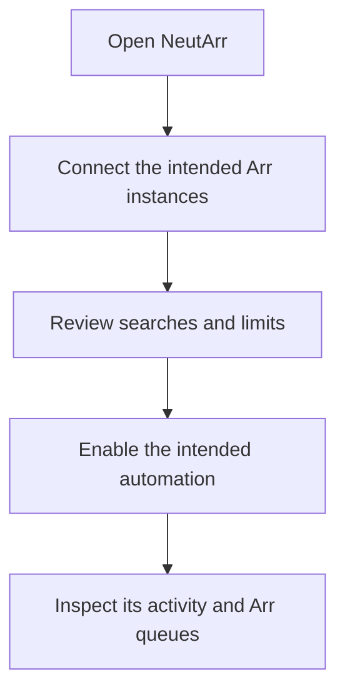

# NeutArr

NeutArr schedules missing-content and upgrade searches in selected Radarr, Sonarr, Lidarr, and Whisparr instances. It is disabled by default. Review targets, schedules, and limits before enabling searches against your indexers.

<!-- visual:service-flow -->
## At a glance

NeutArr acts on connected libraries according to your chosen rules. Check exact instances and limits before scheduling work.




---

## First start

1. Select **NeutArr** during onboarding and opt in only the Arr instances you want it to search. For an existing Arr instance, open its **DUMB Config**, enable `use_neutarr` and **Save to File**.
2. Open the NeutArr service card. On **DUMB Config**, use **Start** if stopped, then select **Embedded UI**.
3. Review the discovered Arr connections and quality profiles in NeutArr. Do not activate a schedule until the intended applications are connected and unexpected targets are excluded.
4. Choose conservative search intervals and limits. These searches use your indexers and provider allowances; a running service does not mean you need to enable every search type.
5. Observe one search cycle in NeutArr and the Arr queue before widening the schedule or adding targets.

<!-- dev:start -->
## Setup checklist and remaining work

The checklist tracks owned Arr connections independently from search policy. Review schedules and limits. Owned opt-outs/disabled targets are reconciled while unowned entries and intentional user disables are preserved. Starting NeutArr does not authorize a new search policy.

Requires the backend setup-arrangement capability. See [Setup checklist and automation](../../features/setup-checklist.md) for retained tasks, coverage and safe retries.
<!-- dev:end -->

## Overview

NeutArr integrates with your Arr stack to automate the hunt for:

- **Missing content** - Movies, TV episodes, or music not yet downloaded
- **Quality upgrades** - Better releases that meet your quality profiles
- **Cutoff unmet** - Content below your configured quality cutoff

DUMB supports multiple NeutArr instances, allowing you to run separate hunters for different Arr configurations (e.g., one for Decypharr-linked services and one for InfiniDysk-linked services).

---

## Service relationships

| Classification | Role                         |
| -------------- | ---------------------------- |
| Core service   | Automated Arr hunting engine |
| Depends on     | None                         |
| Integrates     | Sonarr, Radarr, Lidarr, Whisparr |
| Exposes UI     | Yes (Web UI)                 |

---

## Default ports

| Instance | Port |
|----------|------|
| Default | 9705 |

Additional NeutArr instances must use unique ports.

---

## Automation in DUMB

Choose the target Arr instances in onboarding or through each Arr's **DUMB Config → `use_neutarr`**, then **Save to File**. DUMB maintains those selected connections; configure the search policy and schedule in NeutArr's **Embedded UI**.

If you run multiple NeutArr instances, review each one's workflow filter so the same Arr is not searched unintentionally by several schedules.

<details class="geek-details" markdown="1">
<summary>Geek details: JSON opt-ins, workflow filters and connection storage</summary>

DUMB auto-populates NeutArr with Arr instances that opt in.

1. Set `use_neutarr: true` on the Arr instances you want NeutArr to manage.
2. (Optional) Set `core_service` on the NeutArr instance to filter which Arr instances it pulls in.

Example Arr instance:

```json
{
"radarr": {
  "instances": {
    "Decypharr": {
      "enabled": true,
      "core_service": "decypharr",
      "use_neutarr": true,
      "port": 7878,
      "config_file": "/radarr/decypharr/config.xml"
    }
  }
}
}
```

Example NeutArr instance filter:

```json
{
"neutarr": {
  "instances": {
    "Decypharr": {
      "core_service": ["decypharr", "infinidysk", "altmount"]
    }
  }
}
}
```

With that filter in place, the NeutArr instance only receives Arr entries whose
core services overlap the NeutArr instance. If `core_service` is left blank on a
NeutArr instance, it can receive all Arr instances with `use_neutarr: true`.
For deeper behavior details, see [Core Service Routing](../../reference/core-service.md).

!!! info "Auto-configuration storage"

    DUMB writes NeutArr configuration into NeutArr's JSON config files under the instance `config_dir` (for example `general.json`, `sonarr.json`, `radarr.json`, and `users.json`). You can still tune settings in the NeutArr UI, but DUMB will keep the Arr instance list and related config in sync.

---

</details>

<details class="geek-details" markdown="1">
<summary>Technical details: configuration reference</summary>

## Configuration settings in `dumb_config.json`

Below is a sample configuration for NeutArr within the `dumb_config.json` file:

```json
{
"neutarr": {
  "instances": {
    "Default": {
      "enabled": false,
      "core_service": "",
      "process_name": "NeutArr",
      "repo_owner": "I-am-PUID-0",
      "repo_name": "NeutArr",
      "release_version_enabled": false,
      "release_version": "latest",
      "commit_sha": "",
      "branch_enabled": false,
      "branch": "main",
      "suppress_logging": false,
      "log_level": "INFO",
      "port": 9705,
      "auto_update": false,
      "auto_update_interval": 24,
      "auto_update_start_time": "04:00",
      "clear_on_update": false,
      "exclude_dirs": [
        "/neutarr/default/config"
      ],
      "platforms": [
        "python"
      ],
      "command": [
        "/neutarr/default/venv/bin/python",
        "main.py"
      ],
      "config_dir": "/neutarr/default",
      "config_file": "/neutarr/default/config/general.json",
      "log_file": "/neutarr/default/config/logs/neutarr.log",
      "env": {
        "NEUTARR_CONFIG_DIR": "/neutarr/default/config",
        "NEUTARR_PORT": "{port}"
      }
    }
  }
}
}
```

### Configuration key descriptions

- **`enabled`**: Whether to start this NeutArr instance.
- **`process_name`**: Display name used in logs and the frontend.
- **`repo_owner`** / **`repo_name`**: GitHub repository to pull from.
- **`release_version_enabled`** / **`release_version`**: Use a tagged release if enabled.
- **`commit_sha`**: Build this instance from an exact full 40-character GitHub SHA. It overrides release/branch selection and disables automatic updates for that instance until cleared.
- **`branch_enabled`** / **`branch`**: Use a specific branch if enabled.
- **`suppress_logging`**: Suppresses service messages in the main DUMB output.
- **`log_level`**: Logging verbosity (e.g., `DEBUG`, `INFO`).
- **`port`**: Port the NeutArr web UI is exposed on.
- **`auto_update`**: Enables DUMB's scheduled update checks; `auto_update_mode` determines whether a detected update is installed.
- **`auto_update_interval`**: How often (in hours) to check for updates.
- **`clear_on_update`**: Clears build artifacts or cache during updates.
- **`exclude_dirs`**: Prevents specific directories from being affected by updates.
- **`platforms`**: Required runtime (typically `python`).
- **`command`**: The command used to launch NeutArr.
- **`config_dir`** / **`config_file`**: Where configuration files are stored.
- **`log_file`**: Path to the NeutArr log file.
- **`env`**: Environment variables passed at runtime.

---

</details>

## Multi-instance support

DUMB supports running multiple NeutArr instances to work with different Arr configurations.
The default config ships with a single `Default` instance.

| Instance | Use Case |
|----------|----------|
| `Default` | General use with any Arr instances you opt in |
| Custom instances | Separate hunters for different `core_service` values |

Each instance maintains its own:

- Configuration directory
- JSON config files
- Web UI port
- Log output

---

## NeutArr web UI

Open the service from DUMB's **Embedded UI** tab when available. The native URLs below require the corresponding Docker host port to be published; use the port saved in your running configuration.

NeutArr provides a web interface for:

- Configuring which Arr services to monitor
- Setting search intervals and limits
- Viewing hunt status and history
- Manual search triggers

Access the UI at `http://<host>:<port>` or through the DUMB frontend's embedded service UI feature.

---

## Tips

- Start with conservative search intervals to avoid rate limiting from indexers.
- Use separate NeutArr instances when you have Arr services connected to different download clients.
- Monitor logs via the DUMB frontend or from the `log_file` path defined for each instance.
- NeutArr respects your Arr quality profiles, so configure those first.

---

## Resources

- [NeutArr GitHub Repository](https://github.com/I-am-PUID-0/NeutArr)
