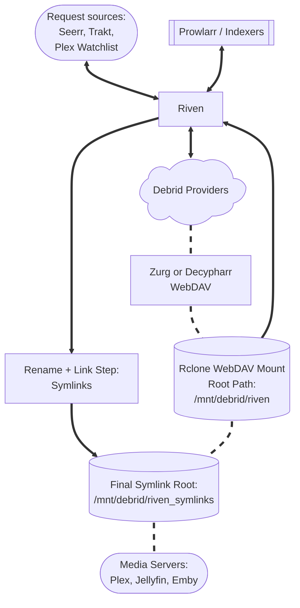

# Riven Backend Configuration

Riven acquires content through configured sources and scrapers, then presents an organized library for your media server. DUMB manages the runtime and PostgreSQL dependency. Configure Riven's provider, source, scraper, and library policies before enabling acquisition.

---

## Initial Setup: Riven Backend

Before Riven Backend can be used, **initial configuration is required**.

After completing the DUMB onboarding, navigate to the **Riven Frontend** and open the `Settings` page. The following sections should be reviewed and updated:

!!! important "Required Configuration"
    At a minimum, **enable at least one Content source** under the `Content` section. Without this, Riven cannot function.

### Recommended Setup Areas

- **General** – Adjust base settings like min/max files size, etc.
- **Media Server** – Review your Plex, Jellyfin, or Emby connection, then choose whether its updater should run.
- **Content** – Configure sources such as Trakt, Seerr, or the Plex Watchlist, MDB List, Listrr.
- **Scrapers** – Enable one or more scrapers (e.g., Zilean, Torrentio, Knightcrawler, Orionoid, Jackett, Mediafusion, Prowlarr, Comet).
- **Ranking** – Customize how results are scored and filtered.

!!! note "After Configuration"
    Once complete, Riven will begin processing requests based on the selected sources and configurations.

---

<!-- dev:start -->
## Setup checklist and remaining work

The checklist distinguishes selected source modes and direct supported provider inputs from legacy mounts. On recognized Riven versions, it checks the generated backend key, native settings schema and version before offering a media-server connection. Select managed Plex, Jellyfin or Emby, or supply an explicitly authorized external server. Existing custom connection changes need a fresh field-by-field preview and acceptance.

Saving a media-server connection preserves its existing updater enablement, library path and all content policies; supplying a URL/key does not enable an updater. Review and deliberately enable the desired native behavior in Riven. Content sources, scrapers, rankings and library policy remain separate choices. Do not enable an obsolete mount just to carry a provider key; source-specific manual work remains visible. A verified settings save is not proof of library scanning or a complete download workflow.

Requires the backend setup-arrangement capability. See [Setup checklist and automation](../../features/setup-checklist.md) for retained tasks, coverage and safe retries.
<!-- dev:end -->

## Workflow diagram



!!! warning "Port conflicts and auto-shift"

    Riven defaults (`3000`/`8080`) overlap with InfiniDysk defaults. DUMB can auto-shift
    conflicting ports at container startup or during the onboarding core-service
    start flow, updating `dumb_config.json` accordingly.
    Per-service stop/start/restart does not re-run port conflict resolution, so fix
    conflicts manually before restarting a single service.

<details class="geek-details" markdown="1">
<summary>Technical details: configuration reference</summary>

## Configuration Settings in `dumb_config.json`

```json
{
"riven_backend": {
    "enabled": false,
    "process_name": "Riven Backend",
    "repo_owner": "rivenmedia",
    "repo_name": "riven",
    "release_version_enabled": false,
    "release_version": "v0.20.1",
    "commit_sha": "",
    "branch_enabled": false,
    "branch": "release-please--branches--main",
    "suppress_logging": false,
    "log_level": "INFO",
    "host": "127.0.0.1",
    "port": 8080,
    "auto_update": false,
    "auto_update_interval": 24,
    "auto_update_start_time": "04:00",
    "symlink_backup_enabled": false,
    "symlink_backup_interval": 168,
    "symlink_backup_start_time": "04:00",
    "symlink_backup_path": "/config/symlink-repair/snapshots/riven-backend-{timestamp}.json",
    "symlink_backup_include_broken": true,
    "symlink_backup_retention_count": 1,
    "symlink_backup_roots": [
        "/mnt/debrid/riven_symlinks"
    ],
    "symlink_library_path": "/mnt/debrid/riven_symlinks",
    "clear_on_update": true,
    "exclude_dirs": [
        "/riven/backend/data"
    ],
    "env_copy": {
        "source": "/riven/backend/data/.env",
        "destination": "/riven/backend/src/.env"
    },
    "platforms": [
        "python"
    ],
    "command": [
        "/riven/backend/venv/bin/python",
        "src/main.py",
        "-p",
        "{port}"
    ],
    "config_dir": "/riven/backend",
    "config_file": "/riven/backend/data/settings.json",
    "log_file": "/log/riven_backend.log",
    "env": {},
    "wait_for_dir": ""
}
}
```

### Configuration Key Descriptions

- **`enabled`**: Whether to start the Riven Backend service.
- **`process_name`**: Used in logs and process tracking.
- **`host`**: IP address for the backend to listen on.
- **`port`**: Port exposed for the API.
- **`repo_owner`** / **`repo_name`**: GitHub repo to pull from.
- **`release_version_enabled`** / **`release_version`**: Use a tagged release if enabled.
- **`commit_sha`**: Builds an exact Riven revision from its full 40-character GitHub SHA.
- **`branch_enabled`** / **`branch`**: Use a specific branch if enabled.
- **`suppress_logging`**: Suppresses service messages in the main DUMB output.
- **`log_level`**: Logging verbosity level (e.g., `DEBUG`, `INFO`).
- **`auto_update`**: Enables DUMB's scheduled update checks; `auto_update_mode` determines whether a detected update is installed.
- **`auto_update_interval`**: How often (in hours) to check for updates.
- **`symlink_library_path`**: Target path for media symlinks.
- **`clear_on_update`**: Clears build artifacts or cache during updates.
- **`exclude_dirs`**: Prevents specific directories from being affected by updates when using `clear_on_update`
- **`env_copy`**: Copies a `.env` file from one location to another. Such as the Riven .env discussed below
- **`platforms`**: Expected runtime environment (e.g., `python`).
- **`command`**: How the service is started.
- **`config_dir`** / **`config_file`**: Configuration directory and settings file.
- **`log_file`**: Path to the Riven backend log file.
- **`env`**: Dictionary of environment variables passed to the process.
- **`wait_for_dir`**: Delays startup until the specified directory exists.

---

</details>

## Commit / Branch / Version Targeting

Choose a full `commit_sha`, a release selector, or an enabled branch in this service's DUMB settings. A commit pin takes precedence over the other selectors and disables automatic updates until you clear it. Review [source selection and update modes](../../features/auto-update.md) before changing a running service.

## Riven's Environment Variables in the `.env.example`

The `.env.example` file includes:

- `RIVEN_FORCE_ENV`: Forces env vars to override `settings.json`.
- `SETTINGS_FILENAME`: Specifies the settings file name.
- `SKIP_TRAKT_CACHE`: Skips cached results.
- `HARD_RESET`: Drops and recreates all database tables.
- `REPAIR_SYMLINKS`: Fixes any broken symlinks.
- `API_KEY`: Custom static API key.
- `WORKERS`: Number of indexing workers.

Each Riven env can also be set within DUMB, either through the **"env"** section of the "riven_backend" within the `dumb_config.json`, or by using the methods defined in the [Configuration](../../features/configuration.md) section of the docs.


[View full example on GitHub](https://github.com/rivenmedia/riven/blob/main/.env.example)

---

## Additional Resources

- [Riven Repository](https://github.com/rivenmedia/riven)
