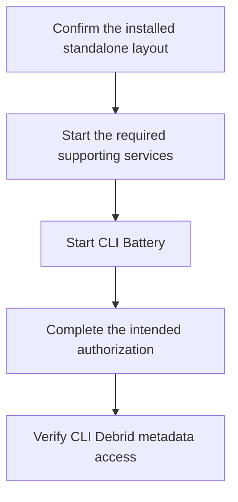

# CLI Battery Configuration

**CLI Battery** provides metadata services, background processing, and Trakt
integration for CLI Debrid. Older CLI Debrid layouts run it as a separate
Flask application. Newer layouts include it inside the CLI Debrid process.
This service's separate process, port, and web interface apply to the older
standalone layout.

<!-- visual:service-flow -->
## At a glance

This flow is for the standalone Battery layout. Check the CLI Debrid version guidance before enabling a separate process.




<!-- dev:start -->
<details class="geek-details" markdown="1">
<summary>Technical details: installed CLI Battery layout</summary>

!!! info "DUMB follows the installed CLI Debrid layout"

    In [CLI Debrid v0.7.29](https://github.com/godver3/cli_debrid/releases/tag/v0.7.29),
    commit [`ef4deb5`](https://github.com/godver3/cli_debrid/commit/ef4deb5bbed60826ef2aaa48be0ecb17250ea87e)
    replaces the standalone Flask/HTTP service with an in-process Python module,
    removing the separate port and process from that upstream layout.

    DUMB inspects the installed files rather than relying on a version label.
    When it recognizes the embedded layout, it skips the managed standalone
    Battery process and removes that startup dependency, even if `cli_battery`
    remains enabled in the saved configuration. Keep Battery enabled when
    running an older layout that still provides `cli_battery/main.py`.
    Starting Battery directly on an embedded layout reports that no separate
    process is needed.

    A missing standalone entrypoint alone does not prove Battery is embedded.
    If DUMB cannot recognize either layout, a direct standalone Battery start
    reports an error; install or repair CLI Debrid first. Separately configured
    Battery commands or source directories retain their own behavior.

</details>

<!-- dev:end -->
<!-- release:start -->
For an upstream CLI Debrid layout with embedded Battery, DUMB 2.23.0 does not detect the replacement automatically. Review the [CLI Debrid FAQ](../../faq/cli-debrid.md#does-cli-debrid-v0729-still-need-a-separate-cli-battery-process) before enabling that layout.
<!-- release:end -->


## Service relationships

| Classification | Role |
| -------------- | ---- |
| Dependent | CLI Debrid companion service |
| Used By | Installed [CLI Debrid](../core/cli-debrid.md) layouts that use the separate port-5001 service |
| Exposes UI | Yes |

---

!!! warning "Trakt authorization"

    CLI Battery handles Trakt OAuth flows. Make sure the callback URL you authorize matches the port you expose.

<details class="geek-details" markdown="1">
<summary>Technical details: configuration reference</summary>

## Configuration settings in `dumb_config.json`

```json
{
"cli_battery": {
  "enabled": false,
  "process_name": "CLI Battery",
  "suppress_logging": false,
  "log_level": "INFO",
  "port": 5001,
  "platforms": ["python"],
  "command": [
    "/cli_debrid/venv/bin/python",
    "cli_battery/main.py"
  ],
  "config_dir": "/cli_debrid",
  "config_file": "/cli_debrid/data/config/settings.json",
  "log_file": "/cli_debrid/data/logs/battery_debug.log",
  "env": {
    "PYTHONPATH": "/cli_debrid",
    "USER_CONFIG": "/cli_debrid/data/config/",
    "USER_LOGS": "/cli_debrid/data/logs/",
    "USER_DB_CONTENT": "/cli_debrid/data/db_content/",
    "CLI_DEBRID_BATTERY_PORT": "{port}"
  }
}
}
```

### Configuration Key Descriptions

* **`enabled`**: Enables the CLI Battery service.
* **`process_name`**: Display name in logs and process manager.
- **`suppress_logging`**: Suppresses service messages in the main DUMB output.
* **`log_level`**: Controls verbosity of logging.
* **`port`**: CLI Battery service port.
* **`command`**: How the service is started.
* **`config_dir`** / **`config_file`**: Configuration paths used by the battery.
* **`log_file`**: Path to the CLI Battery log file.
* **`env`**: Environment variables passed to the subprocess.

### Environment variables

* `CLI_DEBRID_BATTERY_PORT`: Port the Flask app binds to (defaults to `port`).
* `USER_CONFIG`: Config directory (`/cli_debrid/data/config/`).
* `USER_LOGS`: Log directory (`/cli_debrid/data/logs/`).
* `USER_DB_CONTENT`: Metadata database directory (`/cli_debrid/data/db_content/`).
* `PYTHONPATH`: Module lookup path (`/cli_debrid`).

---

</details>

## Required by standalone CLI Debrid layouts

CLI Battery must be running **before** a CLI Debrid layout that depends on its
standalone API launches. DUMB starts the enabled managed Battery first for
that layout. An upstream embedded layout runs Battery within CLI Debrid
and has no separate port-5001 service; follow the version-specific guidance above.

---

## Web interface and API

CLI Battery is a Flask web app exposing a browser UI and REST API:

### Web Dashboard

* `/` — Home dashboard with metadata stats
* `/debug` — Debug view of all metadata items
* `/metadata` — Full metadata list
* `/providers` — Enable/disable metadata providers
* `/settings` — View and update settings

### API Endpoints

* `/api/metadata/<imdb_id>` — Fetch metadata for a specific movie or show
* `/api/seasons/<imdb_id>` — Fetch seasons for a show
* `/authorize_trakt` — Start Trakt OAuth authorization
* `/trakt_callback` — Handle the Trakt OAuth callback

---

## Access

Open the service from DUMB's **Embedded UI** tab when available. The native URLs below require the corresponding Docker host port to be published; use the port saved in your running configuration.

- Navigate to: `http://<host>:<port>` (default `5001`)

---

## Access via Traefik

If Traefik is enabled in DUMB, CLI Battery can be reached via the proxy path:

```
http://<host>:18080/service/ui/cli_battery/
```

---

## Logs and data paths

- Logs: `/cli_debrid/data/logs/battery_debug.log`
- Config: `/cli_debrid/data/config/settings.json`
- Metadata DB: `/cli_debrid/data/db_content/`

---

## Additional Resources

* [CLI Debrid GitHub Repository](https://github.com/godver3/cli_debrid)
* [CLI Battery Source Code](https://github.com/godver3/cli_debrid/tree/main/cli_battery)
