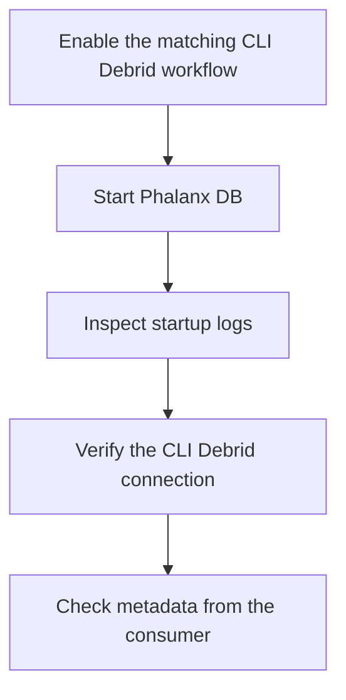

# Phalanx DB Configuration

**Phalanx DB** is an optional decentralized metadata service that can enhance CLI Debrid by providing distributed data capabilities through Hyperswarm. It runs independently and is not required for CLI Debrid to function.

<!-- visual:service-flow -->
## At a glance

Phalanx DB supports CLI Debrid metadata. Check the consumer as well as the database process.




---

## First start

Select Phalanx DB only when your CLI Debrid workflow uses its distributed metadata. DUMB prepares its storage and runtime. After startup, check the Phalanx and CLI Debrid logs to confirm the intended connection; Phalanx DB has no separate browser interface.

## Service relationships

| Classification | Role |
| -------------- | ---- |
| Dependent | Optional metadata service |
| Depends On | None |
| Exposes UI | No (REST API only) |

---

<details class="geek-details" markdown="1">
<summary>Technical details: configuration reference</summary>

## Configuration settings in `dumb_config.json`

```json
{
"phalanx_db": {
  "enabled": false,
  "process_name": "Phalanx DB",
  "repo_owner": "godver3",
  "repo_name": "phalanx_db_hyperswarm",
  "release_version_enabled": false,
  "release_version": "v0.50",
  "commit_sha": "",
  "branch_enabled": false,
  "branch": "main",
  "suppress_logging": false,
  "log_level": "INFO",
  "port": 8888,
  "auto_update": false,
  "auto_update_interval": 24,
  "auto_update_start_time": "04:00",
  "clear_on_update": true,
  "exclude_dirs": [
    "/phalanx_db/data"
  ],
  "platforms": ["pnpm"],
  "command": ["node", "phalanx_db_rest.js"],
  "config_dir": "/phalanx_db",
  "log_file": "/log/phalanx_db.log",
  "env": {}
}
}
```

### Configuration Key Descriptions

* **`enabled`**: Enables or disables Phalanx DB.
* **`process_name`**: Label used for logging and monitoring.
* **`repo_owner`** / **`repo_name`**: Source GitHub repo for updates.
* **`release_version_enabled`** / **`release_version`**: Targets a specific version release.
* **`commit_sha`**: Builds an exact Phalanx DB revision from its full 40-character GitHub SHA.
* **`branch_enabled`** / **`branch`**: If true, uses a GitHub branch instead of a release.
- **`suppress_logging`**: Suppresses service messages in the main DUMB output.
* **`log_level`**: Verbosity level.
* **`port`**: Port Phalanx DB listens on.
* **`auto_update`** / **`auto_update_interval`**: Pull latest changes from GitHub.
* **`clear_on_update`** / **`exclude_dirs`**: Defines cleanup behavior and ignored folders.
* **`platforms`**: Required runtime (usually `pnpm` + Node).
* **`command`**: Startup command.
* **`config_dir`**: Root directory for the config and runtime files.
* **`log_file`**: Path to the Phalanx DB log file.
* **`env`**: Environment variables (if any).

### Environment variables

* `PORT`: REST API port (defaults to `port`).
* `DEBUG`: Debug logging toggle (`true` when `log_level` is `DEBUG`).

---

</details>

## When to Use

Phalanx DB is beneficial if you want to:

* Store metadata in a decentralized way
* Leverage peer-to-peer syncing of release data
* Enable extended features in CLI Debrid when Phalanx DB is active

!!! note "This service is **optional** and should only be enabled if you intend to use its distributed storage model."

---

## How DUMB sets it up

When Phalanx DB starts, DUMB:

- Creates `/phalanx_db/data` and symlinks data subdirectories into the project root
- Ensures storage directories like `autobase_storage_v4/db` exist
- Sets `PORT` and `DEBUG` environment variables
- Resolves the latest `phalanx_db_rest_v*.js` file and uses it as the startup command

!!! info "Data layout"

    Runtime data is stored under `/phalanx_db/data` and symlinked into `/phalanx_db` so upgrades can preserve data.

---

## Commit / Branch / Version Targeting

Choose a full `commit_sha`, a release selector, or an enabled branch in this service's DUMB settings. A commit pin takes precedence over the other selectors and disables automatic updates until you clear it. Review [source selection and update modes](../../features/auto-update.md) before changing a running service.

## Access

Open the service from DUMB's **Embedded UI** tab when available. The native URLs below require the corresponding Docker host port to be published; use the port saved in your running configuration.

- REST API: `http://<host>:8888` (default)

---

## Logs and data paths

- Data root: `/phalanx_db/data`
- Logs: `/log/phalanx_db.log`

---

## Additional Resources

* [Phalanx DB GitHub Repository](https://github.com/godver3/phalanx_db_hyperswarm)
