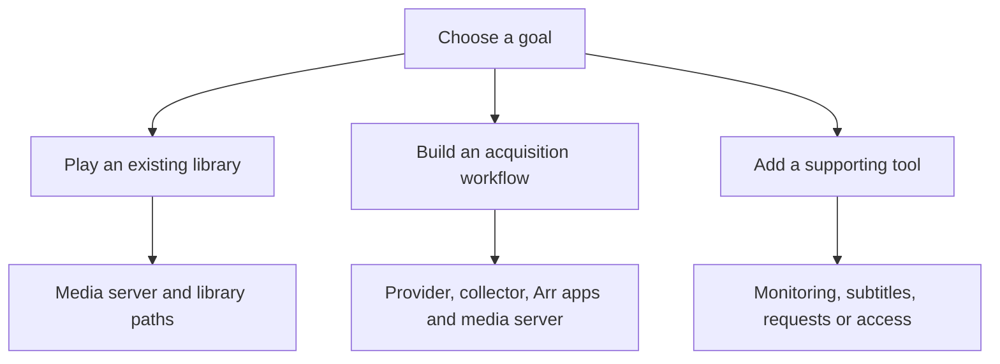

# Choose your services

Start with the workflow you want, then enable its services in onboarding. You do not need every service in this catalog. DUMB runs managed applications as processes inside its container; they share the container's network and mounted paths.

<!-- visual:service-flow -->
## At a glance

Choose the result you want first, then add only the services and dependencies that workflow needs.

## How the services work together

| You want to… | Start with | Also review |
|---|---|---|
| Automate a Debrid library | [CLI Debrid](core/cli-debrid.md), [Riven](core/riven-backend.md), or [Decypharr](core/decypharr.md) | Provider credentials, mounts, and curated library paths |
| Stream a Usenet library | [InfiniDysk](core/infinidysk.md), [AltMount](core/altmount.md), or [Decypharr](core/decypharr.md) | NNTP account limits, indexers, Arr clients, and import strategy |
| Manage movies, TV, or music | [Radarr](core/radarr.md), [Sonarr](core/sonarr.md), [Lidarr](core/lidarr.md), [Whisparr](core/whisparr.md) | [Prowlarr](core/prowlarr.md), download clients, roots, and profiles |
| Play an existing library | [Plex](core/plex-media-server.md), [Jellyfin](core/jellyfin.md), or [Emby](core/emby.md) | Readable media paths, accounts, and hardware acceleration |
<!-- dev:start -->
| Serve books or podcasts | [Audiobookshelf](optional/audiobookshelf.md) | Book/podcast folders and library access |
<!-- dev:end -->
| Take requests | [Seerr](core/seerr.md) or [Pulsarr](optional/pulsarr.md) | Exact media-server and Arr connections, approvals, and quotas |
| Use Stremio addons | [AIOStreams](optional/aiostreams.md) | Sources and a dedicated public HTTPS addon address |
| Use a separate streaming client | [mediastorm](optional/mediastorm.md) | PostgreSQL and playback-provider accounts |
| Publish selected applications | [Traefik Proxy Admin](optional/traefik-proxy-admin.md) | Route protection, DNS, HTTPS, and optional [Cloudflared](optional/cloudflared.md) |

DUMB can prepare supported connections, but account authorization, profiles, library policy, and playback still need review.

<!-- dev:start -->
Follow the [setup checklist](../features/setup-checklist.md) after starting your chosen services.
<!-- dev:end -->

## Quick reference

| Service | Role |
|---|---|
| [DUMB API](dumb/api.md) | Backend configuration, lifecycle, logs, and health |
| [DUMB Frontend](dumb/dumb-frontend.md) | Dashboard, onboarding, service controls, and embedded UIs |
| [CLI Debrid](core/cli-debrid.md) | Debrid acquisition, list monitoring, upgrades, and symlinks |
| [Riven Backend](core/riven-backend.md) | Debrid acquisition and library organization |
| [Decypharr](core/decypharr.md) | Debrid/Usenet download clients, WebDAV, and mounts |
| [InfiniDysk](core/infinidysk.md) | Usenet WebDAV and Arr download-client workflow |
| [AltMount](core/altmount.md) | Usenet WebDAV, mounts, and Arr import workflow |
| [Plex](core/plex-media-server.md), [Jellyfin](core/jellyfin.md), [Emby](core/emby.md) | Video library servers |
| [Sonarr](core/sonarr.md), [Radarr](core/radarr.md), [Lidarr](core/lidarr.md), [Whisparr](core/whisparr.md) | TV, movies, music, and adult media automation |
| [Prowlarr](core/prowlarr.md) | Indexer management and Arr synchronization |
| [NeutArr](core/neutarr.md) | Scheduled backlog and upgrade searches |
| [Profilarr](core/profilarr.md) | Sonarr/Radarr profiles and custom formats |
| [Seerr](core/seerr.md) | Requests and discovery |
| [rclone](dependent/rclone.md), [Zurg](dependent/zurg.md) | WebDAV mounting and Debrid file access |
| [PostgreSQL](dependent/postgres.md) | Shared cluster with separate application databases |
| [CLI Battery](dependent/cli-battery.md), [Phalanx DB](dependent/phalanx-db.md) | CLI Debrid metadata dependencies where required by the installed layout |
| [Zilean](optional/zilean.md) | Searchable Debrid hash lists and Torznab access |
| [pgAdmin](optional/pgadmin.md) | PostgreSQL administration |
| [Riven Frontend](optional/riven-frontend.md) | Optional Riven interface |
| [Tautulli](optional/tautulli.md) | Plex playback history and monitoring |
<!-- dev:start -->
| [Audiobookshelf](optional/audiobookshelf.md) | Books and podcasts |
<!-- dev:end -->
| [Bazarr](optional/bazarr.md) | Subtitles for Sonarr/Radarr libraries |
| [Pulsarr](optional/pulsarr.md) | Plex watchlist requests |
| [Maintainerr](optional/maintainerr.md) | Rule-based review collections and optional cleanup |
| [mediastorm](optional/mediastorm.md), [AIOStreams](optional/aiostreams.md) | Additional streaming workflows |
| [Authelia](optional/authelia.md) | Identity provider and optional ForwardAuth |
| [Traefik Proxy Admin](optional/traefik-proxy-admin.md), [Cloudflared](optional/cloudflared.md) | Application routes and tunnel ingress |

## Service categories

- [DUMB services](dumb/index.md): the management API and dashboard.
- [Core services](core/index.md): acquisition, automation, requests, and playback.
- [Dependent services](dependent/index.md): mounts, databases, and supporting runtimes.
- [Optional services](optional/index.md): tools you add for a particular workflow.

These categories describe DUMB's service model. An optional service can still be essential to your chosen workflow; disabling it may break clients that use it.
