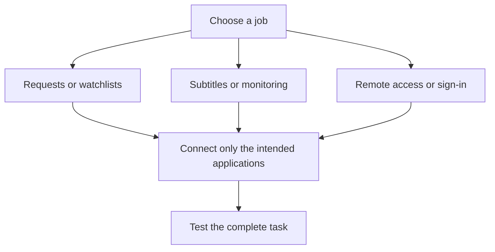

# Optional services

Add these tools when you need their specific function. They are not required by every DUMB installation, but other applications or users may depend on them once configured.

<!-- visual:service-flow -->
## At a glance

Add an optional tool for a specific job and verify its connections before relying on its automation.

## Optional Service Index

| Service                           | Description                                                 | Used By                        |
| --------------------------------- | ----------------------------------------------------------- | ------------------------------ |
| [pgAdmin](../optional/pgadmin.md) | Web-based PostgreSQL administration UI                      | PostgreSQL                     |
| [Riven Frontend](../optional/riven-frontend.md) | Web-based UI for management of the [Riven Backend](../core/riven-backend.md) | Riven |
| [Tautulli](../optional/tautulli.md) | Plex monitoring and statistics                            | Plex Media Server              |
<!-- dev:start -->
| [Audiobookshelf](audiobookshelf.md) | Audiobook and podcast libraries with basic ebook reading | Standalone media libraries |
<!-- dev:end -->
| [Bazarr](../optional/bazarr.md) | Subtitle search and management                              | Sonarr, Radarr                 |
| [Pulsarr](../optional/pulsarr.md) | Plex watchlist request automation                         | Plex, Sonarr, Radarr           |
| [Maintainerr](../optional/maintainerr.md) | Rule-based library cleanup and leaving-soon collections | Plex/Jellyfin/Emby, Sonarr, Radarr, Seerr, Tautulli |
| [mediastorm](../optional/mediastorm.md) | Self-hosted streaming for Debrid, torrent, and Usenet sources | PostgreSQL, playback providers |
| [AIOStreams](../optional/aiostreams.md) | Configurable Stremio addon aggregator for Debrid and Usenet playback | Prowlarr, Zilean, InfiniDysk, AltMount |
| [Traefik Proxy Admin](../optional/traefik-proxy-admin.md) | User-managed Traefik reverse proxy routes | Traefik, PostgreSQL |
| [Authelia](../optional/authelia.md) | Identity provider, DUMB/TPA OIDC, and Traefik ForwardAuth | Traefik, PostgreSQL |
| [Cloudflared](../optional/cloudflared.md) | Cloudflare Tunnel connector for DUMB Traefik | Traefik |
| [Zilean](../optional/zilean.md)   | Debrid scraper and metadata cache for various core services | Riven, CLI Debrid |

---

## Before enabling a tool

- Check its service guide for required databases, upstream accounts, and first-run setup.
- Confirm library paths are visible inside the DUMB container before configuring a media consumer.
- Review schedules before enabling a tool that searches, downloads, or removes content.
- Configure access protection before publishing an application route.

## Common choices

| Need | Tool |
|---|---|
| Inspect PostgreSQL or schedule database jobs | [pgAdmin](pgadmin.md) |
| See Plex activity and playback history | [Tautulli](tautulli.md) |
| Add subtitles to Sonarr/Radarr libraries | [Bazarr](bazarr.md) |
| Route Plex watchlist requests | [Pulsarr](pulsarr.md) |
| Review library retention rules | [Maintainerr](maintainerr.md) |
<!-- dev:start -->
| Serve books and podcasts | [Audiobookshelf](audiobookshelf.md) |
<!-- dev:end -->
| Aggregate Stremio addons | [AIOStreams](aiostreams.md) |
| Add identity and protected application routes | [Authelia](authelia.md), [Traefik Proxy Admin](traefik-proxy-admin.md), and optionally [Cloudflared](cloudflared.md) |

AIOStreams needs a dedicated trusted HTTPS `BASE_URL` for remote Stremio clients. Its embedded DUMB UI is an administration view; it is not the addon installation address.

## Related pages

- [All services](../index.md)
- [Core services](../core/index.md)
- [Dependent services](../dependent/index.md)
