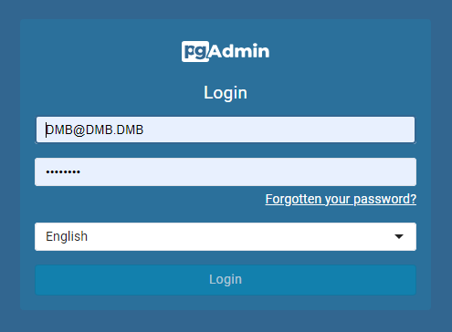
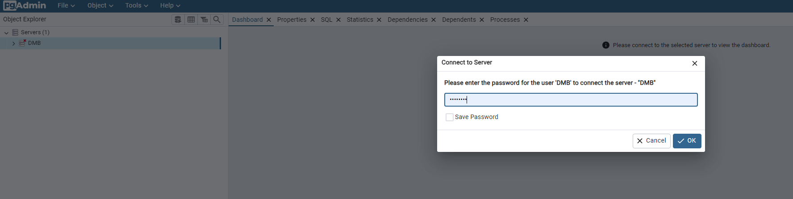
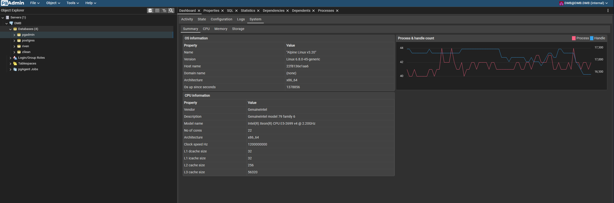
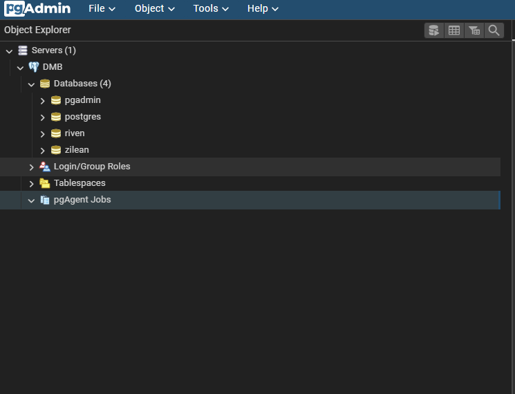

# pgAdmin 4

Use pgAdmin to inspect PostgreSQL, run SQL, create database backups, and manage pgAgent jobs. It is optional and disabled by default.

| Setting | Default |
|---|---|
| Web UI port | `5050` |
| Configuration | `/pgadmin/data/config_local.py` |
| Local state and log directory | `/pgadmin/data` |
| Persistence in the maintained layout | `/data/pgadmin` |
| pgAdmin configuration database | `pgadmin` in managed PostgreSQL |

## Enable pgAdmin

1. Set a first-run email/username and a strong password in pgAdmin's DUMB settings.
2. Enable pgAdmin and start the service. Managed PostgreSQL must also be running.
3. Open **pgAdmin → Embedded UI**, or use `http://<host>:5050` if you deliberately publish that port.
4. Sign in with the pgAdmin account, then review the saved PostgreSQL connection.

The shipped bootstrap account is `DUMB@DUMB.DUMB` with password `postgres`. Replace these public values before use outside a trusted local network. An existing pgAdmin account can have different credentials; changing DUMB's first-run settings does not reset that account's password.

The email serves as the username and can use a reserved address such as `pgadmin@example.com`.



<details class="geek-details" markdown="1">
<summary>Technical details: configuration reference</summary>

## Configuration settings in `dumb_config.json`

A minimal override for a fresh account:

```json
{
  "pgadmin": {
    "enabled": true,
    "setup_email": "pgadmin@example.com",
    "setup_password": "<choose-a-strong-password>",
    "port": 5050
  }
}
```

| Field | Meaning |
|---|---|
| `enabled` | Start the managed pgAdmin service |
| `setup_email`, `setup_password` | First-run account credentials; environment overrides are `PGADMIN_SETUP_EMAIL` and `PGADMIN_SETUP_PASSWORD` |
| `default_server` | Listener address; default `0.0.0.0` binds all container interfaces |
| `port` | Container listener port; this does not publish a Docker host port |
| `config_dir`, `config_file`, `log_file` | Managed state, generated configuration, and log paths |
| `command` | Managed startup command; normally leave this to DUMB |

</details>

## Server configuration

The pgAdmin login and the PostgreSQL connection use separate credentials. When opening a saved server, enter the database password from `postgres.password` or `POSTGRES_PASSWORD`; its public bootstrap default is `postgres`.

<!-- dev:start -->
The [setup checklist](../../features/setup-checklist.md) can register a connection through pgAdmin's supported provisioning command. Choose the connection name and group, review the preview, then apply it. DUMB reuses an exact existing connection and preserves unrelated definitions and saved-password settings. If automatic registration cannot use an existing pgAdmin account, the web service can still run; review or add the connection manually.
<!-- dev:end -->

For a manual connection, use the managed PostgreSQL host and port saved in DUMB (normally `127.0.0.1:5432` inside the container), maintenance database `postgres`, and the configured PostgreSQL user.



## Extensions

### `system_stats`

The image includes the PostgreSQL system-statistics extension. Inspect it in a connected database where the extension is installed.



### `pgAgent`

DUMB starts pgAgent with pgAdmin for scheduled database jobs. Follow the [scheduled-backup example](../../faq/pgadmin.md#example-scheduled-backups-with-pgagent) for database discovery, retention, off-system copies, and a restore test.



## Backups and access

Backing up pgAdmin's local data alone does not back up the databases it administers, or its PostgreSQL-backed configuration database. Use logical `pg_dump` backups for the databases and protect the local pgAdmin state as well.

The configured database role determines what pgAdmin can change. The default shared DUMB role can administer the registered application databases, so keep access restricted and disable pgAdmin when it is no longer needed.

<!-- dev:start -->
## If pgAdmin stays on the loading screen

A working login page can still belong to an incomplete pgAdmin installation.
In the browser's Network panel, JavaScript or stylesheet requests under
`/static/js/generated/` returning `404` or HTML can identify missing web files.
If those files also fail at pgAdmin's direct address, inspect the installed
runtime before changing proxy settings.

DUMB image builds keep the selected pgAdmin version and check its compiled
JavaScript and stylesheets. Complete packages need no repair. If web files are
missing, the image build verifies the same version's official source archive
and publisher signature, then builds its web assets using that release's
locked dependencies. Failed verification, compilation or completeness checks
stop the image build. DUMB does not downgrade pgAdmin to replace missing files.

Use a new or rebuilt DUMB image containing the corrected pgAdmin runtime.
Keep existing pgAdmin accounts, server registrations and persistent data.
Proxy adjustments and database resets cannot replace missing runtime files.
<!-- dev:end -->

## More info

- [pgAdmin FAQ and backup examples](../../faq/pgadmin.md)
- [pgAdmin documentation](https://www.pgadmin.org/docs/pgadmin4/latest/index.html)
- [pgAgent jobs](https://www.pgadmin.org/docs/pgadmin4/latest/pgagent_jobs.html)
