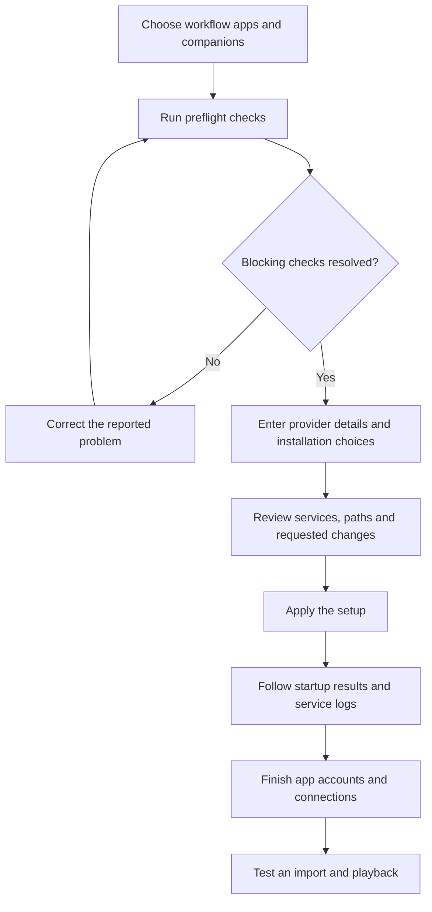

# Onboarding

Onboarding selects services, collects their settings, and starts the chosen stack. It opens on a fresh installation; use **Settings → Onboarding → Launch Onboarding** to run it again.

Existing application data is retained, but the wizard can apply new settings. Use a service's own configuration editor for an ordinary setting change. Onboarding is not a database or namespace migration.

## Before you begin

Have the intended storage mounted inside DUMB, provider credentials ready, and a plan for which application owns requests, downloads, imports, and playback. A host-only mount or browser-reachable URL may not be visible from inside the container.

<!-- dev:start -->
A compatible backend retains a setup checklist after you leave the wizard. It records configured actions, failed checks, missing inputs, and manual work separately. A running process does not complete an arrangement. See [Setup checklist and automation](../features/setup-checklist.md).
<!-- dev:end -->

## Wizard steps

Plan the complete workflow, then check the applications after they start:

### Step 1: Choose services

Select your workflow applications and supporting services, or use **Guided setup**:

1. Choose **Debrid**, **Usenet**, or **Both**.
2. For Usenet, choose Decypharr, InfiniDysk, AltMount, or a supported combination.
3. Decide whether to use Arrs; Usenet arrangements require them.
4. Choose **Combined** or **Separate** Arr instances when using several workflows.
5. Optionally choose separate quality-tier Sonarr/Radarr instances.
6. Select supporting services and choose **Apply recommendations**.

| Layout | Result |
| --- | --- |
| Combined | One Arr instance can use several `core_service` values |
| Separate | Independent Arr instances per workflow |
| Multi-quality | Additional Sonarr/Radarr instances per quality tier |

A tier name such as `1080p` is an instance label, not proof that the application has the intended quality profile.

<!-- dev:start -->
The manual catalog groups services by role, with alphabetical expandable categories and service descriptions. **Expand all** and **Collapse all** change only the layout. Selected categories open initially; summaries retain selection counts when closed.

Review **Chosen by you**, **Required dependency**, and **Optional companion** separately. The historical Core/Optional catalog names do not make every core service mandatory.
<!-- dev:end -->

### Step 2: Preflight checks

The wizard checks whether DUMB can continue setup and shows any problems it finds. Read each result, correct blocking errors, then run the check again before continuing.

<!-- release:start -->
Resolve blocking failures before continuing. A passed API response does not independently prove that a configured storage path is mounted or usable by another application.
<!-- release:end -->
<!-- dev:start -->
Health, capability, and catalog failures block the next step. Storage-path inventory and embedded UI checks are advisory. Unknown storage, remote timeout, or consumer-namespace results stay **Not verified** rather than being reported as passed. Correct confirmed critical failures before starting.
<!-- dev:end -->

### Step 3: Configure provider credentials

Enter the credentials requested by the selected workflow. Debrid API keys are available from the provider's account page. DUMB maps supported inputs into the selected services' configuration.

An NNTP provider account and an NZB indexer account serve different purposes; supplying one does not configure the other.

### Step 4: Choose companion services

Select optional tools that fit the chosen workflow. Required dependencies can be added automatically and may not appear as separate choices. Already enabled optional services remain visible but cannot be selected as new installations.

Authelia appears only when the backend supports its managed integration. A newer frontend cannot enable an unsupported service on an older API.

| Application | First-start consideration |
| --- | --- |
| mediastorm | Use its [initial credential flow](../services/optional/mediastorm.md#initial-setup) and replace the bootstrap password |
| AIOStreams | Set a stable public HTTPS base URL for remote clients and create its dashboard login |
| Authelia / TPA / Cloudflared | Review public origins, DNS, and authentication routes separately from embedded UI access |

### Step 5: Service-specific options

Review paths, ports, mount mode, media-server settings, and requested provider/database options. Defaults are starting values, not a validation of your deployment.

For Decypharr and AltMount, choose FUSE, embedded rclone, external rclone, or no-mount mode where offered. AltMount still needs an administrator, NNTP provider, import strategy, and valid consumer paths; use its [first-start checklist](../services/core/altmount.md#first-start-checklist).

InfiniDysk 1's `postgres_enabled` and `postgres_database` options are for a fresh installation. They do not copy an existing SQLite library. Existing installations must use the guarded [database migration workflow](../features/arr-postgres-migration.md), after any required namespace migration.

<!-- dev:start -->
For InfiniDysk 2, review the separate runtime and mount choices. Generation 1 retains historical rclone; generation 2 can use rclone-over-WebDAV or native FUSE. FUSE needs a visible device, permissions, and the same mount in every consumer namespace.

Choosing generation 2 opens its guarded installation/migration tool without accepting its acknowledgements or starting a job. Finish the tool, then refresh the setup plan. Existing 1.x data needs major migration; selecting an option does not convert it. Native FUSE omits the associated rclone dependency. See [InfiniDysk 2 installation and upgrade](../features/infinidysk-v2-migration.md).

### Connections and choices

Choose exact application instances, authorized external services, provider-account allocations, library paths, quality profiles, languages, and default/4K request routes. **External server** and **No media server** are separate choices.

Some profiles, roots, and generated keys are available only after first start. Leave those tasks unfinished and return to them later. Existing unowned settings require a reviewed adoption before DUMB changes them.
<!-- dev:end -->

### Embedded service access

Enable embedded UIs when offered to use proxied service tabs, split view, and direct links. This does not publish public DNS or configure an external HTTPS origin.

### Review configuration

Review selected services, dependencies, credentials, instance paths, and custom options before applying. Confirmation can install, configure, and start services.

<!-- dev:start -->
The plan groups work into **DUMB will configure**, **Information you must provide**, and **Finish manually**. Choose **Start services** to apply the reviewed plan.

### Setup progress and retained tasks

Follow the checklist and live logs. Correct the relevant input, then apply, retry, or recheck that action. **Continue to dashboard** leaves the wizard without discarding unfinished work; the same checklist appears on the dashboard and matching service pages.

Manual completion records your confirmation separately from an independently passed check. Closing the browser does not complete remaining tasks. External provider/account setup and unsupported connections remain visible as manual work.
<!-- dev:end -->
<!-- release:start -->
### Setup progress

Follow live setup logs and the reported startup result. If a service fails, inspect its error and dependency state before retrying. After the stack starts, check each application's accounts, provider/indexer settings, routes, and a representative import/playback path; process startup alone does not verify them.
<!-- release:end -->

## Skipping onboarding

Use onboarding for the guided setup. If you leave before finishing, open **Settings → Onboarding → Launch Onboarding** to return. Keep track of unfinished provider, account, library, and connection steps; a running service may still need them.

Technical alternative: configure services without the wizard

Set the appropriate `enabled` flags and required paths/credentials through the service configuration or runtime configuration. Disabled applications will not start merely because their files already exist. Do not skip setup steps by guessing a generated API key or database selector.

Technical details: saved configuration and deployment overrides

## Configuration applied

The wizard updates the runtime `dumb_config.json`, including enabled services, selected provider inputs, service options, and instances. Higher-priority environment or secret values still apply. See [configuration precedence](../features/configuration.md#configuration-precedence).

## Multi-instance support

Instances need distinct names, process identities, ports, and appropriate data paths. Combined Arr layouts can use list-based `core_service`; separate layouts keep independent integrations. Review the [multi-instance guide](../reference/instances.md) before changing a working topology.

<!-- dev:start -->
## External media and Plex authorization

External endpoints must be reachable from DUMB and require explicit authorization for private-network access. The media-server choice becomes the initial connection choice for selected request/maintenance applications; review each form before applying.

Plex can be claimed from its retained account task after it is ready. Use a fresh short-lived claim token when needed. Existing claimed servers retain their account; claim inputs and API tokens remain masked.
<!-- dev:end -->

## After onboarding

Check service status, actual application configuration, and one intended end-to-end workflow. Configure [media-library protection](../features/media-library-protection.md) before unattended storage maintenance, and keep application data backed up.

## Troubleshooting

| Problem | Next step |
| --- | --- |
| A step blocks Next | Read its validation error; check required fields and backend reachability |
| Service fails to start | Inspect its logs, dependencies, configured ports, and mount access |
| Existing service is not offered again | Use its service page; the wizard filters already-enabled selections |
| Need a different topology | Review the change in onboarding; use dedicated migration tools for existing data |

<!-- dev:start -->
Refreshing loses unsaved credential drafts, but the backend's retained setup run remains. Resume its checklist rather than reinstalling successful services.
<!-- dev:end -->
